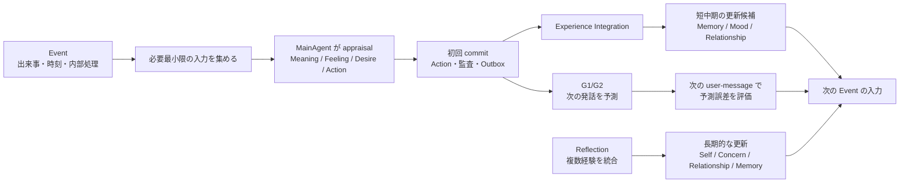
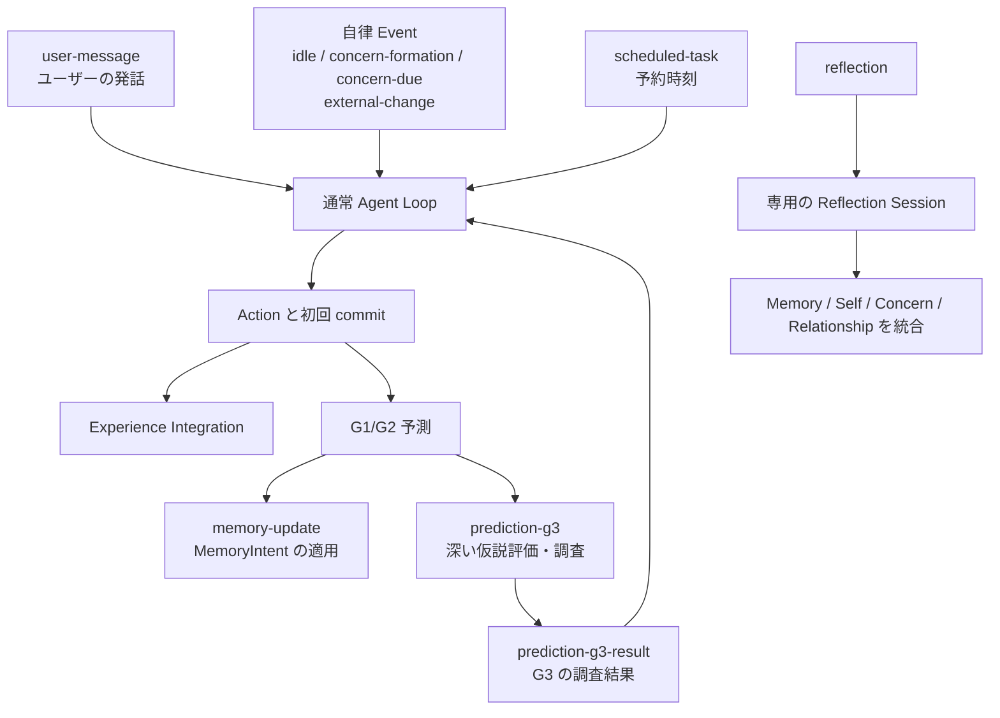
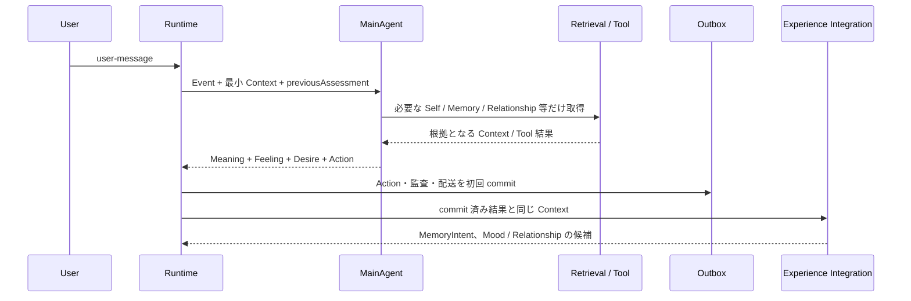
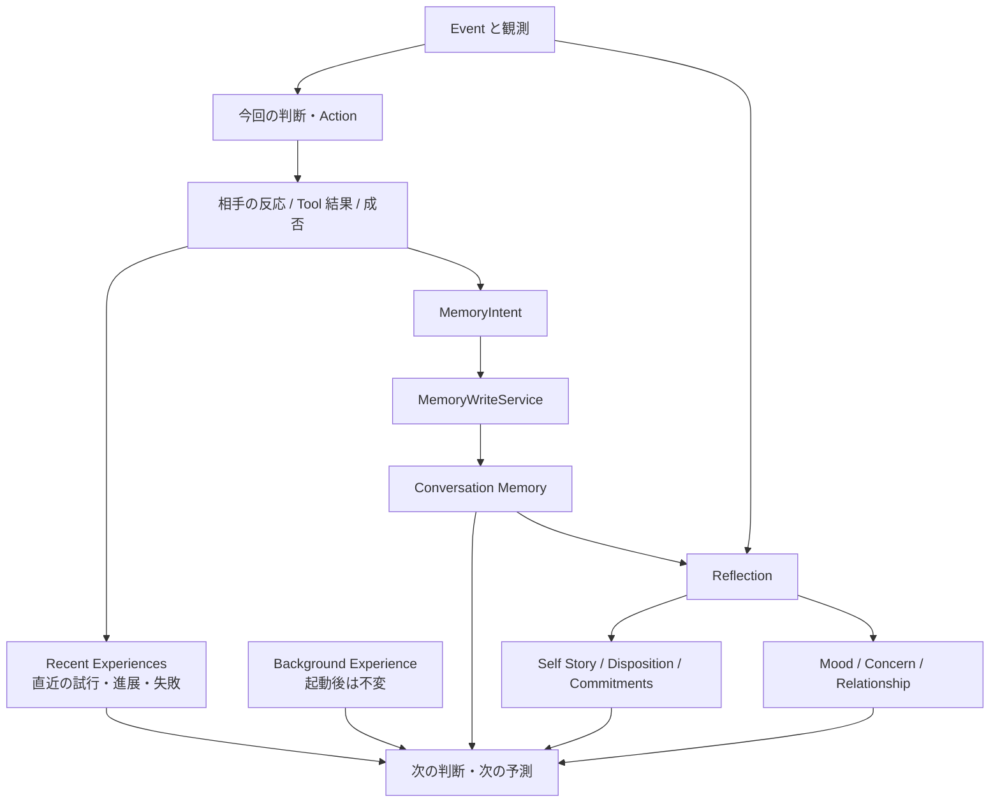

# Agent の Event・経験・個体化の全体像

この文書は、Agent が **何をきっかけに動き（Event）**、**何を入力として判断し**、**何を更新するか**を短く俯瞰するための案内である。

詳細な契約・例外・データ項目は [Agentの動機・感情・行動モデル](AGENT_MOTIVATION_MODEL.md) と [予測・予測誤差・背景経験の設計](../spec/prediction-error-design.md) を正とする。本書はそれらを置き換えない。

## まず全体を一枚で見る



通常の判断をする主体は MainAgent である。予測誤差は判断材料の一つであり、それ自体が感情や行動を決めるものではない。経験が蓄積し、Reflection が長期状態へ反映することで、同じ Event に対しても Agent ごと・時点ごとに異なる判断が生まれる。

## Event の地図



| Event | 主な入力 | 主な出力・更新 | ねらい |
|---|---|---|---|
| `user-message` | ユーザー発話、前回の評価・欲求、必要に応じて取得した文脈 | 応答、今回の Meaning / Feeling / Desire、Experience Integration による Memory・Mood・Relationship 候補 | 会話に応答する |
| `idle` | 現在の Concern、直近の経験 | 自律的な発話または拒否、Concern の進展 | 気に掛かっている事柄を進める |
| `concern-formation` | Self、Memory、Relationship、背景経験、探索候補 | 新しい Concern、または外部 Action なし | 継続して気に掛ける問いを形成する |
| `concern-due` | 再検討時刻、新しいMemory、既存 Concern | Concern の再評価・派生、発話または拒否 | 継続して気に掛ける対象を外へ表し直す |
| `external-change` | 外部変化、既存 Concern | Concern の再評価・派生、共有する動機があれば発話 | 変化に応じて関心を更新する |
| `scheduled-task` | 予約内容と時刻 | 通常 Loop の Action / Outbox / 監査 | 約束・予約を実行する |
| `memory-update` | 決定済みの MemoryIntent と RAG 候補 | Conversation Memory の create / update / no-op | LLM を呼ばず記憶だけを安全に適用する |
| `prediction-g3` | G1/G2 が示した要調査の仮説 | 仮説の支持・反証・判断不能、MainAgent 向け調査結果 | 意図・信念・関係など深い層を調べる |
| `prediction-g3-result` | G3 の調査結果 | MainAgent による再判断、必要なら Action・経験統合 | 調査結果を主体的な判断へ戻す |
| `reflection` | 複数の Event、Memory、現在の長期状態 | Memory の整理、Self / Concern / Relationship / Mood の長期更新 | 経験をまとまりとして個体化へ反映する |

### 発話するEvent／しないEvent

`idle`だけが自律発話の契機ではない。`concern-due`は、継続して気に掛けていた対象を再評価した結果として、各Eventで必ずユーザーへ質問・報告・話題提供または拒否を返す。`external-change`も、変化がConcernに影響して共有する理由があれば発話できる。未返信・返答待ち・連投回避は、`idle`と`concern-due`で発話を抑制する理由にしない。

| 区分 | Event |
|---|---|
| 発話を返せる通常Loop | `user-message`、`idle`、`concern-due`、`external-change`、配送先を持つ`scheduled-task`、`prediction-g3-result` |
| 発話を返さないmaintenance | `concern-formation`、`memory-update`、`reflection` |

`idle`と`concern-due`は発話またはrefuseを必須とする。その他の発話可能Eventは、Agent自身に話す動機があるときだけ発話する。特に`prediction-g3-result`は調査結果の再判断を行う経路であり、調査が完了したことだけを理由に通知するものではない。

優先順位は `user-message`、`memory-update`、G3、`reflection` の順である。低優先度処理は、ユーザーへの応答を待たせない。なお `tool-result` は Tool 実行結果を監査可能に残す Domain Event であり、上表の判断 Event を補助する。

## 通常会話のフロー



入力はすべてを prompt に詰め込むのではなく、Event と直近の継続情報を起点に必要なものだけを取得する。MainAgent は Event の終了時点で Meaning / Feeling / Desire / Action を一貫して決める。初回 commit 後の Experience Integration は次の Action を決めず、経験を残す価値があるときだけ持続状態の候補を作る。

### どの状態がいつ変わるか

| 状態 | 通常 Event | Memory Update | Reflection |
|---|---|---|---|
| Meaning / Feeling / Desire / Action | 今回だけ確定する | 変更しない | 直接の Action は決めない |
| Conversation Memory | Experience Integration が候補を判断する | MemoryWriteService が適用する | Formation / Reconciliation で整理する |
| Mood / Relationship | Experience Integration が候補を反映できる | 変更しない | 複数経験を根拠に長期的に更新できる |
| Concern | Event 種別ごとに許可された proposal のみ | 変更しない | 作成・統合・終了を含め整理できる |
| Self（Disposition / Self Story / Commitments） | 直接変更しない | 変更しない | 複数経験と Memory 根拠に基づいて更新できる |

Conversation Memory の書込み経路は常に `MemoryWriteService` である。候補が既存記憶と合わない、または古くなった場合には、create / update だけでなく no-op も選べる。

## 予測誤差は「判断材料」である

```mermaid
flowchart LR
    P0[前回の予測 P(t-1)] --> OBS[今回の user-message を観測]
    OBS --> E[ G1/G2 が誤差を評価<br/>一致・意外性・差異・不確実性・原因帰属]
    E --> CTX[次回の Prediction Context]
    CTX --> APP[MainAgent の appraisal]
    SELF[Self / Concern / Relationship<br/>Memory / 背景経験] --> APP
    APP --> MF[Meaning / Feeling]
    APP --> D[Desire]
    D --> ACT[Action]
```

1. 応答後、G1/G2 は次のユーザー発話を予測する。
2. 次の `user-message` を観測したとき、前回予測との誤差を評価する（最初のターンには前回予測がない）。
3. 評価結果は次の MainAgent の Context に渡される。
4. MainAgent が Self、Concern、Relationship、Memory、背景経験と合わせて解釈し、感情・欲求・行動を決める。

そのため「予測が外れた → 必ず不安になる」「誤差を減らす → 相手に迎合する」ではない。同じ誤差でも、確認する、検索する、記憶を疑う、信念を維持する、話題を変える、何もしない、といった異なる選択があり得る。G1/G2 が Feeling を確定することはない。

## 経験が個体化につながる流れ



- **Recent Experiences** は直近の試行の要約であり、次の判断で同じ失敗を機械的に繰り返さないための短い入力である。永続的な本文の複製ではない。
- **Conversation Memory** は会話・観測から得た、後の判断に効く具体的な経験の要点である。起動後に増減する。
- **Background Experience** は Agent が事前に持つ AI としての対話・探索経験である。Conversation Memory とは別 Store で、起動後は更新しない。
- **Reflection** は多数の経験をまとめて見直す。新しい経験を形成し、関連する既存記憶だけを局所的に再統合したうえで、必要なら Self、Concern、Relationship、Mood へ反映する。

個体化とは、固定パラメータを増やすことではない。Agent ごとに異なる Conversation Memory、関心（Concern）、関係、Self Story と、そこからの解釈が次の予測・欲求・行動を変えていく循環である。背景経験は共通の出発点になり得る一方、会話から得た経験と Reflection が、その Agent 固有の現在地を作る。

## 読み方の目安

- 「今この発話にどう応答するか」を追う: **通常会話のフロー**
- 「なぜ予想外の反応が次回の態度に影響するか」を追う: **予測誤差**
- 「経験が性格・関心・関係にどう残るか」を追う: **経験が個体化につながる流れ**
- Event ごとの権限、失敗時の扱い、厳密なデータ契約を確認する: 正規文書を参照する
