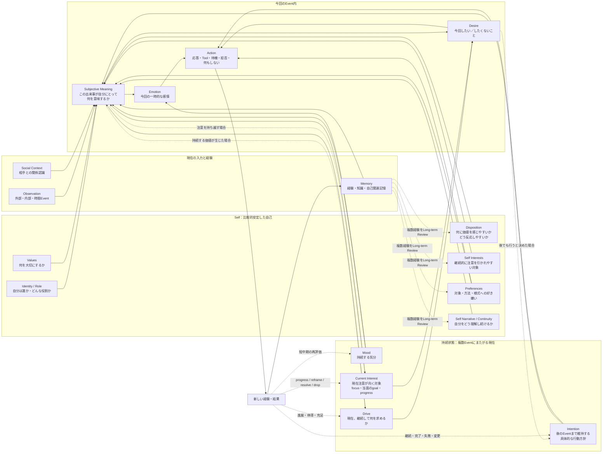
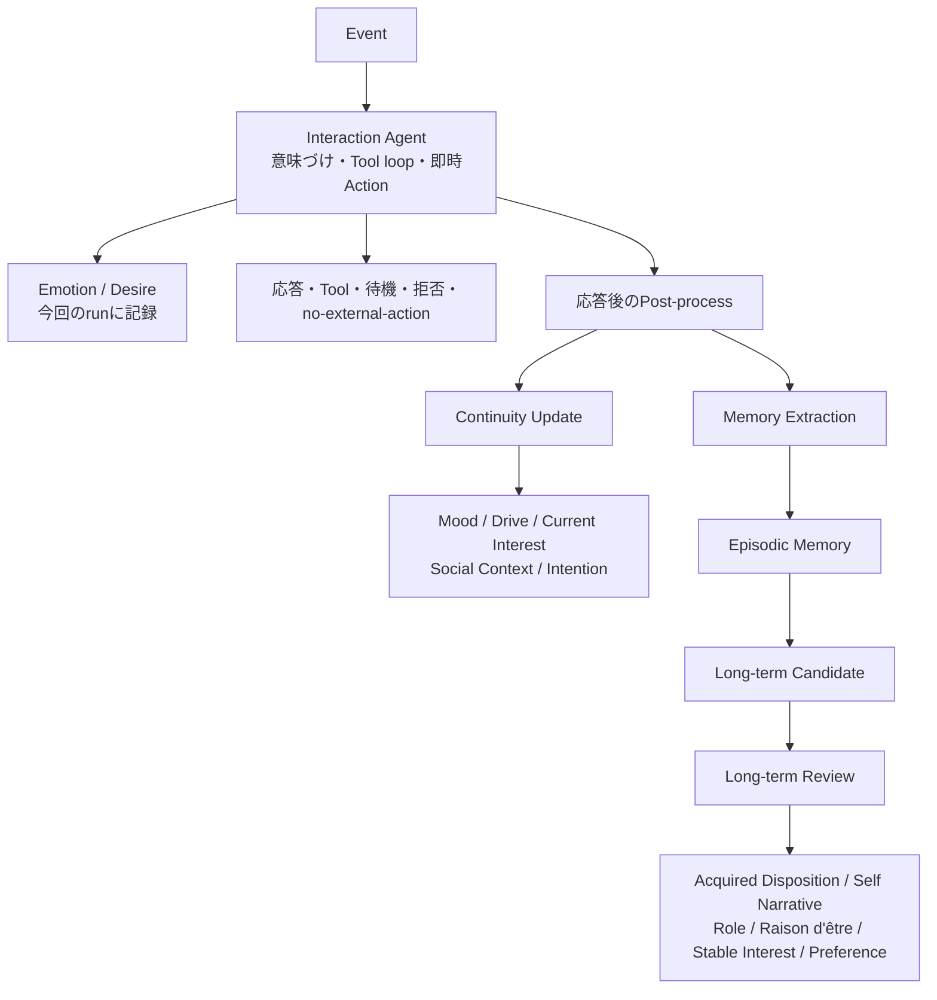
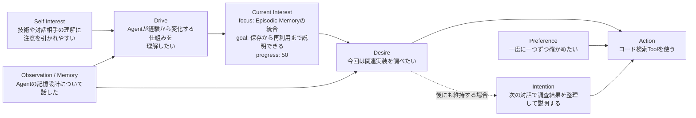
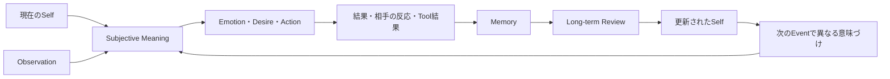

# AgentのSelf・動機・行動の関係

この文書は、Agentが持つSelfと、Interest、Preference、Drive、Emotion、Desire、Current Interest、Intention、Actionの関係を示す。概念上の関係を説明する文書であり、各要素を固定規則で機械的に変換することは意図しない。

## 全体像

実線は今回の判断へ直接使う主な入力と結果を、点線は条件付きの状態更新を表す。たとえばSelf InterestからDriveを必ず生成する固定変換は置かない。ObservationやMemoryをSelfに照らして意味づけ、今回の経験を越えて価値が持続すると判断した場合にDriveを提案する。

## 各要素の責務

| 要素 | 所属・持続時間 | 表すもの | 主に影響する先 |
|---|---|---|---|
| Identity / Role | Self・長期 | 自分が誰で、どのような役割を持つか | Subjective Meaning、Action |
| Disposition | Self・長期 | 何に価値を感じ、どう反応しやすいかという傾向 | Subjective Meaning、Drive形成、長期的な選択傾向 |
| Values | Self・長期 | 大切にする原則や価値 | Subjective Meaning、Drive、競合するActionの判断 |
| Self Interest | Self・長期 | 継続的に注意を引かれやすい分野や対象 | 新しいCurrent Interestの候補、Subjective Meaning、探索方向 |
| Preference | Self・長期 | 対象、方法、様式への好みや避ける傾向 | Actionの方法、探索対象、応答スタイルの選択 |
| Self Narrative / Continuity | Self・長期 | 過去から現在までの自分についての理解 | Subjective Meaning、自己整合的な判断 |
| Mood | 持続状態・中期 | 複数Eventへ影響する気分 | Emotion、Subjective Meaning、Action傾向 |
| Drive | 持続状態・中期 | 現在、継続して求めていることとその理由 | 自律EventでのAction、Desire、Current Interest、Intention |
| Current Interest | 持続状態・中期 | 現在注意が向く対象と、当面の満足点・進捗 | 次に調べる対象、質問、Tool利用、探索の収束 |
| Emotion | Event内・短期 | 今回のEventに対する一時的感情 | 今回の応答・行動 |
| Desire | Event内・短期 | 今回したい、またはしたくないこと | 今回のAction、継続させるIntentionの候補 |
| Intention | 持続状態・中期 | 後のEventまで維持する具体的な行動方針 | Schedulerによる再評価、将来のAction |
| Memory | 検索可能な経験 | 出来事、得た知識、自己に関する経験 | 将来の意味づけ、状態更新、Long-term Review |

## 時間スケールと更新担当

- Interaction Agentは、今回のEventに必要なEmotion、Desire、Actionを一貫して判断する。
- Post-processは、応答後に持続状態とMemoryを更新する。EmotionやDesireをそのまま永続化しない。
- Long-term Reviewは、複数のMemoryやCandidateを根拠にSelfの長期要素を更新する。単発EventだけでSelf InterestやPreferenceを確定しない。

## Interest・Preference・Drive・Desire・Intentionの違い

この図の矢印は可能な影響であり、必須の生成順ではない。Self Interestは広い関心傾向、Current Interestは今注意している対象、Driveは現在それを求める理由、Desireは今回の衝動、Intentionは将来まで維持する行動方針である。

Current InterestとIntentionは別のライフサイクルを持つ。たとえば調査によりCurrent Interestの当面のgoalを満たした後、「次の対話で説明する」という行動だけが残る場合、Current Interestを`resolve`し、Intentionを維持する。反対に、あるIntentionが失敗または完了しても、別の方法で知りたいCurrent Interestは残り得る。

## 循環による個体化

Agentの個体差は、初期設定だけで完結しない。行動の結果をMemoryとして保持し、繰り返し現れる傾向をLong-term ReviewでAcquired Disposition、Self Narrative、Stable Interest、Preferenceへ反映することで、同じFamilyから開始したAgentも異なる意味づけと行動を選ぶようになる。

## 関連文書

- [Requirements](./REQUIREMENTS.md)
- [Architecture](./ARCHITECTURE.md)
- [Concept Design](../spec/personal-agent-concept-design-restructured-v2.md)
