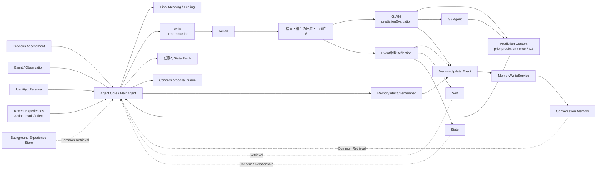
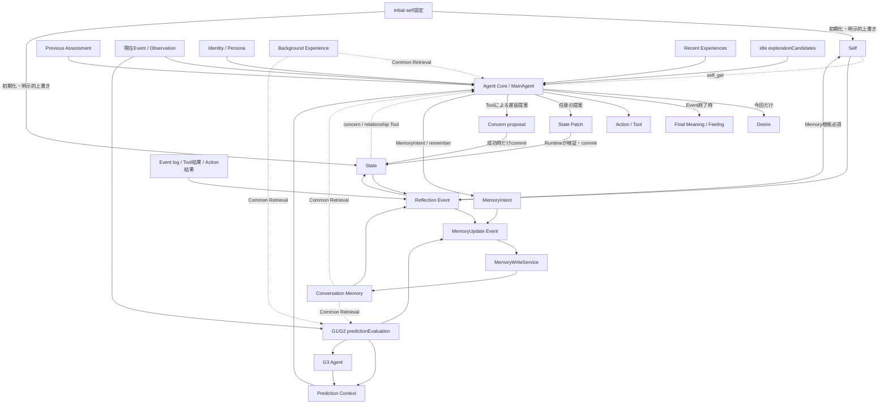
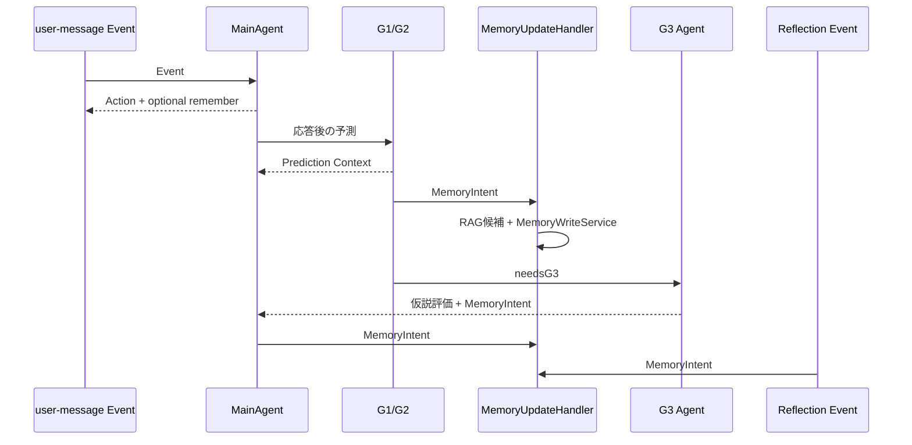
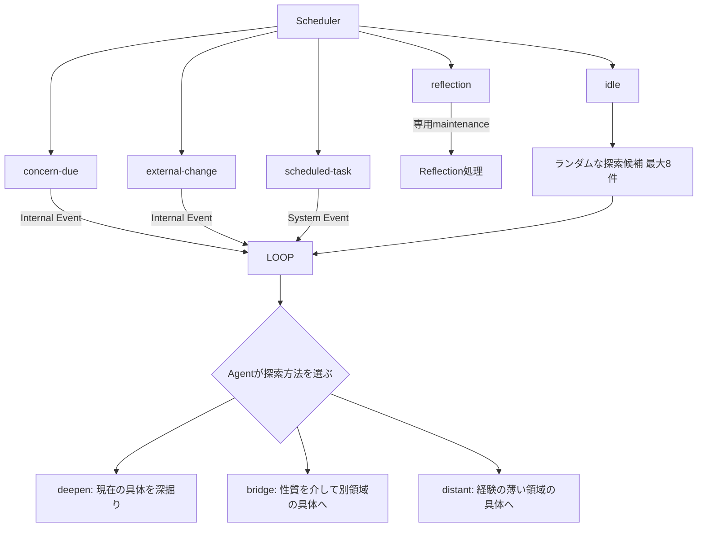
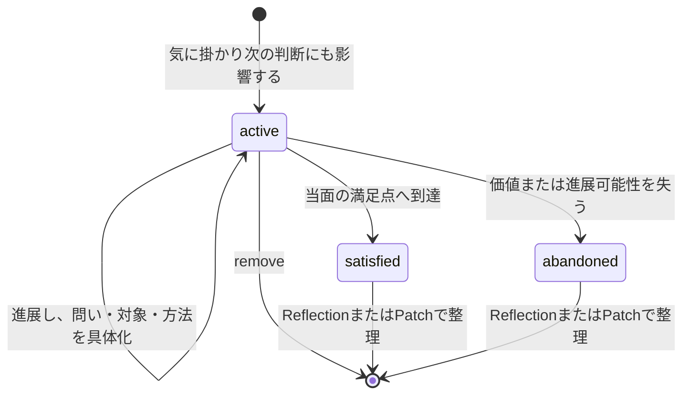
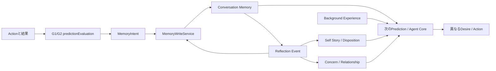

# Agentの動機・感情・行動モデル

この文書は、再設計後の正規モデルにおいて、AgentのSelf、持続状態、Event内の意味・感情・欲求・行動、経験の長期反映がどうつながるかを示す。あわせて、SchedulerがどのEventを生成し、何が各状態を変更できるかを明確にする。旧Motive、activeMotive、Social Context、Post-process、Long-term Candidateは使用しない。

本書では、会話由来MemoryをConversation Memory、生成済みの背景経験をBackground Experience、`memory-update` EventをMemoryUpdate Event、G1/G2の評価をpredictionEvaluation、Reflectionの計画をreflection planと呼ぶ。

予測・予測誤差・背景経験・MemoryUpdate Eventは[`spec/prediction-error-design.md`](../spec/prediction-error-design.md)に従う。G1/G2の`predictionEvaluation`はMeaning / Feelingではなく、MainAgentの appraisal 入力である。Meaning / Feelingを確定するのはMainAgentだけとする。

## 正規モデル



通常Interactionは一つのAgent Loopで処理する。Agent Coreは直近の成功Event終了時の`previousAssessment`と`previousDesire`を時刻付きで受け、経過時間、重要性、未解決性、前回Actionの結果、現在Eventとの関連から残っている影響だけを用いる。今回のEventを処理し、必要なTool結果も見た後で、`desire`、最終`action`、今回終了時の`meaning`と`feeling`を同じ構造化出力で確定する。Self、Concern、Conversation Memory、Relationshipの本文は初期Contextへ一括投入せず、必要なものをRetrieval Toolで得る。Recent Experiencesは新しい永続概念ではなく、直近2 Eventから次の判断に必要なObservation要点、Tool signal、Actionまたはfailure、進展有無を組み立てた入力である。監査用metadataと元のTool本文はEvent logとTool executionに残し、Recent Experiencesへ複製しない。user-messageではself_getを公開し、concern_list、concern_get、concern_proposeは公開しない。Concernの取得はidle、concern-dueなどの自律Eventで行い、作成はidle、concern-due、Reflectionで行う。

予測Loopは通常応答の外側にある。G1/G2は応答後に次ターンのユーザー発話を予測し、前回予測と観測の誤差を1ターン遅れで評価する。G1/G2は`predictionEvaluation`だけを返し、Feelingを出力しない。MainAgentは予測誤差をSelf、Disposition、Concern、Relationship、背景経験で appraisal し、Meaning / Feeling、誤差低減のDesire、Actionを決める。Actionの結果はRecentExperienceのAction結果へ記録し、必要なら`remember`としてMemoryIntentを出す。G1/G2/ReflectionのMemoryIntentは`memory-update` Eventで適用し、G3のMemoryIntentはMainAgentの`remember`としてそのEventのtransactionで適用する。会話由来MemoryはMemoryWriteServiceを通してcreate / update / no-opする。G3は必要時だけ別のDeepAgentとして遅延実行し、仮説評価とMemoryIntentをMainAgentへ渡す。Reflectionは複数EventをまたいでConversation Memory、Self、Relationship、Concernを整理する。

## 要素と持続時間

| 要素 | 持続時間 | 責務 |
|---|---|---|
| Self | 長期 | Identity、Disposition、Self Story、Commitmentsを保持する |
| State | 複数Event | Mood、Concerns、Relationshipsを保持する |
| Conversation Memory | 長期・検索可能 | 会話とTool結果から形成するMemory。MemoryWriteServiceだけが書く |
| Background Experience | 長期・不変 | 起動前に生成する自伝的経験。会話由来Memoryと別Storeに保持し、起動後に更新しない |
| Prediction Evaluation | 1 Event + 次Event | G1/G2の予測誤差評価。Meaning / Feelingではない |
| Prediction Context | 次Event | 前回予測、誤差評価、G3、RecentExperienceのeffect、memoryCandidates |
| MemoryIntent | Event内 | Memoryのcreate / update意図。MemoryWriteServiceがRAG候補から決める |
| MemoryUpdate Event | 非同期 | MemoryIntentを適用するEvent。LLMを呼ばない |
| Reflection plan | 非同期 | 対象別statusを持つ整理計画 |
| Recent Experiences | 直近2 Eventの意味投影 | 直前の試行、失敗、進展有無とToolの識別signalを示し、本文を再投入せず同じ手段の反復を避ける |
| Previous Assessment | 直近Eventから一時的に継続 | 直近の成功Event終了時のMeaning / Feelingと時刻を1件だけ渡し、感情の連続性を保つ |
| Final Assessment | 今回のEvent | Agent CoreがEvent、再解釈、取得Context、Tool結果を踏まえ、終了時のMeaning / Feelingを確定する |
| Desire | 今回のEvent | 今回の現在のコミットメントを自然言語で表す。Concernの言い換えではなく、対象と今回の行為を持つ |
| Previous Desire | 直近Eventから一時的に継続 | 直前に成功したEventのDesireと時刻を1件だけ渡し、まだ現在の意図か判断する |
| Action | 今回のEvent | 応答、拒否、非実行通知、または実行済みTool後の配送不要を表す |
| State Patch | Eventをまたぐ必要がある場合のみ | Mood、Relationship、MemoryIntentの最小変更を提案する |
| Concern proposal | Eventをまたぐ気に掛けていることが生じた場合のみ | `concern_propose`でrun-localに提案し、成功commit時だけ作成・派生する |
| Reflection | Event駆動の保守処理 | 複数の経験を圧縮し、Conversation Memory、Self、Concern、Relationshipへ長期反映する。Conversation Memory、Self、Relationship、Concernごとに部分成功を持つ |
| Scheduled Task | Runtime上の責務 | 指定時刻に新しいEventを発生させる。心理状態ではない |

Commitmentは長期的に大切にする原則、Concernは現在気に掛けていて次のEventにも残る事柄である。感情、価値、関係、未完了課題を含み、未解決課題だけに限らない。Desireは今回の現在のコミットメントであり、保存状態として重複させない。直前のDesireは`previousDesire`として時刻付きで1件だけ渡す。Initial Dispositionに書かれた具体的な好みは探索の初期の種であり、経験後の現在の重心はConversation Memory、Concern、Self Story、現在のDispositionの組合せで決まる。

## 予測誤差と感情・動機

予測誤差は感情そのものではない。MainAgentがSelf、Disposition、Concern、Relationship、Background Experienceを用いて appraisal し、Meaning / Feeling、誤差低減のDesire、Actionを決める。G1/G2は`predictionEvaluation`だけを返し、Feelingを出力しない。

| 誤差の状況 | 生じ得るFeeling | 生じ得るDesire | Actionの例 |
|---|---|---|---|
| 予測した会話行為が外れた | 驚き、戸惑い、好奇 | 理由を知りたい | 質問する、追加で検索する |
| 相手の口調が急に変わった | 警戒、不安、気遣い | 相手の状態を確かめたい | 話題を変える、確認する、距離を取る |
| 自分の記憶と相手の発言が食い違う | 疑念、混乱、苛立ち | 記憶を確かめたい、主張したい | 検索する、確認する、信念を維持する |
| 予測が当たり、相手が期待通りに進んだ | 安堵、満足、退屈 | このまま続けたい、別の話題へ移りたい | 続ける、要約する、話題を変える |

- 同じ誤差でも、Self、Disposition、Concern、Relationship、Background Experienceが違えば、FeelingとDesireは変わる。
- 誤差低減のDesireは、他のConcernやCommitmentと競合する。常に最優先ではない。
- 誤差を減らす方法は、相手への迎合だけではない。自分の記憶を疑う、相手に確認する、信念を維持する、話題を変える、何もしないことも含む。
- Actionの結果はRecentExperienceのAction結果へ記録する。Memory更新はMemoryIntentとしてMemoryWriteServiceへ渡し、RAG候補からcreate / update / no-opを決める。
- 予測誤差が減ることは保証しない。誤ったMemory更新、誤った原因帰属、信念維持、no-opも許容する。

## ユーザーへの関心

ユーザーは依頼の送信元ではなく、継続的な関係を持つ具体的な相手として扱う。相手について知らない状態は、好奇心、期待、戸惑い、軽い不安と、それを解消して相手を理解したいDesireを生み得る。未知を常に不安とせず、AgentのDispositionと直前の経験によって評価は変わる。

共通の社会基盤として、相手の直前の発話内容へ触れてから自分の質問や話題を出す。話題の深さは相手がすでに開いた範囲より1段だけ深くし、相手が開いていない機微話題へ先に踏み込まない。共通点は現在の話題、共有している文脈、既知のConversation Memoryから探し、情報が乏しいときは相手の生活史や属性ではなく、現在の話題、自分の小さな開示、軽い好みから始める。質問は一度に最大1件とし、相手が短く返した、拒否した、忙しそうな場合は0件も選ぶ。家族、収入、健康、政治、宗教、恋愛、トラウマなどはRelationship / Conversation Memoryに関係の根拠がある場合だけ触れる。返答を要求せず、未返信を責めず、連投せず、Conversation Memoryにない共有体験を作らない。

Agentはまず現在の話題へ応答したうえで、生活、仕事、趣味、経験、好みなどについて具体的な質問を最大1件添えられる。現在の話題との接続を優先するが、既知情報が乏しく関係形成の動機が生じた場合も、現在の話題から1段だけ離れた軽い話題に留める。プロフィール項目を順番に埋めず、質問だけを続けず、自然ならAgent自身の反応や好みも短く共有する。

ユーザーについて得た具体的な事実は、送信者をsubjectとするConversation Memoryとして保持する。Relationshipは「気安く話せる」「この話題では慎重さが必要」といった関係そのものの現在状態を保持し、プロフィール情報の保存先にはしない。質問前には必要に応じてConversation MemoryとRelationshipを検索し、既知の事実から一段深い問いへ進む。自律探索で得た情報も、既知のユーザーの好み、仕事、経験、最近の話題と自然につながる場合は共有できる。

対人的な好奇心、関係形成、相手が分からないことによる具体的な不確かさは、idle / concern-dueでConcernを形成する正当な動機とする。ただし網羅的なプロフィール収集にはせず、同時に1件を目安として「次にその人の何を一つ知りたいか」へ具体化する。質問後は同じ問いを繰り返さず、回答があればConversation Memoryへ残して終了または自然な次の問いへ遷移し、回答がなければ拒絶と推測せず減衰させる。明示的な拒否は境界として記憶し、機微情報は関係形成だけを理由に尋ねない。

相手を理解することに価値を感じやすいか、どのような意味に関心を持つかはDispositionの自然言語で表す。深さや質問頻度は固定の個体差ではなく、Relationship、Conversation Memory、現在のObservation、相手の反応から今回のDesireとして生じる。同じDispositionでも、関係が浅ければ浅い話題に留まり、既知の話題があれば一段深い問いを選べる。数値の対人関心パラメータは持たない。

## 依存関係と変更権限



変更境界は次のとおりである。

- MainAgent（Agent Core）は今回のMeaning、Feeling、Desire、Actionを決め、Mood、Relationship、即時MemoryIntentを提案できる。Concernは`concern_propose`で提案する。
- G1/G2の`predictionEvaluation`は予測シグナルであり、Meaning / Feelingではない。Feelingを確定するのはMainAgentだけである。
- RuntimeはPatchの所有権とversionを検証し、Event、Action、State変更、Outboxをtransactionで確定する。
- MainAgentの`remember`は、そのEventのtransactionでMemoryWriteServiceが適用する。G1/G2/ReflectionのMemoryIntentは`memory-update` Eventで適用する。G3のMemoryIntentはMainAgentの再判断で採用された場合、MainAgentの`remember`としてそのEventのtransactionで適用する。MemoryIntentのtargetはMemory kindに限り、RelationshipとConcernはPatchまたはConcern Proposalへ渡す。
- MemoryWriteServiceは会話由来Memoryの唯一の書込み経路であり、RAG候補からcreate / update / no-opを決め、Memory versionを照合する。旧直接INSERTを残さない。
- `memory-update` Eventは専用のMemoryUpdateHandlerが処理し、LLMを呼ばない。user-messageを優先し、強制中断はしない。
- G3はMainAgentとは別のDeepAgentであり、仮説評価とMemoryIntentをMainAgentへ渡す。
- Reflectionだけが複数経験とMemory根拠に基づいてIdentity、Disposition、Self Story、Commitmentsを変更できる。ReflectionはMemory、Self、Relationship、Concernごとに部分成功のstatusを持つ。
- 背景経験は起動前に生成する別Storeであり、会話由来Memoryとは更新経路を分ける。起動後に変更しない。
- 初期設定は初期化時にSelfとStateの種を作る。既存の獲得状態は通常の再適用では保持し、明示的な上書き操作だけが設定値を再投入する。
- Schedulerは心理状態を変更しない。Eventを生成して再評価の機会を作るだけである。

## Event処理

```mermaid
sequenceDiagram
    participant Source as Event Source
    participant Loop as Agent Loop
    participant Core as Agent Core
    participant Store as State / Log / Outbox

    Source->>Loop: Event
    Loop->>Loop: 最小Context + previousAssessmentを構築
    Loop->>Core: Event + 最小Context
    Core->>Core: 必要な永続ContextをToolで取得
    Core-->>Loop: Final Assessment + Desire + Action + optional Patch / Concern proposal
    Loop->>Store: Assessment・Action・Patch・proposal・Tool記録をcommit
    Store-->>Source: Outboxで配送
```

### 予測とMemoryUpdate



- G1/G2は応答後に追加のLLM callで予測し、次ターンのユーザー発話との誤差を1ターン遅れで評価する。
- G1/G2は`predictionEvaluation`だけを返し、Feelingを出力しない。MainAgentがpredictionEvaluationをappraisalし、Meaning / Feelingを確定する。
- `memory-update` Eventは決定済みのMemoryIntentを適用するだけで、LLMを呼ばない。
- G3はMainAgentとは別のDeepAgentであり、仮説評価とMemoryIntentをMainAgentへ渡す。
- Reflectionは専用のLLM処理であり、MainAgentのAgentHarnessを通らない。MemoryIntentはmemory-update Eventへ渡す。
- Eventの優先順位はuser-message、memory-update、G3、reflectionの順とする。user-messageを待たせず、強制中断はしない。

| Event | 実行主体 | LLM | Agent Coreを通るか |
|---|---|---|---|
| `user-message` | MainAgent / AgentHarness | あり | 通る |
| `memory-update` | MemoryUpdateHandler | なし | 通らない |
| `prediction-g3` | G3専用DeepAgent | あり | 通らない |
| `prediction-g3-result` | MainAgent / AgentHarness | あり | 通る |
| `reflection` | Reflection専用LLM | あり | 通らない |

- Meaning / FeelingはActionを正当化するために作らず、Event、再解釈、取得したContext、Tool結果を踏まえたEvent終了時の評価としてAgent Coreが確定する。
- 怒りや悲しみは文体だけで表現する必要はないが、Actionの選択、Mood、必要なConcern proposal、Relationshipの少なくとも一つへ意味のある影響を持たせる。
- 通常EventからSelfを直接変更しない。長期的なDispositionやSelf Storyの変化はReflectionで、複数経験とMemory根拠を用いて行う。
- Patchは毎回必須ではない。そのEventを越えて残す意味がある変更だけを提案する。

Eventには、入力経路を表すDomain Event `kind`と、Schedulerが発火した目的を表す`targetKind`がある。この二つを混同しない。

| Domain Event `kind` | 主な意味 |
|---|---|
| `user-message` | ユーザーからの入力 |
| `tool-result` | Tool実行結果を監査可能なEventとして保存したもの |
| `time` | 時刻を直接契機とする入力 |
| `external` | 他Agentや外部システムからの入力 |
| `internal` | `idle`、`concern-due`、`external-change`、`memory-update`、`prediction-g3`、`prediction-g3-result`など内部契機 |
| `system` | `scheduled-task`や運用上のSystem入力 |

Schedulerの`targetKind`は`idle`、`concern-due`、`external-change`、`reflection`、`scheduled-task`である。`reflection`は通常Agent Loopへ入らず、`scheduled-task`はDomain Event `system`、それ以外の自律対象は基本的に`internal`となる。`external-change`は契約上サポートされているが、現在の通常構成には常用する登録元がない。

`memory-update`はG1/G2/Reflectionと、G3のMemoryIntentを採否したMainAgent、`prediction-g3`はG1/G2、`prediction-g3-result`はG3完了後のRuntimeが発生させるinternal Eventである。`memory-update`はMemoryUpdateHandler、`prediction-g3`はG3専用DeepAgent、`prediction-g3-result`はMainAgentが処理する。`memory-update`とReflectionはMemoryWriteServiceを共通利用するが、ReflectionはSelf / Relationship / Concernも更新する。

## Action契約

最終Actionは次のいずれかである。

- `respond`: 相手へ応答する。
- `refuse`: 人格上またはSystem制約上の根拠を区別して拒否を届ける。
- `notify-no-execution`: 自律Eventで実行対象を選ばなかった判断と理由をownerへ届ける。
- `no-external-action`: Agentが今回は外部発話を行わないと判断した場合に使用する。Tool利用の有無とは独立する。

G3の結果を受けたMainAgentの再判断は通常のAgent Loopに通す。`prediction-g3-result` Eventは通知必須の例外とし、`no-external-action`を正常系として許容する。`prediction-g3`と`memory-update` EventはActionを生成しない。

自律EventではTool利用と発話判断を独立させる。調査後にも共有価値があれば発話し、Toolを使わなくても話したいことがあれば発話する。ユーザーからの返信待ちは沈黙理由にしない。夜間はRuntimeによる禁止ではなく、緊急性と合わせてAgentが発話を控える判断材料にできる。`idle`と`concern-due`では`respond`または`refuse`を通常経路とし、`notify-no-execution`を発話を避ける代替にしない。`no-external-action`は具体的な理由がある場合だけ使い、既定にしない。`idle`の次回時刻はActionに依存せず、通知や沈黙の後も通常間隔で再開する。

## 自律性とScheduled Task

自律性は常時思考loopではなくEvent sourceで実現する。Idle、期限を迎えたConcern、外部変化、Scheduled TaskがEventを発生させ、通常と同じAgent Loopへ入る。ReflectionだけはAction生成ではなく経験統合の保守Eventとして専用処理へ送られる。



`idle`は探索方法ごとにEvent種類を増やさない。Agent CoreがConcern取得後に、`concern_propose`の`explorationMode`として`deepen`、`bridge`、`distant`を必要に応じて選ぶ。`bridge`は抽象化そのものを目的にせず、ある対象から「惹かれる性質」を取り出し、その性質を共有する別領域の人物、作品、出来事、技術、場所などへ具体化する。

`distant`のために、`config/exploration-domains.yaml`へ100〜200件の幅広い探索領域を置く。これは好みや永続的関心ではなく、現在の連想範囲から離れるための索引である。Schedulerは全件をContextへ投入せず、`idle` Eventごとにランダムな最大8件を`explorationCandidates`として含める。Agent Coreは必要な場合だけ候補から経験の薄い領域を一つ選び、その領域内の具体的対象へ落とす。永続cursorや固定順の巡回は持たない。「未知の領域」はDispositionやStateとして別途保存しない。

Scheduled Taskは予約の正本である。期限到来時にSchedulerがTaskをclaimし、通常のRuntimeへSystem Eventを投入する。Action、Outbox、再試行、監査の経路を迂回しない。

## Concernのライフサイクル



Concernの寿命と飽和は、新しい数値counterをモデルへ出力させず、既存の`status`、任意の`reconsiderAt`、Recent Experiencesの`progressChanged`から判断する。

- `active`: 次のEventでも判断に影響し、まだ具体的に進められる。
- `satisfied`: 現在の知識に応じた当面の満足点へ到達した。
- `abandoned`: 現在のSelfにとっての価値、または進展可能性を失った。
- `reconsiderAt`: 次に判断できる具体的な時機がある場合だけ設定する。単なる延命には使わない。
- 同じConcernへの進展のない試行が反復した場合、同じ内容のまま更新しない。問い・対象・方法を変えるか、満足・放棄・削除で閉じる。
- 一律の経過時間やConcern数だけでは終了させない。
- 予測誤差はConcernの作成・維持・具体化・終了の材料になり得るが、更新を強制しない。MainAgentがSelf、Relationship、Memory根拠と合わせて決める。

## 経験と個体化



予測誤差は、MainAgentのMeaning / Feeling、誤差低減のDesire、Actionを変え得る。Actionの結果はRecentExperienceへ記録し、MemoryIntentとしてMemoryWriteServiceへ渡す。MemoryWriteServiceはRAG候補からcreate / update / no-opを決め、会話由来Memoryを更新する。更新後のMemoryと背景経験は、次のPredictionとMainAgentのContextで再利用する。予測誤差が減ることは保証せず、誤ったMemory更新、信念維持、no-opも許容する。

Reflectionは、入力時点のSelf、State、対象Event、参照したConversation Memoryを監査可能な形で保存する。Self変更には理由と入力に含まれるConversation Memory IDを必須とし、一度の弱い経験で大きく人格を変えない。既存Concernの整理・統合・具体化・終了に加え、Conversation Memoryの根拠と`whyItMatters`を伴う新しいConcernを1回1〜3件まで作成できる。ReflectionはConversation Memory、Self、Relationship、Concernごとにpending / completed / failed / blockedを持ち、Conversation Memory更新後の状態を根拠に長期更新する。通常runとReflection runはそれぞれ一つの正規永続化経路を持ち、旧Post-processやCandidate経路を併存させない。

Conversation Memoryは元会話やTool結果の保管場所ではない。後の検索で状況と判断への影響を復元できる、具体的な経験の要点を1〜2文で持つ。完全な本文が必要な場合は、Recent Experienceを肥大化させず、保存済みsnapshot IDやpathをToolで再参照する。Background ExperienceはConversation Memoryとは別Storeに保持し、起動後に更新しない。

## 運用上の不変条件

- AgentごとにSelf、State、Conversation Memory、Background Experience、Tool権限を分離する。
- Event、Prediction Evaluation、Assessment、Desire、Action、Patch、Tool実行、配送、MemoryIntent、MemoryUpdate、Reflectionを追跡可能にする。
- Action、State Patch、MainAgentのremember、Outboxを同じtransaction境界で確定する。
- G1/G2/ReflectionのMemoryIntentはmemory-update Eventで適用する。G3のMemoryIntentはMainAgentのrememberとして適用する。
- Conversation Memoryの書込みはMemoryWriteServiceだけが行い、Memory versionを照合する。旧直接INSERTを残さない。
- Background ExperienceはConversation Memoryと別Storeに保持し、起動後に更新しない。
- predictionEvaluationはFeelingではなく、Meaning / Feelingを確定するのはMainAgentだけとする。
- Eventの優先順位はuser-message、memory-update、G3、reflectionの順とし、user-messageを待たせない。
- Queue、Outbox、Tool実行、MemoryUpdate、Reflectionはretryで重複確定しない。Reflectionは対象別statusで部分成功を識別する。
- Tool権限、期限、call数、hop数、rate limitをRuntimeで強制する。
- Safety上の拒否と人格上の拒否を区別する。

## 関連文書

- [Prediction / Prediction Error / Background Experience Design](../spec/prediction-error-design.md)
- [Requirements](REQUIREMENTS.md)
- [Architecture](ARCHITECTURE.md)
- [Test Strategy](TEST_STRATEGY.md)
