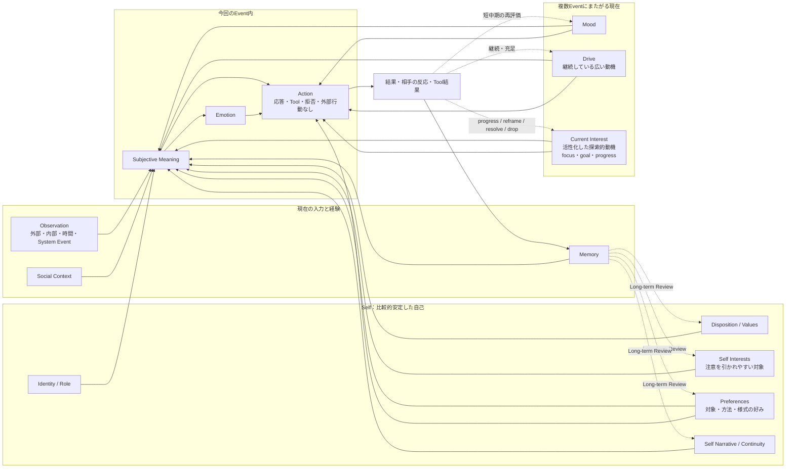
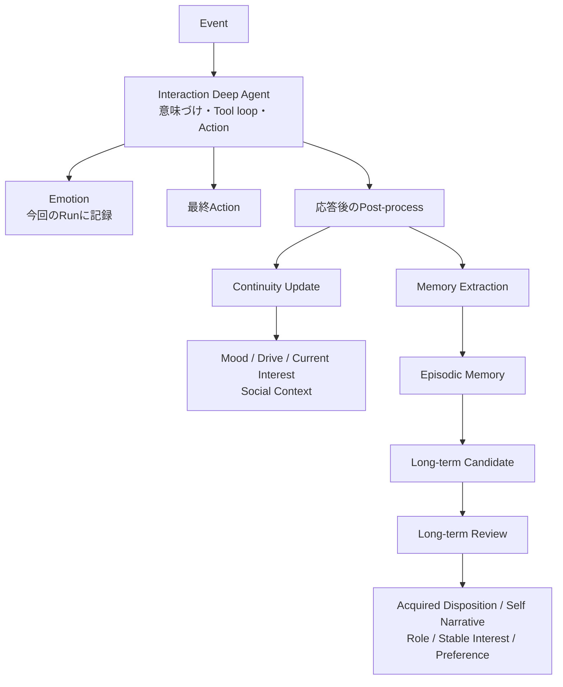
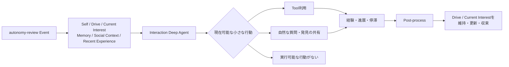
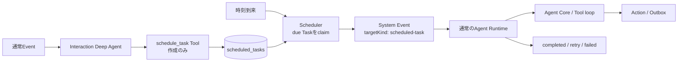
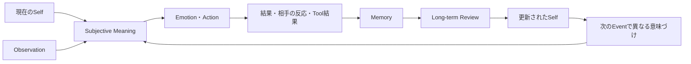

# AgentのSelf・動機・行動・Scheduled Taskの関係

この文書は、Agentが持つSelf、持続状態、Event内の反応、行動、明示的な予約実行の関係を示す。各要素を固定規則で機械的に変換するものではない。

## 全体像

DriveとCurrent Interestはいずれも動機であり、Actionへ直接影響する。独立したDesire状態を間に置かない。「調べたい」と「休みたい」の競合も、正と負のDesireではなく複数の動機、Emotion、Mood、Preference、制約を現在文脈で比較してActionを選ぶ。

## 各要素の責務

| 要素 | 所属・持続時間 | 表すもの | 主に影響する先 |
|---|---|---|---|
| Identity / Role | Self・長期 | 自分が誰で、どの役割を持つか | Subjective Meaning、Action |
| Disposition | Self・長期 | 何に価値を感じ、どう反応しやすいか | Subjective Meaning、Drive形成、選択傾向 |
| Values | Self・長期 | 大切にする原則や価値 | Subjective Meaning、Drive、Actionの競合判断 |
| Self Interest | Self・長期 | 継続的に注意を引かれやすい分野や対象 | 新しいDrive・Current Interestの候補 |
| Preference | Self・長期 | 対象、方法、様式への好みや避ける傾向 | Actionの方法、探索対象、応答表現 |
| Self Narrative / Continuity | Self・長期 | 過去から現在までの自己理解 | Subjective Meaning、自己整合的な判断 |
| Mood | 持続状態・中期 | 複数Eventへ影響する気分 | Subjective Meaning、Emotion、Action傾向 |
| Drive | 持続状態・中期 | 現在継続して求める広い方向と理由 | Action、Current Interestの形成・選択・収束 |
| Current Interest | 持続状態・中期 | 現在活性化した探索的動機と当面の充足点・進捗 | 質問、Tool利用、共有、探索の収束 |
| Emotion | Event内・短期 | 今回のEventへの一時的な感情反応 | 今回のAction |
| Memory | 検索可能な経験 | 出来事、知識、自己に関する経験 | 意味づけ、状態更新、Long-term Review |
| Scheduled Task | Runtime管理 | 明示的な時刻に実行する責務 | 期限到来時のSystem Event |

Self Interestは広い注意傾向で、Preferenceは対象や方法への好き嫌いである。Driveは現在継続している広い動機であり、Current Interestはその時点で注意が活性化した具体的な探索的動機である。Current Interestのgoalは興味全体の終了条件ではなく、現在の知識や経験に応じた当面の満足点である。

## Event処理と更新時間

- Interaction Deep Agentは今回のEmotionとActionを一貫して判断する。
- DriveとCurrent InterestはActionの直接入力であり、Desireへ変換しない。
- Post-processは応答後に持続状態とMemoryを更新する。Emotionは永続化しない。
- Long-term Reviewは複数のMemoryやCandidateを根拠にSelfの長期要素を更新する。

## 自律行動

Current Interestがなくても、Self Interest、会話、Social Context、Memory、Tool結果、Web Snapshot、Driveから現在小さく確かめられる対象を判断できる。継続して注意を持ち越す価値が生じた場合だけPost-processがCurrent Interestを作る。

## Scheduled Task

Scheduled Taskは心理状態ではなく、明示した時刻に処理する運用上の責務である。約束した経験や意味はMemoryへ保存し、実行の正本はScheduled Taskへ保存する。

- `schedule_task`、`scheduled_task_list`、`scheduled_task_cancel`は予約データの作成・参照・取消だけを行う。
- Tool呼び出し時に予約対象の処理を実行しない。
- 期限到来後の唯一の実行入口はEventである。SchedulerはAgent Coreを直接呼ばない。
- EventはTask ID、instruction、destination、作成元Event / Runを持ち、通常のRuntime、Tool loop、Outboxを通る。
- Scheduled TaskはMood、Drive、Current Interestを複製しない。実行時点のContextでActionを判断する。

## 循環による個体化

Agentの個体差は初期設定だけで完結しない。経験をMemoryとして保持し、繰り返し現れる傾向をLong-term ReviewでSelfへ反映することで、同じFamilyから始まったAgentも異なる意味づけと行動を選ぶ。

## 関連文書

- [Requirements](./REQUIREMENTS.md)
- [Architecture](./ARCHITECTURE.md)
- [Concept Design](../spec/personal-agent-concept-design-restructured-v2.md)
- [Implementation Design](../spec/personal-agent-implementation-design-v2.md)
