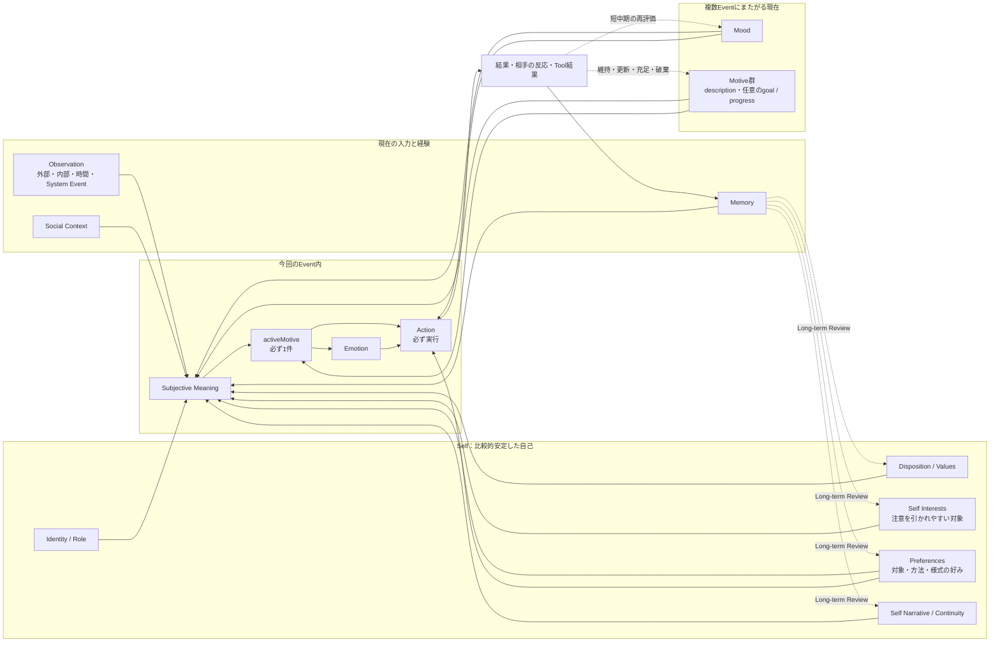
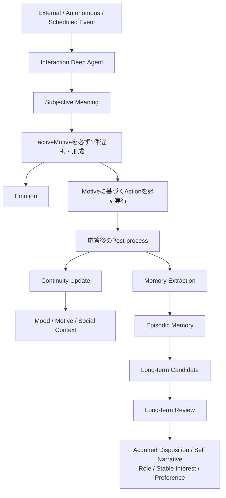
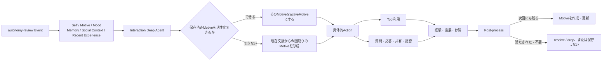
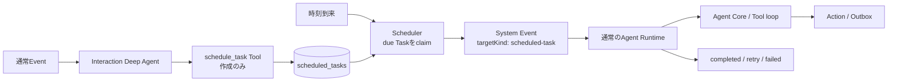
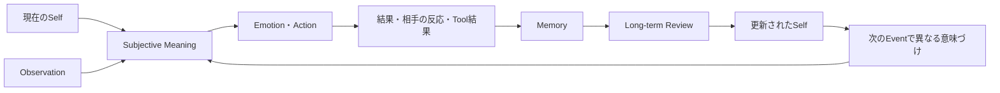

# AgentのSelf・Motive・Action・Scheduled Taskの関係

この文書は、Agentが持つSelf、持続状態、Event内で活性化する動機、行動、明示的な予約実行の関係を示す。各要素を固定規則で機械的に変換するものではない。

## 全体像

すべてのActionは、そのEventで活性化した1件の`activeMotive`から生じる。保存済みMotiveがあればその一つを現在の文脈で活性化し、なければObservation、Self、Mood、Memory、Social Contextから今回限りのMotiveを形成する。独立したDesire、Drive、Current Interestを間に置かない。

## 各要素の責務

| 要素 | 所属・持続時間 | 表すもの | 主に影響する先 |
|---|---|---|---|
| Identity / Role | Self・長期 | 自分が誰で、どの役割を持つか | Subjective Meaning、Motive形成、Action |
| Disposition | Self・長期 | 何に価値を感じ、どう反応しやすいか | Subjective Meaning、Motive形成、選択傾向 |
| Values | Self・長期 | 大切にする原則や価値 | Subjective Meaning、MotiveとActionの競合判断 |
| Self Interest | Self・長期 | 継続的に注意を引かれやすい分野や対象 | 新しいMotiveの候補 |
| Preference | Self・長期 | 対象、方法、様式への好みや避ける傾向 | Motiveの対象、Actionの方法、応答表現 |
| Self Narrative / Continuity | Self・長期 | 過去から現在までの自己理解 | Subjective Meaning、自己整合的な判断 |
| Mood | 持続状態・中期 | 複数Eventへ影響する気分 | Subjective Meaning、Emotion、MotiveとActionの傾向 |
| Motive | 持続状態・中期 | 現在求めていること。探索型では任意のgoalとprogressを持つ | activeMotiveの候補、Action、充足・収束 |
| activeMotive | Event内・短期 | 今回のActionを生じさせるために選択または形成した1件の動機 | Emotion、今回のAction |
| Emotion | Event内・短期 | 今回のEventへの一時的な感情反応 | 今回のAction |
| Memory | 検索可能な経験 | 出来事、知識、自己に関する経験 | 意味づけ、Motive形成、Long-term Review |
| Scheduled Task | Runtime管理 | 明示した時刻に実行する責務 | 期限到来時のSystem Event |

Self Interestは広い注意傾向、Preferenceは対象や方法への好き嫌いであり、Motiveそのものではない。Motiveは「水分を得たい」「会話を続けたい」「技術を理解したい」のようにActionを生じさせる現在の動機である。探索型Motiveのgoalは興味全体の終了条件ではなく、現在の知識や経験に応じた当面の満足点である。探索以外のMotiveにgoalやprogressを強制しない。

## Event処理と更新時間

- Interaction Deep Agentは`activeMotive`、今回のEmotion、Actionを一貫して判断する。
- `activeMotive`は必須で1件とし、保存済みMotiveのIDまたは今回のEvent内の根拠に結び付ける。
- Interaction Agentが処理するEventでは、Tool利用、応答、質問、共有、拒否などの具体的Actionを必ず実行する。
- 理由だけを返して何もしない`no-external-action`は許可しない。Toolを実行した結果、外部配送が不要と判断した最終結果には使用できる。
- 実行制約により要求された行動ができない場合も、拒否または可能な代替応答をActionとして実行する。
- Post-processは、今回形成された動機が次のEventにも残る場合だけMotiveとして作成・更新する。その場で満たされた動機は保存しない。
- `state-review`はInteraction Deep Agentを通らず、持続状態だけを再評価するため、必須`activeMotive`と必須Actionの対象外とする。
- Long-term Reviewは複数のMemoryやCandidateを根拠にSelfの長期要素を更新する。

## 自律行動

自律行動専用のMotive生成Eventは追加しない。`autonomy-review`自体が行動機会となり、通常のInteraction Deep AgentがそのEvent内でMotiveを必ず1件活性化する。MotiveごとのScheduleは作らず、Agentごとに1件の`autonomy-review`から、その時点で行動するMotiveを選ぶ。これにより、同じ動機を複数のScheduleが重複して処理することを防ぐ。

## Scheduled Task

Scheduled Taskは心理状態ではなく、明示した時刻に処理する運用上の責務である。約束した経験や意味はMemoryへ保存し、実行の正本はScheduled Taskへ保存する。

- `schedule_task`、`scheduled_task_list`、`scheduled_task_cancel`は予約データの作成・参照・取消だけを行う。
- Tool呼び出し時に予約対象の処理を実行しない。
- 期限到来後の唯一の実行入口はEventである。SchedulerはAgent Coreを直接呼ばない。
- EventはTask ID、instruction、destination、作成元Event / Runを持ち、通常のRuntime、Tool loop、Outboxを通る。
- Scheduled TaskはMoodやMotiveを複製しない。実行時点のContextでActionを判断する。

## 循環による個体化

Agentの個体差は初期設定だけで完結しない。経験をMemoryとして保持し、繰り返し現れる傾向をLong-term ReviewでSelfへ反映することで、同じFamilyから始まったAgentも異なる意味づけと行動を選ぶ。

## 関連文書

- [Requirements](./REQUIREMENTS.md)
- [Architecture](./ARCHITECTURE.md)
- [Concept Design](../spec/personal-agent-concept-design-restructured-v2.md)
- [Implementation Design](../spec/personal-agent-implementation-design-v2.md)
