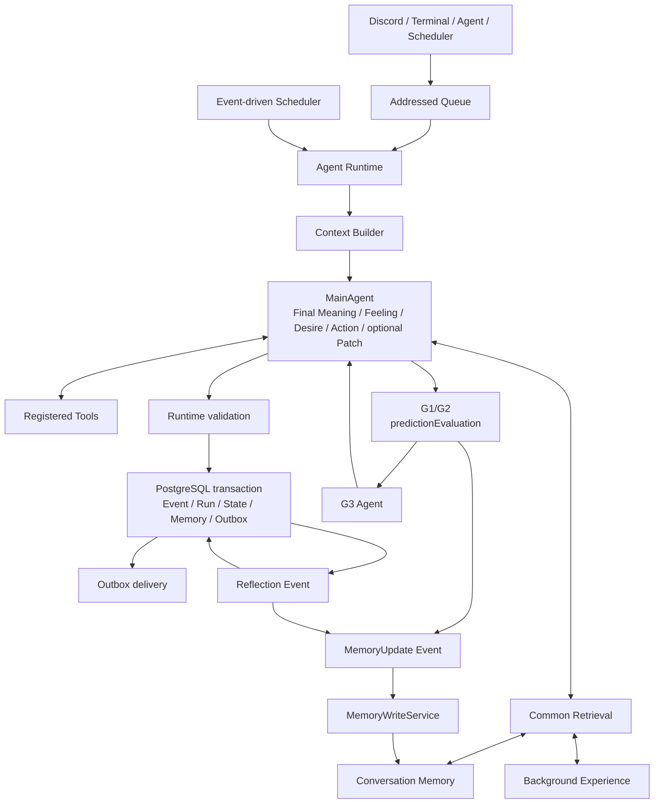

# Architecture

本書は現在の実装および追加設計を説明する二次資料である。概念と要求の一次資料は[`spec/`](../spec/)、動機・感情・行動モデルは[`AGENT_MOTIVATION_MODEL.md`](AGENT_MOTIVATION_MODEL.md)を正とする。本書と実装が異なる場合は、出荷時点の挙動をコードとテストで確認し、文書の差分を解消する。過去文書の `old_docs/` は本書の対象外である。

## 設計判断の背景

現行実装はSubjective Meaning、Emotion、Motive、Mood、Memory、Candidate、Long-term Reviewを厳密に扱うため、Event Assessment、Decision / Tool Loop、Experience Integration、Candidate Detection、Long-term Reviewの多段処理になりやすい。この構造は監査性を高める一方で、次の問題を招く。

- Event Assessmentの結果を行動決定へ渡す配線が複雑で、失敗時に因果関係を保ちにくい。
- Schema整合性とEvidence ID管理が推論能力を消費する。
- 一度の経験を保存するための非同期jobと失敗点が多い。
- 認知責務が別moduleとして増殖する。
- 実装の複雑さに対して、人格らしさと自律性の改善が実証されていない。

そのため、旧構造を段階的に温存せず、通常のAgent Loopに少数の持続状態を追加する構造へ再設計した。

## 設計原則

- 通常のAgent Loopに、一個体性と個体化を生む少数の持続状態を追加する。
- 認知概念ごとにmodule、LLM call、job、tableを増やさない。
- 意味と感情の評価と、DesireとActionの決定を分離する。
- 持続状態は少数の自然言語状態に限定し、重複する項目は統合する。
- 感情を語尾ではなくAction選択へ影響させる。
- Runtimeは意味を決めず、権限、所有権、期限、Tool上限、配送、冪等性、Schema検証を保証する。
- 旧構造との互換性を設計目標にしない。

## Architecture Decisions

| ID | 決定 | 由来 |
|---|---|---|
| ADR-1 | すべてのEventを単一のAgentRuntimeへ入力し、UIは送受信だけを担う。 | FR-1, FR-2, NFR-1 |
| ADR-2 | EventはAgent Core内でAssessmentとActionを確定し、Candidate DetectionとLong-term Reviewを外す。 | FR-2, FR-3, FR-5 |
| ADR-3 | Context Builderは判断に必要な状態だけを選び、Agent所有権とtoken budgetを境界で保証する。 | NFR-1, NFR-3, NFR-4, FR-29, FR-30 |
| ADR-4 | Deep AgentsのresponseFormatとtoolStrategyで構造化出力を取得し、Runtimeで厳密に再検証してrepairする。 | FR-11, FR-12, FR-13, FR-14, FR-15, FR-16 |
| ADR-5 | 最終Actionをrespond、refuse、notify-no-execution、no-external-actionに限定する。`no-external-action`はEventごとの発話契約が許す場合に使い、内部Event、会話目的が満たされたpeer/direct、認知後も具体的な発話動機がないpeer/observedを明示的な根拠にする。 | FR-17, FR-18, FR-19, FR-20, FR-21, FR-22, FR-23, FR-90 |
| ADR-6 | ToolはDeep Agent内のloopで実行し、登録、権限、回数、冪等性、結果投影をRuntimeが管理する。 | FR-4, FR-32, FR-33, FR-35, FR-36, FR-37, FR-38 |
| ADR-7 | 自律EventはRuntimeが生成し、Reflectionを通常Action選択から分離した、Memory→Concern / Relationship→Self / Moodの対象別maintenance Sessionとする。 | FR-24, FR-39, FR-40, FR-41, FR-42, NFR-6 |
| ADR-8 | PostgreSQLを正本とし、Event、State、Conversation Memory、Prediction、MemoryMutation、Outboxをtransactionとadvisory lockで確定する。通常CRUDはDrizzle repository、PostgreSQL固有操作だけはrepository内の限定SQLに閉じる。 | NFR-7, NFR-8, NFR-9, NFR-10, NFR-11 |
| ADR-9 | Debug UIは読取り専用とし、secretは実行時だけ読み込む。 | NFR-12, NFR-13 |
| ADR-10 | 概念語彙をSelf、State、Conversation Memory、Background Experience、Prediction、Reflectionの境界へ簡略化し、予測LoopとMemoryUpdateに必要な最小のtableとmoduleだけを追加する。それ以外の個別tableや認知moduleを増やさない。 | FR-5, FR-6, FR-7, NFR-11 |
| ADR-11 | モジュールはAgent Loop、Prediction、MemoryUpdate、Retrieval、Autonomy、Reflection、Model、Persistence、Tools、Eventsの境界に留める。 | FR-1, FR-2, NFR-10 |
| ADR-12 | 予測LoopをMainAgentの外側に置き、G1/G2はdirectな`message-received`への応答後に1回のLLM callで同じ相手の次ターンを予測する。predictionEvaluationはMeaning / Feelingではなく、FeelingはMainAgentだけが確定する。peer/observedと自律Eventは予測対象にしない。 | FR-48, FR-49, FR-50, NFR-16 |
| ADR-13 | G3はMainAgentとは別のDeepAgentとして遅延実行し、仮説評価、発見、自然言語のMemory候補を通常Agent Loopへ渡す。`prediction-g3-result` Eventは通常Loopで再判断し、Agent自身に共有する動機がある場合だけ発話する。`prediction-g3`はActionを生成しない。 | FR-51, FR-52, FR-84 |
| ADR-14 | Conversation MemoryとBackground Experienceを別Storeに保持し、単一RetrievalServiceでvector、keyword、subject、recencyを共通順位付けにして検索する。Reflectionの関連Event検索は、元Eventから作る検索専用Event projectionを同じ契約へ追加する。 | FR-53, FR-54, FR-55, FR-74, NFR-19 |
| ADR-15 | MemoryIntentのtargetはMemory kindに限定し、MemoryWriteServiceを唯一の書込み経路としてversion楽観ロックを行う。G1/G2/ReflectionのMemoryIntentはmemory-update Eventで適用し、G3結果は通常Agent Loop後のExperience Integrationで統合する。 | FR-56, FR-57, FR-58, NFR-15 |
| ADR-16 | Event優先順位は`message-received/human/direct`、`message-received/peer/direct`、`message-received/peer/observed`、memory-update、G3、reflectionの順とし、協調的スケジューリングでdirect入力を待たせない。peer/observedは通常Loop前に軽量Gateで選別する。 | FR-59, FR-91, NFR-18 |
| ADR-17 | Reflectionは開始時にEvent範囲を固定し、最大16 EventのMemory Formation、有限予算のMemory Reconciliation、Concern / Relationship / Self / Moodの順で統合する。対象別statusとSession / Reflector attemptを保存し、完了batchを重複せず失敗対象だけ再試行する。 | FR-25, FR-41, FR-60, FR-71, FR-72, NFR-7, NFR-17 |
| ADR-18 | 予測Loopは旧continuity / memory分割後処理ではない。G1/G2の追加callはNFRの例外とし、deadlineとcall予算を持つ。 | FR-63, FR-64, NFR-16 |
| ADR-19 | 予測、G3 Task、Memory mutationは監査・集計のため専用tableに保存し、Conversation MemoryとBackground Experienceは別Storeにする。既存Run/Event/StateChangeは意味判断と行動の監査に限定する。 | FR-50, FR-57, FR-60, FR-61, NFR-17 |
| ADR-20 | 構造化出力はdescription付きJSON Schemaをモデルへ渡す。通常Ollamaは`format`または`withStructuredOutput`、DeepAgentは`toolStrategy`のstructured output toolを使い、descriptionはRuntime検証を置き換えない。Context Builderは監査用の生actor IDをmodel-facing actor viewから除き、LLM向けschemaは永続canonical ID・Discord ID・local handle・局所参照を含めない。`message-received`には自然言語の相手表示名、`senderKind`、`addressing`だけを公開し、Runtimeが検索・範囲制約から根拠と対象を解決する。`interaction_context_get`は解決済みの現在相手だけに束縛する。human ownerは`user-main`へ、allowlistに一意一致するpeer actorは`agent:<agentId>`へ解決する。subjectを含むMemoryとRelationshipはAgent所有であり、別Agentのユーザー像・peer像を共有しない。 | FR-33, FR-65, FR-77, FR-82, FR-90, NFR-20 |
| ADR-21 | Discord peer設定は`config/agent-peers/<botId>.yaml`をBotごとのruntime configuration正本とし、DB registryを持たない。受信Adapterはowner human mentionをhuman/direct、allowlist peer mentionをpeer/direct、allowlist peerのnonmention投稿をpeer/observedの`message-received`へ正規化し、directを二重観測しない。peer/observedだけは短いSelf view、現在Mood、Relationship、少数のConcern・Memory、直近自己発話を含む小さいID-free viewのObservation Gateで`ignore | engage`を決める。Gate失敗は任意観測を通常Loopへ昇格させず`ignore`として監査する。engageは認知価値であり発話義務ではなく、具体的な問い、判断を変える差分、次行為、自発表現だけが発話根拠になる。peer/directは通常Agent Coreへ入り、Desireを会話目的として再評価する。mention自体は返答義務でなく、目的が満たされ新しい問い・対象・動機がなければ`no-external-action`で監査完了する。ignoreはEventとGate判断だけを監査し、engageとpeer/directだけが同じAgent Core、Concern、Experience Integrationへ入る。`respond.content`はinteraction由来の通常返信又は宛先を持たない共有発話、`respond.observedReply.content`はpeer/observedのsource投稿へのthread返信、`respond.peer: { name, content }`は一意なallowlist peerへのmentionであり、Runtimeが宛先・返信metadataを解決する。配送Adapterは同じallowlistを再検証する。各Bot Adapterは自分が送信したDiscord message IDをキーにcorrelation ID、hop、causationをenvelope expiryまで短期Mapへ保持し、allowlist peerが当該messageへreplyした時だけcorrelationを継承してhopを1増やす。再起動、Map miss、通常投稿、新規mentionは`hop: 0`の新規 ingressとし、MapをDB・Redis・Bot間共有へ昇格させない。 | FR-76, FR-88, FR-90, FR-91, NFR-8, NFR-9, NFR-10, NFR-21 |
| ADR-22 | MemoryのAgent所有、対象subject、因果根拠を別々に保持する。`agent_id`は所有者、`memory_subjects`は対象、Event / Run / evidenceは根拠であり、任意情報源をAgent IDとして保存する列は持たない。 | FR-89, NFR-7, NFR-8 |

ADR-12〜ADR-19は追加設計であり、現行コードには未実装である。実装Issueでコード、migration、testを追加する。

## 実行境界



本書では、会話由来MemoryをConversation Memory、生成済みの背景経験をBackground Experience、`memory-update` EventをMemoryUpdate Event、G1/G2の評価をpredictionEvaluation、Reflectionの計画をreflection planと呼ぶ。単にMemoryと書く場合はConversation Memoryを指す。

UI層はEventの送受信だけを担い、認知・状態更新・永続化を持たない。Discord、Terminal、Agent間Message、自律Eventはいずれも同じ`AgentRuntime`へ入る。配送はcommit後にOutboxから行うため、外部UIの障害とAgentの判断確定を分離できる。G1/G2、memory-update、G3、Reflectionは通常応答の外側のinternal Eventとして扱い、Memory書込みはMemoryWriteServiceに集約する。

## 正規Agent Loop

1. Runtimeが受信EnvelopeをEventへ正規化し、重複受信、TTL、hop、rate limit、Agent単位lockを検査する。
2. Context BuilderがCurrent Self、Current State、Recent Experience、関連するConversation Memory、Background Experience、`previousDesire`、`predictionContext`、利用可能Tool、実行制約を読み込む。`message-received`では本文、相手の自然言語表示、`senderKind`、`addressing`だけを渡す。middlewareはEventとinteractionに応じてToolを制限し、directではself_getを公開し、concern_list、concern_get、concern_proposeを公開しない。相手固有文脈はRuntimeが解決済みsubjectに束縛する。
3. MainAgentがContextからFinal Meaning、Feeling、`desire`、最終`action`、任意の`patch`、任意の`remember`（MemoryIntent）を一つの構造化出力で決める。Toolを使う場合も同じDeep Agent内でTool resultを受けて続行する。
4. RuntimeがMeaningとFeelingをAssessmentへ分離し、出力、参照、ActionとTool実績の整合性、Patchの更新範囲、rememberのevidenceとtargetを検証する。
5. Event、Run、Tool execution、State change、Receipt、Outboxを一つのtransactionで確定する。長期経験はこの後のExperience IntegrationがMemoryWriteServiceを通して統合する。
6. Outbox dispatcherがUIへ配送し、失敗時は未送信recordを保持して再試行する。
7. directな`message-received`への応答commit後、G1/G2が追加の1 callで同じ相手の次ターンを予測し、次の同一subjectのdirect入力で誤差を`predictionEvaluation`として評価する。予測は1ターン遅れでMainAgentへ渡る。peer/observedと自律Eventはこの対象にしない。
8. G1/G2/ReflectionのMemoryIntentはmemory-update EventとしてMemoryUpdateHandlerが適用する。memory-updateはLLMを呼ばず、MemoryWriteServiceがcreate / update / no-opを決める。G3結果の長期経験は通常Agent Loop後のExperience Integrationがsource EventとRuntime根拠から統合する。
9. G3が必要な場合は別DeepAgentとして遅延実行する。G3結果はMainAgentの再判断Eventへ渡し、MainAgentが追加発話、MemoryIntent、no-external-actionを決める。

旧Candidate Detection、Long-term Review、Interaction後の複数post-process認知pipelineは正規経路に置かない。長期整理はReflectionという独立したmaintenance境界で扱う。G1/G2の予測Loopは旧continuity / memory分割後処理ではなく、予測誤差をMainAgentのappraisalへ渡す独立したLoopである。

## Contextと状態

ContextへAgentState全体を無制限に渡さず、現在の判断に必要な情報を選ぶ。

- Current Self: `identity`、`disposition`、`selfStory`、`commitments`
- Current State: 任意の`mood`、`concerns`、`relationships`
- Concern: 内容、重要な理由、状態、任意の再検討時刻
- Previous Desire: 直前の成功runのDesireと発生時刻。現在のEventにふさわしい場合だけ現在の意図として使う
- Conversation Memory: episodic / semantic / self-related / self-change / common-ground、重要度、subject、EventまたはConversation Memoryの根拠、version
- Background Experience: 起動前に生成する、AIとしての対話・探索経験。Conversation Memoryと別Storeに保持し、起動前に初期化してプロセス起動中は更新しない
- Prediction Context: 前回予測、predictionEvaluation、G3の要約とmemoryIntents、RecentExperienceのeffect、memoryCandidates
- Recent Experience: 直近Eventの再判断に必要なObservation要点、Action、Tool実績、進展有無、Actionのeffect。Event IDと時刻は外側に一度だけ保持し、監査用provenanceや元入力本文は含めない

所有Agentをすべての境界で検証する。文字列長、件数、Context tokenを制限し、Recent Experienceと重複する通常優先度のepisodic Memoryは除外する。Conversation MemoryとBackground Experienceは単一RetrievalServiceで検索し、Prediction ContextとBackground Experienceも4,500推定tokenのContext上限の対象にする。system promptとTool schemaを含む8,000推定tokenは観測用警告閾値であり、provider呼び出しは中断しない。

Feelingは現在Eventへの短期反応であり、それ自体は永続状態にしない。予測誤差はFeelingではなく、MainAgentがappraisalしてMeaning / Feelingを確定する。次のEventにも影響する変化だけをMood、Concern、Relationship、MemoryIntentとしてPatchする。Selfは通常Interactionから直接変更できず、ReflectionだけがConversation Memory根拠と理由を伴って更新できる。

Concernのライフサイクルは新しい数値counterを増やさず、`active / satisfied / abandoned`、任意の`reconsiderAt`、Recent Experienceの`progressChanged`で扱う。進展のない同一試行を繰り返すConcernは、問い・対象・方法を変えるか、満足・放棄・削除で閉じる。一律の経過時間だけでは終了させない。

## Deep Agentと構造化出力

本番Agent Coreは`createDeepAgent`へ登録Tool群、system prompt、context schema、middlewareを一度設定し、`toolStrategy(...)`を`responseFormat`として渡す。通常Toolの呼び出しと最終構造化出力ToolはDeep Agentsの標準loopに任せる。system promptは共通規則とEvent skillのルーティングだけを持ち、`skills/`の`SKILL.md`をEvent種別に応じてRegistry Tool `skill_read`で読む。`createDeepAgent`には`skills`と`FilesystemBackend`を渡し、Toolの公開範囲はmiddlewareで強制する。`skill_read`はcontent-read policyで結果と上限を管理し、Deep Agents組み込みの`read_file`は公開しない。

モデル向け最終出力は、nested unionを直接生成させず、説明付きのflat schemaを使う。通常Ollama経路ではJSON Schemaを`format`または`withStructuredOutput`で渡し、DeepAgent経路では`toolStrategy`のstructured output toolへ同じdescription付きJSON Schemaを渡す。descriptionは生成を補助するが、RuntimeのZod検証を省略しない。必須なのは`desire`と`actionType`で、ActionやPatchに必要なfieldだけを追加する。providerへ渡すJSON Schemaから`$schema`と文字列の正規表現制約を除き、日時や参照整合性を含む厳密なZod Domain schemaはRuntime側で再検証する。これによりモデル負荷を抑えてもDomain保証は緩めない。

初回出力が不正な場合、初回と同じ固定入力、不正出力、flat schemaを含むrepair入力で再試行する。LLM向けschemaとrepair入力は永続canonical ID・局所参照を含めない。Runtimeだけが入力範囲と検索結果から根拠・更新対象を解決し、解決不能な候補はcommitしない。repair中は通常Toolを無効にする。全試行後も不正ならcommitせずfailureだけを記録する。ただし`message-received/human/direct`で既知の`action: string`誤出力だけは、空でない応答または定型の再試行依頼へ限定的に復旧する。自律Event、peer入力、観測の不正出力にはこのfallbackを使わない。

## 予測Loop、G3、MemoryUpdate

G1/G2は応答commit後に追加の1回のLLM callで実行する。Context BuilderがConversation MemoryとBackground Experienceから予測材料を取得し、G1/G2は予測候補、predictionEvaluation、G3起動判断だけを返す。G1/G2は長期Memoryを作らず、Feelingも返さない。予測誤差は1ターン遅れでMainAgentのappraisal入力として渡し、長期経験の統合はExperience Integration又はG3結果を受けた通常Agent Loopに委譲する。

G3はMainAgentとは別の`createDeepAgent`で構成する。G3は`retrieval_search`、`self_get`、`concern_list`、`concern_get`を使い、前回仮説の支持・反証・判断不能、新しい仮説、調査結果、Memory候補を返す。LLMへ返すTool結果にはIDを含めず、Runtimeがsource Eventと実行中の非公開evidence poolから根拠を解決する。G3はConversation Memoryを直接書き換えず、結果を`prediction-g3-result` EventでMainAgentへ渡す。`prediction-g3-result` Eventは通常Loopで再判断し、Agent自身に共有する動機がある場合だけ発話する。`no-external-action`を正常系として許容する。`prediction-g3`はActionを生成しない。

G1/G2/ReflectionのMemoryIntentは`memory-update` Eventで適用する。MemoryUpdateHandlerはLLMを呼ばず、MemoryWriteServiceがmemoryCandidatesとMemoryIntentからcreate / update / no-opを決める。G3結果は通常Agent Loop後のExperience Integrationがsource EventとRuntime evidenceからMemory候補を統合する。MainAgentはMemoryIntentを出力しない。

Event優先順位は`message-received/human/direct`、`message-received/peer/direct`、`message-received/peer/observed`、memory-update、G3、reflectionの順とする。direct入力が待っている間は下位Eventを開始せず、実行中でも強制中断せず短いtransaction単位で完了させる。Reflectionはbatchに分割し、次のbatchを開始しない。

## ActionとPatch

Domain上の最終Actionは次の4種類である。

- `respond`: contentを相手へ配送する。
- `refuse`: contentを配送し、内部にreasonと`personality | system`のbasisを残す。
- `notify-no-execution`: 自律Eventで実行しない判断と理由をownerへ配送する。
- `no-external-action`: Eventごとの発話契約が許す場合に、Actionを配送せず完了する内部終端である。内部Event、Desireの会話目的が満たされたpeer/direct、認知後も具体的な発話動機がないpeer/observedを明示的な根拠にし、idleでは選択できない。Tool利用の有無とは独立する。

Tool利用とユーザーへの発話判断は独立する。自律探索はAgent自身のDesireを満たすために行い、発話は独り言、仮説、感情、反論、途中経過、またはAgentが知りたい具体的な事実への問いとして`respond`できる。Toolを使わなくても発話でき、退屈・面倒・期待外れ・別の関心を理由に探索を先送り、中断、脱線、方法変更してよい。ただし完了・予約・根拠を偽らない。Scheduled Taskは自由な探索ではなく、役割・約束として処理する。反対に、Actionを生成しない内部Eventは`no-external-action`で完了できる。ただしidleでは選択できず、情報が不十分なら`respond`でその旨を伝える。ユーザーからの返信待ちは発話を控える理由にしない。夜間は設定された時間帯にidle Eventを発生させず、次の許可時刻へ再スケジュールする。

Patchは任意のmood、Relationship 1件、`remember`（MemoryIntent）に限定する。Concernは`concern_propose` Toolで提案し、成功したcommit時だけ反映する。Runtimeがupsert/remove、Agent所有権、evidence、versionを検証し、DB metadataやIDは通常コードが付与する。MainAgentの`remember`はそのEventのtransactionでMemoryWriteServiceが適用し、G1/G2/ReflectionのMemoryIntentはmemory-update Eventで適用する。

G3結果のMainAgent再判断は通常のAgent Loopに通す。`prediction-g3-result` Eventは、Agent自身に共有する動機がある場合だけ発話し、`no-external-action`を正常系として許容する。`prediction-g3`と`memory-update` EventはActionを生成しない。

## Tool実行

起動時に実装済みToolをRegistryからDeep Agentへ複数登録する。各Toolは短い用途説明と説明付き入力schemaを持ち、Runtime contextからagent / run / event、権限、deadlineを受け取る。Agent Core promptへはTool名と要約だけを重複掲載し、完全なschemaはTool binding側だけに置く。

G3とMainAgentのConversation Memory・Background Experienceの検索は`retrieval_search`に集約する。`retrieval_search`はscope（conversation / background / all）、kinds、subjectIds、query、期間、limitを持ち、単一RetrievalServiceのvector、keyword、subject、recencyで検索する。既存の`memory_search`、`interaction_context_get`、`relationship_search`は同じRetrievalServiceの薄いadapterとし、独自の順位付けSQLを残さない。G3は`retrieval_search`、`self_get`、`concern_list`、`concern_get`を使う。

通常コードは登録有無、入力schema、権限、冪等性、最大25回のTool call、Runごとの設定上限、同一Tool・同一入力の反復、結果サイズを検証する。モデルが未登録Tool名を生成した場合はprovider障害としてrunを中断せず、失敗Tool Messageを同じloopへ返して別Toolまたは最終Actionへ回復させる。Tool実績は成功・失敗を含めてRunへ関連付けるが、Tool成否から発話可否を決定しない。

完全なTool入出力は監査記録に保存するが、Recent Experienceへは再判断に必要な識別子、URL、path、query、件数、状態などのsignalだけを投影する。本文fieldは文字数、短いpreview、hashへ変換し、巨大な本文を次のmodel入力へ戻さない。Tool固有projectorがある場合はそれを優先する。同一Tool入力の反復判定にも同じ投影を使うため、本文をContextへ戻さず反復を検出できる。

## Event-driven autonomyとReflection

常時思考loopは持たない。Schedulerは`idle`、`concern-due`、`external-change`、`reflection`および明示的Scheduled TaskをEventとして発火し、lease付きでclaimする。`memory-update`はG1/G2/Reflectionと、G3のMemoryIntentを採否したMainAgent、`prediction-g3`はG1/G2、`prediction-g3-result`はG3完了後のRuntimeが発生させるinternal Eventであり、Schedulerの自律Eventとは分ける。Scheduled TaskのTool descriptionはToolの用途、入力schemaは各fieldへ保存する内容、scheduled-task skillは期限到来後の共通実行規則をそれぞれ記述し、実行規則を`instruction`へ複製しない。`idle`の次回時刻はActionに依存せず、`notify-no-execution`の後も`autonomyReviewIntervalMs`で再開する。夜間のidle抑制は`AUTONOMY_IDLE_QUIET_HOURS`と`AUTONOMY_IDLE_QUIET_TIME_ZONE`で設定し、抑制中は次の許可時刻へ再スケジュールする。`idle`などの自律Eventは通常Agent Loopへ入り、Concernの`reconsiderAt`はscheduleと同期する。Schedulerは`idle` Eventごとに`config/exploration-domains.yaml`からランダムな最大8件を候補として渡すが、探索方法は指定しない。Agent Coreは`concern_list`で状態を取得し、Focus ConcernまたはConcern不在を判断したうえで、`concern_propose`の`explorationMode`として`deepen`、`bridge`、`distant`を必要に応じて選ぶ。永続的な探索modeとcursorは持たない。モードの成功・失敗による巡回状態も保存しない。

Event優先順位は`message-received/human/direct`、`message-received/peer/direct`、`message-received/peer/observed`、memory-update、G3、reflectionの順とする。direct入力が待っている間は下位Eventを開始せず、実行中でも強制中断せず短いtransaction単位で完了させる。`memory-update`は専用MemoryUpdateHandlerが処理し、LLMを呼ばない。G3は別DeepAgent、Reflectionは専用LLM処理であり、MainAgentのAgentHarnessを通らない。

Reflectionは通常Action・外部探索・日常的Concern消化を行わないmaintenance Sessionである。開始時に前回成功範囲の末尾から現在までのEvent範囲を固定し、Memory Formation、Memory Reconciliation、Concern / Relationship、Self / Moodの順で長期状態を扱う。各Reflectorは必要な小さな読み取りToolを反復利用できるが、Session外の探索、外部Tool、発話は公開しない。選択Contextは完全なcommit基準Stateと分離する。

Memory Formationは、未統合Eventを古い順に最大16件ずつ扱い、直接根拠を持つ新しいMemoryだけを形成する。既存Memory集合を初期入力へ複写せず、重複が疑われるときだけ限定した検索を使う。Reflectorは解釈・理由・種別・視点を出力し、Event IDやMemory IDを出力しない。Runtimeが固定batchの範囲と検索結果から根拠Eventを解決する。Formationは古いEventによって、後から形成された既存Memoryを内容一致だけで更新しない。commit層はReflection用のconfidenceとpurposeを導出するが、既存Memoryを更新する権限はReconciliationに限る。

Memory Reconciliationは、全Memoryを走査せず、Formationによる影響、利用・Concernの根拠、未再検討、遠い連想を再活性化理由として候補を集める。Runtimeはembedding近傍・subject・時刻で候補をcluster化し、理由間をround-robinして代表anchorを選ぶ。候補が尽きるかSession共有の軽量Reflector call予算に達するまで、各anchorから関連Memory最大6件、関連Event最大16件だけを取得する。ReflectorはMemoryとEventの検索Toolでこの近傍だけを読み、IDを出力せずに種別ごとの補強、訂正、分割、維持を判断する。Runtimeが選択済みanchorと検索結果から対象・根拠を解決する。episodicは不変、semantic / common-groundは後続根拠による訂正だけ、self-related / self-changeは反復経験に基づく統合・弱化・更新・分割だけを許す。矛盾は新旧の根拠と時刻を残し、古い経験で新しい理解を巻き戻さない。splitは、元Memoryを狭い内容へ更新し、分離内容を元Memoryを根拠にした新規Memoryとして同一transactionで作るMemoryWriteServiceの複合操作である。

根拠解決はLLMの仕事ではない。Formationは、固定batchから得たMemory候補の`content`と`reason`をqueryに、同じbatch内だけをHybrid Retrievalして根拠Eventを決める。Reconciliationは、再活性化理由で機械的に絞り込み・cluster化したanchorごとにReflectorを起動し、anchorを暗黙の更新対象に束縛する。Reflectorは`keep`、`update`、`split`と本文・理由・種別だけを返し、Runtimeがanchorより後のEventだけを検索して根拠を付与する。根拠なし、変更不要、解決不能は監査付きのno-opであり、検索基盤障害とtransaction競合だけを再試行する。競合は最新Stateで1回だけ再評価する。

Reflectorが使うread-only ToolはReflection専用adapterである。自然言語query、時間範囲、種別を入力とし、結果本文からcanonical ID、局所参照、cursorその他のRecord識別子を除く。Runtimeは非公開handleで検索結果、anchor、採用根拠を対応付ける。Formationは候補`content + reason`をqueryに固定batchのevent projectionへvector・keyword・subjectのhybrid rankingを行い、versioned thresholdを満たす根拠だけを採用する。Reconciliationはembedding近傍・subject・時刻でcluster化した代表anchorを理由間round-robinで選ぶ。Sessionは軽量Reflector call（既定32、上限96）、RAG query（既定256、上限999）、並列数4の共有予算を持つ。予算で未開始の候補は`deferred`として次Sessionへ残し、候補切れでも停止する。resolver version、query要約、候補数、採否理由、score、時系列判定、最終分類は候補単位の`reflection_resolutions`監査Recordへ保存する。

`events`は監査の正本であり、agent所有権、時刻、種別、Observationを保持する。`event_experiences`はEvent固有のsummaryとfactsの正本、`event_subjects`はEventと抽出subjectの関連、`event_projections`はExperience content hashとembedding、model、dimension、status、error、last attemptだけを持つ再生成可能な検索indexとする。Reconciliationのhybrid RAGはこれらをjoinし、既存RetrievalServiceのvector / keyword / subject / recency rankingを流用する。Event IDによる直接根拠参照はprojectionを経由しない。Projectionの作成失敗は元EventとExperienceを失わせず、検索可能性だけを低下させる。

Session、Reflector、Memory batchはpending / completed / failed / blocked、入力・出力・retryを保存する。失敗またはblockedの対象と失敗batchだけを次回Sessionで再試行し、完了batchのMemoryを重複確定しない。成功したSessionの範囲末尾だけを次回の起点に進め、実行中に到着したEventは次回Sessionへ渡す。Concern Activityは作成、focus、progress、derive、review、status変更をID単位で記録し、stale closeも同じ監査境界で確定する。

Agent Coreの8,000推定tokenはproviderのcontext上限ではなく観測用の警告閾値とする。超過時も呼び出しを継続し、実際の受付可否はproviderへ委ねる。ToolのJSON SchemaはDeep AgentのTool定義だけに保持し、Agent Coreのuser messageへTool名・説明・Schemaを重複して埋め込まない。

## Domain Modelと変更権限

Selfは`identity`、`disposition`、`selfStory`、`commitments`を持つ。Stateは任意の`mood`、`concerns`、`relationships`を持つ。Conversation Memoryは単一Storeで、`kind`、`content`、`importance`、`occurredAt`、`createdAt`、`subject`、`evidenceEventIds`、`version`などを保持し、`kind`には`common-ground`を含む。Background ExperienceはConversation Memoryとは別Storeで、起動前に生成した経験を保持し、起動前に初期化してプロセス起動中は更新しない。詳細な項目はREQUIREMENTSのFR-6、FR-7、FR-8、FR-10、FR-53、FR-54に従う。

変更権限は次の通り。

| 対象 | 通常Interaction | Reflection | Runtime |
|---|---|---|---|
| Self | 直接変更しない | Conversation Memory根拠と理由を伴って変更する | 初期化、version、所有権を検証する |
| Mood | Patchで提案する | 変更してよい | 所有権とversionを検証してcommitする |
| Relationship | Patchで1件提案する | 整理・変更してよい | 所有権とversionを検証してcommitする |
| Concern | `concern_propose`で提案する | 継続・満足・放棄・整理し、Conversation Memory根拠付きで新規作成する（1回1〜3件） | 成功commit時だけ作成・派生し、新規IDを付与する |
| Prediction | G1/G2/G3が生成する | 変更しない | Event / Runへ保存し、predictionEvaluationをMainAgentへ渡す |
| Conversation Memory | `remember`またはMemoryIntentで提案する | Formationで新規形成し、Reconciliationで種別規則に従って既存Memoryを再統合する | MemoryWriteServiceがcreate / update / no-op / split、ID、時刻、根拠、所有権、versionを付与する |
| Background Experience | 変更しない | 変更しない | 初期化時にYAMLから置換し、会話で更新しない |
| Scheduled Task | Toolで登録・参照・取消する | 変更しない | 期限到来時にSystem Eventを生成する |
| Scheduler | 状態を変更しない | 状態を変更しない | Event生成、claim、lease、retryを行う |

## 自律EventとAction不変条件

- 自律性は常時思考loopではなく、`idle`、`concern-due`、`external-change`、`scheduled-task`などのEvent sourceで起動する。
- `reflection`は通常のAction生成ではなく、専用のmaintenance処理へ送る。
- `memory-update`は決定済みのMemoryIntentを適用するEventであり、Actionを生成しない。
- G3結果のMainAgent再判断は通常Loopに通し、`prediction-g3-result` EventはAgent自身に共有する動機がある場合だけ発話する。`prediction-g3`はActionを生成しない。
- 最終Actionは`respond`、`refuse`、`notify-no-execution`、`no-external-action`の4種である。
- 自律Eventの成功runは、具体的なTool、送信、記録、予約、または`notify-no-execution`を持つ。
- 何も実行しない判断は`notify-no-execution`としてユーザーへ配送する。
- `no-external-action`はEventごとの発話契約が許す場合に、Actionを配送せず完了した記録として監査に残す。内部Event、Desireの会話目的が満たされたpeer/direct、認知後も具体的な発話動機がないpeer/observedを明示的な根拠にし、idleでは選択できない。外部へ観測可能な結果が必要な自律Eventでは`notify-no-execution`を使う。
- 通知先を解決できない自律Eventは成功扱いにせず、再試行・運用通知の対象にする。
- 同じEvent sourceでも、Self、State、Conversation Memory、Relationshipが異なれば異なるActionを選べる。
- Event優先順位は`message-received/human/direct`、`message-received/peer/direct`、`message-received/peer/observed`、memory-update、G3、reflectionの順とする。direct入力を待たせない。

## Module境界

物理構成は論理責務以上に細分化しない。

```text
domain/
  agent.ts          Self / State / Concern / Conversation Memory / MemoryIntent / Background Experience / Action

application/
  agent-loop.ts     Event -> Context -> MainAgent -> Commit
  prediction.ts     G1/G2 predictionEvaluation と Prediction Context
  memory-update.ts  MemoryUpdateHandler と MemoryWriteService
  retrieval.ts      Conversation Memory / Background Experience / Event projection の共通Retrieval
  autonomy.ts       Event sourceと自律Action契約
  reflection.ts     経験の圧縮と長期更新

infrastructure/
  model/            MainAgent / G3 / ReflectionのLLM adapter
  persistence/      State、Log、Outbox、Prediction、MemoryMutation、Background Experience
  tools/            Tool adapterとRetrieval adapter
  events/           Message、Schedule、External Event、Prediction、MemoryUpdate
```

Context Builderは独立した認知moduleにせず、`agent-loop`が利用する取得・選択処理として扱う。Portは交換可能性または明確な外部境界がある箇所にだけ置く。G3はMainAgentとは別のDeepAgent、Reflectionは専用LLM処理であり、同じAgentHarnessを共有しない。

## 実装順序

互換性を優先しないため、新旧経路を長期間併存させない。実装時は次の順序を基本とする。

1. 新しいDomain契約とAction不変条件を確定する。
2. 新しいSelf / State / Concern / Conversation Memory schemaを設計する。
3. Background Experience Storeと共通Retrievalを実装する。
4. MainAgentの入出力とTool continuationを実装する。
5. EventからCommit、OutboxまでのAgent Loopを実装する。
6. G1/G2の予測LoopとPrediction Contextを実装する。
7. MemoryIntent、MemoryWriteService、memory-update Eventを実装する。
8. G3 DeepAgentとprediction-g3-resultを実装する。
9. Event駆動の自律sourceとAction / 通知契約を実装する。
10. Reflectionをplan / 対象別statusへ拡張する。
11. 新しいbehavior scenarioを通す。
12. 旧直接INSERT、旧Retrieval ranking、旧後処理、旧schedule、旧schema、旧table、旧testを削除する。
13. 必要な一度限りのDB migrationを実施する。
14. 複数Agent、再起動、配送障害、長期運用を検証する。

大規模変更中も、同一のproduction DBで新旧writerを同時に動かさない。切替単位を明確にし、旧workerや旧schedulerが新状態へ書き込まないようにする。

## 永続化と運用保証

PostgreSQLを正本とする。Agentごとの状態・Conversation Memory・Background Experience分離、advisory lock、optimistic state version、Queue receipt、Outbox、Tool冪等性、correlation、TTL、hop、rate limitを通常コードが保証する。Conversation Memoryの書込みはMemoryWriteServiceに集約し、Memory versionの楽観ロックとAgent単位の直列処理を行う。predictionEvaluation、Prediction Context、MemoryIntent、memory-update Event、memory mutation、Reflectionの対象別statusを監査可能にする。MainAgentは権限やsystem constraintを上書きできない。

`events`は論理EventとObservationの不変な正本、`agent_runs`は一つのEventへ複数存在し得る実行attemptの入力・出力監査である。retryは新しいRunを作るが新しいEvent Experienceを作らない。成功EventのExperience IntegrationがEvent Experienceを一度だけ形成し、Event ProjectionはExperience summaryとfactsのhashに対応するembedding・model・dimension・状態・error・last attemptだけを持つ従属indexとする。検索本文、agent、時刻、kindはEventとExperience、subjectは`event_subjects`からjoinする。summary又はfactsが変わればProjectionをpendingへ戻し、再embeddingできるまでvector検索から外す。Tool Resultは`tool_executions`に完全保存し、Run参照からEventへ到達する監査recordであり、tool-result Eventを新規作成せず、通常のEvent Projection・Reflection検索へ投影しない。Experience Integrationはsource Runを親とし、agentとEventをRunから導出して、Run等から再構成できる入力snapshotを複写しない。G3を含む検索対象EventもExperience Integration後にだけProjectionを作る。

通常CRUD、transaction、schema DDLはDrizzle ORMのschemaとrepositoryを経由する。vector / hybrid RAG、`FOR UPDATE SKIP LOCKED`、advisory lock、rate-window原子更新だけを、repository内のDrizzle transactionで実行するPostgreSQL固有SQLとして許容する。application service、Tool adapter、Debug UIはdatabase clientを直接受け取らない。schema移行はexpand → data migration → reader切替 → writer切替 → contract → dropで行い、data migrationはdry-run既定・`--apply`明示、参照不整合またはactive work itemがあれば切替停止とする。

Debug UIは状態、Event、Run、Tool実績、Conversation Memory、Prediction Evaluation、MemoryIntent、memory-update Event、Background Experience、Outbox等を観測する運用UIであり、別の認知経路や状態更新規則を持たない。Event traceは発火入力、Run開始時の判断入力断面、Tool実行、外部化済みの評価・Action、更新、派生処理を結ぶ。ReflectionとEvent台帳に起点のない更新は通常traceと区別して表示し、モデルの内部思考過程やprompt全文は監査対象にしない。

## 未実装・非目標

一次仕様が示す概念語彙すべてを個別tableや個別認知moduleとして実装することは目標にしない。Acquired Disposition、Self Narrative、長期的な関係等は、現在のSelf / State / Conversation Memory / Reflectionの小さい境界で表現する。人格らしさを固定reward、数値心理モデル、巨大な状態遷移へ置き換えない。

削除・統合した旧構造は次の通り。

- 旧Motive、activeMotive、Intention、Social Contextの独立状態
- Candidate DetectionとLong-term Reviewの二段階pipeline
- Interactionごとのcontinuity / memory分割後処理
- Conversation Memory種別ごとの保存経路
- 認知処理として分かれたstate-review、memory-recall、autonomy-review

G1/G2の予測Loopは、削除したInteractionごとのcontinuity / memory分割後処理ではない。予測誤差をMainAgentのappraisalへ渡す独立したLoopであり、Memory書込みはMemoryWriteServiceに限定する。

次は非目標とする。

- 人間の心理構造を完全に再現すること。
- 感情を数値モデルとして厳密にシミュレーションすること。
- 怒りや悲しみを毎回外部へ明言させること。
- 自律Eventを大量に発生させ、行動量を主体性の代わりにすること。
- すべての経験をConversation MemoryまたはSelf変更として保存すること。
- 予測精度の最大化を目的にすること。
- 予測誤差による迎合を強制すること。
- Background Experienceを現在のユーザーとの共有経験として扱うこと。
- MemoryWriteService以外からConversation Memoryへ書き込むこと。
- 予測ID、意味タグ、predictionKeyで予測とMemoryを対応づけること。
- 旧API、旧DB schema、旧testとの恒久的な互換性を維持すること。
