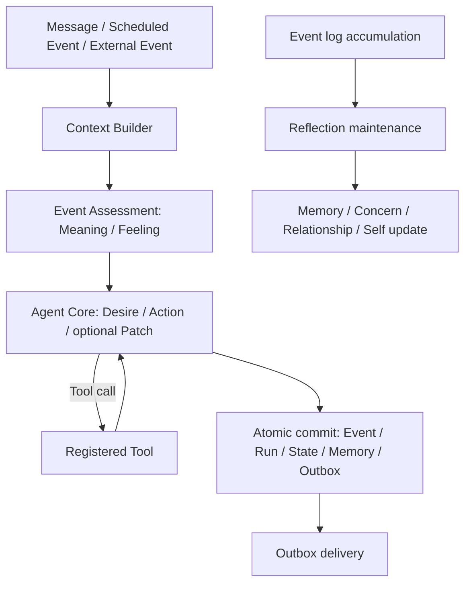

# Architecture

本書は現在の実装を説明する二次資料である。再設計方針は[`note/agent-architecture-redesign-policy.md`](../note/agent-architecture-redesign-policy.md)、過去資料は[D3](D3/README.md)を参照する。

## 正規Agent Loop

通常Eventは一つのAgent Loopを通る。Event Assessmentは現在Eventの主観的意味とFeelingを決め、Agent Coreはその結果と`currentSelf`、`state`、Memoryから今回の`desire`、最終`action`、任意の`patch`を返す。Tool利用時も同じCore内で継続し、別の認知pipelineへ分岐しない。

## Context

必須入力はObservation、Current Self、Current Agent State、Recent Experiences、関連Memory、利用可能Tool、Runtime制約である。

- Current Self: identity、disposition、selfStory、commitments
- Current Agent State: mood、concerns、relationships
- Concern: description、whyItMatters、status、任意のreconsiderAt
- Memory: episodic / semantic / self-relatedとprovenance

Context Builderは所有Agentを検証し、文字列・件数・推定token budgetを制限する。Recent Experienceと重複する通常優先度のepisodic Memoryは除外する。Memory検索queryにはObservation、Mood、Concern、Relationshipを使う。

## ActionとState Patch

Agent Coreの正規出力は次の三要素である。

- `desire`: 今回実際に望むこと
- `action`: `respond`、`refuse`、または`no-external-action`
- `patch`: mood、Concern 1件、Relationship 1件、次回へ残すMemory意図

通常Interactionの`no-external-action`は、成功したTool実行がある場合に限る。自律Eventは具体的Actionまたは通知可能な応答なしに成功できない。Reflectionは行動選択ではなくmaintenance Eventなので、この制約とは別に実行結果を記録する。

RuntimeがPatchを検証・適用し、Event、Run、State change、即時Memory、Tool execution、Outboxをtransaction境界内で確定する。Agent CoreはDB metadataやversionを生成しない。

## Event-driven autonomy

常時思考loopは持たない。Runtimeは`idle`、`concern-due`、`external-change`、明示的Scheduled TaskをEventへ変換し、通常と同じAgent Loopへ渡す。Concernの`reconsiderAt`はscheduleと同期する。Scheduled Taskはユーザーとの約束を表し、ConcernやMemoryの代替ではない。

## Reflection

Reflectionは蓄積Eventを読み、Memory圧縮、ConcernとRelationshipの整理、必要なSelf更新を一つのmaintenance境界で行う。Self変更にはMemory根拠と明示的理由が必要で、通常Agent Coreから直接変更できない。旧Candidate Detection、Long-term Review、interaction後の複数post-process jobは存在しない。

## 永続化と運用保証

PostgreSQLを正本とし、AgentごとのState・Memory分離、advisory lock、Queue receipt、Outbox、Tool冪等性、TTL、hop、rate limitをRuntime責務として維持する。旧`social_contexts`、Motive、Emotion永続列、Candidate、post-process tableはmigrationで削除済みである。

## 評価

自動testはschemaと運用不変条件を検証する。人格・状態差による行動差はpaired live scenarioで別途検証し、自動test合格だけを振る舞いの実証とは扱わない。
