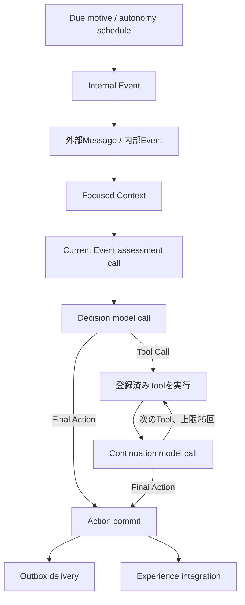

# Architecture

本書は現在の実装を説明する二次資料である。要求の一次資料は[概念設計](../spec/personal-agent-concept-design-restructured-v2.md)と[実装設計](../spec/personal-agent-implementation-design-v2.md)、過去の設計・監査記録は[D3](D3/README.md)を参照する。

## 実行フロー

現在EventのMeaningとEmotionを独立したassessment callで構造化し、その結果をDecisionへ渡す。Decisionは最終Action、または登録済みToolを選ぶ。Tool結果を受けたcontinuationは別のToolか最終Actionを選べ、production上限は25 Tool、既定のmodel call上限はassessmentを含む27回である。同一Tool・同一入力の反復は拒否する。構造化出力の修復も実model call数へ数え、各call直前に入力予算と残余回数を検査する。

## Focused Context

各入力ではSelf、最新Emotion、関連状態を必要量だけ組み立てる。

- Motive: 最大3件
- Social Context: 最大1件
- Episodic Memory: 3〜5件
- Recent Event: 2〜4件
- Self: 判断に必要な要約

`motive-review`では対象Motiveを上限内に必ず残す。active Motiveの根拠はEvent/MemoryだけでなくSelf、Mood、Social Context、Motiveを型付き参照で表す。

system prompt、messages、tool定義、出力schemaを含む総入力を**推定**6,000 token以内に収める。これはprovider tokenizerによるhard limitではなく、文字数から算出する保守的なgateである。assessment、Decision、Tool continuation、repairを含む全model call直前に適用し、超過時は低優先度情報を落とした後、解消できなければlimit errorにする。

## Actionと確定境界

Agentが選べる外部Actionは`respond`、`refuse`、外部送信なしのActionである。`respond`と`refuse`はどちらも利用者向け`content`をOutboxへ保存する。`refuse`は内部説明の`reason`も持つ。

ActionとOutboxは同一transactionで確定する。確定後のexperience integrationに失敗しても、確定済みActionを失敗扱いに戻さない。配送はOutboxの再試行と冪等性で扱う。

## 状態更新

Action確定後、永続的な`experience-integration` jobを1件作る。workerはcontinuity更新とepisodic memory抽出を1回の構造化LLM結果から同一transactionで保存する。失敗jobは再claimでき、process内Promise cacheへ正本を置かない。Eventを候補検出器として使う経路はない。

Emotionは現在状態として、description、発生時刻、根拠Eventとともに永続化する。強いfocusは6時間で期限切れになる。Motiveは`nextConsiderAt`と`considerationReason`を持ち、作成・更新時に再検討scheduleと同期する。

自律的な再検討は共通のautonomy review経路に集約する。期限を迎えたMotiveは`motive-review` Eventになり、他の自律入力と同じDecision loopを通る。ユーザー指定のreminderなど、明示的Scheduled Taskは別の配送契約を保つ。

## 永続化と外部境界

PostgreSQLを状態の正本とし、Drizzle repositoryがtransaction境界を提供する。外部MessageはQueueからRuntimeへ入り、応答はOutbox経由で配送される。LLM、embedding、web tool、clock、ID生成はport越しに利用する。

## 実装・評価status

- **実装済み:** Issue 146〜157のpaired scenario、runtime executor、全call gate、実call計数、対象Motive保持、失敗Tool後のAction制約、Event assessment、型付き根拠、永続integration job、最大25 Tool loop。
- **実行可能:** unit、system、evaluation、PostgreSQL integrationの各suiteと、実Ollamaを使う`pnpm eval:llm`。
- **実測済み:** 6 pair × 2 variant × 3回の36試行。artifactは[`summary.json`](../artifacts/evaluation/2026-10-11T10-01-53-495Z-870dfd7a-21c3-485b-a994-edfe20718c63/summary.json)に保存した。
- **未実証:** 上記live gateは全6 pairで不合格だった。主因はAgent Coreのwiring失敗19件とtimeout 16件で、状態差による自律性改善を示していない。実装完了を人格らしさや行動改善の証明として扱わない。
