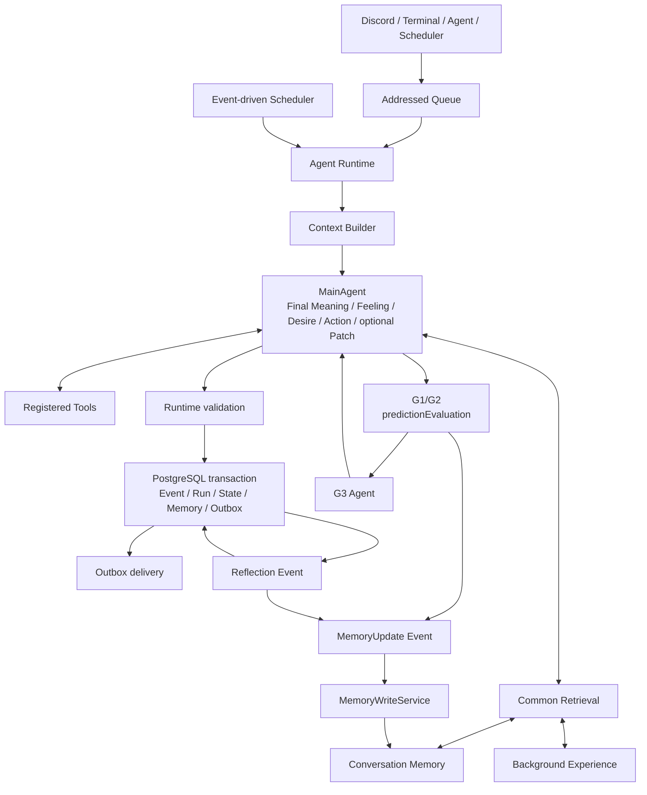

# Architecture

本書は現在の実装および追加設計を説明する二次資料である。概念と要求の一次資料は[`spec/`](../spec/)、動機・感情・行動モデルは[`AGENT_MOTIVATION_MODEL.md`](AGENT_MOTIVATION_MODEL.md)を正とする。本書と実装が異なる場合は、出荷時点の挙動をコードとテストで確認し、文書の差分を解消する。過去文書の `old_docs/` は本書の対象外である。

## 設計判断の背景

現行実装はSubjective Meaning、Emotion、Motive、Mood、Memory、Candidate、Long-term Reviewを厳密に扱うため、Event Assessment、Decision / Tool Loop、Experience Integration、Candidate Detection、Long-term Reviewの多段処理になりやすい。この構造は監査性を高める一方で、次の問題を招く。

- Event Assessmentの結果を行動決定へ渡す配線が複雑で、失敗時に因果関係を保ちにくい。
- Schema整合性とEvidence ID管理が推論能力を消費する。
- 一度の経験を保存するための非同期jobと失敗点が多い。
- 認知責務が別moduleとして増殖する。
- 実装の複雑さに対して、人格らしさと自律性の改善が実証されていない。

そのため、旧構造を段階的に温存せず、通常のAgent Loopに少数の持続状態を追加する構造へ再設計した。

## 設計原則

- 通常のAgent Loopに、一個体性と個体化を生む少数の持続状態を追加する。
- 認知概念ごとにmodule、LLM call、job、tableを増やさない。
- 意味と感情の評価と、DesireとActionの決定を分離する。
- 持続状態は少数の自然言語状態に限定し、重複する項目は統合する。
- 感情を語尾ではなくAction選択へ影響させる。
- Runtimeは意味を決めず、権限、所有権、期限、Tool上限、配送、冪等性、Schema検証を保証する。
- 旧構造との互換性を設計目標にしない。

## Architecture Decisions

| ID | 決定 | 由来 |
|---|---|---|
| ADR-1 | すべてのEventを単一のAgentRuntimeへ入力し、UIは送受信だけを担う。 | FR-1, FR-2, NFR-1 |
| ADR-2 | EventはAgent Core内でAssessmentとActionを確定し、Candidate DetectionとLong-term Reviewを外す。 | FR-2, FR-3, FR-5 |
| ADR-3 | Context Builderは判断に必要な状態だけを選び、Agent所有権とtoken budgetを境界で保証する。 | NFR-1, NFR-3, NFR-4, FR-29, FR-30 |
| ADR-4 | Deep AgentsのresponseFormatとtoolStrategyで構造化出力を取得し、Runtimeで厳密に再検証してrepairする。 | FR-11, FR-12, FR-13, FR-14, FR-15, FR-16 |
| ADR-5 | 最終Actionをrespond、refuse、notify-no-execution、no-external-actionに限定し、Patch対象を限定する。 | FR-17, FR-18, FR-19, FR-20, FR-21, FR-22, FR-23 |
| ADR-6 | ToolはDeep Agent内のloopで実行し、登録、権限、回数、冪等性、結果投影をRuntimeが管理する。 | FR-4, FR-32, FR-33, FR-35, FR-36, FR-37, FR-38 |
| ADR-7 | 自律EventはRuntimeが生成し、Reflectionを通常Action選択から分離したmaintenance処理とする。 | FR-24, FR-39, FR-40, FR-41, FR-42, NFR-6 |
| ADR-8 | PostgreSQLを正本とし、Event、State、Conversation Memory、Prediction、MemoryMutation、Outboxをtransactionとadvisory lockで確定する。 | NFR-7, NFR-8, NFR-9, NFR-10, NFR-11 |
| ADR-9 | Debug UIは読取り専用とし、secretは実行時だけ読み込む。 | NFR-12, NFR-13 |
| ADR-10 | 概念語彙をSelf、State、Conversation Memory、Background Experience、Prediction、Reflectionの境界へ簡略化し、予測LoopとMemoryUpdateに必要な最小のtableとmoduleだけを追加する。それ以外の個別tableや認知moduleを増やさない。 | FR-5, FR-6, FR-7, NFR-11 |
| ADR-11 | モジュールはAgent Loop、Prediction、MemoryUpdate、Retrieval、Autonomy、Reflection、Model、Persistence、Tools、Eventsの境界に留める。 | FR-1, FR-2, NFR-10 |
| ADR-12 | 予測LoopをMainAgentの外側に置き、G1/G2は応答後に1回のLLM callで次ターンのユーザー発話を予測する。predictionEvaluationはMeaning / Feelingではなく、FeelingはMainAgentだけが確定する。 | FR-48, FR-49, FR-50, NFR-16 |
| ADR-13 | G3はMainAgentとは別のDeepAgentとして遅延実行し、仮説評価とMemoryIntentをMainAgentへ渡す。`prediction-g3-result` Eventは通知必須の例外とし、`prediction-g3`はActionを生成しない。 | FR-51, FR-52 |
| ADR-14 | Conversation MemoryとBackground Experienceを別Storeに保持し、単一RetrievalServiceでvector、keyword、subject、recencyを共通順位付けにして検索する。 | FR-53, FR-54, FR-55, NFR-19 |
| ADR-15 | MemoryIntentのtargetはMemory kindに限定し、MemoryWriteServiceを唯一の書込み経路としてversion楽観ロックを行う。G1/G2/ReflectionのMemoryIntentはmemory-update Eventで適用し、G3のMemoryIntentはMainAgentのrememberとして適用する。 | FR-56, FR-57, FR-58, NFR-15 |
| ADR-16 | Event優先順位はuser-message、memory-update、G3、reflectionの順とし、協調的スケジューリングでuser-messageを待たせない。 | FR-59, NFR-18 |
| ADR-17 | ReflectionはMemory、Self、Relationship、Concernごとのstatusを持つplanで適用し、部分成功と失敗対象の再試行を許容する。 | FR-60, NFR-17 |
| ADR-18 | 予測Loopは旧continuity / memory分割後処理ではない。G1/G2の追加callはNFRの例外とし、deadlineとcall予算を持つ。 | FR-63, FR-64, NFR-16 |
| ADR-19 | 予測、G3 Task、Memory mutationは監査・集計のため専用tableに保存し、Conversation MemoryとBackground Experienceは別Storeにする。既存Run/Event/StateChangeは意味判断と行動の監査に限定する。 | FR-50, FR-57, FR-60, FR-61, NFR-17 |

ADR-12〜ADR-19は追加設計であり、現行コードには未実装である。実装Issueでコード、migration、testを追加する。

## 実行境界



本書では、会話由来MemoryをConversation Memory、生成済みの背景経験をBackground Experience、`memory-update` EventをMemoryUpdate Event、G1/G2の評価をpredictionEvaluation、Reflectionの計画をreflection planと呼ぶ。単にMemoryと書く場合はConversation Memoryを指す。

UI層はEventの送受信だけを担い、認知・状態更新・永続化を持たない。Discord、Terminal、Agent間Message、自律Eventはいずれも同じ`AgentRuntime`へ入る。配送はcommit後にOutboxから行うため、外部UIの障害とAgentの判断確定を分離できる。G1/G2、memory-update、G3、Reflectionは通常応答の外側のinternal Eventとして扱い、Memory書込みはMemoryWriteServiceに集約する。

## 正規Agent Loop

1. Runtimeが受信EnvelopeをEventへ正規化し、重複受信、TTL、hop、rate limit、Agent単位lockを検査する。
2. Context BuilderがCurrent Self、Current State、Recent Experience、関連するConversation Memory、Background Experience、`previousDesire`、`predictionContext`、利用可能Tool、実行制約を読み込む。middlewareはEvent種別に応じて公開Toolを制限し、user-messageではself_getを公開し、concern_list、concern_get、concern_proposeを公開しない。
3. MainAgentがContextからFinal Meaning、Feeling、`desire`、最終`action`、任意の`patch`、任意の`remember`（MemoryIntent）を一つの構造化出力で決める。Toolを使う場合も同じDeep Agent内でTool resultを受けて続行する。
4. RuntimeがMeaningとFeelingをAssessmentへ分離し、出力、参照、ActionとTool実績の整合性、Patchの更新範囲、rememberのevidenceとtargetを検証する。
5. Event、Run、Tool execution、State change、MainAgentのremember、Receipt、Outboxを一つのtransactionで確定する。rememberはMemoryWriteServiceを通す。
6. Outbox dispatcherがUIへ配送し、失敗時は未送信recordを保持して再試行する。
7. 応答commit後、G1/G2が追加の1 callで次ターンのユーザー発話を予測し、前回予測との誤差を`predictionEvaluation`として評価する。予測は1ターン遅れでMainAgentへ渡る。
8. G1/G2/ReflectionのMemoryIntentはmemory-update EventとしてMemoryUpdateHandlerが適用する。G3のMemoryIntentはMainAgentの再判断で採用された場合、MainAgentのrememberとしてそのEventのtransactionで適用する。memory-updateはLLMを呼ばず、MemoryWriteServiceがcreate / update / no-opを決める。
9. G3が必要な場合は別DeepAgentとして遅延実行する。G3結果はMainAgentの再判断Eventへ渡し、MainAgentが追加発話、MemoryIntent、no-external-actionを決める。

旧Candidate Detection、Long-term Review、Interaction後の複数post-process認知pipelineは正規経路に置かない。長期整理はReflectionという独立したmaintenance境界で扱う。G1/G2の予測Loopは旧continuity / memory分割後処理ではなく、予測誤差をMainAgentのappraisalへ渡す独立したLoopである。

## Contextと状態

ContextへAgentState全体を無制限に渡さず、現在の判断に必要な情報を選ぶ。

- Current Self: `identity`、`disposition`、`selfStory`、`commitments`
- Current State: 任意の`mood`、`concerns`、`relationships`
- Concern: 内容、重要な理由、状態、任意の再検討時刻
- Previous Desire: 直前の成功runのDesireと発生時刻。現在のEventにふさわしい場合だけ現在の意図として使う
- Conversation Memory: episodic / semantic / self-related / self-change / common-ground、重要度、subject、EventまたはConversation Memoryの根拠、version
- Background Experience: 起動前に生成する自伝的経験。Conversation Memoryと別Storeに保持し、起動前に初期化してプロセス起動中は更新しない
- Prediction Context: 前回予測、predictionEvaluation、G3の要約とmemoryIntents、RecentExperienceのeffect、memoryCandidates
- Recent Experience: 直近Eventの再判断に必要なObservation要点、Action、Tool実績、進展有無、Actionのeffect。Event IDと時刻は外側に一度だけ保持し、監査用provenanceや元入力本文は含めない

所有Agentをすべての境界で検証する。文字列長、件数、Context tokenを制限し、Recent Experienceと重複する通常優先度のepisodic Memoryは除外する。Conversation MemoryとBackground Experienceは単一RetrievalServiceで検索し、Prediction ContextとBackground Experienceも4,500推定tokenのContext上限の対象にする。system promptとTool schemaを含む8,000推定tokenは観測用警告閾値であり、provider呼び出しは中断しない。

Feelingは現在Eventへの短期反応であり、それ自体は永続状態にしない。予測誤差はFeelingではなく、MainAgentがappraisalしてMeaning / Feelingを確定する。次のEventにも影響する変化だけをMood、Concern、Relationship、MemoryIntentとしてPatchする。Selfは通常Interactionから直接変更できず、ReflectionだけがConversation Memory根拠と理由を伴って更新できる。

Concernのライフサイクルは新しい数値counterを増やさず、`active / satisfied / abandoned`、任意の`reconsiderAt`、Recent Experienceの`progressChanged`で扱う。進展のない同一試行を繰り返すConcernは、問い・対象・方法を変えるか、満足・放棄・削除で閉じる。一律の経過時間だけでは終了させない。

## Deep Agentと構造化出力

本番Agent Coreは`createDeepAgent`へ登録Tool群、system prompt、context schema、middlewareを一度設定し、`toolStrategy(...)`を`responseFormat`として渡す。通常Toolの呼び出しと最終構造化出力ToolはDeep Agentsの標準loopに任せる。system promptは共通規則とEvent skillのルーティングだけを持ち、`skills/`の`SKILL.md`をEvent種別に応じてRegistry Tool `skill_read`で読む。`createDeepAgent`には`skills`と`FilesystemBackend`を渡し、Toolの公開範囲はmiddlewareで強制する。`skill_read`はcontent-read policyで結果と上限を管理し、Deep Agents組み込みの`read_file`は公開しない。

モデル向け最終出力は、nested unionを直接生成させず、説明付きのflat schemaを使う。必須なのは`desire`と`actionType`で、ActionやPatchに必要なfieldだけを追加する。providerへ渡すJSON Schemaから`$schema`と文字列の正規表現制約を除き、日時や参照整合性を含む厳密なZod Domain schemaはRuntime側で再検証する。これによりモデル負荷を抑えてもDomain保証は緩めない。

初回出力が不正な場合、validation issue、許可されたevidence ID、不正出力、flat schemaを含むrepair入力で再試行する。repair中は通常Toolを無効にする。全試行後も不正ならcommitせずfailureだけを記録する。ただしuser-messageで既知の`action: string`誤出力だけは、空でない応答または定型の再試行依頼へ限定的に復旧する。自律Eventやその他の不正出力にはこのfallbackを使わない。

## 予測Loop、G3、MemoryUpdate

G1/G2は応答commit後に追加の1回のLLM callで実行する。Context BuilderがConversation MemoryとBackground ExperienceからmemoryCandidatesを取得し、G1/G2は予測候補、predictionEvaluation、観測候補、remember（MemoryIntent）、G3起動判断を返す。G1/G2はFeelingを返さず、予測誤差は1ターン遅れでMainAgentのappraisal入力として渡す。predictionEvaluationはMainAgentのMeaning / Feelingを置き換えない。

G3はMainAgentとは別の`createDeepAgent`で構成する。G3は`retrieval_search`、`self_get`、`concern_list`、`concern_get`を使い、前回仮説の支持・反証・判断不能、新しい仮説、調査結果、remember（MemoryIntent）を返す。G3はConversation Memoryを直接書き換えず、結果を`prediction-g3-result` EventでMainAgentへ渡す。`prediction-g3-result` Eventは通知必須の例外とし、`no-external-action`を正常系として許容する。`prediction-g3`はActionを生成しない。

G1/G2/ReflectionのMemoryIntentは`memory-update` Eventで適用する。G3のMemoryIntentはMainAgentの再判断で採用された場合、MainAgentのrememberとしてそのEventのtransactionで適用する。MemoryUpdateHandlerはLLMを呼ばず、MemoryWriteServiceがmemoryCandidatesとMemoryIntentからcreate / update / no-opを決める。MainAgentのrememberは、そのEventのtransactionでMemoryWriteServiceが適用する。

Event優先順位はuser-message、memory-update、G3、reflectionの順とする。user-messageが待っている間は下位Eventを開始せず、実行中でも強制中断せず短いtransaction単位で完了させる。Reflectionはbatchに分割し、次のbatchを開始しない。

## ActionとPatch

Domain上の最終Actionは次の4種類である。

- `respond`: contentを相手へ配送する。
- `refuse`: contentを配送し、内部にreasonと`personality | system`のbasisを残す。
- `notify-no-execution`: 自律Eventで実行しない判断と理由をownerへ配送する。
- `no-external-action`: Agentが今回は外部発話を行わないと判断した内部終端である。Tool利用の有無とは独立して選ぶ。

Tool利用とユーザーへの発話判断は独立する。Toolの前後を問わず共有価値があれば`respond`でき、Toolを使わなくても発話できる。反対に、Agentは具体的理由があれば`no-external-action`を選べる。ただし、ユーザーからの返信待ちは発話を控える理由にしない。夜間であることは強制制御ではなく、緊急性と合わせてAgentが発話を控える判断材料にできる。

Patchは任意のmood、Relationship 1件、`remember`（MemoryIntent）に限定する。Concernは`concern_propose` Toolで提案し、成功したcommit時だけ反映する。Runtimeがupsert/remove、Agent所有権、evidence、versionを検証し、DB metadataやIDは通常コードが付与する。MainAgentの`remember`はそのEventのtransactionでMemoryWriteServiceが適用し、G1/G2/ReflectionのMemoryIntentはmemory-update Eventで適用する。

G3結果のMainAgent再判断は通常のAgent Loopに通す。`prediction-g3-result` Eventは通知必須の例外とし、`no-external-action`を正常系として許容する。`prediction-g3`と`memory-update` EventはActionを生成しない。

## Tool実行

起動時に実装済みToolをRegistryからDeep Agentへ複数登録する。各Toolは短い用途説明と説明付き入力schemaを持ち、Runtime contextからagent / run / event、権限、deadlineを受け取る。Agent Core promptへはTool名と要約だけを重複掲載し、完全なschemaはTool binding側だけに置く。

G3とMainAgentのConversation Memory・Background Experienceの検索は`retrieval_search`に集約する。`retrieval_search`はscope（conversation / background / all）、kinds、subjectIds、query、期間、limitを持ち、単一RetrievalServiceのvector、keyword、subject、recencyで検索する。既存の`memory_search`、`user_context_get`、`relationship_search`は同じRetrievalServiceの薄いadapterとし、独自の順位付けSQLを残さない。G3は`retrieval_search`、`self_get`、`concern_list`、`concern_get`を使う。

通常コードは登録有無、入力schema、権限、冪等性、最大25回のTool call、Runごとの設定上限、同一Tool・同一入力の反復、結果サイズを検証する。モデルが未登録Tool名を生成した場合はprovider障害としてrunを中断せず、失敗Tool Messageを同じloopへ返して別Toolまたは最終Actionへ回復させる。Tool実績は成功・失敗を含めてRunへ関連付けるが、Tool成否から発話可否を決定しない。

完全なTool入出力は監査記録に保存するが、Recent Experienceへは再判断に必要な識別子、URL、path、query、件数、状態などのsignalだけを投影する。本文fieldは文字数、短いpreview、hashへ変換し、巨大な本文を次のmodel入力へ戻さない。Tool固有projectorがある場合はそれを優先する。同一Tool入力の反復判定にも同じ投影を使うため、本文をContextへ戻さず反復を検出できる。

## Event-driven autonomyとReflection

常時思考loopは持たない。Schedulerは`idle`、`concern-due`、`external-change`、`reflection`および明示的Scheduled TaskをEventとして発火し、lease付きでclaimする。`memory-update`はG1/G2/Reflectionと、G3のMemoryIntentを採否したMainAgent、`prediction-g3`はG1/G2、`prediction-g3-result`はG3完了後のRuntimeが発生させるinternal Eventであり、Schedulerの自律Eventとは分ける。Scheduled TaskのTool descriptionはToolの用途、入力schemaは各fieldへ保存する内容、scheduled-task skillは期限到来後の共通実行規則をそれぞれ記述し、実行規則を`instruction`へ複製しない。`idle`の次回時刻はActionに依存せず、`no-external-action`や`notify-no-execution`の後も`autonomyReviewIntervalMs`で再開する。`idle`などの自律Eventは通常Agent Loopへ入り、Concernの`reconsiderAt`はscheduleと同期する。Schedulerは`idle` Eventごとに`config/exploration-domains.yaml`からランダムな最大8件を候補として渡すが、探索方法は指定しない。Agent Coreは`concern_list`で状態を取得し、Focus ConcernまたはConcern不在を判断したうえで、`concern_propose`の`explorationMode`として`deepen`、`bridge`、`distant`を必要に応じて選ぶ。永続的な探索modeとcursorは持たない。モードの成功・失敗による巡回状態も保存しない。

Event優先順位はuser-message、memory-update、G3、reflectionの順とする。user-messageが待っている間は下位Eventを開始せず、実行中でも強制中断せず短いtransaction単位で完了させる。`memory-update`は専用MemoryUpdateHandlerが処理し、LLMを呼ばない。G3は別DeepAgent、Reflectionは専用LLM処理であり、MainAgentのAgentHarnessを通らない。

Reflectionは蓄積EventをConversation Memoryへ圧縮し、Concern、Relationship、Selfを整理するmaintenance処理である。既存Concernの整理・統合・具体化・終了に加え、Conversation Memory根拠と`whyItMatters`を伴う新しいConcernを1回1〜3件まで作成できる。Conversation Memoryは会話やTool結果の保存場所ではなく、後の検索と判断で再利用する具体的な要点を1〜2文で生成する。通常Action選択とは分離し、Self変更にはConversation Memory根拠と明示的理由を要求する。ReflectionもDeep Agentsの`toolStrategy`による説明付き構造化出力を使い、モデル向けの単純な変更recordを厳密なDomain outputへ変換する。入力はEvent / Conversation Memory各32件と8,000推定token、1回の出力はConversation Memory / Concern / Relationship各4件までに制限する。連続失敗時のscheduleは5分を起点に指数backoffし、最大24時間まで延長する。

ReflectionはConversation Memory、Self、Relationship、Concernごとのpending / completed / failed / blockedを持つreflection planで適用する。Conversation Memory更新はmemory-update Eventで先に行い、その結果を根拠にSelf、Relationship、Concernを更新する。失敗またはblockedの対象だけを次回Reflectionで再試行し、部分成功を許容する。

Agent Coreの8,000推定tokenはproviderのcontext上限ではなく観測用の警告閾値とする。超過時も呼び出しを継続し、実際の受付可否はproviderへ委ねる。ToolのJSON SchemaはDeep AgentのTool定義だけに保持し、Agent Coreのuser messageへTool名・説明・Schemaを重複して埋め込まない。

## Domain Modelと変更権限

Selfは`identity`、`disposition`、`selfStory`、`commitments`を持つ。Stateは任意の`mood`、`concerns`、`relationships`を持つ。Conversation Memoryは単一Storeで、`kind`、`content`、`importance`、`occurredAt`、`createdAt`、`subject`、`evidenceEventIds`、`version`などを保持し、`kind`には`common-ground`を含む。Background ExperienceはConversation Memoryとは別Storeで、起動前に生成した経験を保持し、起動前に初期化してプロセス起動中は更新しない。詳細な項目はREQUIREMENTSのFR-6、FR-7、FR-8、FR-10、FR-53、FR-54に従う。

変更権限は次の通り。

| 対象 | 通常Interaction | Reflection | Runtime |
|---|---|---|---|
| Self | 直接変更しない | Conversation Memory根拠と理由を伴って変更する | 初期化、version、所有権を検証する |
| Mood | Patchで提案する | 変更してよい | 所有権とversionを検証してcommitする |
| Relationship | Patchで1件提案する | 整理・変更してよい | 所有権とversionを検証してcommitする |
| Concern | `concern_propose`で提案する | 継続・満足・放棄・整理し、Conversation Memory根拠付きで新規作成する（1回1〜3件） | 成功commit時だけ作成・派生し、新規IDを付与する |
| Prediction | G1/G2/G3が生成する | 変更しない | Event / Runへ保存し、predictionEvaluationをMainAgentへ渡す |
| Conversation Memory | `remember`またはMemoryIntentで提案する | 圧縮・統合し、MemoryIntentを生成する | MemoryWriteServiceがcreate / update / no-op、ID、時刻、根拠、所有権、versionを付与する |
| Background Experience | 変更しない | 変更しない | 初期化時にYAMLから置換し、会話で更新しない |
| Scheduled Task | Toolで登録・参照・取消する | 変更しない | 期限到来時にSystem Eventを生成する |
| Scheduler | 状態を変更しない | 状態を変更しない | Event生成、claim、lease、retryを行う |

## 自律EventとAction不変条件

- 自律性は常時思考loopではなく、`idle`、`concern-due`、`external-change`、`scheduled-task`などのEvent sourceで起動する。
- `reflection`は通常のAction生成ではなく、専用のmaintenance処理へ送る。
- `memory-update`は決定済みのMemoryIntentを適用するEventであり、Actionを生成しない。
- G3結果のMainAgent再判断は通常Loopに通し、`prediction-g3-result` Eventは通知必須の例外とする。`prediction-g3`はActionを生成しない。
- 最終Actionは`respond`、`refuse`、`notify-no-execution`、`no-external-action`の4種である。
- 自律Eventの成功runは、具体的なTool、送信、記録、予約、または`notify-no-execution`を持つ。
- 何も実行しない判断は`notify-no-execution`としてユーザーへ配送する。
- `no-external-action`は外部発話なしの判断として監査に残す。外部へ観測可能な結果が必要な自律Eventでは`notify-no-execution`を使う。
- 通知先を解決できない自律Eventは成功扱いにせず、再試行・運用通知の対象にする。
- 同じEvent sourceでも、Self、State、Conversation Memory、Relationshipが異なれば異なるActionを選べる。
- Event優先順位はuser-message、memory-update、G3、reflectionの順とする。user-messageを待たせない。

## Module境界

物理構成は論理責務以上に細分化しない。

```text
domain/
  agent.ts          Self / State / Concern / Conversation Memory / MemoryIntent / Background Experience / Action

application/
  agent-loop.ts     Event -> Context -> MainAgent -> Commit
  prediction.ts     G1/G2 predictionEvaluation と Prediction Context
  memory-update.ts  MemoryUpdateHandler と MemoryWriteService
  retrieval.ts      Conversation Memory / Background Experience の共通Retrieval
  autonomy.ts       Event sourceと自律Action契約
  reflection.ts     経験の圧縮と長期更新

infrastructure/
  model/            MainAgent / G3 / ReflectionのLLM adapter
  persistence/      State、Log、Outbox、Prediction、MemoryMutation、Background Experience
  tools/            Tool adapterとRetrieval adapter
  events/           Message、Schedule、External Event、Prediction、MemoryUpdate
```

Context Builderは独立した認知moduleにせず、`agent-loop`が利用する取得・選択処理として扱う。Portは交換可能性または明確な外部境界がある箇所にだけ置く。G3はMainAgentとは別のDeepAgent、Reflectionは専用LLM処理であり、同じAgentHarnessを共有しない。

## 実装順序

互換性を優先しないため、新旧経路を長期間併存させない。実装時は次の順序を基本とする。

1. 新しいDomain契約とAction不変条件を確定する。
2. 新しいSelf / State / Concern / Conversation Memory schemaを設計する。
3. Background Experience Storeと共通Retrievalを実装する。
4. MainAgentの入出力とTool continuationを実装する。
5. EventからCommit、OutboxまでのAgent Loopを実装する。
6. G1/G2の予測LoopとPrediction Contextを実装する。
7. MemoryIntent、MemoryWriteService、memory-update Eventを実装する。
8. G3 DeepAgentとprediction-g3-resultを実装する。
9. Event駆動の自律sourceとAction / 通知契約を実装する。
10. Reflectionをplan / 対象別statusへ拡張する。
11. 新しいbehavior scenarioを通す。
12. 旧直接INSERT、旧Retrieval ranking、旧後処理、旧schedule、旧schema、旧table、旧testを削除する。
13. 必要な一度限りのDB migrationを実施する。
14. 複数Agent、再起動、配送障害、長期運用を検証する。

大規模変更中も、同一のproduction DBで新旧writerを同時に動かさない。切替単位を明確にし、旧workerや旧schedulerが新状態へ書き込まないようにする。

## 永続化と運用保証

PostgreSQLを正本とする。Agentごとの状態・Conversation Memory・Background Experience分離、advisory lock、optimistic state version、Queue receipt、Outbox、Tool冪等性、correlation、TTL、hop、rate limitを通常コードが保証する。Conversation Memoryの書込みはMemoryWriteServiceに集約し、Memory versionの楽観ロックとAgent単位の直列処理を行う。predictionEvaluation、Prediction Context、MemoryIntent、memory-update Event、memory mutation、Reflectionの対象別statusを監査可能にする。MainAgentは権限やsystem constraintを上書きできない。

Debug UIは状態、Event、Run、Tool実績、Conversation Memory、Prediction Evaluation、MemoryIntent、memory-update Event、Background Experience、Outbox等を観測する運用UIであり、別の認知経路や状態更新規則を持たない。

## 未実装・非目標

一次仕様が示す概念語彙すべてを個別tableや個別認知moduleとして実装することは目標にしない。Acquired Disposition、Self Narrative、長期的な関係等は、現在のSelf / State / Conversation Memory / Reflectionの小さい境界で表現する。人格らしさを固定reward、数値心理モデル、巨大な状態遷移へ置き換えない。

削除・統合した旧構造は次の通り。

- 旧Motive、activeMotive、Intention、Social Contextの独立状態
- Candidate DetectionとLong-term Reviewの二段階pipeline
- Interactionごとのcontinuity / memory分割後処理
- Conversation Memory種別ごとの保存経路
- 認知処理として分かれたstate-review、memory-recall、autonomy-review

G1/G2の予測Loopは、削除したInteractionごとのcontinuity / memory分割後処理ではない。予測誤差をMainAgentのappraisalへ渡す独立したLoopであり、Memory書込みはMemoryWriteServiceに限定する。

次は非目標とする。

- 人間の心理構造を完全に再現すること。
- 感情を数値モデルとして厳密にシミュレーションすること。
- 怒りや悲しみを毎回外部へ明言させること。
- 自律Eventを大量に発生させ、行動量を主体性の代わりにすること。
- すべての経験をConversation MemoryまたはSelf変更として保存すること。
- 予測精度の最大化を目的にすること。
- 予測誤差による迎合を強制すること。
- Background Experienceを現在のユーザーとの共有経験として扱うこと。
- MemoryWriteService以外からConversation Memoryへ書き込むこと。
- 予測ID、意味タグ、predictionKeyで予測とMemoryを対応づけること。
- 旧API、旧DB schema、旧testとの恒久的な互換性を維持すること。
