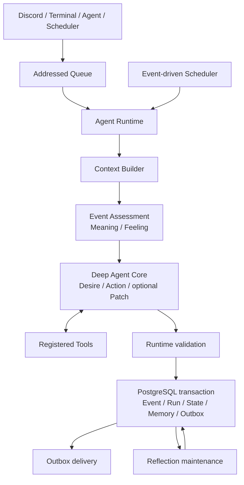

# Architecture

本書は現在の実装を説明する二次資料である。概念と要求の一次資料は[`spec/`](../spec/)、簡略化の判断は[`note/agent-architecture-redesign-policy.md`](../note/agent-architecture-redesign-policy.md)を正とする。本書と実装が異なる場合は、出荷時点の挙動をコードとテストで確認し、文書の差分を解消する。`docs/D3/`は本書の対象外である。

## 実行境界

UI層はEventの送受信だけを担い、認知・状態更新・永続化を持たない。Discord、Terminal、Agent間Message、自律Eventはいずれも同じ`AgentRuntime`へ入る。配送はcommit後にOutboxから行うため、外部UIの障害とAgentの判断確定を分離できる。

## 正規Agent Loop

1. Runtimeが受信EnvelopeをEventへ正規化し、重複受信、TTL、hop、rate limit、Agent単位lockを検査する。
2. Context BuilderがCurrent Self、Current State、Recent Experience、関連Memory、利用可能Tool、実行制約を読み込む。
3. Event Assessmentが現在Eventの`meaning`と`feeling`を先に構造化出力する。ここではActionや通常Toolを選ばない。
4. Agent CoreがAssessmentを含むContextから`desire`、最終`action`、任意の`patch`を決める。Toolを使う場合も同じDeep Agent内でTool resultを受けて続行する。
5. Runtimeが出力、参照、ActionとTool実績の整合性、Patchの更新範囲を検証する。
6. Event、Run、Tool execution、State change、即時Memory、Receipt、Outboxを一つのtransactionで確定する。
7. Outbox dispatcherがUIへ配送し、失敗時は未送信recordを保持して再試行する。

旧Candidate Detection、Long-term Review、Interaction後の複数post-process認知pipelineは正規経路に置かない。長期整理はReflectionという独立したmaintenance境界で扱う。

## Contextと状態

ContextへAgentState全体を無制限に渡さず、現在の判断に必要な情報を選ぶ。

- Current Self: `identity`、`disposition`、`selfStory`、`commitments`
- Current State: 任意の`mood`、`concerns`、`relationships`
- Concern: 内容、重要な理由、状態、任意の再検討時刻
- Memory: episodic / semantic / self-related、重要度、subject、EventまたはMemoryの根拠
- Recent Experience: 直近RunのAssessment、Desire、Action、Tool実績

所有Agentをすべての境界で検証する。文字列長、件数、Context tokenを制限し、Recent Experienceと重複する通常優先度のepisodic Memoryは除外する。現在のContext上限は4,500推定token、system promptとTool schemaを含むmodel入力上限は8,000推定tokenである。

Feelingは現在Eventへの短期反応であり、それ自体は永続状態にしない。次のEventにも影響する変化だけをMood、Concern、Relationship、MemoryとしてPatchする。Selfは通常Interactionから直接変更できず、ReflectionだけがMemory根拠と理由を伴って更新できる。

Concernのライフサイクルは新しい数値counterを増やさず、`active / satisfied / abandoned`、任意の`reconsiderAt`、Recent Experienceの`progressChanged`で扱う。進展のない同一試行を繰り返すConcernは、問い・対象・方法を変えるか、満足・放棄・削除で閉じる。一律の経過時間だけでは終了させない。

## Deep Agentと構造化出力

本番Agent Coreは`createDeepAgent`へ登録Tool群、system prompt、context schema、middlewareを一度設定し、`toolStrategy(...)`を`responseFormat`として渡す。通常Toolの呼び出しと最終構造化出力ToolはDeep Agentsの標準loopに任せる。

モデル向け最終出力は、nested unionを直接生成させず、説明付きのflat schemaを使う。必須なのは`desire`と`actionType`で、ActionやPatchに必要なfieldだけを追加する。providerへ渡すJSON Schemaから`$schema`と文字列の正規表現制約を除き、日時や参照整合性を含む厳密なZod Domain schemaはRuntime側で再検証する。これによりモデル負荷を抑えてもDomain保証は緩めない。

初回出力が不正な場合、validation issue、許可されたevidence ID、不正出力、flat schemaを含むrepair入力で再試行する。repair中は通常Toolを無効にする。全試行後も不正ならcommitせずfailureだけを記録する。ただしuser-messageで既知の`action: string`誤出力だけは、空でない応答または定型の再試行依頼へ限定的に復旧する。自律Eventやその他の不正出力にはこのfallbackを使わない。

## ActionとPatch

Domain上の最終Actionは次の4種類である。

- `respond`: contentを相手へ配送する。
- `refuse`: contentを配送し、内部にreasonと`personality | system`のbasisを残す。
- `notify-no-execution`: 自律Eventで実行しない判断と理由をownerへ配送する。
- `no-external-action`: 成功したToolが具体的な外部Actionを完了し、追加配送が不要な場合だけ使う内部終端である。

通常Interactionは成功Toolなしの`no-external-action`で成功できない。自律Eventも、具体的なTool実行または配送可能なActionなしに成功できない。

Patchは任意のmood、Concern 1件、Relationship 1件、即時Memory意図に限定する。Runtimeがupsert/remove、Agent所有権、evidence、versionを検証し、DB metadataやIDは通常コードが付与する。

## Tool実行

起動時に実装済みToolをRegistryからDeep Agentへ複数登録する。各Toolは短い用途説明と説明付き入力schemaを持ち、Runtime contextからagent / run / event、権限、deadlineを受け取る。Agent Core promptへはTool名と要約だけを重複掲載し、完全なschemaはTool binding側だけに置く。

通常コードは登録有無、入力schema、権限、冪等性、最大25回のTool call、Runごとの設定上限、同一Tool・同一入力の反復、結果サイズを検証する。Tool実績は成功・失敗を含めてRunへ関連付ける。失敗Toolだけでは`no-external-action`の根拠にならない。

## Event-driven autonomyとReflection

常時思考loopは持たない。Schedulerは`idle`、`concern-due`、`reflection`および明示的Scheduled TaskをEventとして発火し、lease付きでclaimする。`idle`などの自律Eventは通常Agent Loopへ入り、Concernの`reconsiderAt`はscheduleと同期する。`idle`はEvent種類を増やさず、永続化した`explorationMode`を`deepen`、`bridge`、`distant`の順に成功時だけ巡回させる。`deepen`は現在の具体的対象を深掘りし、`bridge`は惹かれる性質を介して別領域の具体へ移る。`distant`では`config/exploration-domains.yaml`の100〜200件のカタログから、永続cursorで最大8件をEventへ渡し、Agent CoreがMemoryの薄い領域を一つ選んで具体化する。失敗時はmodeとcursorを進めない。

Reflectionは蓄積EventをMemoryへ圧縮し、Concern、Relationship、Selfを整理するmaintenance処理である。通常Action選択とは分離し、Self変更にはMemory根拠と明示的理由を要求する。ReflectionもDeep Agentsの`toolStrategy`による説明付き構造化出力を使い、モデル向けの単純な変更recordを厳密なDomain outputへ変換する。入力はEvent / Memory各32件と8,000推定token、1回の出力はMemory / Concern / Relationship各4件までに制限する。連続失敗時のscheduleは5分を起点に指数backoffし、最大24時間まで延長する。

## 永続化と運用保証

PostgreSQLを正本とする。Agentごとの状態・Memory分離、advisory lock、optimistic state version、Queue receipt、Outbox、Tool冪等性、correlation、TTL、hop、rate limitを通常コードが保証する。Agent Coreは権限やsystem constraintを上書きできない。

Debug UIは状態、Event、Run、Tool実績、Memory、Outbox等を観測する運用UIであり、別の認知経路や状態更新規則を持たない。

## 未実装・非目標

一次仕様が示す概念語彙すべてを個別tableや個別認知moduleとして実装することは目標にしない。Acquired Disposition、Self Narrative、長期的な関係等は、現在のSelf / State / Memory / Reflectionの小さい境界で表現する。人格らしさを固定reward、数値心理モデル、巨大な状態遷移へ置き換えない。
