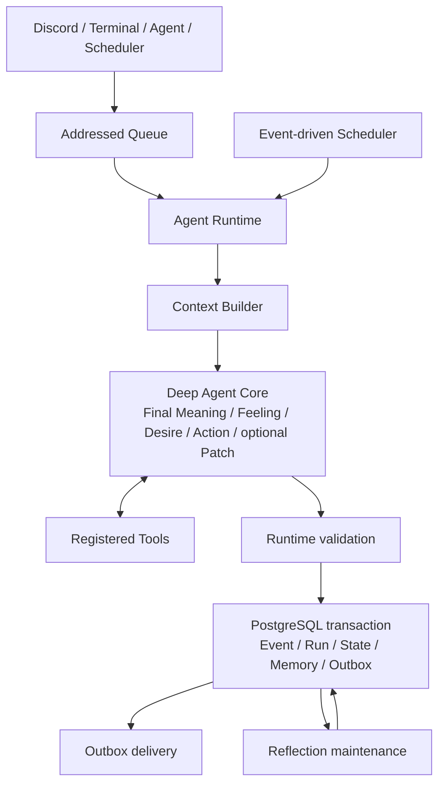

# Architecture

本書は現在の実装を説明する二次資料である。概念と要求の一次資料は[`spec/`](../spec/)、動機・感情・行動モデルは[`AGENT_MOTIVATION_MODEL.md`](AGENT_MOTIVATION_MODEL.md)を正とする。本書と実装が異なる場合は、出荷時点の挙動をコードとテストで確認し、文書の差分を解消する。過去文書の `old_docs/` は本書の対象外である。

## 設計判断の背景

現行実装はSubjective Meaning、Emotion、Motive、Mood、Memory、Candidate、Long-term Reviewを厳密に扱うため、Event Assessment、Decision / Tool Loop、Experience Integration、Candidate Detection、Long-term Reviewの多段処理になりやすい。この構造は監査性を高める一方で、次の問題を招く。

- Event Assessmentの結果を行動決定へ渡す配線が複雑で、失敗時に因果関係を保ちにくい。
- Schema整合性とEvidence ID管理が推論能力を消費する。
- 一度の経験を保存するための非同期jobと失敗点が多い。
- 認知責務が別moduleとして増殖する。
- 実装の複雑さに対して、人格らしさと自律性の改善が実証されていない。

そのため、旧構造を段階的に温存せず、通常のAgent Loopに少数の持続状態を追加する構造へ再設計した。

## 設計原則

- 通常のAgent Loopに、一個体性と個体化を生む少数の持続状態を追加する。
- 認知概念ごとにmodule、LLM call、job、tableを増やさない。
- 意味と感情の評価と、DesireとActionの決定を分離する。
- 持続状態は少数の自然言語状態に限定し、重複する項目は統合する。
- 感情を語尾ではなくAction選択へ影響させる。
- Runtimeは意味を決めず、権限、所有権、期限、Tool上限、配送、冪等性、Schema検証を保証する。
- 旧構造との互換性を設計目標にしない。

## Architecture Decisions

| ID | 決定 | 由来 |
|---|---|---|
| ADR-1 | すべてのEventを単一のAgentRuntimeへ入力し、UIは送受信だけを担う。 | FR-1, FR-2, NFR-1 |
| ADR-2 | EventはAgent Core内でAssessmentとActionを確定し、Candidate DetectionとLong-term Reviewを外す。 | FR-2, FR-3, FR-5 |
| ADR-3 | Context Builderは判断に必要な状態だけを選び、Agent所有権とtoken budgetを境界で保証する。 | NFR-1, NFR-3, NFR-4, FR-29, FR-30 |
| ADR-4 | Deep AgentsのresponseFormatとtoolStrategyで構造化出力を取得し、Runtimeで厳密に再検証してrepairする。 | FR-11, FR-12, FR-13, FR-14, FR-15, FR-16 |
| ADR-5 | 最終Actionをrespond、refuse、notify-no-execution、no-external-actionに限定し、Patch対象を限定する。 | FR-17, FR-18, FR-19, FR-20, FR-21, FR-22, FR-23 |
| ADR-6 | ToolはDeep Agent内のloopで実行し、登録、権限、回数、冪等性、結果投影をRuntimeが管理する。 | FR-4, FR-32, FR-33, FR-35, FR-36, FR-37, FR-38 |
| ADR-7 | 自律EventはRuntimeが生成し、Reflectionを通常Action選択から分離したmaintenance処理とする。 | FR-24, FR-39, FR-40, FR-41, FR-42, NFR-6 |
| ADR-8 | PostgreSQLを正本とし、Event、State、Memory、Outboxをtransactionとadvisory lockで確定する。 | NFR-7, NFR-8, NFR-9, NFR-10, NFR-11 |
| ADR-9 | Debug UIは読取り専用とし、secretは実行時だけ読み込む。 | NFR-12, NFR-13 |
| ADR-10 | 概念語彙をSelf、State、Memory、Reflectionの小さい境界へ簡略化し、個別tableや認知moduleを増やさない。 | FR-5, FR-6, FR-7, NFR-11 |
| ADR-11 | モジュールはAgent Loop、Autonomy、Reflection、Model、Persistence、Tools、Eventsの境界に留める。 | FR-1, FR-2, NFR-10 |

## 実行境界



UI層はEventの送受信だけを担い、認知・状態更新・永続化を持たない。Discord、Terminal、Agent間Message、自律Eventはいずれも同じ`AgentRuntime`へ入る。配送はcommit後にOutboxから行うため、外部UIの障害とAgentの判断確定を分離できる。

## 正規Agent Loop

1. Runtimeが受信EnvelopeをEventへ正規化し、重複受信、TTL、hop、rate limit、Agent単位lockを検査する。
2. Context BuilderがCurrent Self、Current State、Recent Experience、関連Memory、利用可能Tool、実行制約を読み込む。
3. Agent CoreがContextからFinal Meaning、Feeling、`desire`、最終`action`、任意の`patch`を一つの構造化出力で決める。Toolを使う場合も同じDeep Agent内でTool resultを受けて続行する。
4. RuntimeがMeaningとFeelingをAssessmentへ分離し、出力、参照、ActionとTool実績の整合性、Patchの更新範囲を検証する。
5. Event、Run、Tool execution、State change、即時Memory、Receipt、Outboxを一つのtransactionで確定する。
6. Outbox dispatcherがUIへ配送し、失敗時は未送信recordを保持して再試行する。

旧Candidate Detection、Long-term Review、Interaction後の複数post-process認知pipelineは正規経路に置かない。長期整理はReflectionという独立したmaintenance境界で扱う。

## Contextと状態

ContextへAgentState全体を無制限に渡さず、現在の判断に必要な情報を選ぶ。

- Current Self: `identity`、`disposition`、`selfStory`、`commitments`
- Current State: 任意の`mood`、`concerns`、`relationships`
- Concern: 内容、重要な理由、状態、任意の再検討時刻
- Memory: episodic / semantic / self-related / self-change、重要度、subject、EventまたはMemoryの根拠
- Recent Experience: 直近Eventの再判断に必要なObservation要点、Action、Tool実績、進展有無。Event IDと時刻は外側に一度だけ保持し、監査用provenanceや元入力本文は含めない

所有Agentをすべての境界で検証する。文字列長、件数、Context tokenを制限し、Recent Experienceと重複する通常優先度のepisodic Memoryは除外する。現在のContext上限は4,500推定tokenである。system promptとTool schemaを含む8,000推定tokenは観測用警告閾値であり、provider呼び出しは中断しない。

Feelingは現在Eventへの短期反応であり、それ自体は永続状態にしない。次のEventにも影響する変化だけをMood、Concern、Relationship、MemoryとしてPatchする。Selfは通常Interactionから直接変更できず、ReflectionだけがMemory根拠と理由を伴って更新できる。

Concernのライフサイクルは新しい数値counterを増やさず、`active / satisfied / abandoned`、任意の`reconsiderAt`、Recent Experienceの`progressChanged`で扱う。進展のない同一試行を繰り返すConcernは、問い・対象・方法を変えるか、満足・放棄・削除で閉じる。一律の経過時間だけでは終了させない。

## Deep Agentと構造化出力

本番Agent Coreは`createDeepAgent`へ登録Tool群、system prompt、context schema、middlewareを一度設定し、`toolStrategy(...)`を`responseFormat`として渡す。通常Toolの呼び出しと最終構造化出力ToolはDeep Agentsの標準loopに任せる。

モデル向け最終出力は、nested unionを直接生成させず、説明付きのflat schemaを使う。必須なのは`desire`と`actionType`で、ActionやPatchに必要なfieldだけを追加する。providerへ渡すJSON Schemaから`$schema`と文字列の正規表現制約を除き、日時や参照整合性を含む厳密なZod Domain schemaはRuntime側で再検証する。これによりモデル負荷を抑えてもDomain保証は緩めない。

初回出力が不正な場合、validation issue、許可されたevidence ID、不正出力、flat schemaを含むrepair入力で再試行する。repair中は通常Toolを無効にする。全試行後も不正ならcommitせずfailureだけを記録する。ただしuser-messageで既知の`action: string`誤出力だけは、空でない応答または定型の再試行依頼へ限定的に復旧する。自律Eventやその他の不正出力にはこのfallbackを使わない。

## ActionとPatch

Domain上の最終Actionは次の4種類である。

- `respond`: contentを相手へ配送する。
- `refuse`: contentを配送し、内部にreasonと`personality | system`のbasisを残す。
- `notify-no-execution`: 自律Eventで実行しない判断と理由をownerへ配送する。
- `no-external-action`: Agentが今回は外部発話を行わないと判断した内部終端である。Tool利用の有無とは独立して選ぶ。

Tool利用とユーザーへの発話判断は独立する。Toolの前後を問わず共有価値があれば`respond`でき、Toolを使わなくても発話できる。反対に、Agentは具体的理由があれば`no-external-action`を選べる。ただし、ユーザーからの返信待ちは発話を控える理由にしない。夜間であることは強制制御ではなく、緊急性と合わせてAgentが発話を控える判断材料にできる。

Patchは任意のmood、Relationship 1件、即時Memory意図に限定する。Concernは`concern_propose` Toolで提案し、成功したcommit時だけ反映する。Runtimeがupsert/remove、Agent所有権、evidence、versionを検証し、DB metadataやIDは通常コードが付与する。

## Tool実行

起動時に実装済みToolをRegistryからDeep Agentへ複数登録する。各Toolは短い用途説明と説明付き入力schemaを持ち、Runtime contextからagent / run / event、権限、deadlineを受け取る。Agent Core promptへはTool名と要約だけを重複掲載し、完全なschemaはTool binding側だけに置く。

通常コードは登録有無、入力schema、権限、冪等性、最大25回のTool call、Runごとの設定上限、同一Tool・同一入力の反復、結果サイズを検証する。モデルが未登録Tool名を生成した場合はprovider障害としてrunを中断せず、失敗Tool Messageを同じloopへ返して別Toolまたは最終Actionへ回復させる。Tool実績は成功・失敗を含めてRunへ関連付けるが、Tool成否から発話可否を決定しない。

完全なTool入出力は監査記録に保存するが、Recent Experienceへは再判断に必要な識別子、URL、path、query、件数、状態などのsignalだけを投影する。本文fieldは文字数、短いpreview、hashへ変換し、巨大な本文を次のmodel入力へ戻さない。Tool固有projectorがある場合はそれを優先する。同一Tool入力の反復判定にも同じ投影を使うため、本文をContextへ戻さず反復を検出できる。

## Event-driven autonomyとReflection

常時思考loopは持たない。Schedulerは`idle`、`concern-due`、`external-change`、`reflection`および明示的Scheduled TaskをEventとして発火し、lease付きでclaimする。`idle`などの自律Eventは通常Agent Loopへ入り、Concernの`reconsiderAt`はscheduleと同期する。Schedulerは`idle` Eventごとに`config/exploration-domains.yaml`からランダムな最大8件を候補として渡すが、探索方法は指定しない。Agent Coreは`concern_list`で状態を取得し、Focus ConcernまたはConcern不在を判断したうえで、`concern_propose`の`explorationMode`として`deepen`、`bridge`、`distant`を必要に応じて選ぶ。永続的な探索modeとcursorは持たない。モードの成功・失敗による巡回状態も保存しない。

Reflectionは蓄積EventをMemoryへ圧縮し、Concern、Relationship、Selfを整理するmaintenance処理である。Memoryは会話やTool結果の保存場所ではなく、後の検索と判断で再利用する具体的な要点を1〜2文で生成する。通常Action選択とは分離し、Self変更にはMemory根拠と明示的理由を要求する。ReflectionもDeep Agentsの`toolStrategy`による説明付き構造化出力を使い、モデル向けの単純な変更recordを厳密なDomain outputへ変換する。入力はEvent / Memory各32件と8,000推定token、1回の出力はMemory / Concern / Relationship各4件までに制限する。連続失敗時のscheduleは5分を起点に指数backoffし、最大24時間まで延長する。

Agent Coreの8,000推定tokenはproviderのcontext上限ではなく観測用の警告閾値とする。超過時も呼び出しを継続し、実際の受付可否はproviderへ委ねる。ToolのJSON SchemaはDeep AgentのTool定義だけに保持し、Agent Coreのuser messageへTool名・説明・Schemaを重複して埋め込まない。

## Domain Modelと変更権限

Selfは`identity`、`disposition`、`selfStory`、`commitments`を持つ。Stateは任意の`mood`、`concerns`、`relationships`を持つ。Memoryは単一Storeで、`kind`、`content`、`importance`、`occurredAt`、`createdAt`、`subject`、`evidenceEventIds`などを保持する。詳細な項目はREQUIREMENTSのFR-6、FR-7、FR-8、FR-10に従う。

変更権限は次の通り。

| 対象 | 通常Interaction | Reflection | Runtime |
|---|---|---|---|
| Self | 直接変更しない | Memory根拠と理由を伴って変更する | 初期化、version、所有権を検証する |
| Mood | Patchで提案する | 変更してよい | 所有権とversionを検証してcommitする |
| Relationship | Patchで1件提案する | 整理・変更してよい | 所有権とversionを検証してcommitする |
| Concern | `concern_propose`で提案する | 継続・満足・放棄・整理する | 成功commit時だけ作成・派生する |
| Memory | `remember`またはReflectionで提案する | 圧縮・統合・生成する | ID、時刻、根拠、所有権を付与する |
| Scheduled Task | Toolで登録・参照・取消する | 変更しない | 期限到来時にSystem Eventを生成する |
| Scheduler | 状態を変更しない | 状態を変更しない | Event生成、claim、lease、retryを行う |

## 自律EventとAction不変条件

- 自律性は常時思考loopではなく、`idle`、`concern-due`、`external-change`、`scheduled-task`などのEvent sourceで起動する。
- `reflection`は通常のAction生成ではなく、専用のmaintenance処理へ送る。
- 最終Actionは`respond`、`refuse`、`notify-no-execution`、`no-external-action`の4種である。
- 自律Eventの成功runは、具体的なTool、送信、記録、予約、または`notify-no-execution`を持つ。
- 何も実行しない判断は`notify-no-execution`としてユーザーへ配送する。
- `no-external-action`は外部発話なしの判断として監査に残す。外部へ観測可能な結果が必要な自律Eventでは`notify-no-execution`を使う。
- 通知先を解決できない自律Eventは成功扱いにせず、再試行・運用通知の対象にする。
- 同じEvent sourceでも、Self、State、Memory、Relationshipが異なれば異なるActionを選べる。

## Module境界

物理構成は論理責務以上に細分化しない。

```text
domain/
  agent.ts          Self / State / Concern / Memory / Action

application/
  agent-loop.ts     Event -> Context -> Agent Core -> Commit
  autonomy.ts       Event sourceと自律Action契約
  reflection.ts     経験の圧縮と長期更新

infrastructure/
  model/            Agent Core / ReflectionのLLM adapter
  persistence/      State、Log、Outbox
  tools/            Tool adapter
  events/           Message、Schedule、External Event source
```

Context Builderは独立した認知moduleにせず、`agent-loop`が利用する取得・選択処理として扱う。Portは交換可能性または明確な外部境界がある箇所にだけ置く。

## 実装順序

互換性を優先しないため、新旧経路を長期間併存させない。実装時は次の順序を基本とする。

1. 新しいDomain契約とAction不変条件を確定する。
2. 新しいSelf / State / Concern / Memory schemaを設計する。
3. Agent Coreの入出力とTool continuationを実装する。
4. EventからCommit、OutboxまでのAgent Loopを実装する。
5. Event駆動の自律sourceとAction / 通知契約を実装する。
6. Reflectionを実装する。
7. 新しいbehavior scenarioを通す。
8. 旧後処理、旧schedule、旧schema、旧table、旧testを削除する。
9. 必要な一度限りのDB migrationを実施する。
10. 複数Agent、再起動、配送障害、長期運用を検証する。

大規模変更中も、同一のproduction DBで新旧writerを同時に動かさない。切替単位を明確にし、旧workerや旧schedulerが新状態へ書き込まないようにする。

## 永続化と運用保証

PostgreSQLを正本とする。Agentごとの状態・Memory分離、advisory lock、optimistic state version、Queue receipt、Outbox、Tool冪等性、correlation、TTL、hop、rate limitを通常コードが保証する。Agent Coreは権限やsystem constraintを上書きできない。

Debug UIは状態、Event、Run、Tool実績、Memory、Outbox等を観測する運用UIであり、別の認知経路や状態更新規則を持たない。

## 未実装・非目標

一次仕様が示す概念語彙すべてを個別tableや個別認知moduleとして実装することは目標にしない。Acquired Disposition、Self Narrative、長期的な関係等は、現在のSelf / State / Memory / Reflectionの小さい境界で表現する。人格らしさを固定reward、数値心理モデル、巨大な状態遷移へ置き換えない。

削除・統合した旧構造は次の通り。

- 旧Motive、activeMotive、Intention、Social Contextの独立状態
- Candidate DetectionとLong-term Reviewの二段階pipeline
- Interactionごとのcontinuity / memory分割後処理
- Memory種別ごとの保存経路
- 認知処理として分かれたstate-review、memory-recall、autonomy-review

次は非目標とする。

- 人間の心理構造を完全に再現すること。
- 感情を数値モデルとして厳密にシミュレーションすること。
- 怒りや悲しみを毎回外部へ明言させること。
- 自律Eventを大量に発生させ、行動量を主体性の代わりにすること。
- すべての経験をMemoryまたはSelf変更として保存すること。
- 旧API、旧DB schema、旧testとの恒久的な互換性を維持すること。
