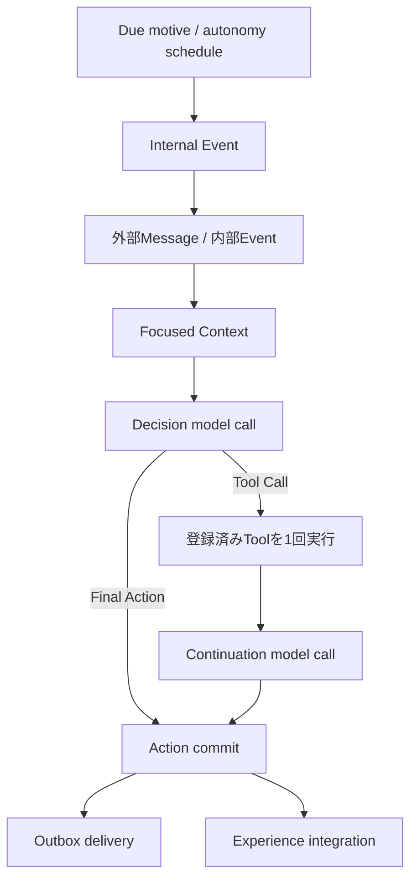

# Architecture

本書は現在の実装を説明する二次資料である。要求の一次資料は[概念設計](../spec/personal-agent-concept-design-restructured-v2.md)と[実装設計](../spec/personal-agent-implementation-design-v2.md)、過去の設計・監査記録は[D3](D3/README.md)を参照する。

## 実行フロー

1回の実行は、最終Actionを直接得る1段階、またはToolを1回実行して継続推論する2段階で終わる。実行時に利用できるのは明示的に登録されたToolだけで、再帰的な委譲、組み込みファイル操作、会話履歴の自動要約は行わない。再帰上限は設定値をそのまま適用し、構造化出力の修復にも同じ実行予算を使う。

## Focused Context

各入力ではSelf、最新Emotion、関連状態を必要量だけ組み立てる。

- Motive: 最大3件
- Social Context: 最大1件
- Episodic Memory: 3〜5件
- Recent Event: 2〜4件
- Self: 判断に必要な要約

system prompt、messages、tool定義、出力schemaを含む総入力を6,000 token以内に収める。収まらない場合は低優先度の情報を落とし、それでも超える場合は明示的なlimit errorにする。

## Actionと確定境界

Agentが選べる外部Actionは`respond`、`refuse`、外部送信なしのActionである。`respond`と`refuse`はどちらも利用者向け`content`をOutboxへ保存する。`refuse`は内部説明の`reason`も持つ。

ActionとOutboxは同一transactionで確定する。確定後のexperience integrationに失敗しても、確定済みActionを失敗扱いに戻さない。配送はOutboxの再試行と冪等性で扱う。

## 状態更新

Action確定後、continuity更新とepisodic memory抽出を1回の構造化LLM結果から保存する。Eventを候補検出器として使う経路はない。

Emotionは現在状態として、description、発生時刻、根拠Eventとともに永続化する。強いfocusは6時間で期限切れになる。Motiveは`nextConsiderAt`と`considerationReason`を持ち、作成・更新時に再検討scheduleと同期する。

自律的な再検討は共通のautonomy review経路に集約する。期限を迎えたMotiveは`motive-review` Eventになり、他の自律入力と同じDecision loopを通る。ユーザー指定のreminderなど、明示的Scheduled Taskは別の配送契約を保つ。

## 永続化と外部境界

PostgreSQLを状態の正本とし、Drizzle repositoryがtransaction境界を提供する。外部MessageはQueueからRuntimeへ入り、応答はOutbox経由で配送される。LLM、embedding、web tool、clock、ID生成はport越しに利用する。

## 実装・評価status

Issue 134〜144の契約は実装され、unit、contract、system、PostgreSQL integration testで検証されている。一方、人格らしさ、拒否の自然さ、状態差による行動変化などの振る舞いは、実モデルによる反復評価artifactが揃った範囲だけを「評価済み」と扱う。実装完了だけを振る舞いの証明にはしない。
