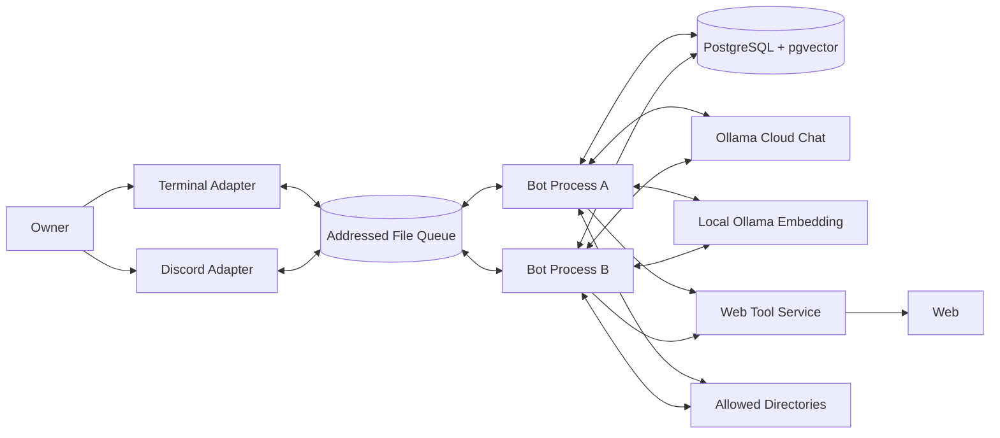
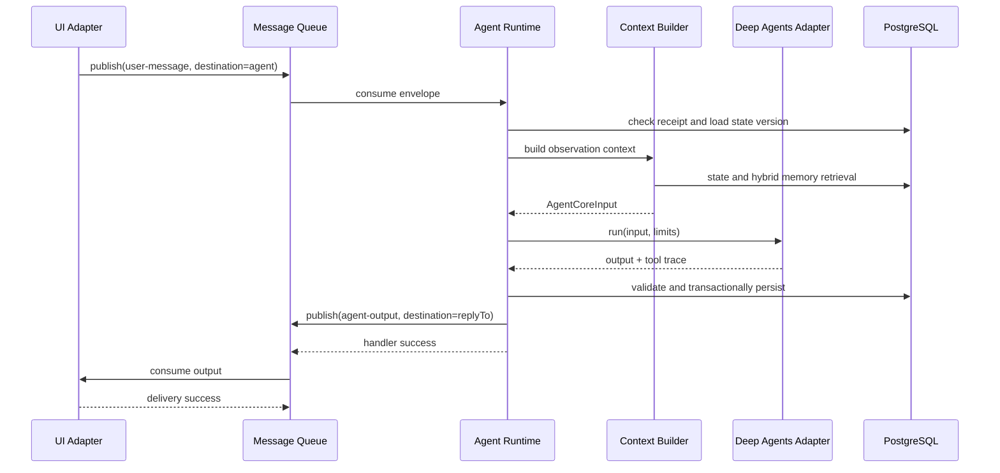

# Architecture

## 1. 目的と前提

本書は `REQUIREMENTS.md` を満たすシステム構成、責務境界、データフロー、永続化、障害処理、配置方法を定義する。

主な前提は次のとおりである。

- 1つの長時間稼働Node.jsプロセスを、1つのbotおよび1つのAgent個体に対応させる。
- 別のbotは、Agent ID、Discord資格情報、Queue宛先等を変えた同一構成のプロセスとして起動する。
- 各botプロセスはRuntime、Scheduler、Agent Harness、Terminal Adapter、Discord Adapterを内包する。
- PostgreSQL + pgvector、ローカルOllama Embedding、共有Queueディレクトリは複数botから利用し、LLM推論にはOllama Cloudを利用する。
- Web検索とページ取得には `SIMPLE_CLIENT_BASE_URL` で指定された既存Web Toolサービスを利用する。
- 外部からAgentへの入力とAgentから外部への出力は、宛先付きの双方向Message Queueで抽象化する。
- Internal Event、Time Event、Tool Result、Long-term ReviewはAgent Runtime内部で処理し、外部Queueへ戻さない。
- 実装言語はTypeScript、境界検証はZod、DBアクセスはDrizzle ORMを使用する。

## 2. Architecture原則

### A-01: DomainをFrameworkから分離する

Self、Disposition、Memory、Intention、Long-term Review等のドメイン型とルールは、Deep Agents、LangChain、Discord、Drizzle等の型に依存させない。外部ライブラリはAdapter内に閉じ込める。

### A-02: Portを所有する側を明確にする

Application / Domain層が必要とする契約をPortとして定義し、Infrastructure層が実装する。UI、Queue、LLM、Embedding、Memory Retrieval、Tool、Clock、ID生成はPort越しに利用する。

### A-03: 外部Messageと内部Eventを分ける

外部Messageは配送、再試行、宛先解決が必要なためQueueを通す。Internal EventとTool Resultは同一Runtime内の制御フローであり、Queue配送の対象にしない。

### A-04: LLMは提案し、Runtimeが確定する

LLMはSubjective Meaning、状態更新、Memory、Intention、Long-term Candidate、最終Actionを提案する。提案に保存用ID、作成時刻、所有Agent ID、保存済みという事実を生成させない。RuntimeはZod Schema、権限、参照整合性、状態version、ループ上限を検証し、IDと時刻を付与してDB transactionで確定する。

### A-05: 配送はat-least-once、処理は冪等にする

ファイルQueueはMessageを失わないことを優先し、同一Messageが再配送される可能性を許容する。RuntimeとUI AdapterはMessage IDを使って重複処理を防ぐ。

## 3. System Context



Terminal AdapterとDiscord Adapterは同じbotプロセス内で動作するが、Agent RuntimeとはQueue Portを介して通信する。図では論理的な境界を示している。

## 4. Layerと依存方向

```text
Domain
  ├── Agent state and value objects
  ├── Event / Observation / Action
  ├── Memory / Intention / Candidate
  └── Validation rules independent from I/O
        ▲
        │
Application
  ├── AgentRuntime
  ├── ContextBuilder
  ├── StateUpdateService
  ├── LongTermReviewService
  ├── Scheduler
  └── MessageRouter
        ▲
        │ ports
Infrastructure
  ├── DeepAgentsAdapter
  ├── Ollama adapters
  ├── Drizzle repositories
  ├── AddressedFileQueue
  ├── Terminal / Discord adapters
  └── Web / File / AgentCommunication tools
        ▲
        │
Bootstrap
  └── config load, dependency wiring, lifecycle
```

依存は外側から内側への一方向とする。DomainとApplicationはInfrastructureの具象クラスをimportしない。

## 5. 主要コンポーネント

### 5.1 Bootstrap / Bot Host

1つのbotプロセスを組み立て、終了まで管理する。

責務:

- `.env.sample`、`.env`、`process.env`から設定を読み、Zodで検証する
- `--env-file <path>`が指定された場合は`.env.sample → .env → 指定file → process.env`の順に上書きする
- Agent IDに対するPostgreSQL advisory lockを取得する
- DB接続、Queue、Ollama、Tool Registry、UI Adapterを構築する
- Queue consumer、Scheduler、Discord接続、Terminal入力を開始する
- SIGINT / SIGTERM時に新規受付を止め、処理中Eventを完了または再配送可能な状態へ戻す
- advisory lockと外部接続を解放する

同じAgent IDで2プロセスが起動した場合、後から起動したプロセスは処理を開始せず終了する。

起動順序は、設定検証、DB接続、Agent存在確認、Agent advisory lock、Chat／Embedding capability check、依存component構築、Queue復旧、consumer開始、`ready`遷移とする。migrationは複数processが競合しないよう`bot:start`から実行せず、事前に明示commandで適用する。

### 5.2 Message Queue

Agent Runtimeへの外部入力と外部向け出力を配送する。

```ts
type Destination =
  | { type: "agent"; id: string }
  | { type: "terminal"; id: string }
  | { type: "discord"; id: string }
  | { type: "external"; id: string }

type MessageEnvelope = {
  schemaVersion: 1
  id: string
  source: Destination
  destination: Destination
  kind:
    | "user-message"
    | "agent-message"
    | "agent-output"
    | "external-event"
    | "delivery-error"
  payload: unknown
  correlationId?: string
  causationId?: string
  replyTo?: Destination
  attempt: number
  createdAt: string
  availableAt?: string
}

interface MessageQueue {
  publish(message: MessageEnvelope): Promise<void>
  consume(
    destination: Destination,
    handler: (message: MessageEnvelope) => Promise<void>,
  ): Promise<QueueSubscription>
}
```

`payload`は`kind`ごとのZod Schemaで検証する。Queue実装固有のack / nackは`consume`の内側でhandlerの成否へ対応させ、Application層へ漏らさない。

### 5.3 UI Adapter

UI固有入力をMessageへ変換し、UI宛てMessageを表示または送信する。

```ts
interface UiAdapter {
  start(): Promise<void>
  stop(): Promise<void>
}
```

Terminal Adapter:

- 標準入力を`user-message`として`agent:{agentId}`へpublishする
- `terminal:{terminalId}`宛て出力をconsumeして表示する
- 対話開始時の`replyTo`をTerminal宛先に設定する

Discord Adapter:

- 対象bot自身へのuser mention（`<@BOT_USER_ID>`または`<@!BOT_USER_ID>`）を含むMessageだけを受理し、Agentへ渡す本文から対象mentionを除去する
- 人間のMessageは設定されたowner、guild、channel allowlistに一致する場合だけ受理する
- 別botのMessageは対象mentionとguild、channel allowlistを満たす場合に受理し、対象bot自身による投稿は自己応答loopを防ぐため無視する
- mentionだけのMessageは、空文字ではなく「メンションされました」というObservation用本文へ正規化する
- Discord Message IDから安定したQueue Message IDを作り、重複受信を抑止する
- `replyTo`にchannelとthreadを解決できるDiscord宛先IDを設定する
- Discord宛て出力の送信失敗時はQueue handlerを失敗させ、再配送させる

新しいUIは、同じQueue契約に対してpublish / consumeするAdapterとして追加する。

### 5.4 Agent Runtime

1 Eventの処理を調停するApplication Serviceであり、LLMによる意味判断と機械的制約の境界となる。

責務:

- 外部MessageをDomain Event / Observationへ変換する
- Agent単位でEventを直列処理する
- Context Builderを呼び出す
- Agent Harnessを実行する
- Deep Agents Adapterへ利用可能Toolと機械的制限を渡し、Tool実行記録を受け取る
- Agent Core Outputを検証する
- 状態、Memory、Intention、Candidate、Event logをtransactionで保存する
- 外部向けActionを宛先付きQueueへpublishする
- Internal EventとTime Eventを通常Agent CoreまたはLong-term Reviewへ振り分ける

外部Message consumerのconcurrencyはbotごとに1とする。長時間Tool実行中も同じAgentの別Eventを並行処理しない。

### 5.5 Context Builder

Agent Harnessへ渡す入力を組み立てる。

```ts
interface ContextBuilder {
  build(input: {
    agentId: string
    observation: Observation
    contextBudget: ContextBudget
  }): Promise<AgentCoreInput>
}
```

次を選択する。

- IdentityとShared / Initial Disposition
- Observationに関連するAcquired Disposition、Values、Role、Self Narrative
- 現在有効なEmotion、Mood、複数Drive、複数Desire、Current Interests、Intention
- Observationのsubjectに関係するSocial Context
- hybrid retrievalで取得したMemory
- 登録済みTool定義
- Runtimeの残りstep数、deadline、ファイル許可範囲等の制約

長期状態や全Memoryを無条件に投入しない。各カテゴリに上限を設け、Memoryには関連する種類の予約枠と全体順位による残り枠を適用し、最終的にmodelのContext budget内へ収める。

### 5.6 Agent Harness

Deep Agentsを利用してLLM reasoningとTool Loopを行う。

```ts
interface AgentHarness {
  run(input: AgentCoreInput, limits: RunLimits): Promise<AgentCoreResult>
}
```

`DeepAgentsAdapter`は次を担う。

- `AgentCoreInput`からsystem promptとmessagesを構築する
- Tool RegistryのToolだけをLangChain Toolへ変換して登録する
- API key付きOllama Cloud Chat ModelをDeep Agentsへ注入する
- 各Tool callとresultをRuntime traceへ通知する
- Tool resultを同じDeep Agent runの次のreasoning stepへ返し、最終Actionまで内部loopを完了する
- step上限とdeadlineを強制する
- 最終結果を`AgentCoreOutputSchema`でparseする
- Deep Agents / LangChain固有のmessage、tool、state型をDomain型へ変換する

Deep Agentsの組み込みMemory、filesystem、subagent機能は、明示的に採用したもの以外をドメイン状態の正本として使わない。特にSelf、Disposition、Intention、Memory、Long-term CandidateはPostgreSQL側を正本とする。

Ollama Cloudのchat modelはTool callingと要求する構造化出力を満たすものを設定する。接続先、API key、modelはそれぞれ `OLLAMA_BASE_URL`、`OLLAMA_API_KEY`、`OLLAMA_CHAT_MODEL` から読み取る。起動時に認証を含む簡単なcapability checkを行い、満たさない場合はbotをready状態にしない。

### 5.7 Tool Registry

利用可能なToolを起動時に固定する。

```ts
interface AgentTool<TInput, TResult> {
  readonly name: string
  readonly description: string
  readonly inputSchema: z.ZodType<TInput>
  execute(input: TInput, context: ToolExecutionContext): Promise<TResult>
}

interface ToolRegistry {
  list(): readonly AgentTool<unknown, unknown>[]
  get(name: string): AgentTool<unknown, unknown> | undefined
}
```

必須Tool:

- `web_search`: `SIMPLE_CLIENT_BASE_URL` の `POST /list` へ `{ q, k }` を送り、`query`、`k`、rank付きの`title`、`url`、任意の`snippet`と`published_date`を返す
- `web_fetch`: 同じサービスの `POST /page` へ `{ url }` を送り、取得した各documentの`url`、`title`、Markdown本文を返す
- `file_read` / `file_write` / `file_delete`: 許可root配下だけを操作する
- `agent_send`: 別Agent宛ての`agent-message`をQueueへpublishする

Toolは個別承認なしで実行する。未知のTool名は拒否する。コード実行、shell、任意外部API、カレンダーは登録しない。

File Toolは入力pathを絶対pathへ正規化し、`realpath`で許可root配下にあることを確認する。新規ファイルは最も近い既存親の`realpath`を検証する。symlinkを使ったroot外アクセスを拒否する。

Web Tool Adapterは `docs/web_tool.md` のrequest / responseをZodで検証し、timeout、response size、service errorを共通Tool errorへ変換する。Agentが指定するpage URLはHTTP / HTTPSだけを許可する。Web取得先へのnetwork制約とredirect検証はWeb Toolサービス側の責務であり、本システムは信頼するservice endpoint自体を `SIMPLE_CLIENT_BASE_URL` で固定する。

### 5.8 Memory Service

Memory保存と検索を担当する。

#### Memory生成経路

通常Agent Coreは現在のEventを中心に、直近の対話を文脈解決へ使い、具体的な出来事をEpisodic Memoryとして0件以上提案する。SemanticとSelf-relatedについては、通常runでは確定Memoryではなく、主張、理由、根拠Event / Memory IDを持つLong-term Candidateを提案する。Long-term Reviewは複数の根拠と既存Memoryを照合し、Semantic Memoryの作成・統合・訂正とSelf-related Memoryの作成・統合・訂正を確定する。

Self Change MemoryはLong-term Reviewが長期状態を変更した事実を表す派生・監査記録であり、Episodic、Semantic、Self-relatedと並ぶ認知上の第4用途にはしない。既存の永続化上の`self-change`識別子は維持できるが、通常Retrievalの3種類の候補枠から除外する。

```ts
interface MemoryRepository {
  save(memory: Memory): Promise<void>
  findByIds(agentId: string, ids: string[]): Promise<Memory[]>
}

interface MemoryRetriever {
  retrieve(query: MemoryQuery): Promise<RetrievedMemory[]>
}

interface EmbeddingProvider {
  embed(text: string): Promise<number[]>
  dimensions(): number
}
```

#### Embedding lifecycle

Runtimeは検証済みMemoryをまず永続化し、EmbeddingをDB transaction外で生成する。Memoryは`pending`、`ready`、`failed`のEmbedding状態を持ち、失敗時もMemory本文と出典を失わない。成功時はvector、model ID、dimensionを一組として保存する。`pending`と`failed`は冪等なbackfill対象とし、modelまたはdimensionの変更時も再生成できるようにする。Self Change Memoryを含むすべての保存経路が同じlifecycleを使う。

`OllamaEmbeddingAdapter`は `OLLAMA_EMBEDDING_BASE_URL` のローカルOllamaを使ってMemory contentとqueryをembeddingする。modelと期待dimensionは `OLLAMA_EMBEDDING_MODEL` と `OLLAMA_EMBEDDING_DIMENSION` から読み、返却vectorの次元を保存前に検証する。Chat用のOllama Cloud接続やAPI keyは使用しない。

#### Relevant Memory Queryと候補選択

初期実装では追加のLLM呼び出しを行わず、Observation、関連するDynamic State、Active Intention、Working Social Contextの上限付きフィールドから、決定的な`MemoryQuery`を構築する。全状態を検索文へ連結せず、検索語、subject ID、Intention ID、kind、時刻範囲等を分離して表現する。

検索は次の段階で行う。

1. `agent_id`による個体分離
2. Memory type、related subject、Intention、時刻範囲等のmetadata filter
3. vector、keyword、subject関連、Intention関連から候補poolを構築
4. score尺度を正規化するか、Reciprocal Rank Fusion等で各候補poolの順位を統合
5. 新しさと、機械判定用に限定値で保持する`retrievalPriority`による順位調整
6. 関連する種類の予約枠と全体順位による残り枠を使った多様性選択
7. 関連度順を維持したContext budgetによる切り詰め

初期実装の順位統合はRRFの定数を`k = 60`とし、vector、keyword、subject、Intentionの各順位へ`1 / (k + rank)`を与える。recencyは`0.25 / (k + rank)`、`retrievalPriority`は`critical = +0.012`、`high = +0.006`、`normal = 0`、`low = -0.002`で調整する。同点は`occurredAt DESC, id ASC`で決定する。候補poolは要求件数の4倍または24件の大きい方を上限とする。

`significance`は自然言語による意味記述として保持する。検索順位へ機械的に反映する場合は`low | normal | high | critical`等の限定値を持つ`retrievalPriority`を別に使用し、LLMの自然言語を直接数値化しない。scoreは検索順位のために使用し、Agentの価値判断や人格の数値Rewardには使わない。

日本語keyword検索はQueryへNFKC正規化と小文字化を行い、日本語を2文字単位、空白区切りの英数字を単語単位として最大32語抽出し、小文字化したMemory本文の部分一致で候補化する。PostgreSQL `simple`全文検索だけを十分な日本語recallの前提にせず、vectorが利用できない場合もkeyword、subject、Intention、新しさから候補を返す。

Episodic、Semantic、Self-relatedのうち、vector、keyword、subject、Intentionのいずれかに一致した種類には最大1件の予約枠を設け、残りを全体順位から埋める。recencyだけで候補になった種類を件数合わせで予約しない。Self Change Memoryは通常検索から除外する。

Retrieverは各候補について最終順位、候補化した方式、選択・除外理由をtraceへ返す。Context Builderによる除外は`context-budget`として更新し、Agent run resultへ保存する。Agent Coreには採用したMemory本文だけを渡し、ranking traceをpromptへ含めない。Context BuilderはRetrieverの順位を維持し、件数合わせのために無関係な種類を追加しない。

### 5.9 State Update Service

Agent Coreの提案を検証し、transactionで適用する。

検証内容:

- Agent Core Output全体のZod parse
- 変更可能なtargetとoperationのallowlist
- Shared DispositionとIdentity等、通常Eventから変更できない領域の拒否
- 参照するMemory、Intention、subjectが同じAgentに属すること
- 長期状態を通常更新案から直接変更していないこと
- `agent_state.version`が読み取り時と一致すること

更新時はEvent log、状態更新、Memory、Intention、Candidate、Tool実行記録を関連づけて保存する。LLM提案には保存用ID、時刻、所有Agent IDを要求せず、検証後にRuntimeが付与する。外部Toolの副作用はDB rollbackで取り消せないため、Tool実行記録は最終出力の検証失敗時にも失わない境界を設ける。version不一致時は古い提案を適用せず、現在状態からEventを再処理するかdead-letterに移す。

### 5.10 Scheduler

botプロセス内で、そのAgentだけを対象に定期評価する。

責務:

- `next_review_at`を迎えたActive Intentionの再評価
- 持続するDriveの再評価
- 保留Candidateがある場合のLong-term Review起動
- Mood等の時間経過による再評価機会の生成

Intention triggerは`time`、`event`、`idle`、`manual-review`の4種類とする。`time`は指定時刻、`event`はEvent種類と任意keyword、`idle`はAgentの最後の非Scheduler Eventからの無活動時間、`manual-review`は対象Intention IDを持つSystem/Internal Eventで`next_review_at`を設定する。Scheduler自身が生成したEventではtriggerを再評価せず、自己起動loopを防ぐ。

SchedulerはDomain EventをRuntimeへ直接渡す。Queueへpublishしない。通常のInternal Eventは通常Coreへ、`long-term-review` EventはLong-term Review Coreへ振り分ける。同一プロセスではAgent単位で直列化し、DBではIntention、persistent Drive、Candidateを期限付きleaseで取得する。停止中に期限を迎えた対象も再起動時に取得し、成功後は次回時刻を設定、失敗時は短いbackoffを設定してleaseを解放する。外部Queueへ送るのは最終Actionが`respond`の場合だけとする。

### 5.11 Long-term Review Service

通常Agent Loopとは別のprompt / modeで長期状態を再解釈する。

入力:

- 現在のSelf NarrativeとAcquired Disposition
- pending Candidate
- Candidateが参照するEpisodic、Semantic、Self-related Memory
- 関係するSocial Context

出力はKEEP、UPDATE、MERGE、DROPの判断、更新後の値、理由、根拠Memory IDを含む。Semantic / Self-related Memory Candidateについては、Memoryの作成・既存Memoryへの統合・訂正・破棄を同じ判断形式で返す。Zodで検証後、長期状態またはMemoryの更新、Candidateの解決状態、必要なSelf Change Memoryを同一transactionで保存する。

対象はSelf Narrative、Acquired Disposition、Role、Raison d'être、長期Preference／Interest、Semantic／Self-related Memoryとする。Candidate作成時は原則24時間後をReview時刻とし、同一targetが3件以上、criticalな根拠、強いSelf-related Memory、明示された矛盾のいずれかでは即時対象にする。KEEPはpendingのまま7日後へ再scheduleし、UPDATE／MERGE／DROPだけを解決済みにする。

単純追加よりMERGEを優先する。配列型の長期状態も統合済みの簡潔な値へ置換し、Review後も長期状態が設定上限を超える場合は、意味を維持するcompactionを再度提案させる。確定したMemoryとSelf Change Memoryは根拠Memory IDを保持する。

通常Agent CoreとLong-term Review Coreは、同じmodelやAdapterを共有してもよいが、入力契約、出力Schema、prompt、起動Eventを分離する。通常Agent CoreはLong-term Candidateまでを提案し、長期状態を確定しない。

## 6. 外部Messageと内部Event

### 6.1 Queueを通るもの

- Terminal / DiscordからのUser Message
- Agent AからAgent Bへの情報伝達
- 将来追加する外部システム由来Event
- AgentからTerminal / Discord / 将来の出力先へのAction
- UI配送失敗に関するdead-letter対象Message

### 6.2 Queueを通らないもの

- Tool Result
- Intention review用Internal Event
- persistent DriveやMemory recallに基づくInternal Event
- Time Event
- Long-term Review Trigger
- State validation result

これらは1つのbotプロセス内でRuntimeが生成し、必要な永続記録だけをPostgreSQLへ保存する。

## 7. Message Queueのファイル実装

### 7.1 配置

標準実装`AddressedFileQueue`は、共有可能なQueue rootに宛先ごとのspoolを作る。

```text
queue-root/
  agent__agent-a/
    pending/
    processing/
    dead-letter/
  discord__bot-a/
    pending/
    processing/
    dead-letter/
  terminal__bot-a/
    pending/
    processing/
    dead-letter/
```

ファイル名は`availableAt_timestamp-messageId.json`とし、1ファイルに1 Envelopeを保存する。宛先IDはpathとして安全な文字列へencodeし、Queue root外を指せないようにする。

### 7.2 Publish

1. EnvelopeをZodで検証する。
2. 同じ宛先ディレクトリ内にUUID付きtemp fileを排他的に作成する。
3. JSONを書き込み、必要に応じてfile descriptorをsyncする。
4. temp fileを`pending`内の最終名へatomic renameする。
5. 同じMessage IDの最終ファイルが存在する場合は成功済みとして扱う。

共有Queue rootは、atomic renameと複数プロセスからの排他的file createを保証する同一host上のfilesystemを前提とする。NFS等の意味論が異なるfilesystemは標準構成の対象外とする。

### 7.3 Consume / Ack / Retry

1. consumerは自宛先のdueな`pending`ファイルを列挙する。
2. `processing`へのatomic renameに成功したconsumerだけがclaimする。
3. handler成功後、配送済み記録をPostgreSQLへ保存し、processing fileを削除する。
4. 一時失敗時はattemptと`availableAt`を更新し、backoff後の名前で`pending`へ戻す。
5. attempt上限、Schema不正、恒久エラー時は理由metadataとともに`dead-letter`へ移す。
6. 起動時にlease timeoutを超えた`processing`ファイルを`pending`へ戻す。

Queueはat-least-once deliveryとする。`message_receipts`の`(destination, message_id)` unique constraintにより、RuntimeとUI Adapterで副作用を冪等化する。

### 7.4 将来の差し替え

`MessageQueue` Portを維持し、Graphile Worker、pg-boss、Redis、外部broker等へ交換できる。HTTP Event Ingressは今回実装せず、将来`POST /events`をEnvelopeへ変換して`publish`するInbound Adapterとして追加する。

## 8. 主なデータフロー

### 8.1 User Messageから応答まで



通常応答の宛先は入力Envelopeの`replyTo`を使う。`correlationId`は対話全体、`causationId`は直前MessageまたはEventを指す。

### 8.2 Tool Loop

```text
Agent Harness
  → registered Tool call
  → Runtime Tool Adapter validates input and limits
  → Tool executes
  → Tool Result is recorded
  → result returns directly to Agent Harness
  → next reasoning step
  → final AgentCoreOutput
```

Tool Resultは外部Queueへpublishしない。各callは`tool_executions`へ記録し、同じrun内の新しいObservationとしてDeep AgentsのTool Loopへ返す。

実装設計26章の「Runtime → Tool → Tool Result Event」は論理的な責務の流れを示す。本実装ではDeep Agents AdapterがRuntimeからTool実行能力を委譲され、同一run内でこの流れを実行する。RuntimeはTool定義、権限、上限、deadline、冪等性を支配し、Adapterは呼び出しと結果の再入力を行う。Tool結果を外部Eventとして別runへ再投入しない。

### 8.3 bot間通信

```text
Agent A
  → agent_send({ destinationAgentId: B, content })
  → Queue: destination=agent:B, kind=agent-message
  → Agent B Runtime
  → External Event / Observation
  → BのMemoryへ「Aから伝達された情報」として保存
```

Agent AのMemoryをBへ複製しない。返信が必要な場合は`replyTo=agent:A`を使う。連続したbot間通信は各runのstep上限、correlation単位のhop上限、Message TTLで停止する。

### 8.4 自律行動

```text
Scheduler
  → due Intention / pending Candidateを検出
  → RuntimeへInternal / Time Eventを直接渡す
  → Context Builder
  → Agent HarnessまたはLong-term Review
  → DBへ状態を保存
  → 外部通知が必要なActionのみdefault destinationへpublish
```

自律Actionのdefault destinationはbot設定で0件以上指定する。指定がなければ状態とtraceだけを保存し、外部通知は行わない。

## 9. Agent Core契約

主要な入力は既存実装設計の`AgentCoreInput`を基礎にし、実行metadataを追加する。

```ts
type AgentCoreInput = {
  run: {
    runId: string
    eventId: string
    agentId: string
    occurredAt: string
  }
  observation: Observation
  recentObservations: Observation[]
  self: RelevantSelf
  dynamicState: RelevantDynamicState
  socialContext: SocialContext[]
  memories: RetrievedMemory[]
  availableTools: ToolDefinition[]
  runtimeConstraints: RuntimeConstraint[]
}

type AgentCoreOutput = {
  interpretation: { subjectiveMeaning?: string }
  internalChanges: {
    transientStateUpdates: StateUpdateProposal[]
    memoryProposals: MemoryProposal[]
    intentionProposals: IntentionProposal[]
    longTermCandidates: LongTermUpdateCandidateProposal[]
  }
  action: FinalAction
}
```

`FinalAction`はrespond、wait、refuse、no-actionを表現する。Tool callはDeep Agents内部loopの中間操作であり、最終Actionには含めない。Harnessは`AgentCoreOutput`と、通常コードが観測した`ToolExecutionRecord[]`を`AgentRunResult`としてRuntimeへ返す。

`MemoryProposal`、新規`IntentionProposal`、`LongTermUpdateCandidateProposal`は意味内容と根拠を持つが、保存用ID、作成時刻、所有Agent IDを持たない。既存Intention等を更新する提案は、入力Contextに存在する対象IDだけを参照できる。

`recentObservations`は現在Eventより前の同一Agentの完了済みObservationを古い順に最大6件保持し、代名詞や省略の解決だけに使う。通常Coreは現在Eventを中心にEpisodic Memoryを提案し、直近履歴に含まれる同じ出来事を再保存しない。

Schema不適合時は、同じraw outputを添えて構造修復を1回だけ試みる。再度失敗した場合は状態を変更せずrunを失敗させる。再試行回数は設定可能だが、無制限にしない。

## 10. 永続化設計

### 10.1 正本

PostgreSQLを次の正本とする。

- Agent FamilyとAgent個体設定
- Stable / Dynamic State
- Social Context
- Intention
- MemoryとEmbedding
- Long-term Update Candidate
- Eventとrunの追跡情報
- State changeとTool execution
- Message処理済み記録

ファイルQueueは未配送Messageの正本であり、配送完了後の監査記録はPostgreSQLを正本とする。

### 10.2 論理テーブル

| Table | 主な内容 |
|---|---|
| `agent_families` | Shared Disposition、共通Capability、base instruction |
| `agents` | Identity、family ID、Initial Individual Disposition、設定、active状態 |
| `agent_states` | Stable / Dynamic State、Self Narrative、version、更新時刻 |
| `social_contexts` | subjectごとの現在認識 |
| `intentions` | goal、reason、trigger、status、next review |
| `memories` | type、content、significance、retrieval priority、occurredAt、source、embedding status / vector / model / dimension / last attempt |
| `memory_subjects` | Memoryとsubjectの関連 |
| `memory_intentions` | MemoryとIntentionの関連 |
| `long_term_candidates` | target、proposed value、status、reason、review時刻、期限付きlease |
| `candidate_evidence` | Candidateと根拠Memoryの関連 |
| `events` | Event、Observation、source、correlation、処理状態 |
| `agent_runs` | input state version、結果、開始・終了、失敗理由 |
| `state_changes` | target、operation、before、after、reason、run ID |
| `tool_executions` | tool、validated input、result / error、run ID |
| `message_receipts` | destination、message ID、処理結果、処理時刻 |
| `outbox_messages` | DB commit後にQueueへ配送する出力Envelope、配送状態、attempt |

自然言語状態はJSONBまたはtextで保持する。検索・整合性・ライフサイクルに使うID、type、status、時刻、versionは列として構造化する。

### 10.3 SchemaとMigration

- TypeScriptのDrizzle Schemaをアプリケーション管理テーブルのsource of truthとする
- Drizzle Kitでversion管理されたSQL migrationを生成・適用する
- pgvector extension有効化はcustom SQL migrationに含める
- DB insert / select SchemaはDrizzle SchemaからZod Schemaを生成し、必要なrefinementを追加する
- migrationはbot起動時に各プロセスが競合して実行せず、明示的なmigration commandで適用する

### 10.4 Transaction境界

1 Eventの確定では、次を1 transactionに含める。

- 未処理Messageであることの確認とreceipt予約
- Event / run記録
- `agent_states.version`を条件にした状態更新
- Memory、Intention、Candidate、State change、Tool traceの保存
- run完了とreceipt完了

外部向けQueue publishはDB transactionと同一atomic unitにできない。`outbox_messages`テーブルへ出力Envelopeを同じtransactionで保存し、process内Outbox DispatcherがFile Queueへpublish後にsentとする。これによりDB commit後のプロセスクラッシュで出力を失わない。

## 11. 同時実行と整合性

- PostgreSQL advisory lockをAgent IDから生成したkeyで取得し、同一Agentのbotプロセスを1つに限定する
- Agent入力Queueのconsumer concurrencyは1とする
- `agent_states.version`のoptimistic lockを最後の防御とする
- Message処理は`message_receipts` unique constraintで冪等化する
- 外部副作用を伴うToolは`run_id + tool_call_id`をidempotency keyとして受け取れる契約にする
- bot間Messageにはhop countとTTLを持たせ、上限超過時は処理せずdead-letterへ移す
- UI出力はoutboxとdelivery receiptで重複を検出する。Discordでは可能な範囲でMessage IDとの対応を保存する

## 12. Failure Handling

| Failure | 処理 |
|---|---|
| Queue Envelope不正 | consumeせずdead-letterへ移し、理由を記録 |
| bot停止中 | pending fileを保持し、再起動後に処理 |
| 処理中クラッシュ | lease timeout後にprocessingからpendingへ戻す |
| 重複配送 | receiptを確認し、副作用を再実行せずack |
| Ollama Cloud認証・一時障害 | 秘密値を記録せず、上限付きexponential backoff後にMessageを再配送 |
| ローカルOllama Embedding停止 | embedding対象を失敗または保留として識別可能にし、上限付きで再試行 |
| Web Toolサービス停止・不正response | 構造化した失敗結果をHarnessへ返し、Agentに再判断させる |
| LLM構造不正 | 1回だけ修復し、失敗時は状態未変更でrun失敗 |
| Tool入力不正 | Toolを実行せず、失敗Tool ResultとしてHarnessへ返す |
| Web / File Tool失敗 | 構造化した失敗結果をHarnessへ返し、Agentに再判断させる |
| DB transaction失敗 | rollbackし、Messageをretry可能にする |
| state version競合 | 提案を破棄し、最新状態からEventを再処理 |
| Discord送信失敗 | outbound Messageをbackoff付きで再配送 |
| 永続的な失敗 | attempt上限後にdead-letterへ移す |

Runtimeは失敗時に部分的な状態更新を残さない。Toolが外部副作用を完了した後にDB保存が失敗する可能性は、Tool idempotency keyとexecution logで扱う。

## 13. 設定

設定の優先順位は次のとおりとする。後の値が前の値を上書きする。

```text
.env.sample → .env → --env-fileで指定したprocess別file → process.env
```

`.env.sample`は実行可能な既定値を持てるが、実資格情報をrepositoryへ保存しない。process別fileは`.env.bot-a`等としてrepository管理外に置ける。運用・自動化が`.env`またはprocess別fileを変更することはなく、設定項目の追加・説明変更は`.env.sample`だけに行う。

主な設定群:

- bot: Agent ID、Family ID、bot instance ID
- UI: Terminal有効化、Discord token、allowlist、宛先ID
- Queue: root、poll interval、lease、retry、dead-letter、durability mode
- DB: connection URL、pool size
- Ollama Cloud Chat: `OLLAMA_BASE_URL`、`OLLAMA_API_KEY`、`OLLAMA_CHAT_MODEL`、timeouts
- Local Ollama Embedding: `OLLAMA_EMBEDDING_BASE_URL`、`OLLAMA_EMBEDDING_MODEL`、`OLLAMA_EMBEDDING_DIMENSION`、timeouts
- Runtime: max steps、deadline、tool call上限、message hop上限
- Context: category上限、token budget、retrieval top K
- Scheduler: scan interval、review interval
- Tool: file roots、`SIMPLE_CLIENT_BASE_URL`、Web timeout、response size
- Output: autonomous actionのdefault destinations

初期実装で2 bot起動に必要な設定名は次とする。

| Group | Environment variables |
|---|---|
| bot | `BOT_ID`、`BOT_FAMILY_ID` |
| Discord | `DISCORD_BOT_TOKEN`、`DISCORD_BOT_USER_ID`、`DISCORD_OWNER_IDS`、`DISCORD_GUILD_IDS`、`DISCORD_CHANNEL_IDS` |
| UI destination | `DISCORD_QUEUE_DESTINATION`、`DEFAULT_OUTPUT_DESTINATION` |
| loops | `SCHEDULER_INTERVAL_MS`、`OUTBOX_INTERVAL_MS` |
| shared | `POSTGRES_URL`、`QUEUE_ROOT`、Chat／Embedding／Web設定 |

ID一覧はcomma区切りで受け取り、空要素と重複を正規化する。Discordを有効にする場合はtoken、bot user ID、owner、channelを必須とする。Discord Queue destinationは既定で`discord:<BOT_ID>`とし、2つのDiscord Adapterが同じoutbound destinationを競合consumeしないようにする。Agent Runtimeの入力destinationは`BOT_ID`であり、bot間通信も相手の`BOT_ID`を宛先とする。

設定全体をZodで検証し、不足または矛盾がある場合は外部接続を開始する前に終了する。

## 14. Deployment

### 14.1 1 bot

```text
Bot Process
  ├── Agent Runtime
  ├── Scheduler
  ├── Deep Agents Adapter
  ├── Terminal Adapter (optional)
  └── Discord Adapter (optional)

Shared dependencies
  ├── PostgreSQL + pgvector
  ├── Local Ollama Embedding
  └── Queue root on local/shared host filesystem

External dependencies
  ├── Ollama Cloud Chat
  └── Web Tool Service
```

### 14.2 複数bot

同じbuild artifactを異なる設定で複数起動する。各プロセスは1つのAgent IDを所有する。Queue root、PostgreSQL、ローカルOllama Embedding、Ollama Cloud Chat、Web Tool Serviceを共有し、Queue destinationとDBの`agent_id`で分離する。

標準起動形は次とする。

```bash
pnpm ops migrate
pnpm ops agent:init bot-a default
pnpm ops agent:init bot-b default
pnpm bot:start --env-file .env.bot-a
pnpm bot:start --env-file .env.bot-b
```

各process別fileは同じ共有接続先を持ち、`BOT_ID`、Discord資格情報、Discord allowlist、Discord Queue destinationだけを個体ごとに変える。秘密値を含む実ファイルはartifact、log、repositoryへ含めない。

標準ファイルQueueは同一host上の複数プロセスを前提とする。別hostへ配置する場合は、MessageQueue Adapterをネットワーク対応brokerへ交換する。その際もRuntime、UI Adapter、Message Envelopeは変更しない。

### 14.3 Health

プロセス内部に次の状態を持つ。

- `starting`: config検証、migration version、Ollama Cloud Chat capability、ローカルOllama Embeddingのmodel / dimensionを確認中
- `ready`: Agent lock取得済みでQueueをconsume可能
- `degraded`: DiscordやWeb等、一部Adapterが一時利用不能
- `stopping`: 新規consumeを停止し処理中runをdrain中
- `stopped`: consumer、Discord、DB、Agent lockを解放済み

HTTP health serverは今回実装しない。状態は構造化ログとTerminalへ出力する。

## 15. Observabilityと運用

- JSON structured logを標準出力へ出す
- logにはtimestamp、level、bot ID、agent ID、message ID、event ID、run ID、correlation IDを含める
- prompt全文、Memory全文、Tool結果全文のlog出力は設定で制御する。DB保存自体には情報種別の制限を設けない
- Ollama Cloud Chat、ローカルEmbedding、Web Toolサービスの呼び出し時間、Tool実行時間、Queue待ち時間、retry回数、dead-letter件数を区別して記録する
- dead-letterを一覧・再投入する管理CLIを用意する
- PostgreSQL backupとQueue root backupを同じ運用単位として扱う
- データ削除はbot停止後に所有者がDBとQueueを直接操作する。Agent単位削除では外部キー順序または管理SQLを使用する

## 16. Security境界

個人利用であっても、次はRuntimeの機械的制約とする。

- Discord入力は設定されたowner / guild / channelのallowlistで制限する
- Tool Registry外のToolを実行しない
- File Toolは許可root外を拒否する
- Web Tool Adapterはpage URL schemeを制限し、接続先を構成済み `SIMPLE_CLIENT_BASE_URL` に限定する
- `.env`、Discord token、`OLLAMA_API_KEY`をlogやAgent Contextへ渡さない
- DB queryはDrizzleのparameterized queryを使用する
- Queue Envelope、LLM出力、Tool入力、DB境界をZodで検証する
- AgentのSelf Continuityや拒否判断はRuntime権限を変更できない

## 17. Requirementsへの対応

| Requirements領域 | Architecture上の実現箇所 |
|---|---|
| Agent Family・複数個体 | `agent_families`、`agents`、1 bot＝1 Agent process |
| 状態時間区分・更新案 | Domain State、Agent Core契約、State Update Service |
| Event / Observation / Meaning | Agent Runtime、Context Builder、Agent Harness |
| Memory・Retrieval | Memory Service、PostgreSQL全文検索、pgvector |
| Intention・自律行動 | Scheduler、Runtime内部Event |
| Long-term Review | Candidate tables、Long-term Review Service |
| Tool | Tool Registry、Deep Agents Adapter、各Tool Adapter |
| Terminal・Discord・将来UI | Addressed Queue、UI Adapter |
| bot間情報伝達 | `agent_send`、Agent宛てQueue Message |
| 永続化と再起動 | PostgreSQL、File Queue、Outbox、receipt |
| 不正出力・自己ループ防止 | Zod、RunLimits、hop / TTL、dead-letter |

## 18. 採用しない構成

- UIからAgent Runtimeを直接callbackで呼ぶ構成
- Tool ResultやInternal Eventを外部Queueへ往復させる構成
- 1プロセスが複数Agent個体を並行所有する構成
- Memory全文を毎回LLMへ渡す構成
- Deep Agentsの組み込みMemoryを人格状態の正本にする構成
- 複数botが単一append fileをlockなしで共有するQueue
- LLMがDBや永続状態を直接更新する構成
- Deep Agents内部Tool Loopと、最終Actionの`tool`をRuntimeが再実行する二重構成
- HTTP Event Ingress、専用Queue server、分散brokerの今回実装

## 19. 将来の拡張点

- File QueueからGraphile Worker、pg-boss、Redis等へのAdapter交換
- HTTP、Web UI、音声UI等のInbound / Outbound Adapter
- botを別hostへ分散配置するためのnetwork broker
- Web検索Providerの追加
- Toolごとのsandboxまたは個別rate limit
- read replicaや専用worker等へのprocess分割

## 20. 参照

- `docs/DESIGN_ALIGNMENT.md`
- `docs/REQUIREMENTS.md`
- `docs/web_tool.md`
- `spec/personal-agent-concept-design-restructured-v2.md`
- `spec/personal-agent-implementation-design-v2.md`
- [LangChain Deep Agents overview](https://docs.langchain.com/oss/javascript/deepagents/overview)
- [Drizzle ORM migrations](https://orm.drizzle.team/docs/migrations)
- [Drizzle ORM PostgreSQL extensions](https://orm.drizzle.team/docs/extensions)
- [Graphile Worker documentation](https://worker.graphile.org/docs)
