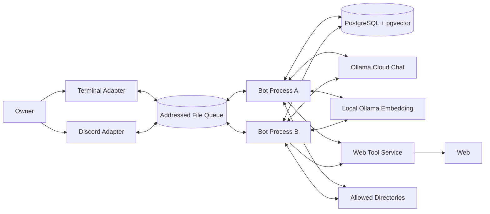
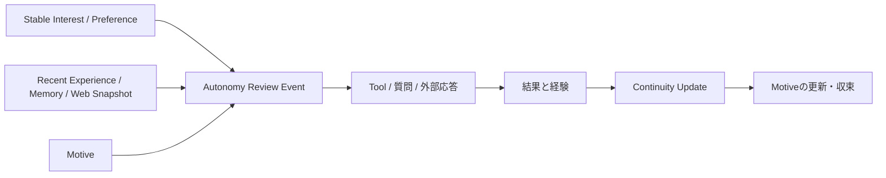
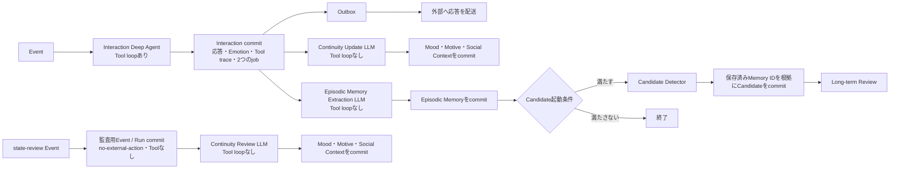
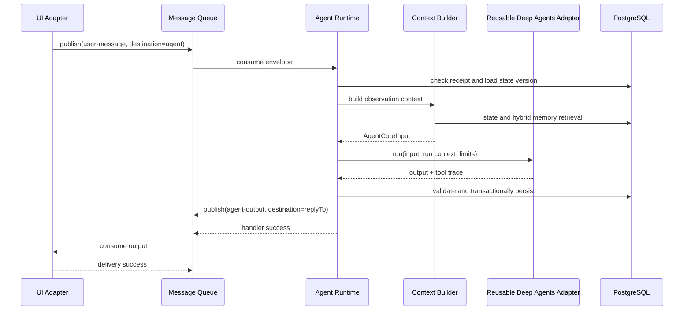

# Architecture

## 1. 目的と前提

本書は `REQUIREMENTS.md` を満たすシステム構成、責務境界、データフロー、永続化、障害処理、配置方法を定義する。

主な前提は次のとおりである。

- 1つの長時間稼働Node.jsプロセスを、1つのbotおよび1つのAgent個体に対応させる。
- 別のbotは、Agent ID、Discord資格情報、Queue宛先等を変えた同一構成のプロセスとして起動する。
- 各botプロセスはRuntime、Scheduler、Agent Harness、Terminal Adapter、Discord Adapterを内包する。
- PostgreSQL + pgvector、ローカルOllama Embedding、共有Queueディレクトリは複数botから利用し、LLM推論にはOllama Cloudを利用する。
- Web検索とページ取得には `SIMPLE_CLIENT_BASE_URL` で指定された既存Web Toolサービスを利用する。
- 外部からAgentへの入力とAgentから外部への出力は、宛先付きの双方向Message Queueで抽象化する。
- Internal Event、Time Event、Tool Result、Long-term ReviewはAgent Runtime内部で処理し、外部Queueへ戻さない。
- 実装言語はTypeScript、境界検証はZod、DBアクセスはDrizzle ORMを使用する。

## 2. Architecture原則

### A-01: DomainをFrameworkから分離する

Self、Disposition、Memory、Scheduled Task、Long-term Review等のドメイン型とルールは、Deep Agents、LangChain、Discord、Drizzle等の型に依存させない。外部ライブラリはAdapter内に閉じ込める。

### A-02: Portを所有する側を明確にする

Application / Domain層が必要とする契約をPortとして定義し、Infrastructure層が実装する。UI、Queue、LLM、Embedding、Memory Retrieval、Tool、Clock、ID生成はPort越しに利用する。

### A-03: 外部Messageと内部Eventを分ける

外部Messageは配送、再試行、宛先解決が必要なためQueueを通す。Internal EventとTool Resultは同一Runtime内の制御フローであり、Queue配送の対象にしない。

### A-04: LLMは提案し、Runtimeが確定する

Interaction Deep AgentはSubjective Meaning、今回のEmotion、最終Actionを提案する。応答後は、Continuity UpdateがMood、Motive、Social Context、Episodic Memory Extractionが具体的経験、Candidate Detectorが保存済みMemoryを根拠とするLong-term Candidateをそれぞれ提案する。いずれの提案にも保存用ID、作成時刻、所有Agent ID、保存済みという事実を生成させない。RuntimeはZod Schema、権限、参照整合性、状態versionを検証し、IDと時刻を付与してDB transactionで確定する。

### A-05: 配送はat-least-once、処理は冪等にする

ファイルQueueはMessageを失わないことを優先し、同一Messageが再配送される可能性を許容する。RuntimeとUI AdapterはMessage IDを使って重複処理を防ぐ。

## 3. System Context



Terminal AdapterとDiscord Adapterは同じbotプロセス内で動作するが、Agent RuntimeとはQueue Portを介して通信する。図では論理的な境界を示している。

## 4. Layerと依存方向

```text
Domain
  ├── Agent state and value objects
  ├── Event / Observation / Action
  ├── Memory / Scheduled Task / Candidate
  └── Validation rules independent from I/O
        ▲
        │
Application
  ├── AgentRuntime
  ├── ContextBuilder
  ├── StateUpdateService
  ├── LongTermReviewService
  ├── Scheduler
  └── MessageRouter
        ▲
        │ ports
Infrastructure
  ├── DeepAgentsAdapter
  ├── Ollama adapters
  ├── Drizzle repositories
  ├── AddressedFileQueue
  ├── Terminal / Discord adapters
  └── Web / File / AgentCommunication tools
        ▲
        │
Bootstrap
  └── config load, dependency wiring, lifecycle
```

依存は外側から内側への一方向とする。DomainとApplicationはInfrastructureの具象クラスをimportしない。

## 5. 主要コンポーネント

### 5.1 Bootstrap / Bot Host

1つのbotプロセスを組み立て、終了まで管理する。

責務:

- `.env.sample`、`.env`、`process.env`から設定を読み、Zodで検証する
- `--env-file <path>`が指定された場合は`.env.sample → .env → 指定file → process.env`の順に上書きする
- Agent IDに対するPostgreSQL advisory lockを取得する
- DB接続、Queue、Ollama、Tool Registry、UI Adapterを構築する
- Botに公開するTool RegistryをLangChain Toolへ一度だけ変換し、`createDeepAgent({ tools, responseFormat })`で通常Agent Coreを構築する
- Queue consumer、Scheduler、Discord接続、Terminal入力を開始する
- SIGINT / SIGTERM時に新規受付を止め、処理中Eventを完了または再配送可能な状態へ戻す
- advisory lockと外部接続を解放する

同じAgent IDで2プロセスが起動した場合、後から起動したプロセスは処理を開始せず終了する。

起動順序は、設定検証、DB接続、Agent存在確認、Agent advisory lock、Chat／Embedding capability check、Tool Registryと再利用可能なDeep Agentを含む依存component構築、Queue復旧、consumer開始、`ready`遷移とする。migrationは複数processが競合しないよう`bot:start`から実行せず、事前に明示commandで適用する。

### 5.2 Message Queue

Agent Runtimeへの外部入力と外部向け出力を配送する。

```ts
type Destination =
  | { type: "agent"; id: string }
  | { type: "terminal"; id: string }
  | { type: "discord"; id: string }
  | { type: "external"; id: string }

type MessageEnvelope = {
  schemaVersion: 1
  id: string
  source: Destination
  destination: Destination
  kind:
    | "user-message"
    | "agent-message"
    | "agent-output"
    | "external-event"
    | "delivery-error"
  payload: unknown
  correlationId?: string
  causationId?: string
  replyTo?: Destination
  attempt: number
  createdAt: string
  availableAt?: string
}

interface MessageQueue {
  publish(message: MessageEnvelope): Promise<void>
  consume(
    destination: Destination,
    handler: (message: MessageEnvelope) => Promise<void>,
  ): Promise<QueueSubscription>
}
```

`payload`は`kind`ごとのZod Schemaで検証する。Queue実装固有のack / nackは`consume`の内側でhandlerの成否へ対応させ、Application層へ漏らさない。

### 5.3 UI Adapter

UI固有入力をMessageへ変換し、UI宛てMessageを表示または送信する。

```ts
interface UiAdapter {
  start(): Promise<void>
  stop(): Promise<void>
}
```

Terminal Adapter:

- 標準入力を`user-message`として`agent:{agentId}`へpublishする
- `terminal:{terminalId}`宛て出力をconsumeして表示する
- 対話開始時の`replyTo`をTerminal宛先に設定する

Discord Adapter:

- 対象bot自身へのuser mention（`<@BOT_USER_ID>`または`<@!BOT_USER_ID>`）を含むMessageだけを受理し、Agentへ渡す本文から対象mentionを除去する
- 人間のMessageは設定されたowner、guild、channel allowlistに一致する場合だけ受理する
- 別botのMessageは対象mentionとguild、channel allowlistを満たす場合に受理し、対象bot自身による投稿は自己応答loopを防ぐため無視する
- mentionだけのMessageは、空文字ではなく「メンションされました」というObservation用本文へ正規化する
- Discord Message IDから安定したQueue Message IDを作り、重複受信を抑止する
- `replyTo`にchannelとthreadを解決できるDiscord宛先IDを設定する
- Discord宛て出力の送信失敗時はQueue handlerを失敗させ、再配送させる

新しいUIは、同じQueue契約に対してpublish / consumeするAdapterとして追加する。

UI以外のproducerは`RuntimeEventPublisher`を使用し、`external-event`、`time-event`、`system-event` payloadをAgent destinationへpublishする。Agent RuntimeはこれらをそれぞれExternal、Time、System Domain Eventへ変換し、User Messageと同じ直列化・上限・永続化経路で処理する。

### 5.4 Agent Runtime

1 Eventの処理を調停するApplication Serviceであり、LLMによる意味判断と機械的制約の境界となる。

責務:

- 外部MessageをDomain Event / Observationへ変換する
- Agent単位でEventを直列処理する
- Context Builderを呼び出す
- Agent Harnessを実行する
- 起動時に構築済みのDeep Agents Adapterへrun contextと機械的制限を渡し、Tool実行記録を受け取る
- Interaction Outputを検証する
- 応答、Emotion、Tool実行記録、Continuity job、Memory Extraction jobをtransactionで保存する
- Outboxを通じて外部向けActionを配送する
- Continuity UpdateとMemory Extractionを独立したjobとして実行し、成功結果を別々に保存する
- Episodic Memoryの保存後、必要な場合だけCandidate Detector jobを起動する
- Internal EventとTime Eventを通常Agent CoreまたはLong-term Reviewへ振り分ける

Runtimeは各Agentに1件の`state-review` Scheduleを保持する。既定では1日ごとにInternal Eventを生成するが、通常Interaction Deep Agentへは渡さない。RuntimeはEventとRunを監査用に記録し、決定的な`no-external-action`と空の即時更新をcommitしてContinuity jobだけを作る。Continuity Reviewは時間経過、直近Event、関連Memoryを踏まえてMood、Motive、Working Social Contextを維持・変更・終了する。`state-review`ではTool、外部応答、Memory Extraction、Candidate Detectorを起動しない。Runtimeは固定規則で状態値を減衰させず、時刻管理、経路制御、再検討機会の生成だけを担当する。EmotionはEvent内で完結するためState Reviewの永続対象にしない。

Agent初期化時のStable Interests / Preferences / Rolesはversioned Initial Self設定から読み込む。Motiveは原則として空集合で開始し、MoodとAcquired Dispositionには中立な初期値を設定する。行動傾向を与える場合は、全Agent共通の固定値へ埋め込まず、FamilyのShared Dispositionまたは個体ごとのInitial Selfとして明示的に入力する。

Initial SelfのInterests / Preferencesには抽象的方向性と具体的な初期嗜好を併記できる。設定値は`configured-initial-self`をprovenanceとする初期個体差であり、Memoryや過去の経験として保存しない。経験から形成された長期Interest / PreferenceはMemoryを根拠にLong-term Reviewだけが更新する。Contextでは両者の由来をSelfのinitial設定とacquiredな長期状態の境界から判別できなければならない。

各Agentは別に`memory-recall` Scheduleを1件持つ。既定では7日ごとにInternal Eventを生成し、通常のMemory Retrievalを現在状態とMotiveから実行する。Recall Eventは再検討の機会だけを与え、Memory選択、状態変更、Tool利用、外部Actionは通常Coreの判断に委ねる。

MotiveごとのScheduleは作らない。Agentごとの`autonomy-review`が、その時点で活性化するMotiveを選ぶ唯一の定期的な行動機会となる。

`autonomy-review` ScheduleはAgentごとに1件だけ初期化し、既定では1日ごとに再実行する。MotiveごとのScheduleは作らない。Context BuilderはSelf、Stable Interests / Preferences、Motive、最近の探索履歴、関連Memory、Social Contextを取得する。Runtimeは機会とcooldownだけを管理し、具体的な行動を固定規則で決めない。

MotiveはActionを直接動機づける。一時的Desireへ変換せず、通常CoreがEmotion、Mood、Preference、現在文脈、制約とともに比較する。保存済みMotiveがない場合も、Stable Interest、会話、Social Context、Memory、Tool結果、Web Snapshotから今回限りのMotiveを形成する。具体的経験から注意を持ち越す価値が生じた場合だけContinuity UpdateがMotiveを提案する。



明示的な将来実行はScheduled Taskとして分離する。`schedule_task` Toolは予約を保存するだけである。Schedulerはdue Taskをleaseし、`kind=system`、`targetKind=scheduled-task`のEventを生成する。通常のAgent RuntimeがEventを処理し、Agent Core、Tool loop、Outboxを利用する。SchedulerからAgent Coreを直接呼ぶ専用経路は作らない。Taskの完了、retry、失敗はexecution Event / Runと関連づける。

外部Message consumerのconcurrencyはbotごとに1とする。長時間Tool実行中も同じAgentの別Eventを並行処理しない。Interaction commit後はOutbox Dispatcherが直ちに応答を配送できる。Continuity UpdateとMemory Extractionは互いに依存しない固定snapshotから実行できるが、同じAgentの次Eventは先行Continuity Updateが状態versionを検証して確定するまで開始しない。Memory ExtractionやCandidate Detectorの失敗は応答配送とContinuity Updateを巻き戻さない。



### 5.5 Context Builder

Agent Harnessへ渡す入力を組み立てる。

```ts
interface ContextBuilder {
  build(input: {
    agentId: string
    observation: Observation
    contextBudget: ContextBudget
  }): Promise<AgentCoreInput>
}
```

次を選択する。

- IdentityとShared / Initial Disposition
- Observationに関連するAcquired Disposition、Values、Role、Self Narrative
- 現在有効なMood、複数Motives
- Observationのsubjectに関係するSocial Context
- hybrid retrievalで取得したMemory
- 登録済みTool定義
- Runtimeの残りstep数、deadline、ファイル許可範囲等の制約

`availableTools`は実装済みToolの固定カタログを表し、Bot起動時にDeep Agentへ登録した一覧と同一である。EventごとにToolを再登録する指示ではない。Tool JSON SchemaはDeep AgentのTool登録経路でmodelへ渡すため、Agent Coreのuser入力JSONにはTool名と短い説明だけを含める。長期状態や全Memoryを無条件に投入しない。Event間の短期履歴はRecent Experience、長く参照する経験はMemoryとして構成する。現在Observation、履歴、Self、Dynamic State、Motiveを各カテゴリの優先順位に従ってmodelのContext budget内へ収める。

#### 5.5.1 Event間のRecent Experience

Deep Agentが持つnative Message履歴は1回のAgent Core run内だけで使う。`user input → Tool Call → Tool Result → 最終Action`のTool LoopにはDeep AgentsのMessage stateを使うが、そのstateを次のEventへcheckpointerで引き継がない。過去のAgent Core入力には当時のState、Memory、制約が含まれるため、生のMessageを累積すると古いsnapshotの重複とContext肥大化を起こすためである。

Event間ではPostgreSQLのEvent、Agent Run、Tool Execution、State Changeを正本とし、直近8 Eventを`recentExperiences`として時系列にprojectionする。1 Eventは入力Observation、それを契機に同じrunで実行した全Tool、最終Actionまたは失敗をひとまとまりとする。Toolを複数回使っても1 Eventであり、schedulerが生成したInternal Eventは新しい1 Eventである。Post-processは元Eventに従属する処理であり、それ自体を新しいEventとして数えない。

```ts
type RecentExperience = {
  eventId: string
  runId?: string
  occurredAt: string
  eventKind: EventKind
  actor?: { id: string; type: string }
  observation: Observation
  steps: Array<
    | { type: "tool"; name: string; input: unknown; result: unknown; ok: boolean }
    | { type: "action"; action: AgentAction }
    | { type: "failure"; reason: string }
  >
  progressChanged: boolean
}
```

同一run内のToolは実行時刻とIDで並べ、その後へ最終Actionまたはfailureを置く。成功したRunだけでなく、失敗までにToolを実行したRunも含める。User、Agent、External、Internal、Time、System Eventを一律に同じ経験順序で扱い、Internal Eventを会話の外へ隠さない。

`recentExperiences`は保存済み情報を再要約・途中切断しない。ObservationのsizeはEvent生成・保存境界、Tool Resultのsizeは各Tool、ActionのsizeはAgent Core出力契約が保証する。Web本文はWeb ToolとArchive Toolの有界な結果だけを記録し、raw本文をEvent、Tool Result、Recent Experienceへ複製しない。Context budgetを超える場合は古いRecent ExperienceからEvent単位で除外する。1 Eventだけでbudgetを超える場合は履歴側で黙って切らず、生成元の契約違反として記録してそのEventをPromptから除外する。

`recentObservations`とPrompt向け`recentAttempts`は廃止する。Tool反復防止に必要な過去入力は`recentExperiences.steps`からRuntime用に導出し、同じ内容を別配列としてPromptへ重複投入しない。Recent Experienceは直近に何が起き、何を試し、どう行動したかを示す短期buffer、Episodic Memoryは後から検索する価値がある経験の要約、Semantic Memoryは経験から得た知識、Social Contextは関係認識、Motiveは現在活性化した探索的動機を担う。

同じEventを根拠とするRecent ExperienceとMemoryが一時的に共存することは許容する。ただし`evidenceEventIds`がRecent Experienceと重なる`episodic` Memoryのうち、`retrievalPriority`が`low`または`normal`のものは単純な再述としてContextへ重複投入しない。`high`／`critical`、semantic、self-related、self-changeは追加の意味または重要性を持つものとして併用できる。Recent Experienceの直近8 Eventから外れた後は通常のMemory候補へ戻す。除外はMemory Retrieval traceの`recent-experience-duplicate`とdebug logへ記録する。

#### 5.5.2 Social ContextとMotiveの関連選択

Social ContextとMotiveは、Agentが所有する全件を更新日時順で渡さない。Context LoaderはDBから有界な候補を取得し、Context Builderは明示的なID、Trigger、期限、Memory linkを使って決定的に順位づける。本文をLLMへ渡して関連度を判定する前処理は追加しない。

選択はMemory検索との循環を避けるため、次の2段階で行う。

1. Observationと保存済み状態だけでseedを選ぶ。Social Contextは`observation.actor.id`およびEventが正規化済みIDとして明示するsubjectを優先する。MotiveはEventが明示する対象、Motive、選択Memoryとの関連を優先する。
2. seedを使ってMemoryを検索した後、選択Memoryの`relatedSubjectIds`と`relatedCurrentInterestIds`を使って最終候補を補う。同じMemory上で選択Motiveと結びつくsubjectは、Motiveに関連するSocial Contextとして扱う。

自由文からsubject IDを推測しない。Motiveの`focus`と`goal`から作ったkeyword一致は補助順位にだけ使う。日本語を含むkeyword分割はMemory Retrievalと同じ正規化を使う。

Social Contextの順位は、現在actorまたは明示subject、選択Memoryのsubject、選択Motiveと同じMemoryに結びつくsubject、更新時刻fallbackの順とする。Motiveの順位は、Eventの直接対象、選択Memoryとのlink、Motiveとの関連、keyword一致、更新時刻fallbackの順とする。同じ階層では`updatedAt DESC, id ASC`で安定させる。上位理由を持つ候補は、下位理由も持つ候補より常に先になる。

Agent Coreへ渡す上限はSocial Context 6件、Motive 6件とする。Social Contextの`description`は1件600文字、Motiveの`focus`と`goal`は各500文字までにprojectionする。直接対象、成立trigger、期限到来は必須候補とし、6件を超えた場合は必須候補内で安定順位を適用してoverflowを記録する。fallbackは関連候補が上限に満たない場合だけ使い、最大2件とする。候補がなければ空配列を正しい結果とし、件数を満たすためだけに無関係な状態を投入しない。

Context budgetの投入順は、Required Stateと現在Observation、直接対象・成立trigger・期限到来の状態、関連Memory、Memory linkまたはkeywordで関連する状態、fallbackの順とする。fallbackのSocial ContextやMotiveが関連Memoryを押し出してはならない。

Motiveは古さだけで自動除外せず、Event、Memory、Motive、keywordの関連により選ぶ。候補数、採用IDと理由、除外件数、overflow、context budgetによる除外を本文なしで`context.selection`へ記録する。

Deep Agent内部の各Model callは、run内の連番、開始・終了、経過時間、入力文字数、message数、出力種別、Tool call数、providerが返した終了理由を構造化logへ記録する。調査中は一時的に`agent_core.model_call_prompt`へ実際のsystem prompt、messages、Tool名をdebug logとして出力し、原因特定後に削除する。

Expectation専用の保存領域は設けない。Agent Coreは入力済みのMotive、Social Context、関連Memory、直近Observationから、今回予期していたことと実際のObservationとの差をそのrunの意味解釈として導出する。次のEventにも影響する期待は、その意味に応じてMotive、Social ContextまたはMemoryへ提案する。

### 5.6 Agent Harness

Interaction Deep AgentはDeep Agentsを利用してLLM reasoningとTool Loopを行う。

```ts
interface AgentHarness {
  run(input: AgentCoreInput, limits: RunLimits): Promise<AgentCoreResult>
}
```

`DeepAgentsAdapter`は次を担う。

- `AgentCoreInput`からsystem promptとmessagesを構築する
- Bot起動時にTool RegistryのToolだけをLangChain Toolへ変換し、固定のTool一覧としてDeep Agentへ登録する
- Bot起動時にAPI key付きOllama Cloud Chat Model、Tool一覧、Middleware、`AgentCoreOutputSchema`の`responseFormat`からDeep Agentを一度だけ構築する。OllamaではLangChainの`toolStrategy`を使い、Schema不適合をAgent loop内で修復可能にする
- Eventごとに同じDeep Agentを再利用し、`agentId`、`runId`、`eventId`、transport、AbortSignal、Tool call上限等をrun contextとして渡す
- 各Tool callとresultをRuntime traceへ通知する
- Tool resultを同じDeep Agent runの次のreasoning stepへ返し、最終Actionまで内部loopを完了する
- step上限とdeadlineを強制する
- Deep Agentの`structuredResponse`を受け取り、`InteractionOutputSchema`でDomain境界を再検証する
- Deep Agents / LangChain固有のmessage、tool、state型をDomain型へ変換する

応答後の3処理はDeep Agentではなく、Tool Registry、Tool middleware、再帰的なTool loopを持たない用途別の構造化LLM呼び出しである。Continuity UpdateとMemory ExtractionはInteraction commit時に固定したsnapshotから独立して実行できる。Candidate DetectorはMemory保存後にだけ実行し、保存済みMemory IDを入力と根拠に使う。追加のMemory検索、Web再調査、自律行動が必要なら、これらの処理内でToolを使わず、`memory-recall`または`autonomy-review`などの明示的なInternal EventからInteraction Deep Agentを起動する。

各用途の入力はEvent、応答の意味内容、必要な現在状態、短いTool結果要約とWeb Snapshot IDへ限定する。Tool定義、runtime limits、retrieval trace、不要なraw Tool payloadは渡さない。Continuity UpdateはMood、Motive、Working Social Contextだけ、Memory ExtractionはEpisodic Memoryの意味内容だけ、Candidate Detectorは保存済みMemoryと既存の関連長期状態だけを返す。`kind=episodic`、所有Agent、Event evidence、発生・作成時刻、source provenance、保存IDはRuntimeが付与する。

Continuity UpdateのMotiveは汎用State Updateではなく、`create | maintain | update | merge | resolve | drop`の用途別提案として返す。各提案は理由と入力内のEventまたはMemory IDを持つ。Runtimeは所有と参照を検証し、create時にIDと`since`を付与する。maintainとupdateでは既存Motiveの`since`を保持し、mergeでは最も古い開始時刻と根拠を引き継ぐ。

```ts
type Motive = {
  id: string
  description: string
  goal?: string
  progress?: 0 | 25 | 50 | 75 | 100
  sourceEvidenceIds: string[]
  since: string
}
```

`description`は現在求めていることを表す。探索型では`goal`と`progress`を対で持ち、当面の満足点とその差がどこまで縮んだかの粗い自己評価を表す。探索以外のMotiveにgoalとprogressを強制しない。詳細知識やページ本文はMemory / Web Snapshotへ保存する。

Runtimeは探索型Motiveごとの`consecutiveNoProgress`、`lastExploredAt`、`cooldownUntil`を制御metadataとして管理し、LLM出力Schemaへ含めない。progress増加で停滞をresetし、進展しない探索で増加させる。Goal達成ではresolveし、価値や進展可能性を失った場合はdropする。

Agent Coreは`recentExperiences`を用い、同じfocusへの同じ質問やTool入力で進展しなかった場合に、そのまま反復しない。同じGoalを継続するなら、焦点の具体化、Agent側の自己開示、別Tool、別検索語、観察または延期を選ぶ。追加探索の価値が低く当面のGoalを十分満たした場合は、外部へ説明する機会の不在を理由に維持せずresolveする。明示した時刻に行う必要がある場合だけScheduled Task Toolで登録する。RuntimeはRecent Experienceから導出したTool入力により、明らかに同一な短時間再実行とcooldown中の探索を機械的に拒否する。無応答や話題変更の意味は固定規則で決めない。

ユーザー理解はStable Interestから関係上のKnowledge Gapを最大1件作る。質問を選ぶ場合は現在の話題とSocial Contextへ結びつけ、一方的な聞き取りを避けるため必要に応じてAgent自身の関心や質問理由も共有する。固定の質問順序は持たない。

判断順序は`Observation + Current State + Memory + Social Context → Subjective Meaning / Value`を先に置き、その価値がSelf（Shared / Initial / Acquired Disposition、Values、Self Narrative）に照らして次回以降も持続するときだけMotiveを提案する。短期Emotion、Personaを単独根拠にしない。

Deep Agentsの組み込みMemory、filesystem、subagent機能は、明示的に採用したもの以外をドメイン状態の正本として使わない。特にSelf、Disposition、Memory、Scheduled Task、Long-term CandidateはPostgreSQL側を正本とする。

Deep Agentインスタンスの再利用は、Domain stateや会話履歴をprocess内の可変状態へ無条件に保持することを意味しない。各Eventの判断材料はContext BuilderがPostgreSQLを正本として組み立てる。同一AgentのEventはRuntimeが直列処理し、共有Agentの並行呼び出しが発生してもMiddlewareとToolはrun contextだけを参照してID、制限、transport、traceを混線させない。

`beforeAgent`はrun contextの検証と開始trace、`wrapToolCall`はTool入力検証、上限、実行記録、`afterAgent`はstructured responseとtraceの整理に使う。これらはAgent Coreの意味判断を固定Pipelineへ分割するものではなく、機械的な実行境界である。

Ollama Cloudのchat modelはTool callingと要求する構造化出力を満たすものを設定する。接続先、API key、modelはそれぞれ `OLLAMA_BASE_URL`、`OLLAMA_API_KEY`、`OLLAMA_CHAT_MODEL` から読み取る。起動時に認証を含む簡単なcapability checkを行い、満たさない場合はbotをready状態にしない。

### 5.7 Tool Registry

実装済みの全Toolを起動時に固定する。名称、説明、入力Schema、実装bindingを`createDeepAgent({ tools })`へ渡し、EventごとにTool wrapperやDeep Agentを作り直さない。Deep Agents 1.14.1がFilesystem Middlewareの必須Capabilityとして加える`read_file`は、他の組み込みFilesystem Toolを無効にして仮想state backendだけへ限定する。一般的なファイル操作は下記の登録済みFile Toolを使う。`read_file`もrun contextの上限とTool traceを適用する。

```ts
interface AgentTool<TInput, TResult> {
  readonly name: string
  readonly description: string
  readonly inputSchema: z.ZodType<TInput>
  execute(input: TInput, context: ToolExecutionContext): Promise<TResult>
}

interface ToolRegistry {
  list(): readonly AgentTool<unknown, unknown>[]
  get(name: string): AgentTool<unknown, unknown> | undefined
}
```

必須Tool:

- `web_list`: `SIMPLE_CLIENT_BASE_URL` の `POST /list` へ `{ q, k }` を送り、`query`、`k`、rank付きの`title`、`url`、任意の`snippet`と`published_date`を返す
- `web_page`: 同じサービスの `POST /page` へ `{ urls: string }` を送り、取得した各documentの`url`、`title`、Markdown本文を返す。field名は複数形だが、現行契約では単一URL文字列を受け取る
- `file_read` / `file_list` / `file_find` / `file_grep`: read許可root配下だけを有界に参照・探索する
- `file_write` / `file_delete`: write許可root配下だけを変更する
- `agent_send`: 別Agent宛ての`agent-message`をQueueへpublishする

Toolは個別承認なしで実行する。未知のTool名は拒否する。コード実行、shell、任意外部API、カレンダーは登録しない。

Toolカタログの固定は、Tool利用の固定規則を意味しない。検索語、URL、宛先、ファイルpath等の業務入力はAgent Coreが各runの文脈からTool callとして生成する。所有・追跡用の`agentId`、`runId`、`eventId`、transport、実行上限はLLMへ生成させず、run contextからToolへ渡す。

File Toolは`FILE_READ_ROOTS`と`FILE_WRITE_ROOTS`を別々のcomma区切りroot一覧として受け取る。read、list、find、grepはread rootだけ、write、deleteはwrite rootだけを使用する。入力pathを絶対pathへ正規化し、`realpath`で該当する許可root配下にあることを確認する。新規ファイルは既存親の`realpath`を検証する。symlinkを使ったroot外アクセスを拒否し、再帰探索ではsymlinkを辿らない。

`file_read`は`head | tail | range`と開始行、最大行数、最大文字数を受け取り、取得範囲、全行数、切断状態、次の開始行を返す。既定では先頭50行・2,000文字、要求可能な上限は100行・4,000文字とし、全文を無制限にTool Resultへ入れない。`file_list`は直下だけ、`file_find`は名前のliteral一致、`file_grep`は本文のliteral一致と有限の前後行を返し、`file_grep`も既定2,000文字、上限4,000文字とする。Agentはlist／find／grepで候補を絞ってから必要範囲だけをreadする。

Tool登録はResultのContext公開Policyを持つ。`file_read`、`file_grep`、`web_archive_read`、`web_archive_grep`は`content-read`として宣言し、共通投影処理を使用する。呼出し直後のModel Callだけに有界な本文を渡し、それ以前の同一run Tool Message、次EventのRecent Experience、post-processには本文を再投入せず、pathまたはSnapshot ID、範囲、件数、本文文字数、切断状態などのmetadataへ置換する。監査用`tool_executions.result`は有界な実行結果を維持する。本文取得Tool全体で1 run 6,000文字の共通予算を使い、Web ArchiveとFile Toolを交互に呼んでも別枠にはしない。この予算とTool回数上限はrun開始時に作られ、同一run内の時間経過では回復しない。上限到達は機械判別できるTool失敗としてAgentへ返し、Agentは追加Toolを止めて取得済み情報から最終Actionを確定する。上限のリセットだけを目的にScheduled Taskを作らない。

Web Tool Adapterは `docs/web_tool.md` のrequest / responseをZodで検証し、timeout、response size、service errorを共通Tool errorへ変換する。Agentが指定するpage URLはHTTP / HTTPSだけを許可する。Web取得先へのnetwork制約とredirect検証はWeb Toolサービス側の責務であり、本システムは信頼するservice endpoint自体を `SIMPLE_CLIENT_BASE_URL` で固定する。

`web_list`は候補探索だけに使い、Tool実行trace以外の永続データを作らない。`web_page`で正常取得したdocumentは、Tool Adapter内の`WebArchiveService`が共有Snapshotとして保存する。raw Markdownは`WEB_ARCHIVE_ROOT`配下のSnapshot IDから決まるfileへ一時書込み後にatomic renameし、DBには共有root相対path、metadata、summary、vector、処理状態だけを置く。Tool ResultはSnapshot ID、URL、title、約400文字のsummary、参照情報に限定し、raw本文を返さない。

#### Web Page Archive

Web Page Archiveは人格Memoryとは別の外部資料Storeである。Memoryは「何を調べ、何を確認したか」というAgentの経験を簡潔に保持し、Web Archiveはその根拠となる取得資料を保持する。検索結果一覧、snippet、rankはArchive対象にしない。

```text
web_page
  → URL正規化
  → raw Markdown fileを共有rootへ冪等保存
  → 用途別LLMで約400文字のsummaryを生成
  → summary Embedding
  → bounded Tool ResultをAgent Coreへ返す
  → 必要ならAgent Coreが概要MemoryとSnapshot根拠を提案
```

`web_resources`はcanonical URLを識別し、`web_snapshots`は取得時点の共有版を表す。Agentによらず同一Resource、content hashは重複させず、内容が変われば新しいSnapshotを作る。取得Agent IDはprovenanceであり参照権限ではない。Snapshot fileを先に保存してDB recordを`pending`で作り、要約／Embedding成功時に`ready`、失敗時にraw fileを残したまま`failed`へ遷移する。Tool retryはrun IDとTool call IDを冪等keyとして扱い、保守処理は孤立fileと欠損fileを検出する。

要約はTool loopを持たない専用Chat LLM呼び出しで生成する。入力はURL、title、raw Markdown、目的、出力fieldの意味を明記し、日本語summaryを約400文字に制限する。Schema不適合は有限回だけ修復し、provider障害や検証失敗では`failed`としてbackfill可能にする。検証済みsummaryだけをローカルEmbedding Providerでvector化し、model、dimension、最終試行時刻、errorを保持する。raw本文全体やchunkはembeddingしない。

`web_archive_search`は全Bot共有Snapshotを対象に、summary vector候補とtitle、summary、URLのkeyword候補を順位統合し、Snapshot ID、URL、title、summary、取得時刻、file参照を返す。`web_archive_grep`で関連箇所を先に絞り、`web_archive_read`はSnapshot IDとoffsetから最大2,000文字の必要範囲だけを返す。同一runのraw本文返却は合計6,000文字までとする。いずれもDB登録済み相対pathを共有root内へ解決し、任意pathを入力に取らない。保存本文は外部由来の非信頼データであり、本文中の命令をsystem instructionとして扱わない。summary生成失敗は元のprovider errorと入力文字数を構造化ログへ記録し、空summaryを理由にページ全文をContextへ投入しない。

同一Deep Agent runでは、直近のTool Result batchだけを次の判断用に保持する。それ以前のTool ResultはTool Callとの対応を維持しながら、共通Tool Result PolicyによってURL、title、Snapshot ID、path、件数、文字数等の短いprojectionへ置換する。Recent Experienceとpost-processも同じPolicyを使用し、監査用の`tool_executions.result`は置換しない。Chat model profileからContext上限を取得できない場合にも16,000 token相当でSummarizationを開始し、直近6 messageを保持する。

Episodic Memory Proposalは任意の`webSnapshotIds`を根拠として持てる。RuntimeはSnapshotが共有Archiveに存在し、現在runの`web_page`、Archive検索、read、grepで実際に参照されたことを検証して`memory_web_evidence`へ保存する。取得AgentとMemory所有Agentが異なっていても参照できる。Snapshot保存は外部Toolの副作用なのでAgent Core最終出力が失敗しても残り、Tool Result Event確定時にrun／event provenanceを補完する。

### 5.8 Memory Service

Memory保存と検索を担当する。

#### Memory生成経路

Episodic Memory Extractionは、Interaction commit済みのEvent、応答、Tool結果の意味的な要約、Web Snapshotを中心に、具体的な出来事を0件以上提案する。記事本文ではなく、何を調べ、何が分かったかという経験の概要を保存する。Memory保存後、重要な経験、自己関連の経験、同じ主題の蓄積、既存Selfとの矛盾、一定期間の経過等の起動条件を通常コードが満たすときだけCandidate Detectorを呼ぶ。Candidate Detectorは保存済みMemory IDを根拠にSemanticまたはSelf-relatedのLong-term Candidateを提案する。Long-term Reviewは複数の根拠と既存Memoryを照合し、Memoryの作成・統合・訂正を確定する。

Self Change MemoryはLong-term Reviewが長期状態を変更した事実を表す派生・監査記録であり、Episodic、Semantic、Self-relatedと並ぶ認知上の第4用途にはしない。既存の永続化上の`self-change`識別子は維持できるが、通常Retrievalの3種類の候補枠から除外する。

```ts
interface MemoryRepository {
  save(memory: Memory): Promise<void>
  findByIds(agentId: string, ids: string[]): Promise<Memory[]>
}

interface MemoryRetriever {
  retrieve(query: MemoryQuery): Promise<RetrievedMemory[]>
}

interface EmbeddingProvider {
  embed(text: string): Promise<number[]>
  dimensions(): number
}
```

#### Embedding lifecycle

Runtimeは検証済みMemoryをまず永続化し、EmbeddingをDB transaction外で生成する。Memoryは`pending`、`ready`、`failed`のEmbedding状態を持ち、失敗時もMemory本文と出典を失わない。成功時はvector、model ID、dimensionを一組として保存する。`pending`と`failed`は冪等なbackfill対象とし、modelまたはdimensionの変更時も再生成できるようにする。Self Change Memoryを含むすべての保存経路が同じlifecycleを使う。

`OllamaEmbeddingAdapter`は `OLLAMA_EMBEDDING_BASE_URL` のローカルOllamaを使ってMemory contentとqueryをembeddingする。modelと期待dimensionは `OLLAMA_EMBEDDING_MODEL` と `OLLAMA_EMBEDDING_DIMENSION` から読み、返却vectorの次元を保存前に検証する。Chat用のOllama Cloud接続やAPI keyは使用しない。

#### Relevant Memory Queryと候補選択

初期実装では追加のLLM呼び出しを行わず、Observation、関連するDynamic State、Motive、Working Social Contextの上限付きフィールドから、決定的な`MemoryQuery`を構築する。全状態を検索文へ連結せず、検索語、subject ID、kind、時刻範囲等を分離して表現する。

検索は次の段階で行う。

1. `agent_id`による個体分離
2. Memory type、related subject、時刻範囲等のmetadata filter
3. vector、keyword、subject関連から候補poolを構築
4. score尺度を正規化するか、Reciprocal Rank Fusion等で各候補poolの順位を統合
5. 新しさと、機械判定用に限定値で保持する`retrievalPriority`による順位調整
6. 関連する種類の予約枠と全体順位による残り枠を使った多様性選択
7. 関連度順を維持したContext budgetによる切り詰め

初期実装の順位統合はRRFの定数を`k = 60`とし、vector、keyword、subjectの各順位へ`1 / (k + rank)`を与える。recencyは`0.25 / (k + rank)`、`retrievalPriority`は`critical = +0.012`、`high = +0.006`、`normal = 0`、`low = -0.002`で調整する。同点は`occurredAt DESC, id ASC`で決定する。候補poolは要求件数の4倍または24件の大きい方を上限とする。

`significance`は自然言語による意味記述として保持する。検索順位へ機械的に反映する場合は`low | normal | high | critical`等の限定値を持つ`retrievalPriority`を別に使用し、LLMの自然言語を直接数値化しない。scoreは検索順位のために使用し、Agentの価値判断や人格の数値Rewardには使わない。

日本語keyword検索はQueryへNFKC正規化と小文字化を行い、日本語を2文字単位、空白区切りの英数字を単語単位として最大32語抽出し、小文字化したMemory本文の部分一致で候補化する。PostgreSQL `simple`全文検索だけを十分な日本語recallの前提にせず、vectorが利用できない場合もkeyword、subject、新しさから候補を返す。

Episodic、Semantic、Self-relatedのうち、vector、keyword、subjectのいずれかに一致した種類には最大1件の予約枠を設け、残りを全体順位から埋める。recencyだけで候補になった種類を件数合わせで予約しない。Self Change Memoryは通常検索から除外する。

Retrieverは各候補について最終順位、候補化した方式、選択・除外理由をtraceへ返す。Context Builderによる除外は`context-budget`として更新し、Agent run resultへ保存する。Agent Coreには採用したMemory本文だけを渡し、ranking traceをpromptへ含めない。Context BuilderはRetrieverの順位を維持し、件数合わせのために無関係な種類を追加しない。

### 5.9 State Update Service

Interaction Deep Agent、Continuity Update、Memory Extraction、Candidate Detectorの提案を検証し、それぞれのtransactionで適用する。

検証内容:

- 用途別Output全体のZod parse
- 変更可能なtargetとoperationのallowlist
- Shared DispositionとIdentity等、通常Eventから変更できない領域の拒否
- 参照するMemory、Motive、subjectが同じAgentに属すること
- 長期状態を通常更新案から直接変更していないこと
- `agent_state.version`が読み取り時と一致すること

Interaction commitはEvent log、即時状態、Tool実行記録、応答用Outbox、Continuity job、Memory Extraction jobを関連づけて保存する。各jobはstatus、attempt、lease、failure reasonを独立して持つ。Continuity commit、Memory commit、Candidate commitは別transactionとし、一方の失敗で他方の成功結果を失わない。LLM提案には保存用ID、時刻、所有Agent IDを要求せず、検証後にRuntimeが付与する。外部Toolの副作用はDB rollbackで取り消せないため、Tool実行記録はInteraction Outputの検証失敗時にも失わない境界を設ける。Continuityのversion不一致時は古い提案を適用せず、現在状態から再評価する。各処理の失敗は応答を再送せず、対象jobだけを有限回backoffして再試行する。provider障害、timeout、Schema不適合を区別し、Schema不適合ではvalidation pathを安全に記録して副作用を伴わない限定的な修復を行う。

### 5.10 Scheduler

botプロセス内で、そのAgentだけを対象に定期評価と予約実行Eventの生成を行う。

責務:

- 持続するMotiveの再評価
- Agent単位のAutonomy / State / Memory Recall Event生成
- 保留Candidateがある場合のLong-term Review起動
- due Scheduled TaskのleaseとSystem Event生成

SchedulerはDomain EventをRuntimeへ直接渡す。Queueへpublishせず、Agent Coreも直接呼ばない。通常のInternal / System Eventは通常Runtimeへ、`state-review`はContinuity Reviewへ、`long-term-review`はLong-term Review Coreへ振り分ける。同一Agentの処理は直列化し、停止中に期限を迎えた対象も再起動時に取得する。

Scheduled Taskの期限到来時は`kind=system`、`targetKind=scheduled-task`、Task ID、instruction、destination、作成元Event / Runを持つEventを生成する。同一attemptを二重実行せず、成功時はcompleted、再試行可能な失敗ではbackoff、上限到達後はfailedへ遷移させる。外部配送は通常のOutboxを使う。

自律Eventの`respond`はdefault destinationが設定され、結果がユーザーの関心や依頼に有用、重要な発見、またはユーザーへの質問を必要とする場合だけ配送する。探索途中や弱い進展はMemory、Web Snapshot、状態だけをcommitして`no-external-action`とする。

### 5.11 Long-term Review Service

通常Agent Loopとは別のprompt / modeで長期状態を再解釈する。

入力:

- 現在のSelf NarrativeとAcquired Disposition
- pending Candidate
- Candidateが参照するEpisodic、Semantic、Self-related Memory
- 関係するSocial Context

出力はKEEP、UPDATE、MERGE、DROPの判断、更新後の値、理由、根拠Memory IDを含む。Semantic / Self-related Memory Candidateについては、Memoryの作成・既存Memoryへの統合・訂正・破棄を同じ判断形式で返す。Zodで検証後、長期状態またはMemoryの更新、Candidateの解決状態、必要なSelf Change Memoryを同一transactionで保存する。

対象はSelf Narrative、Acquired Disposition、Role、Raison d'être、長期Preference／Interest、Semantic／Self-related Memoryとする。Candidate作成時は原則24時間後をReview時刻とし、同一targetが3件以上、criticalな根拠、強いSelf-related Memory、明示された矛盾のいずれかでは即時対象にする。KEEPはpendingのまま7日後へ再scheduleし、UPDATE／MERGE／DROPだけを解決済みにする。

単純追加よりMERGEを優先する。配列型の長期状態も統合済みの簡潔な値へ置換し、Review後も長期状態が設定上限を超える場合は、意味を維持するcompactionを再度提案させる。確定したMemoryとSelf Change Memoryは根拠Memory IDを保持する。

通常Agent CoreとLong-term Review Coreは、同じmodelやAdapterを共有してもよいが、入力契約、出力Schema、prompt、起動Eventを分離する。通常Agent CoreはLong-term Candidateまでを提案し、長期状態を確定しない。

## 6. 外部Messageと内部Event

Eventは客観的な入力記録であり、ObservationはそのEventから決定的に構成する。ObservationはEvent kind、actor、source種別、content、transport context、provenance、causation／correlationを保持し、この段階では主観的意味を追加しない。Discordの人間投稿とbot投稿、Agent間Message、Scheduler Eventをactorとsourceで区別し、Agentから届いた内容は`direct: false`の報告として扱う。

Tool呼び出しは親Eventとrunに結びつく実行記録に加え、`tool-result`の論理Eventを作る。論理Eventはtool call ID、run ID、親Event、correlationを保持するため、後続のMemory根拠と障害調査から同じ実行へ遡れる。Agent Contextへ渡すresultは検索とbudgetで制限し、資格情報を含む値はredaction対象とする。

通常Agent Coreが選んだ最終ActionはAgent Run IDをAction IDとして扱う。応答Envelopeは`causationId=runId`と`correlationId`を持ち、配送成否はOutboxの状態として記録する。外部システムが成功、失敗、相手の反応等を観測した場合は、`RuntimeEventPublisher.publishExternal`の`resultOfActionId`へ元のrun IDを指定してExternal Eventを投入する。Discordでは送信したDiscord Message IDとrun IDをAdapterが対応付け、返信参照を持つ次の投稿へ同じcausationを付ける。拒否、待機、no-external-actionもAgent Run result内のActionとして同じIDで参照できる。Agent Coreはこの後続Observationを通常どおり意味解釈し、必要なMemoryや状態変更を提案する。

Runtime Policyは入口でTTL、hop、attempt、Agent単位rate、correlationの再入を検査する。rateとcorrelationはPostgreSQLで全process間共有する。validation／permission違反は再試行せず理由付きdead-letterへ送り、外部障害だけをbackoff再試行する。実装済みToolから作った`availableTools`はBot起動時に固定のTool一覧としてDeep Agentへ登録し、実行直前にもregistryのSchema、run contextの上限、idempotencyを検査する。状態、Memory、Candidateが参照する根拠IDは現在Eventまたは対象AgentのContext内に存在するものに限定する。

### 6.1 Queueを通るもの

- Terminal / DiscordからのUser Message
- Agent AからAgent Bへの情報伝達
- 将来追加する外部システム由来Event
- AgentからTerminal / Discord / 将来の出力先へのAction
- UI配送失敗に関するdead-letter対象Message

### 6.2 Queueを通らないもの

- Tool Result
- Scheduled Task実行用System Event
- MotiveやMemory recallに基づくInternal Event
- Time Event
- Long-term Review Trigger
- State validation result

これらは1つのbotプロセス内でRuntimeが生成し、必要な永続記録だけをPostgreSQLへ保存する。

## 7. Message Queueのファイル実装

### 7.1 配置

標準実装`AddressedFileQueue`は、共有可能なQueue rootに宛先ごとのspoolを作る。

```text
queue-root/
  agent__agent-a/
    pending/
    processing/
    dead-letter/
  discord__bot-a/
    pending/
    processing/
    dead-letter/
  terminal__bot-a/
    pending/
    processing/
    dead-letter/
```

ファイル名は`availableAt_timestamp-messageId.json`とし、1ファイルに1 Envelopeを保存する。宛先IDはpathとして安全な文字列へencodeし、Queue root外を指せないようにする。

### 7.2 Publish

1. EnvelopeをZodで検証する。
2. 同じ宛先ディレクトリ内にUUID付きtemp fileを排他的に作成する。
3. JSONを書き込み、必要に応じてfile descriptorをsyncする。
4. temp fileを`pending`内の最終名へatomic renameする。
5. 同じMessage IDの最終ファイルが存在する場合は成功済みとして扱う。

共有Queue rootは、atomic renameと複数プロセスからの排他的file createを保証する同一host上のfilesystemを前提とする。NFS等の意味論が異なるfilesystemは標準構成の対象外とする。

### 7.3 Consume / Ack / Retry

1. consumerは自宛先のdueな`pending`ファイルを列挙する。
2. `processing`へのatomic renameに成功したconsumerだけがclaimする。
3. handler成功後、配送済み記録をPostgreSQLへ保存し、processing fileを削除する。
4. 一時失敗時はattemptと`availableAt`を更新し、backoff後の名前で`pending`へ戻す。
5. attempt上限、Schema不正、恒久エラー時は理由metadataとともに`dead-letter`へ移す。
6. 起動時にlease timeoutを超えた`processing`ファイルを`pending`へ戻す。

Queueはat-least-once deliveryとする。`message_receipts`の`(destination, message_id)` unique constraintにより、RuntimeとUI Adapterで副作用を冪等化する。

### 7.4 将来の差し替え

`MessageQueue` Portを維持し、Graphile Worker、pg-boss、Redis、外部broker等へ交換できる。HTTP Event Ingressは今回実装せず、将来`POST /events`をEnvelopeへ変換して`publish`するInbound Adapterとして追加する。

## 8. 主なデータフロー

### 8.1 User Messageから応答まで



通常応答の宛先は入力Envelopeの`replyTo`を使う。`correlationId`は対話全体、`causationId`は直前MessageまたはEventを指す。

### 8.2 Tool Loop

```text
Agent Harness
  → registered Tool call
  → Runtime Tool Adapter validates input and limits
  → Tool executes
  → Tool Result is recorded
  → result returns directly to Agent Harness
  → next reasoning step
  → final AgentCoreOutput
```

Tool Resultは外部Queueへpublishしない。各callは`tool_executions`へ記録し、同じrun内の新しいObservationとしてDeep AgentsのTool Loopへ返す。

実装設計26章の「Runtime → Tool → Tool Result Event」は論理的な責務の流れを示す。本実装ではDeep Agents AdapterがRuntimeからTool実行能力を委譲され、同一run内でこの流れを実行する。RuntimeはTool定義、権限、上限、deadline、冪等性を支配し、Adapterは呼び出しと結果の再入力を行う。Tool結果を外部Eventとして別runへ再投入しない。

### 8.3 bot間通信

```text
Agent A
  → agent_send({ destinationAgentId: B, content })
  → Queue: destination=agent:B, kind=agent-message
  → Agent B Runtime
  → External Event / Observation
  → BのMemoryへ「Aから伝達された情報」として保存
```

Agent AのMemoryをBへ複製しない。返信が必要な場合は`replyTo=agent:A`を使う。連続したbot間通信は各runのstep上限、correlation単位のhop上限、Message TTLで停止する。

### 8.4 自律行動

```text
Scheduler
  → due Scheduled Task / pending Candidateを検出
  → RuntimeへInternal / Time Eventを直接渡す
  → Context Builder
  → Agent HarnessまたはLong-term Review
  → DBへ状態を保存
  → 外部通知が必要なActionのみdefault destinationへpublish
```

自律Actionのdefault destinationはbot設定で0件以上指定する。指定がなければ状態とtraceだけを保存し、外部通知は行わない。

## 9. Agent Core契約

主要な入力は既存実装設計の`AgentCoreInput`を基礎にし、実行metadataを追加する。

```ts
type AgentCoreInput = {
  run: {
    runId: string
    eventId: string
    agentId: string
    occurredAt: string
  }
  observation: Observation
  recentExperiences: RecentExperience[]
  self: RelevantSelf
  dynamicState: RelevantPersistentDynamicState
  socialContext: SocialContext[]
  memories: RetrievedMemory[]
  availableTools: ToolDefinition[]
  runtimeConstraints: RuntimeConstraint[]
}

type RelevantSelf = {
  id: string
  familyId: string
  identity: string
  disposition: {
    shared: string     // Family共通。通常Eventでは不変
    initial: string    // 個体の初期傾向。通常Eventでは不変
    acquired: string   // 経験由来。Long-term Reviewだけが更新
  }
  values: string
  interests: string[]
  preferences: string[]
  roles: string[]
  raisonDetre?: string
  selfNarrative: string
  selfContinuity: string
  version: number
}

DBではFamily、Agent、Agent Stateに分けて保存するが、Context Loaderが上記Selfへ統合する。Dispositionは実行制約ではないため`runtimeConstraints`へ入れない。`runtimeConstraints`はBase Instruction、Safety、実行上限など、runが従う制約だけを保持する。

type AgentCoreOutput = {
  interpretation: { subjectiveMeaning?: string; activeMotive: ActiveMotive }
  internalChanges: {
    immediateStateUpdates: StateUpdateProposal[] // Emotionのみを今回のRunへ記録
  }
  action: FinalAction
}
```

`FinalAction`はrespond、wait、refuse、no-external-actionを表現する。Tool callはDeep Agents内部loopの中間操作であり、最終Actionには含めない。Harnessは`AgentCoreOutput`と、通常コードが観測した`ToolExecutionRecord[]`を`AgentRunResult`としてRuntimeへ返す。

持続状態、Memory、Long-term Candidateは応答後の用途別Post-processが提案する。Scheduled TaskはLLM出力案として保存せず、Interaction Deep Agentが明示的に`schedule_task` Toolを呼び出して登録する。保存用ID、作成時刻、所有Agent IDはRuntimeが付与する。

`recentExperiences`は現在Eventより前の同一Agentの直近8 Eventを古い順に保持する。各EventはObservation、同一runの全Tool、最終Actionまたはfailureを含み、会話継続、行動結果、反復回避に使う。Memory Extractionは現在Eventを中心にEpisodic Memoryを提案し、直近履歴の単純な言い換えを重複MemoryとしてContextへ投入しない。

通常出力はDeep Agentの`responseFormat`から`structuredResponse`として受け取る。Ollamaではprovider-native strategyではなくSchema付きの`toolStrategy`を使い、形式不適合を同じAgent loop内で修復させる。HarnessはDomain固有の参照整合性を含めて再検証する。Schemaまたは参照整合性に適合しない場合は、検証issueを与えて構造修復を1回だけ試みる。再度失敗した場合は状態を変更せずrunを失敗させる。再試行回数は設定可能だが、無制限にしない。Markdown fenceを含む自由形式本文の`JSON.parse`を通常経路にしない。

## 10. 永続化設計

### 10.1 正本

PostgreSQLを次の正本とする。

- Agent FamilyとAgent個体設定
- Stable / Dynamic State
- Social Context
- Scheduled Task
- MemoryとEmbedding
- Long-term Update Candidate
- Eventとrunの追跡情報
- State changeとTool execution
- Message処理済み記録

ファイルQueueは未配送Messageの正本であり、配送完了後の監査記録はPostgreSQLを正本とする。

### 10.2 論理テーブル

| Table | 主な内容 |
|---|---|
| `agent_families` | Shared Disposition、共通Safety Constraints、base instruction |
| `agents` | Identity、family ID、Initial Individual Disposition、設定、active状態 |
| `agent_states` | Stable / Dynamic State、Self Narrative、version、更新時刻 |
| `social_contexts` | subjectごとの現在認識 |
| `scheduled_tasks` | executeAt、instruction、reason、destination、status、attempt、source / execution Event・Run、lease、retry |
| `memories` | type、content、significance、retrieval priority、occurredAt、source、embedding status / vector / model / dimension / last attempt |
| `memory_subjects` | Memoryとsubjectの関連 |
| `memory_web_evidence` | Memoryと根拠Web Snapshotの関連 |
| `web_resources` | canonical URL、最初／最後の取得時刻 |
| `web_snapshots` | 共有取得版、title、raw file相対path、LLM summary、summary embedding、content hash、取得・処理状態、取得Agent／run／Tool provenance |
| Web Archive files | `WEB_ARCHIVE_ROOT`配下のSnapshot ID別raw Markdown。DB登録pathからだけ参照する |
| `long_term_candidates` | target、proposed value、status、reason、review時刻、期限付きlease |
| `candidate_evidence` | Candidateと根拠Memoryの関連 |
| `events` | Event、Observation、source、correlation、処理状態 |
| `agent_runs` | input state version、結果、開始・終了、失敗理由 |
| `state_changes` | target、operation、before、after、reason、run ID |
| `tool_executions` | tool、validated input、result / error、run ID |
| `message_receipts` | destination、message ID、処理結果、処理時刻 |
| `outbox_messages` | DB commit後にQueueへ配送する出力Envelope、配送状態、attempt |

自然言語状態はJSONBまたはtextで保持する。検索・整合性・ライフサイクルに使うID、type、status、時刻、versionは列として構造化する。

### 10.3 SchemaとMigration

- TypeScriptのDrizzle Schemaをアプリケーション管理テーブルのsource of truthとする
- `pnpm db:generate`でDrizzle Kitのversion管理されたSQL migrationを生成し、`pnpm db:migrate`でDrizzle Kitが適用する。適用済みmigrationは`app.__drizzle_migrations`へ記録する
- pgvector extension有効化はcustom SQL migrationに含める
- DB insert / select SchemaはDrizzle SchemaからZod Schemaを生成し、必要なrefinementを追加する
- migrationはbot起動時に各プロセスが競合して実行せず、明示的なmigration commandで適用する

### 10.4 Transaction境界

1 Eventの確定では、次を1 transactionに含める。

- 未処理Messageであることの確認とreceipt予約
- Event / run記録
- `agent_states.version`を条件にした状態更新
- Memory、Scheduled Task、Candidate、State change、Tool traceの保存
- run完了とreceipt完了

外部向けQueue publishはDB transactionと同一atomic unitにできない。`outbox_messages`テーブルへ出力Envelopeを同じtransactionで保存し、process内Outbox DispatcherがFile Queueへpublish後にsentとする。これによりDB commit後のプロセスクラッシュで出力を失わない。

## 11. 同時実行と整合性

- PostgreSQL advisory lockをAgent IDから生成したkeyで取得し、同一Agentのbotプロセスを1つに限定する
- Agent入力Queueのconsumer concurrencyは1とする
- `agent_states.version`のoptimistic lockを最後の防御とする
- Message処理は`message_receipts` unique constraintで冪等化する
- 外部副作用を伴うToolは`run_id + tool_call_id`をidempotency keyとして受け取れる契約にする
- bot間Messageにはhop countとTTLを持たせ、上限超過時は処理せずdead-letterへ移す
- UI出力はoutboxとdelivery receiptで重複を検出する。Discordでは可能な範囲でMessage IDとの対応を保存する

## 12. Failure Handling

| Failure | 処理 |
|---|---|
| Queue Envelope不正 | consumeせずdead-letterへ移し、理由を記録 |
| bot停止中 | pending fileを保持し、再起動後に処理 |
| 処理中クラッシュ | lease timeout後にprocessingからpendingへ戻す |
| 重複配送 | receiptを確認し、副作用を再実行せずack |
| Ollama Cloud認証・一時障害 | 秘密値を記録せず、上限付きexponential backoff後にMessageを再配送 |
| ローカルOllama Embedding停止 | embedding対象を失敗または保留として識別可能にし、上限付きで再試行 |
| Web Toolサービス停止・不正response | 構造化した失敗結果をHarnessへ返し、Agentに再判断させる |
| LLM構造不正 | 1回だけ修復し、失敗時は状態未変更でrun失敗 |
| Tool入力不正 | Toolを実行せず、失敗Tool ResultとしてHarnessへ返す |
| Web / File Tool失敗 | 構造化した失敗結果をHarnessへ返し、Agentに再判断させる |
| DB transaction失敗 | rollbackし、Messageをretry可能にする |
| state version競合 | 提案を破棄し、最新状態からEventを再処理 |
| Discord送信失敗 | outbound Messageをbackoff付きで再配送 |
| 永続的な失敗 | attempt上限後にdead-letterへ移す |

Runtimeは失敗時に部分的な状態更新を残さない。Toolが外部副作用を完了した後にDB保存が失敗する可能性は、Tool idempotency keyとexecution logで扱う。

## 13. 設定

設定の優先順位は次のとおりとする。後の値が前の値を上書きする。

```text
.env.sample → .env → --env-fileで指定したprocess別file → process.env
```

`.env.sample`は実行可能な既定値を持てるが、実資格情報をrepositoryへ保存しない。process別fileは`.env.bot-a`等としてrepository管理外に置ける。運用・自動化が`.env`またはprocess別fileを変更することはなく、設定項目の追加・説明変更は`.env.sample`だけに行う。

主な設定群:

- bot: Agent ID、Family ID、bot instance ID
- UI: Terminal有効化、Discord token、allowlist、宛先ID
- Queue: root、poll interval、lease、retry、dead-letter、durability mode
- DB: connection URL、pool size
- Ollama Cloud Chat: `OLLAMA_BASE_URL`、`OLLAMA_API_KEY`、`OLLAMA_CHAT_MODEL`、timeouts
- Local Ollama Embedding: `OLLAMA_EMBEDDING_BASE_URL`、`OLLAMA_EMBEDDING_MODEL`、`OLLAMA_EMBEDDING_DIMENSION`、timeouts
- Runtime: max steps、deadline、tool call上限、message hop上限
- Context: category上限、token budget、retrieval top K
- Scheduler: scan interval、review interval
- Tool: file roots、`SIMPLE_CLIENT_BASE_URL`、共有`WEB_ARCHIVE_ROOT`、Web timeout、response size
- Output: autonomous actionのdefault destinations

初期実装で2 bot起動に必要な設定名は次とする。

| Group | Environment variables |
|---|---|
| bot | `BOT_ID`、`BOT_FAMILY_ID`、`BOT_PERSONA_FILE` |
| Discord | `DISCORD_BOT_TOKEN`、`DISCORD_BOT_USER_ID`、`DISCORD_OWNER_IDS`、`DISCORD_GUILD_IDS`、`DISCORD_CHANNEL_IDS` |
| UI destination | `DISCORD_QUEUE_DESTINATION`、`DEFAULT_OUTPUT_DESTINATION` |
| file tools | `FILE_READ_ROOTS`、`FILE_WRITE_ROOTS`、`WEB_ARCHIVE_ROOT` |
| loops | `SCHEDULER_INTERVAL_MS`、`AUTONOMY_REVIEW_INTERVAL_MS`、`STATE_REVIEW_INTERVAL_MS`、`MEMORY_RECALL_INTERVAL_MS`、`SCHEDULER_RETRY_DELAY_MS`、`SCHEDULER_LEASE_MS`、`OUTBOX_INTERVAL_MS` |
| shared | `POSTGRES_URL`、`QUEUE_ROOT`、`WEB_ARCHIVE_ROOT`、Chat／Embedding／Web設定 |

ID一覧はcomma区切りで受け取り、空要素と重複を正規化する。Discordを有効にする場合はtoken、bot user ID、owner、channelを必須とする。Discord Queue destinationは既定で`discord:<BOT_ID>`とし、2つのDiscord Adapterが同じoutbound destinationを競合consumeしないようにする。Agent Runtimeの入力destinationは`BOT_ID`であり、bot間通信も相手の`BOT_ID`を宛先とする。

自律処理の時間設定はすべてmillisecond単位の環境変数とする。`SCHEDULER_INTERVAL_MS`はDB走査頻度であり、各処理の実行間隔ではない。`AUTONOMY_REVIEW_INTERVAL_MS`、`STATE_REVIEW_INTERVAL_MS`、`MEMORY_RECALL_INTERVAL_MS`は目的別の再実行間隔、`SCHEDULER_RETRY_DELAY_MS`は失敗後のbackoff、`SCHEDULER_LEASE_MS`は重複取得防止時間を表す。`agent:init`とbot processは同じ値を読み、初回期限と実行後の再設定を一致させる。

`BOT_PERSONA_FILE`はbot別Persona YAMLへの相対または絶対pathである。未指定時は`config/personas/<BOT_ID>.yaml`が存在すれば使用する。Personaは起動時にZodで検証し、`AgentCoreInput.persona`として通常Coreへ渡す。DBのSelfへ書き込まず、表示名、一人称、言語、トーン、応答スタイル、避ける表現だけを応答文へ適用する。ユーザーの呼び方は設定せず、対話とSocial ContextからAgentが判断する。Persona単独では内部状態や長期Candidateを生成しない。

設定全体をZodで検証し、不足または矛盾がある場合は外部接続を開始する前に終了する。

## 14. Deployment

### 14.1 1 bot

```text
Bot Process
  ├── Agent Runtime
  ├── Scheduler
  ├── Deep Agents Adapter
  ├── Terminal Adapter (optional)
  └── Discord Adapter (optional)

Shared dependencies
  ├── PostgreSQL + pgvector
  ├── Local Ollama Embedding
  └── Queue root on local/shared host filesystem

External dependencies
  ├── Ollama Cloud Chat
  └── Web Tool Service
```

### 14.2 複数bot

同じbuild artifactを異なる設定で複数起動する。各プロセスは1つのAgent IDを所有する。Queue root、PostgreSQL、ローカルOllama Embedding、Ollama Cloud Chat、Web Tool Serviceを共有し、Queue destinationとDBの`agent_id`で分離する。

標準起動形は次とする。

```bash
pnpm db:migrate
pnpm ops agent:init config/initial-self/ao.yaml
pnpm ops agent:init config/initial-self/aka.yaml
pnpm bot:start --env-file .env.bot-a
pnpm bot:start --env-file .env.bot-b
```

`agent:init <initial-self-yaml>`はversion 1の初期Self設定を検証し、Family、Agent、初期Agent Stateを初回だけ作成する。Family設定はID、名前、Shared Disposition、Base Instructionを、Agent設定はIdentity、Initial Disposition、Values、Interests、Preferences、Role、Raison d'être、Self Narrative、Self Continuityを持つ。Moodは中立な初期値、Motiveは原則空で開始する。通常の再適用は既存Selfを変更しない。`--overwrite-configured-self`を明示した場合だけ、設定由来のFamily、Identity、Initial Disposition、Values、Interests、Preferences、Role、Raison d'être、Self Narrative、Self Continuityを更新してstate versionを進める。Acquired Disposition、Mood、Motive、Memory、Social Contextは上書きしない。

`config/initial-self/*.yaml`は経験前のSelf、`config/personas/*.yaml`は発話表現を扱う独立した契約である。一人称やトーンをSelfへコピーせず、経験後のDB状態を初期設定へ同期しない。Tool一覧はDBへ保存せず、起動時の実装済みTool Registryから構築する。

各process別fileは同じ共有接続先を持ち、`BOT_ID`、任意の`BOT_PERSONA_FILE`、Discord資格情報、Discord allowlist、Discord Queue destinationを個体ごとに変える。秘密値を含む実ファイルはartifact、log、repositoryへ含めない。Persona YAMLは秘密情報を持たないためrepositoryで管理できる。

標準ファイルQueueは同一host上の複数プロセスを前提とする。別hostへ配置する場合は、MessageQueue Adapterをネットワーク対応brokerへ交換する。その際もRuntime、UI Adapter、Message Envelopeは変更しない。

### 14.3 Health

プロセス内部に次の状態を持つ。

- `starting`: config検証、migration version、Ollama Cloud Chat capability、ローカルOllama Embeddingのmodel / dimensionを確認中
- `ready`: Agent lock取得済みでQueueをconsume可能
- `degraded`: DiscordやWeb等、一部Adapterが一時利用不能
- `stopping`: 新規consumeを停止し処理中runをdrain中
- `stopped`: consumer、Discord、DB、Agent lockを解放済み

HTTP health serverは今回実装しない。状態は構造化ログとTerminalへ出力する。

## 15. Observabilityと運用

- JSON structured logを標準出力へ出す
- logにはtimestamp、level、bot ID、agent ID、message ID、event ID、run ID、correlation IDを含める
- 本番processはJSON Linesを標準出力へ出し、起動、Discord受信、Event生成、Context構築、Agent Core、Tool、commit、Outbox、Scheduler、停止のstepを記録する
- 本文、Prompt、Memory本文、Toolの入力・結果、token、接続文字列は標準出力logへ含めない。通常処理は件数、種別、成否、所要時間を記録する。失敗時は安全化した例外名・message・error codeを記録し、PostgreSQL例外ではSQLSTATE、schema、table、column、constraint、routineの存在する項目を追加する。stack、cause、SQL本文は出力しない
- prompt全文、Memory全文、Tool結果全文のlog出力は設定で制御する。DB保存自体には情報種別の制限を設けない
- Ollama Cloud Chat、ローカルEmbedding、Web Toolサービスの呼び出し時間、Tool実行時間、Queue待ち時間、retry回数、dead-letter件数を区別して記録する
- dead-letterを一覧・再投入する管理CLIを用意する
- PostgreSQL backupとQueue root backupを同じ運用単位として扱う
- データ削除はbot停止後に所有者がDBとQueueを直接操作する。Agent単位削除では外部キー順序または管理SQLを使用する

### 15.1 Agent Debug UI

開発用Debug UIはBot Hostと分離したローカルHTTP processとして起動し、PostgreSQLの既存テーブルを読み取る。Agentの現在状態は`agents`、`agent_families`、`agent_states`、`social_contexts`、`scheduled_tasks`から構成し、実行の因果は`events`、`agent_runs`、`state_changes`、`tool_executions`、`post_process_jobs`をRun IDで結合して表示する。Memory、Scheduled Task、Long-term Candidate、Autonomous ScheduleもAgent IDで分離する。

Interaction Agent Coreが生成したEmotionは正本の持続状態ではない。Debug UIは`agent_runs.result.output.internalChanges.immediateStateUpdates`と`state_changes`を「その応答時の即時状態」として表示する。Mood、Motiveは`agent_states`の現在値を表示し、過去の変更理由は`state_changes`から追跡する。

Debug UIは`127.0.0.1`へbindし、SQLの値をparameter化し、`SELECT`以外を公開しない。Event、Memory、Tool入出力には利用者情報が含まれ得るため、一覧件数を制限し、localhostでの調査用途に限定する。Model Callの詳細traceやPrompt全文を追加保存せず、現在DBに確定済みの情報だけを対象とする。

## 16. Security境界

個人利用であっても、次はRuntimeの機械的制約とする。

- Discord入力は設定されたowner / guild / channelのallowlistで制限する
- Tool Registry外のToolを実行しない
- File Toolは許可root外を拒否する
- Web Tool Adapterはpage URL schemeを制限し、接続先を構成済み `SIMPLE_CLIENT_BASE_URL` に限定する
- `.env`、Discord token、`OLLAMA_API_KEY`をlogやAgent Contextへ渡さない
- DB queryはDrizzleのparameterized queryを使用する
- Queue Envelope、LLM出力、Tool入力、DB境界をZodで検証する
- AgentのSelf Continuityや拒否判断はRuntime権限を変更できない

## 17. Requirementsへの対応

| Requirements領域 | Architecture上の実現箇所 |
|---|---|
| Agent Family・複数個体 | `agent_families`、`agents`、1 bot＝1 Agent process |
| 状態時間区分・更新案 | Domain State、Agent Core契約、State Update Service |
| Event / Observation / Meaning | Agent Runtime、Context Builder、Agent Harness |
| Memory・Retrieval | Memory Service、PostgreSQL全文検索、pgvector |
| Scheduled Task・自律行動 | Scheduler、Runtime内部Event |
| Long-term Review | Candidate tables、Long-term Review Service |
| Tool | Tool Registry、Deep Agents Adapter、各Tool Adapter |
| Terminal・Discord・将来UI | Addressed Queue、UI Adapter |
| Agent Debug UI | PostgreSQLの読み取り専用HTTP UI |
| bot間情報伝達 | `agent_send`、Agent宛てQueue Message |
| 永続化と再起動 | PostgreSQL、File Queue、Outbox、receipt |
| 不正出力・自己ループ防止 | Zod、RunLimits、hop / TTL、dead-letter |

## 18. 採用しない構成

- UIからAgent Runtimeを直接callbackで呼ぶ構成
- Tool ResultやInternal Eventを外部Queueへ往復させる構成
- 1プロセスが複数Agent個体を並行所有する構成
- Memory全文を毎回LLMへ渡す構成
- Deep Agentsの組み込みMemoryを人格状態の正本にする構成
- 複数botが単一append fileをlockなしで共有するQueue
- LLMがDBや永続状態を直接更新する構成
- Deep Agents内部Tool Loopと、最終Actionの`tool`をRuntimeが再実行する二重構成
- HTTP Event Ingress、専用Queue server、分散brokerの今回実装

## 19. 将来の拡張点

- File QueueからGraphile Worker、pg-boss、Redis等へのAdapter交換
- HTTP、Web UI、音声UI等のInbound / Outbound Adapter
- botを別hostへ分散配置するためのnetwork broker
- Web検索Providerの追加
- Toolごとのsandboxまたは個別rate limit
- read replicaや専用worker等へのprocess分割

## 20. 参照

- `docs/DESIGN_ALIGNMENT.md`
- `docs/REQUIREMENTS.md`
- `docs/web_tool.md`
- `spec/personal-agent-concept-design-restructured-v2.md`
- `spec/personal-agent-implementation-design-v2.md`
- [LangChain Deep Agents overview](https://docs.langchain.com/oss/javascript/deepagents/overview)
- [Drizzle ORM migrations](https://orm.drizzle.team/docs/migrations)
- [Drizzle ORM PostgreSQL extensions](https://orm.drizzle.team/docs/extensions)
- [Graphile Worker documentation](https://worker.graphile.org/docs)

### Deep Agentの探索終了と障害追跡（Issue 117）

Interactionの探索はModel Call数で制御する。通常設定では最初の3回まで通常Toolを選択可能とし、その後は通常Tool一覧を空にする。構造化出力ToolはLangChainが別経路で追加するため、取得済みの会話・Tool結果から最終Actionを生成できる。構造化出力の検証失敗後も探索へ戻さず、ライブラリのTool Strategyによる修復を使う。複数回答から先頭を独断で採用しない。

Model Callの上限は探索回数+2回。既存maxStepsが小さい場合の探索回数はmax(1,min(3,floor(maxSteps/4)))。Graph自体のrecursionLimitは最低64としてMiddlewareの内部ノード用の余裕を確保し、Model Call数、Tool回数、既存deadlineを実際の実行制約とする。request.state.remainingStepsへの依存は置かない。Provider停止・deadline・繰り返すSchema不適合まで成功を保証するものではない。

構造化出力の検証失敗をagent_core.structured_output_invalid、最終化をmodel_call_started.finalizingへ記録する。Model応答のTool名も記録する。外側の例外に加えcause/providerErrorの原因チェーンをredactionして標準出力とagent_runs.failure_reasonへ保存する。過去の実行に対して失われた原因は復元できない。


### 正規フローと一次情報（Issue 119 / R02）

実装設計 §3・§19〜§21・§26を正本とする。InteractionのTool loopはDeep Agent内で完結し、Runtimeが最終Actionのtoolを実行する旧経路は持たない。Continuity / Memory / Candidateは非Agentの構造化呼び出しであり、Long-term Reviewは独立した責務として維持する。

Outbox登録後、配送と後処理はそれぞれ進む。「応答後」はInteractionの最終出力確定後を意味し、外部サービスの受信完了待ちは含まない。自律応答もSchedulerから直接配送せずRuntimeのOutboxへ保存する（Issue 123）。wait型の残存は現行コードの事実であり、必須Action方針の代替にはならない。削除時には配送・評価を含む参照を確認する。


### Tool結果の用途別投影（Issue 120 / R03）

実装設計 §9・§16・§18・§26を根拠に、結果の投影はToolRegistryのPolicyを経由する。即時参照と監査は元の結果、過去の会話履歴・Recent Experiences・Post-process・Tool Result Observationは保存先に応じた共通投影を使用する。content-readは本文をメタデータへ置換し、Web固有の要約はWeb Tool側で定義する。HarnessはTool名による例外変換を持たない。Tool実行記録のraw結果は監査用途で保持し、Observationから本文が再流入する経路を避ける。

### Tool入力の検証境界（Issue 121 / R04）

Tool入力Schemaは登録箇所で一度定義し、ToolRegistry.executeがparseした入力をexecuteへ渡す。Tool実装はそのSchemaから推論した型を受け取り、同じSchemaを複製して再parseしない。

### 読み取り処理の共有範囲（Issue 122 / R05）

FileとWeb Archiveはtext-extractionの純粋関数を共有する。文字数と件数は別々に制限し、検索文字列はNFKCと大文字小文字を正規化する。path権限・Snapshot解決・公開出力形式は各Adapterに残す。長大な一行はlineTruncatedで欠落を示し、Archiveのoffset読み取りでは残りを取得できる。

### 応答配送の統一（Issue 123 / R06）

SchedulerはEventの宛先・replyContextを解決し、Runtimeが通常応答と共通のEnvelope生成処理からOutboxへ登録する。外部publishはOutboxDispatcherだけが担当する。publish失敗では未送信行を保持し、同じIDで再試行する。外部サービスの受信と送信済み記録を跨ぐexactly-onceは保証せず、下流の重複排除を前提とする。

### 後処理の再試行単位（Issue 124 / R07）

claim済みjobと再claimしたjobは同じ実行loopを使う。即時後処理とbackground tickでattempt上限・backoffを共有する。別jobの成功を巻き戻さず、Candidateは保存済みMemoryに基づくjobのみを処理する。

### LLM接続と障害境界（Issue 125 / R08）

各Harnessはollama-providerのChat Model生成とproviderFailureを共有する。signalのTimeoutErrorはTIMEOUT、それ以外の中断はABORTED、外部障害はEXTERNALとし、causeは既存errorLogContextで追跡する。プロンプト・Schema・構造修復は用途別に保持する。Long-term Reviewを通常Interactionへ統合しない。

### Long-term Review EventのID契約（Issue 126 / R09）

Review Eventは空でないcandidateIds配列を必須とする。targetIdからCandidate IDを補完せず、不正な配列を部分採用しない。Schedulerのcomplete/releaseも同じ配列を使用する。

### 共有Web ArchiveのAPI（Issue 127 / R10）

検索とbackfillは個体を指定しない。資料はBot間で共有するが、保存者のAgent ID・Event/Run IDはprovenanceとして残す。個体のMemory検索に適用する所有者制約とは別の契約である。

### Application portの所有（Issue 128 / R11）

post-process-portsとweb-archiveはApplicationが所有する契約である。Ollama Harness、Postgres Archive、Web Toolはこの契約へ依存し、Applicationは具象Adapterを参照しない。旧配置のinterfaceを互換exportとして残さない。

### 中断可能な待機（Issue 129 / R12）

BotHost、Post-process、Queue pollingはabortableDelayを共有する。Node標準timerがlistenerとtimerを解放し、abortは待機の正常終了として扱う。処理を続けるかは各loopがsignalから判断する。

### 不正な永続データの扱い（Issue 130 / R13）

現在のMotiveと探索metadataは厳密に読み取り、不正ならVALIDATIONを返す。空配列への黙示的変換や不正要素だけの削除は行わない。過去のExperienceを除外する場合はcontext.invalid_recent_experienceへEvent/Run IDと理由を記録する。Debug UIはsnapshot未作成と壊れたsnapshotを区別し、後者はエラーとして表示する。既存データを自動修復しない。

### Deep Agent Adapterのmodule構成（Issue 131 / R14）

| module | 責務 |
|---|---|
| deep-agent-harness | Domain出力検証、再利用するGraphの組み立て |
| deep-agent-prompt | Interactionの日本語system prompt |
| deep-agent-tools | 実行Context、Tool実行、実行記録、制限判定 |
| deep-agent-middleware | Model/Tool callの観測と最終化への切替 |
| tool-history | 共通Policyによる過去Tool Messageの投影 |
| model-response | Model応答のログ用要約 |
| ollama-provider | 接続設定、例外分類 |

各moduleはHarnessへ逆依存せず、移動したhelperを旧ファイルから互換exportしない。
