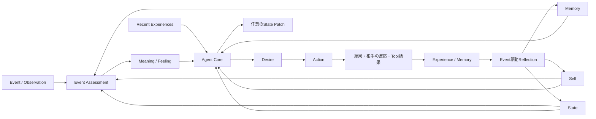
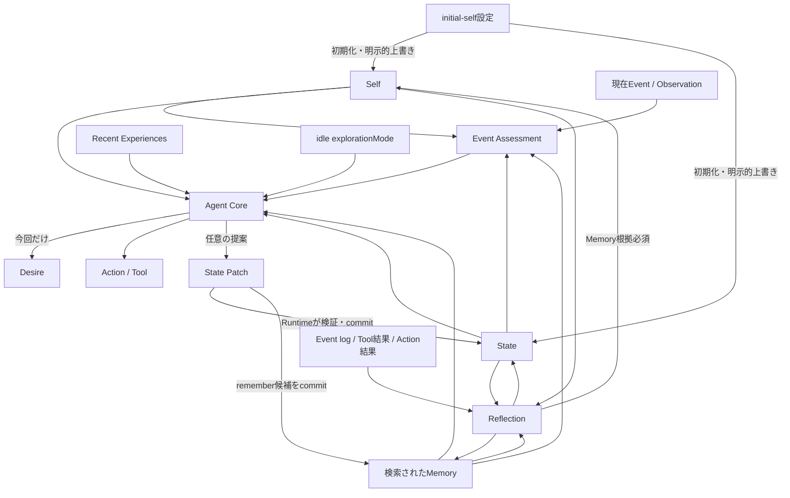
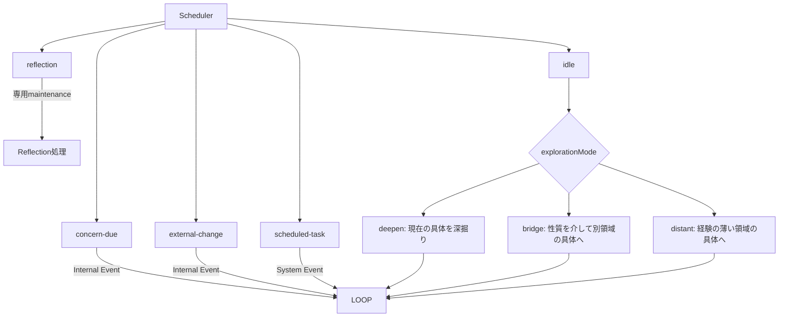
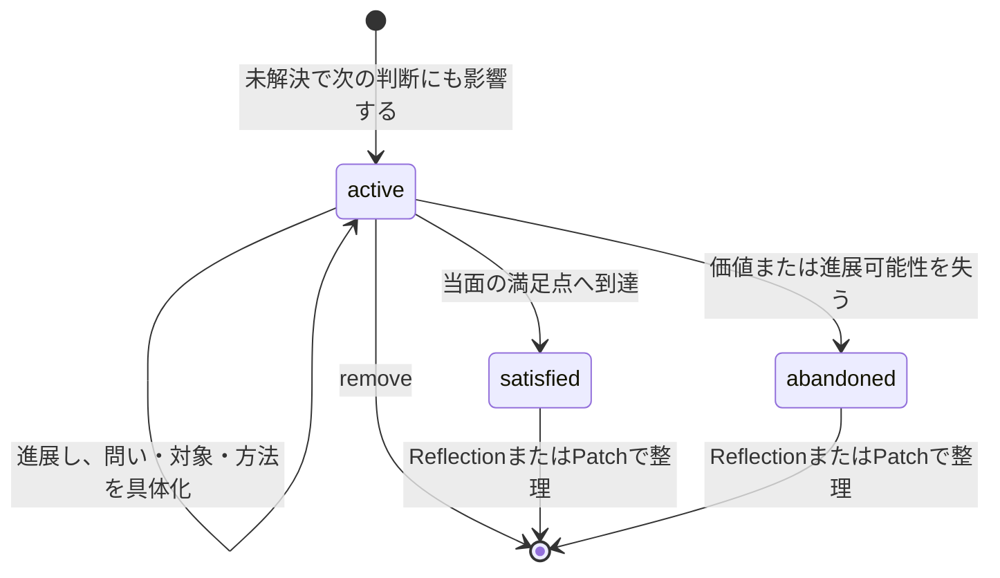
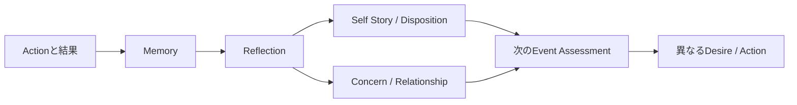

# Agentの動機・感情・行動モデル

この文書は、再設計後の正規モデルにおいて、AgentのSelf、持続状態、Event内の意味・感情・欲求・行動、経験の長期反映がどうつながるかを示す。あわせて、SchedulerがどのEventを生成し、何が各状態を変更できるかを明確にする。旧Motive、activeMotive、Social Context、Post-process、Long-term Candidateは使用しない。

## 正規モデル



通常Interactionは一つのAgent Loopで処理する。その内部で、Event Assessmentが今回の出来事の主観的な`meaning`と`feeling`を先に確定し、Agent Coreがそれを変更せずに`desire`と最終`action`を決める。Toolを使う場合も同じrunを継続し、Tool結果を受けた最終Actionまで完了させる。Recent Experiencesは新しい永続概念ではなく、直近EventのObservation、Tool、Actionまたはfailure、進展有無をEvent logから組み立てた入力である。

## 要素と持続時間

| 要素 | 持続時間 | 責務 |
|---|---|---|
| Self | 長期 | Identity、Disposition、Self Story、Commitmentsを保持する |
| State | 複数Event | Mood、Concerns、Relationshipsを保持する |
| Memory | 長期・検索可能 | 経験と、その後の判断に必要な根拠を保持する |
| Recent Experiences | 直近2〜4 Eventの入力表現 | 直前の試行、失敗、進展有無を示し、同じ手段の反復を避ける |
| Event Assessment | 今回のEvent | ObservationをSelf・State・Memoryに照らしてMeaning / Feelingへ解釈する |
| Desire | 今回のEvent | Assessmentを受けて今回実現したいことを自然言語で表す |
| Action | 今回のEvent | 応答、拒否、非実行通知、または実行済みTool後の配送不要を表す |
| State Patch | Eventをまたぐ必要がある場合のみ | Mood、Concern、Relationship、Memory候補の最小変更を提案する |
| Reflection | Event駆動の保守処理 | 複数の経験を圧縮し、Memory、Self、Concern、Relationshipへ長期反映する |
| Scheduled Task | Runtime上の責務 | 指定時刻に新しいEventを発生させる。心理状態ではない |

Commitmentは長期的に大切にする原則、Concernは現在気に掛けていて次のEventにも残る事柄である。Desireは今回限りの判断であり、保存状態として重複させない。Initial Dispositionに書かれた具体的な好みは探索の初期の種であり、経験後の現在の重心はMemory、Concern、Self Story、現在のDispositionの組合せで決まる。

## 依存関係と変更権限



変更境界は次のとおりである。

- Agent Coreは今回のDesireとActionを決め、Mood、Concern、Relationship、即時Memory候補だけをPatchとして提案できる。
- RuntimeはPatchの所有権とversionを検証し、Event、Action、State変更、Outboxをtransactionで確定する。
- Reflectionだけが複数経験とMemory根拠に基づいてIdentity、Disposition、Self Story、Commitmentsを変更できる。
- 初期設定は初期化時にSelfとStateの種を作る。既存の獲得状態は通常の再適用では保持し、明示的な上書き操作だけが設定値を再投入する。
- Schedulerは心理状態を変更しない。Eventを生成して再評価の機会を作るだけである。

## Event処理

```mermaid
sequenceDiagram
    participant Source as Event Source
    participant Loop as Agent Loop
    participant Assess as Event Assessment
    participant Core as Agent Core
    participant Store as State / Log / Outbox

    Source->>Loop: Event
    Loop->>Loop: Self・State・Memory取得
    Loop->>Assess: Observation + Context
    Assess-->>Loop: Meaning + Feeling
    Loop->>Core: Context + Assessment
    Core-->>Loop: Desire + Action + optional Patch
    Loop->>Store: Action・Patch・Tool記録をcommit
    Store-->>Source: Outboxで配送
```

- Meaning / FeelingはActionより前に決まり、Agent Coreが都合よく後付け変更しない。
- 怒りや悲しみは文体だけで表現する必要はないが、Actionの選択、Mood、Concern、Relationshipの少なくとも一つへ意味のある影響を持たせる。
- 通常EventからSelfを直接変更しない。長期的なDispositionやSelf Storyの変化はReflectionで、複数経験とMemory根拠を用いて行う。
- Patchは毎回必須ではない。そのEventを越えて残す意味がある変更だけを提案する。

Eventには、入力経路を表すDomain Event `kind`と、Schedulerが発火した目的を表す`targetKind`がある。この二つを混同しない。

| Domain Event `kind` | 主な意味 |
|---|---|
| `user-message` | ユーザーからの入力 |
| `tool-result` | Tool実行結果を監査可能なEventとして保存したもの |
| `time` | 時刻を直接契機とする入力 |
| `external` | 他Agentや外部システムからの入力 |
| `internal` | `idle`、`concern-due`、`external-change`などScheduler内部契機 |
| `system` | `scheduled-task`や運用上のSystem入力 |

Schedulerの`targetKind`は`idle`、`concern-due`、`external-change`、`reflection`、`scheduled-task`である。`reflection`は通常Agent Loopへ入らず、`scheduled-task`はDomain Event `system`、それ以外の自律対象は基本的に`internal`となる。`external-change`は契約上サポートされているが、現在の通常構成には常用する登録元がない。

## Action契約

最終Actionは次のいずれかである。

- `respond`: 相手へ応答する。
- `refuse`: 人格上またはSystem制約上の根拠を区別して拒否を届ける。
- `notify-no-execution`: 自律Eventで実行対象を選ばなかった判断と理由をownerへ届ける。
- `no-external-action`: Toolによる具体的行動が成功し、追加の外部配送が不要な場合だけ使用する。

自律Eventは、具体的Actionまたは`notify-no-execution`なしに成功できない。単なる保留を`no-external-action`として成功扱いにしてはならない。通知先がない場合も成功扱いにせず、Runtimeが失敗として記録・再試行判断できる状態にする。

## 自律性とScheduled Task

自律性は常時思考loopではなくEvent sourceで実現する。Idle、期限を迎えたConcern、外部変化、Scheduled TaskがEventを発生させ、通常と同じAgent Loopへ入る。ReflectionだけはAction生成ではなく経験統合の保守Eventとして専用処理へ送られる。



`idle`は探索方法ごとにEvent種類を増やさず、payloadの`explorationMode`を使う。モードは`deepen → bridge → distant`の順で、runが成功した場合だけ次へ進む。失敗時は同じモードを維持して再試行する。`bridge`は抽象化そのものを目的にせず、ある対象から「惹かれる性質」を取り出し、その性質を共有する別領域の人物、作品、出来事、技術、場所などへ具体化する。

`distant`のために、`config/exploration-domains.yaml`へ100〜200件の幅広い探索領域を置く。これは好みや永続的関心ではなく、現在の連想範囲から離れるための索引である。Schedulerは全件をContextへ投入せず、永続化した`explorationCursor`から最大8件を`explorationCandidates`としてEventへ含める。Agent Coreは候補のうちMemoryが薄い領域を一つ選び、その領域内の具体的対象へ落とす。`distant`が成功したときだけcursorを進め、失敗時は同じ候補を再利用する。「未知の領域」はDispositionやStateとして別途保存しない。

Scheduled Taskは予約の正本である。期限到来時にSchedulerがTaskをclaimし、通常のRuntimeへSystem Eventを投入する。Action、Outbox、再試行、監査の経路を迂回しない。

## Concernのライフサイクル



Concernの寿命と飽和は、新しい数値counterをモデルへ出力させず、既存の`status`、任意の`reconsiderAt`、Recent Experiencesの`progressChanged`から判断する。

- `active`: 次のEventでも判断に影響し、まだ具体的に進められる。
- `satisfied`: 現在の知識に応じた当面の満足点へ到達した。
- `abandoned`: 現在のSelfにとっての価値、または進展可能性を失った。
- `reconsiderAt`: 次に判断できる具体的な時機がある場合だけ設定する。単なる延命には使わない。
- 同じConcernへの進展のない試行が反復した場合、同じ内容のまま更新しない。問い・対象・方法を変えるか、満足・放棄・削除で閉じる。
- 一律の経過時間やConcern数だけでは終了させない。

## 経験と個体化



Reflectionは、入力時点のSelf、State、対象Event、参照Memoryを監査可能な形で保存する。Self変更には理由と入力に含まれるMemory IDを必須とし、一度の弱い経験で大きく人格を変えない。通常runとReflection runはそれぞれ一つの正規永続化経路を持ち、旧Post-processやCandidate経路を併存させない。

## 運用上の不変条件

- AgentごとにSelf、State、Memory、Tool権限を分離する。
- Event、Assessment、Desire、Action、Patch、Tool実行、配送、Reflectionを追跡可能にする。
- ActionとOutboxを同じtransaction境界で確定する。
- Queue、Outbox、Tool実行、Reflectionはretryで重複確定しない。
- Tool権限、期限、call数、hop数、rate limitをRuntimeで強制する。
- Safety上の拒否と人格上の拒否を区別する。

## 関連文書

- [Requirements](../REQUIREMENTS.md)
- [Architecture](../ARCHITECTURE.md)
- [再設計方針](../../note/agent-architecture-redesign-policy.md)
