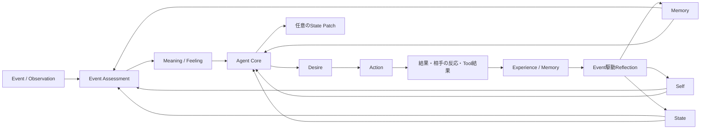
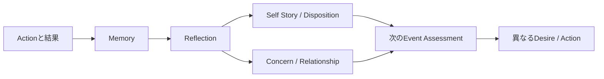

# Agentの動機・感情・行動モデル

この文書は、再設計後の正規モデルにおいて、AgentのSelf、持続状態、Event内の意味・感情・欲求・行動、経験の長期反映がどうつながるかを示す。旧Motive、activeMotive、Social Context、Post-process、Long-term Candidateは使用しない。

## 正規モデル



通常Interactionは一つのAgent Loopで処理する。その内部で、Event Assessmentが今回の出来事の主観的な`meaning`と`feeling`を先に確定し、Agent Coreがそれを変更せずに`desire`と最終`action`を決める。Toolを使う場合も同じrunを継続し、Tool結果を受けた最終Actionまで完了させる。

## 要素と持続時間

| 要素 | 持続時間 | 責務 |
|---|---|---|
| Self | 長期 | Identity、Disposition、Self Story、Commitmentsを保持する |
| State | 複数Event | Mood、Concerns、Relationshipsを保持する |
| Memory | 長期・検索可能 | 経験と、その後の判断に必要な根拠を保持する |
| Event Assessment | 今回のEvent | ObservationをSelf・State・Memoryに照らしてMeaning / Feelingへ解釈する |
| Desire | 今回のEvent | Assessmentを受けて今回実現したいことを自然言語で表す |
| Action | 今回のEvent | 応答、拒否、非実行通知、または実行済みTool後の配送不要を表す |
| State Patch | Eventをまたぐ必要がある場合のみ | Mood、Concern、Relationship、Memory候補の最小変更を提案する |
| Reflection | Event駆動の保守処理 | 複数の経験を圧縮し、Memory、Self、Concern、Relationshipへ長期反映する |
| Scheduled Task | Runtime上の責務 | 指定時刻に新しいEventを発生させる。心理状態ではない |

Commitmentは長期的に大切にする原則、Concernは現在気に掛けていて次のEventにも残る事柄である。Desireは今回限りの判断であり、保存状態として重複させない。

## Event処理

```mermaid
sequenceDiagram
    participant Source as Event Source
    participant Loop as Agent Loop
    participant Assess as Event Assessment
    participant Core as Agent Core
    participant Store as State / Log / Outbox

    Source->>Loop: Event
    Loop->>Loop: Self・State・Memory取得
    Loop->>Assess: Observation + Context
    Assess-->>Loop: Meaning + Feeling
    Loop->>Core: Context + Assessment
    Core-->>Loop: Desire + Action + optional Patch
    Loop->>Store: Action・Patch・Tool記録をcommit
    Store-->>Source: Outboxで配送
```

- Meaning / FeelingはActionより前に決まり、Agent Coreが都合よく後付け変更しない。
- 怒りや悲しみは文体だけで表現する必要はないが、Actionの選択、Mood、Concern、Relationshipの少なくとも一つへ意味のある影響を持たせる。
- 通常EventからSelfを直接変更しない。長期的なDispositionやSelf Storyの変化はReflectionで、複数経験とMemory根拠を用いて行う。
- Patchは毎回必須ではない。そのEventを越えて残す意味がある変更だけを提案する。

## Action契約

最終Actionは次のいずれかである。

- `respond`: 相手へ応答する。
- `refuse`: 人格上またはSystem制約上の根拠を区別して拒否を届ける。
- `notify-no-execution`: 自律Eventで実行対象を選ばなかった判断と理由をownerへ届ける。
- `no-external-action`: Toolによる具体的行動が成功し、追加の外部配送が不要な場合だけ使用する。

自律Eventは、具体的Actionまたは`notify-no-execution`なしに成功できない。単なる保留を`no-external-action`として成功扱いにしてはならない。通知先がない場合も成功扱いにせず、Runtimeが失敗として記録・再試行判断できる状態にする。

## 自律性とScheduled Task

自律性は常時思考loopではなくEvent sourceで実現する。Idle、期限を迎えたConcern、外部変化、Scheduled TaskがEventを発生させ、通常と同じAgent Loopへ入る。ReflectionだけはAction生成ではなく経験統合の保守Eventとして専用処理へ送られる。

Scheduled Taskは予約の正本である。期限到来時にSchedulerがTaskをclaimし、通常のRuntimeへSystem Eventを投入する。Action、Outbox、再試行、監査の経路を迂回しない。

## 経験と個体化



Reflectionは、入力時点のSelf、State、対象Event、参照Memoryを監査可能な形で保存する。Self変更には理由と入力に含まれるMemory IDを必須とし、一度の弱い経験で大きく人格を変えない。通常runとReflection runはそれぞれ一つの正規永続化経路を持ち、旧Post-processやCandidate経路を併存させない。

## 運用上の不変条件

- AgentごとにSelf、State、Memory、Tool権限を分離する。
- Event、Assessment、Desire、Action、Patch、Tool実行、配送、Reflectionを追跡可能にする。
- ActionとOutboxを同じtransaction境界で確定する。
- Queue、Outbox、Tool実行、Reflectionはretryで重複確定しない。
- Tool権限、期限、call数、hop数、rate limitをRuntimeで強制する。
- Safety上の拒否と人格上の拒否を区別する。

## 関連文書

- [Requirements](./REQUIREMENTS.md)
- [Architecture](./ARCHITECTURE.md)
- [再設計方針](../../note/agent-architecture-redesign-policy.md)
