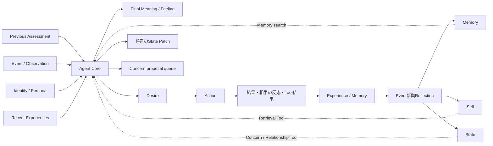
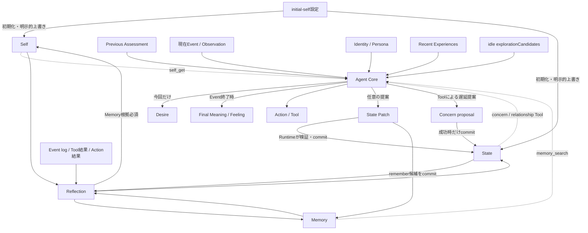
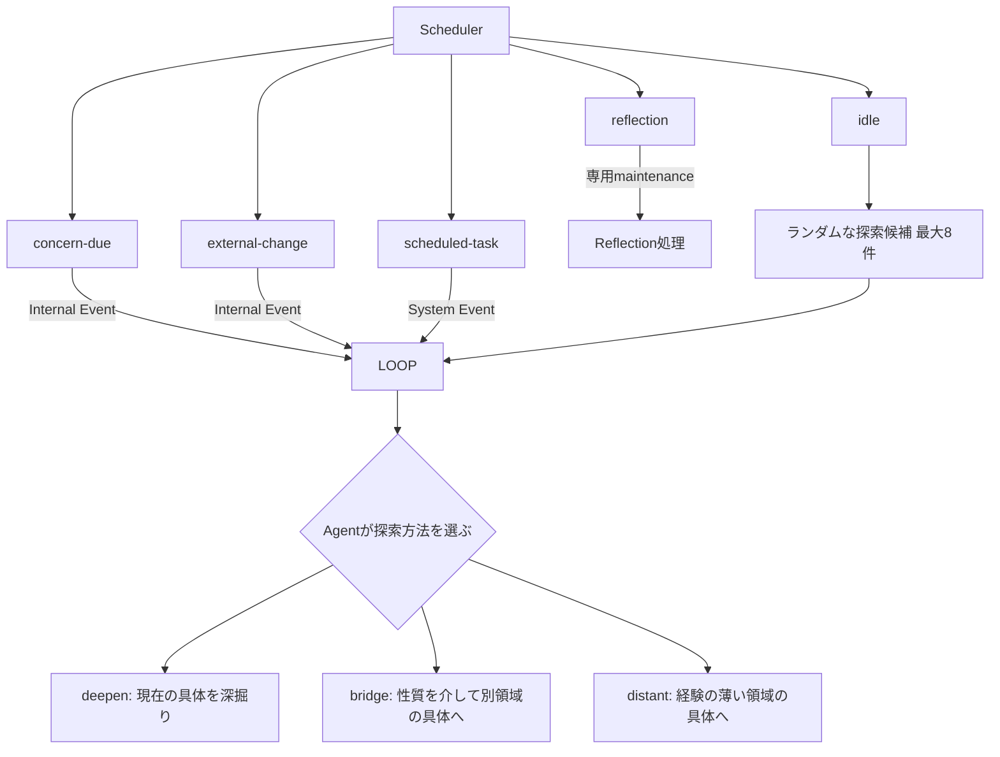
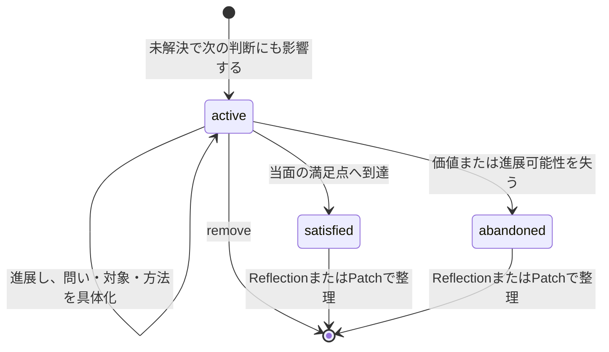
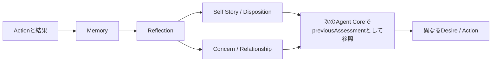

# Agentの動機・感情・行動モデル

この文書は、再設計後の正規モデルにおいて、AgentのSelf、持続状態、Event内の意味・感情・欲求・行動、経験の長期反映がどうつながるかを示す。あわせて、SchedulerがどのEventを生成し、何が各状態を変更できるかを明確にする。旧Motive、activeMotive、Social Context、Post-process、Long-term Candidateは使用しない。

## 正規モデル



通常Interactionは一つのAgent Loopで処理する。Agent Coreは直近の成功Event終了時の`previousAssessment`を時刻付きで受け、経過時間、重要性、未解決性、現在Eventとの関連から残っている影響だけを用いる。今回のEventを処理し、必要なTool結果も見た後で、`desire`、最終`action`、今回終了時の`meaning`と`feeling`を同じ構造化出力で確定する。Self、Concern、Memory、Relationshipの本文は初期Contextへ一括投入せず、必要なものをRetrieval Toolで得る。Recent Experiencesは新しい永続概念ではなく、直近2 Eventから次の判断に必要なObservation要点、Tool signal、Actionまたはfailure、進展有無を組み立てた入力である。監査用metadataと元のTool本文はEvent logとTool executionに残し、Recent Experiencesへ複製しない。

## 要素と持続時間

| 要素 | 持続時間 | 責務 |
|---|---|---|
| Self | 長期 | Identity、Disposition、Self Story、Commitmentsを保持する |
| State | 複数Event | Mood、Concerns、Relationshipsを保持する |
| Memory | 長期・検索可能 | 経験と、その後の判断に必要な根拠を保持する |
| Recent Experiences | 直近2 Eventの意味投影 | 直前の試行、失敗、進展有無とToolの識別signalを示し、本文を再投入せず同じ手段の反復を避ける |
| Previous Assessment | 直近Eventから一時的に継続 | 直近の成功Event終了時のMeaning / Feelingと時刻を1件だけ渡し、感情の連続性を保つ |
| Final Assessment | 今回のEvent | Agent CoreがEvent、再解釈、取得Context、Tool結果を踏まえ、終了時のMeaning / Feelingを確定する |
| Desire | 今回のEvent | 今回実現したいことを自然言語で表す |
| Action | 今回のEvent | 応答、拒否、非実行通知、または実行済みTool後の配送不要を表す |
| State Patch | Eventをまたぐ必要がある場合のみ | Mood、Relationship、Memory候補の最小変更を提案する |
| Concern proposal | Eventをまたぐ未解決事項が生じた場合のみ | `concern_propose`でrun-localに提案し、成功commit時だけ作成・派生する |
| Reflection | Event駆動の保守処理 | 複数の経験を圧縮し、Memory、Self、Concern、Relationshipへ長期反映する |
| Scheduled Task | Runtime上の責務 | 指定時刻に新しいEventを発生させる。心理状態ではない |

Commitmentは長期的に大切にする原則、Concernは現在気に掛けていて次のEventにも残る事柄である。Desireは今回限りの判断であり、保存状態として重複させない。Initial Dispositionに書かれた具体的な好みは探索の初期の種であり、経験後の現在の重心はMemory、Concern、Self Story、現在のDispositionの組合せで決まる。

## ユーザーへの関心

ユーザーは依頼の送信元ではなく、継続的な関係を持つ具体的な相手として扱う。Agentは会話の流れに関係し、相手を理解することが今後の対話に役立つ場合、まず現在の話題へ応答したうえで、生活、仕事、趣味、経験、好みなどについて具体的な質問を1件まで添えられる。プロフィール項目を順番に埋める質問、現在の話題と無関係な質問、既知の事実を聞き直す質問は行わない。

ユーザーについて得た具体的な事実は、送信者をsubjectとするMemoryとして保持する。Relationshipは「気安く話せる」「この話題では慎重さが必要」といった関係そのものの現在状態を保持し、プロフィール情報の保存先にはしない。質問前には必要に応じてMemoryとRelationshipを検索し、既知の事実から一段深い問いへ進む。自律探索で得た情報も、既知のユーザーの好み、仕事、経験、最近の話題と自然につながる場合は共有できる。

ユーザーを知ること自体を機械的にConcernへ変換しない。後日確認する具体的な約束、継続調査する価値のある問い、未解決事項が生じた場合だけConcernとして残す。

## 依存関係と変更権限



変更境界は次のとおりである。

- Agent Coreは今回のDesireとActionを決め、Mood、Relationship、即時Memory候補をPatchとして提案できる。Concernは最終出力ではなく`concern_propose`で提案する。
- RuntimeはPatchの所有権とversionを検証し、Event、Action、State変更、Outboxをtransactionで確定する。
- Reflectionだけが複数経験とMemory根拠に基づいてIdentity、Disposition、Self Story、Commitmentsを変更できる。
- 初期設定は初期化時にSelfとStateの種を作る。既存の獲得状態は通常の再適用では保持し、明示的な上書き操作だけが設定値を再投入する。
- Schedulerは心理状態を変更しない。Eventを生成して再評価の機会を作るだけである。

## Event処理

```mermaid
sequenceDiagram
    participant Source as Event Source
    participant Loop as Agent Loop
    participant Core as Agent Core
    participant Store as State / Log / Outbox

    Source->>Loop: Event
    Loop->>Loop: 最小Context + previousAssessmentを構築
    Loop->>Core: Event + 最小Context
    Core->>Core: 必要な永続ContextをToolで取得
    Core-->>Loop: Final Assessment + Desire + Action + optional Patch / Concern proposal
    Loop->>Store: Assessment・Action・Patch・proposal・Tool記録をcommit
    Store-->>Source: Outboxで配送
```

- Meaning / FeelingはActionを正当化するために作らず、Event、再解釈、取得したContext、Tool結果を踏まえたEvent終了時の評価としてAgent Coreが確定する。
- 怒りや悲しみは文体だけで表現する必要はないが、Actionの選択、Mood、必要なConcern proposal、Relationshipの少なくとも一つへ意味のある影響を持たせる。
- 通常EventからSelfを直接変更しない。長期的なDispositionやSelf Storyの変化はReflectionで、複数経験とMemory根拠を用いて行う。
- Patchは毎回必須ではない。そのEventを越えて残す意味がある変更だけを提案する。

Eventには、入力経路を表すDomain Event `kind`と、Schedulerが発火した目的を表す`targetKind`がある。この二つを混同しない。

| Domain Event `kind` | 主な意味 |
|---|---|
| `user-message` | ユーザーからの入力 |
| `tool-result` | Tool実行結果を監査可能なEventとして保存したもの |
| `time` | 時刻を直接契機とする入力 |
| `external` | 他Agentや外部システムからの入力 |
| `internal` | `idle`、`concern-due`、`external-change`などScheduler内部契機 |
| `system` | `scheduled-task`や運用上のSystem入力 |

Schedulerの`targetKind`は`idle`、`concern-due`、`external-change`、`reflection`、`scheduled-task`である。`reflection`は通常Agent Loopへ入らず、`scheduled-task`はDomain Event `system`、それ以外の自律対象は基本的に`internal`となる。`external-change`は契約上サポートされているが、現在の通常構成には常用する登録元がない。

## Action契約

最終Actionは次のいずれかである。

- `respond`: 相手へ応答する。
- `refuse`: 人格上またはSystem制約上の根拠を区別して拒否を届ける。
- `notify-no-execution`: 自律Eventで実行対象を選ばなかった判断と理由をownerへ届ける。
- `no-external-action`: Agentが今回は外部発話を行わないと判断した場合に使用する。Tool利用の有無とは独立する。

自律EventではTool利用と発話判断を独立させる。調査後にも共有価値があれば発話し、Toolを使わなくても話したいことがあれば発話する。ユーザーからの返信待ちは沈黙理由にしない。夜間はRuntimeによる禁止ではなく、緊急性と合わせてAgentが発話を控える判断材料にできる。

## 自律性とScheduled Task

自律性は常時思考loopではなくEvent sourceで実現する。Idle、期限を迎えたConcern、外部変化、Scheduled TaskがEventを発生させ、通常と同じAgent Loopへ入る。ReflectionだけはAction生成ではなく経験統合の保守Eventとして専用処理へ送られる。



`idle`は探索方法ごとにEvent種類を増やさない。Agent CoreがConcern取得後に、`concern_propose`の`explorationMode`として`deepen`、`bridge`、`distant`を必要に応じて選ぶ。`bridge`は抽象化そのものを目的にせず、ある対象から「惹かれる性質」を取り出し、その性質を共有する別領域の人物、作品、出来事、技術、場所などへ具体化する。

`distant`のために、`config/exploration-domains.yaml`へ100〜200件の幅広い探索領域を置く。これは好みや永続的関心ではなく、現在の連想範囲から離れるための索引である。Schedulerは全件をContextへ投入せず、`idle` Eventごとにランダムな最大8件を`explorationCandidates`として含める。Agent Coreは必要な場合だけ候補から経験の薄い領域を一つ選び、その領域内の具体的対象へ落とす。永続cursorや固定順の巡回は持たない。「未知の領域」はDispositionやStateとして別途保存しない。

Scheduled Taskは予約の正本である。期限到来時にSchedulerがTaskをclaimし、通常のRuntimeへSystem Eventを投入する。Action、Outbox、再試行、監査の経路を迂回しない。

## Concernのライフサイクル



Concernの寿命と飽和は、新しい数値counterをモデルへ出力させず、既存の`status`、任意の`reconsiderAt`、Recent Experiencesの`progressChanged`から判断する。

- `active`: 次のEventでも判断に影響し、まだ具体的に進められる。
- `satisfied`: 現在の知識に応じた当面の満足点へ到達した。
- `abandoned`: 現在のSelfにとっての価値、または進展可能性を失った。
- `reconsiderAt`: 次に判断できる具体的な時機がある場合だけ設定する。単なる延命には使わない。
- 同じConcernへの進展のない試行が反復した場合、同じ内容のまま更新しない。問い・対象・方法を変えるか、満足・放棄・削除で閉じる。
- 一律の経過時間やConcern数だけでは終了させない。

## 経験と個体化



Reflectionは、入力時点のSelf、State、対象Event、参照Memoryを監査可能な形で保存する。Self変更には理由と入力に含まれるMemory IDを必須とし、一度の弱い経験で大きく人格を変えない。通常runとReflection runはそれぞれ一つの正規永続化経路を持ち、旧Post-processやCandidate経路を併存させない。

Memoryは元会話やTool結果の保管場所ではない。後の検索で状況と判断への影響を復元できる、具体的な経験の要点を1〜2文で持つ。完全な本文が必要な場合は、Recent Experienceを肥大化させず、保存済みsnapshot IDやpathをToolで再参照する。

## 運用上の不変条件

- AgentごとにSelf、State、Memory、Tool権限を分離する。
- Event、Assessment、Desire、Action、Patch、Tool実行、配送、Reflectionを追跡可能にする。
- ActionとOutboxを同じtransaction境界で確定する。
- Queue、Outbox、Tool実行、Reflectionはretryで重複確定しない。
- Tool権限、期限、call数、hop数、rate limitをRuntimeで強制する。
- Safety上の拒否と人格上の拒否を区別する。

## 関連文書

- [Requirements](../REQUIREMENTS.md)
- [Architecture](../ARCHITECTURE.md)
- [再設計方針](../../note/agent-architecture-redesign-policy.md)
