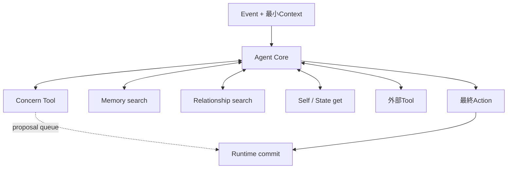

# Concern駆動Agent Core設計案

## 位置付け

この文書は、Concern駆動の自律行動とAgent CoreのContext・Tool境界を定める、次の実装修正の設計方針である。正規モデル全体は[AGENT_MOTIVATION_MODEL.md](./AGENT_MOTIVATION_MODEL.md)を参照する。

## 採用方針

- Agent Coreは一つのDeep Agentとして維持する。
- 自律行動はConcern駆動へ統一し、1 Eventで扱うFocus Concernは1件とする。
- 初期Contextを最小化し、Concern、Memory、Relationship、SelfなどはAgentic Retrievalで取得する。
- Dynamic Tool Filteringにより、各model callで必要なTool Schemaだけをモデルへ渡す。
- Concernの作成・派生はToolでrun-local queueへ提案し、Agent Core成功後に確定する。
- ReflectionはConcernを新規探索せず、重複整理、統合、終了判定を行う。

Concern PlannerとAgent Coreを別々のDeep Agentとして常時直列実行する案、Agent Core後にConcern専用LLMを毎回呼ぶ案、Agent Coreの最終出力へ複数Concern変更を含める案は採用しない。Provider Tool SearchはOllamaが対応しないため利用しない。SkillsによるTool Bindingは現在の`deepagents` 1.14.1では必要versionを満たさない。Subagentは将来、多段階調査のContext隔離が必要な場合に限って検討する。

## Concern契約

Concernは、次の自律行動で何を明らかにする、試す、または確認するかを表す具体的な未解決事項である。

- `description`: 対象と次に行う確認・調査・試行を書く。
- `whyItMatters`: 結果をどの判断、行動、会話、またはConcern解決に使うかを書く。
- 調査履歴、Tool結果、資料候補、実行記録は含めない。
- 1 Event内で完結した興味や調査結果はConcernにしない。
- 新規ConcernのID、`active` status、管理metadataはRuntimeが付与する。

```yaml
description: 復元されたフォノトグラフ音声の正確性を研究者がどう検証したか確認する
whyItMatters: 復元音声を歴史的事実として紹介できるか判断するため
```

「音の記録について考える」「自分の存在の根幹に関係する」のように、対象、次の行為、結果の利用先が判別できない表現は作らない。

## 自律行動とConcernの派生

- active Concernがあれば、dueを優先してFocus Concernを1件選び、具体的なActionで進める。
- active Concernがなければ、Disposition、Memory、現在Event、探索候補からConcernを原則1件作る。
- 行動結果から継続して追う問いが生じた場合、後続Concernを通常1件作る。
- 独立して並行追跡する価値がある場合だけforkする。作成数は3件程度までをPrompt上の目安とし、件数超過だけをSchema errorにはしない。
- `idle`と`concern-due`は別の思考経路にしない。いずれも同じAgent Coreへ入り、期限はFocus選択の優先条件として扱う。

`deepen`、`bridge`、`distant`はEvent種類ではなく、Concernを作成・派生させる探索方法である。

| 方法 | 意味 |
|---|---|
| `deepen` | Focus Concernと同じ具体的対象をさらに掘り下げる |
| `bridge` | 対象から性質を一度だけ抽出し、その性質を共有する別領域の具体へ移る |
| `distant` | 既存ConcernやMemoryから離れ、経験の薄い領域の具体を選ぶ |

通常は元Concernを閉じて後続Concernへ`replace`し、並行追跡が必要な場合だけ`fork`する。探索方法や抽象語ではなく、到達した具体的未解決事項をConcernに保存する。

## Agent CoreのContext



初期Contextには次だけを含める。

- 現在EventのObservationとユーザー入力本文
- `eventKind`、`targetKind`、発生時刻
- 最小限のIdentityと発話persona
- 直近2件程度の簡潔なRecent Experience
- Dynamic Tool Filtering後のTool

Concern本文、Memory、Relationship、Mood、Disposition全文、Self Story、Commitments、Memory retrieval trace、探索領域カタログはデフォルト投入しない。agentId、runId、配送先、DB接続、権限、limitなどモデルの判断へ直接不要な値はRuntime contextに置き、promptへ複製しない。

## Dynamic Tool Filtering

実行可能なTool集合と、各model callでモデルへ公開するTool集合を分離する。既存middlewareの`wrapModelCall`で、次の条件から`request.tools`を絞る。

- Event種別とrun段階
- `concern_list`、`concern_get`の実行状態とFocus取得状態
- AgentごとのTool権限
- maxToolCallsとcontent-read budget

| 状況 | 主に公開するTool |
|---|---|
| ユーザー入力 | `memory_search`、`relationship_search`、`concern_propose`、利用可能な外部・Scheduled Task Tool |
| 自律Event開始 | `concern_list`、`concern_get`、`concern_propose`、`memory_search`、`self_get`、利用可能な外部Tool |
| Focus取得後 | Focusを進める取得・調査Toolと`concern_propose` |
| 最終Action確定 | 通常Toolを隠し、最終構造化出力だけを要求する |
| Reflection | Agent Core用Toolを公開しない |

非公開Toolの呼出しは実行せず、利用可能なToolだけを使うようTool errorを返す。初期実装はEvent種別と権限による決定的なfilterとし、別LLMや意味類似度によるTool選択は導入しない。

## Retrieval・Concern Tool

Toolは短い説明、少ない引数、小さい返却値を持ち、検索結果には件数上限を設ける。

| Tool | 契約 |
|---|---|
| `concern_list` | Focus選択用にID、短いdescription、reconsiderAt、直近進展時刻を返す |
| `concern_get` | 1件のdescription、whyItMatters、status、reconsiderAt、直近2件程度の進展を返す |
| `concern_propose` | 新規・派生Concernをrun-local queueへ積み、永続化予定だけを返す |
| `memory_search` | query、subject、limitで検索し、ID、1〜2文の要点、significance、occurredAtを返す |
| `relationship_search` | subjectId完全一致または自然言語queryで、subjectIdと簡潔なdescriptionを返す |
| `self_get` | Disposition、Self Story、Commitments、Moodの必要な現在値を返す |

ユーザー入力の送信者は`relationship_search`の既定subjectとしてRuntimeから解決し、Agentに内部IDを推測させない。Schedulerは`idle` Eventに、`config/exploration-domains.yaml`から重複なくランダム抽出した最大8件だけを添付する。Agentは`concern_propose`で`distant`を選ぶときにこの候補を利用できるが、候補の採用は必須ではない。全カタログや永続cursorはmodelへ渡さない。元会話やTool本文をMemory検索結果へ複製しない。

### `concern_propose`

```ts
type ConcernProposal = {
  operation: "create" | "derive";
  description: string;
  whyItMatters: string;
  sourceConcernId?: string;
  explorationMode?: "deepen" | "bridge" | "distant";
  transition?: "replace" | "fork";
  reconsiderAt?: string;
};
```

`derive`はFocus Concernから後続Concernを作り、`sourceConcernId`を指定する。`deepen`と`bridge`は原則として派生元を必要とし、`distant`は派生元なしでもよい。queueはappend-onlyとし、Agent Core成功時だけRuntimeがAction、Event、Outboxと整合するtransaction境界で確定する。run失敗時は破棄する。

既存Concernの減衰、進展判定、`satisfied`、`abandoned`、remove、`reconsiderAt`による再検討はConcernライフサイクルで扱い、新規作成Toolへ混在させない。

## Event別の規則

ユーザー入力Eventは応答を主目的とする。必要なContextをToolで取得し、次のEventにも残る具体的な未解決事項が生じた場合だけ`concern_propose`を使う。

自律Eventは次の順に処理する。

1. 最初に`concern_list`を呼び、Concernの有無とdueを確認する。
2. Concernがあればdueを優先してFocus Concernを1件選び、`concern_get`で取得する。
3. Focus Concernを進める具体的なActionを行う。
4. 継続して追う問いが生じた場合だけ後続Concernを提案する。
5. Concernがなければ、必要なSelfやMemoryとEventの探索候補を参照し、Concernを原則1件提案する。

Tool利用と発話判断は独立する。ユーザーからの返信待ちは沈黙理由にしない。

## Reflection

Reflectionは新規Concernを探索せず、複数Eventを基に次を行う。

- 重複Concernの統合
- 停滞したConcernの終了判断
- `satisfied`、`abandoned`、removeによる整理
- Concern本文へ混入した履歴の除去と具体化

## 現在の実装

- Agent Coreの最終出力SchemaからConcern変更を除き、`concern_propose`の成功結果をrun-local proposalとして回収する。
- RuntimeはAgent Core成功後にproposalを状態へ適用し、Event、Action、Outboxと同じtransactionで保存する。失敗runのproposalは適用しない。
- `derive + replace`は派生元を`satisfied`にして後続Concernをactiveで追加し、`fork`は派生元を残す。
- 最初のmodel callではEvent種別でToolを絞り、`concern_get`成功後は`concern_list`と`concern_get`を非公開にしてFocusを一件に保つ。
- 初期promptはEvent、Identity、Persona、直近2件のRecent Experience、制約、Event Assessmentだけを持つ。Concernの件数や本文を含む永続状態はRuntimeのcommit検証用には保持するが、model promptへは渡さない。
- Memoryの事前検索を廃止し、`concern_list`、`concern_get`、`memory_search`、`relationship_search`、`self_get`で必要時に取得する。
- Schedulerは`idle` Eventを所定時刻に発火し、探索領域カタログからランダムな最大8件を候補として添付するだけとする。Concernの存在確認、Focus選択、`deepen`・`bridge`・`distant`の選択、Concern提案はAgent Coreが行う。
- Scheduleには探索modeやcursorを永続化しない。候補はEventごとに独立して抽出する。

残る運用課題は、filter前後のTool Schema token量、Tool選択成功率、Concernの具体性と重複率を継続計測することである。

## 不変条件

- Agent Coreは一つのDeep AgentとしてEventを最後まで処理する。
- 1 EventのFocus Concernは1件である。
- Agent実行中にConcernの永続状態を変更しない。
- Concern提案はAgent Core成功後にだけ確定する。
- Concern作成失敗時のfailure方針を明示し、成功したユーザー応答を不用意に失わない。
- 永続ContextやTool結果の全文をmodel promptへ無制限に投入しない。
- Event、Tool実行、Concern提案、Action、永続化結果をrun単位で追跡できる。
