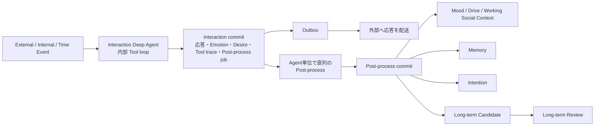

# 069: 応答・即時状態と応答後Post-processの境界を設計する

## Background

現在の通常Agent Coreは、最終応答、Emotion / Desireを含む状態更新、Memory、Intention、Long-term Candidateを一つの構造化出力として同時に生成する。このため、応答に関係しない持続状態や経験の整理まで完了しないと応答をOutboxへ確定できない。

合意した方針は、今回の応答や行動判断に直接関わる即時状態であるEmotionとDesireを応答と同じInteraction処理で確定し、Memory、Intention、Long-term Candidate、Mood、Drive、Working Social Contextなどの持続状態を応答後のPost-processで生成することである。`spec/`を一次情報とし、この分割が基本Agent LoopとShort-term / Long-term Updateの原則を損なわない実装境界を決める。

## Scope

- `spec/`の基本Agent Loop、Emotion / Mood、Desire / Intention、Memory、Short-term UpdateとLong-term Updateを調査する
- 現在のAgent Core出力、Runtime commit、Outbox、State Update、Memory / Intention / Candidate永続化の順序を調査する
- Interaction処理とPost-processの入力、出力、永続化責務、失敗時の再試行境界を設計する
- EmotionとDesireを応答と同じ処理・同じ整合性境界に置く理由を明記する
- Mood、Drive、Working Social Context、Memory、Intention、Long-term CandidateをPost-process対象とする条件と例外を定義する
- 応答配送とPost-processの並行関係、同一Agentの後続Eventとの順序、状態version競合時の扱いを決める
- Tool結果、とくにWeb ArchiveとEpisodic Memory提案をどちらの処理が扱うか決める

## Out of scope

- docsの本文修正
- Domain schema、Runtime、Agent Harness、DB schemaの変更
- Discord途中応答やtyping表示の実装
- Long-term Reviewの判断ロジック変更

## Implementation notes

- Deep Agent内のTool loopはInteraction処理に含める。RuntimeがToolを再実行する方式には戻さない。
- Interaction結果は、最終応答、最終行動、Emotion、Desire、およびPost-processを起動するために必要な根拠へ縮小する。
- Post-processは元Event、Interaction結果、Tool実行記録、必要な状態snapshotを正本入力として扱う。前runのAgent messageを暗黙継承しない。
- 応答を保存してからPost-processが失敗しても、経験整理を失わず再試行できるEventまたは永続ジョブ境界を設計する。
- MoodはEmotionより持続的、IntentionはDesireより持続的という概念上の区別を維持する。

## Acceptance criteria

- 各状態・提案がInteraction処理またはPost-processのどちらに属するか、理由とともに表で定義されている
- 応答とEmotion / Desireの一貫性を保つ保存境界が定義されている
- Post-processが応答配送を待たずに実行でき、失敗しても応答の配送結果を巻き戻さない設計になっている
- 同一Agentの次Eventが、必要な持続状態更新を見落とさない順序・競合解決方針が定義されている
- Tool結果とWeb Archiveの保存、Memory提案、Long-term Candidateの根拠参照の責務が矛盾なく定義されている
- 設計が`spec/`の基本Agent LoopとShort-term / Long-term Updateに矛盾しないことを確認している

## Tests

- 現在のRuntimeから、応答・状態・Memory・Intention・Candidateが同一実行・同一commitで処理される箇所を特定する
- Interaction成功・Post-process失敗・Post-process再試行・後続Event到着の時系列をレビューする
- Emotion / Desireが応答の文脈と同じ入力から決まること、持続状態がPost-process入力へ渡ることを確認する

## Dependencies

- Issue 067（Deep Agentの起動時再利用、完了済み）
- Issue 044（Web Page Archive実装、完了済み）
- Issue 045 / 046（Emotion / DesireのEvent境界、完了済み）

## Plan reference

- [Concept design: Emotion / Mood](../spec/personal-agent-concept-design-restructured-v2.md#9-emotion--mood)
- [Concept design: Desire / Intention](../spec/personal-agent-concept-design-restructured-v2.md#10-desire--intention)
- [Concept design: Memory](../spec/personal-agent-concept-design-restructured-v2.md#12-memory)
- [Concept design: 基本的なAgent Loop](../spec/personal-agent-concept-design-restructured-v2.md#21-基本的なagent-loop)
- [Implementation design: Short-term Update と Long-term Update](../spec/personal-agent-implementation-design-v2.md#21-short-term-update-と-long-term-update)
- [Implementation design: Long-term Update Candidate](../spec/personal-agent-implementation-design-v2.md#22-long-term-update-candidate)

## Result

### 採用するフロー



`Interaction Deep Agent` は現在のDeep Agentを置き換える別のTool loopではない。現在と同じく、必要に応じて `LLM → Tool call → Tool result → LLM` を内部で繰り返す。最終的に返す契約を、応答に必要な情報へ縮小する。

```ts
type InteractionOutput = {
  interpretation: { subjectiveMeaning?: string }
  immediateChanges: {
    emotion?: StateUpdateProposal
    desire?: StateUpdateProposal
  }
  action: FinalAction
}
```

`mood`、`drives`、`currentInterests`、`socialContext`、`memoryProposals`、`intentionProposals`、`longTermCandidates`はInteraction Outputに含めない。`Emotion`と`Desire`は今回の意味づけと最終応答・行動判断に使うEvent scopedな状態であり、Interaction commitのstate change / run resultに記録する。次EventのDynamic Stateとして復元しない既存方針を維持する。

Interaction commitは、親Event、Interaction run、即時状態変更、Tool execution trace、最終応答用Outbox envelope、Post-process jobを一つのDB transactionで確定する。応答とPost-process jobの片方だけが確定する状態を作らない。Outbox Dispatcherはcommit直後から応答を配送でき、Post-processのLLM、Memory embedding、持続状態保存を待たない。

### Post-process

Post-process jobは親Event ID、Interaction run ID、即時結果、Tool execution trace、Interaction開始時と即時commit後のstate versionを保持する。Post-process Coreは、この固定された経験と、即時commit後の正本Contextを入力として以下だけを提案する。

```ts
type PostProcessOutput = {
  persistentStateUpdates: StateUpdateProposal[] // mood, drives, currentInterests, socialContext
  memoryProposals: MemoryProposal[]
  intentionProposals: IntentionProposal[]
  longTermCandidates: LongTermCandidateProposal[]
}
```

Web ToolはInteractionのTool loop中にURL、本文、Snapshot、取得時刻などを保存する。Post-processはその実行記録・Snapshotを根拠に、記事本文ではなく「何を調べ、何が分かったか」というEpisodic Memoryを提案する。Candidateが同じPost-processで新規作成したMemoryを根拠にする場合、LLMにDB IDを生成させない。Memory proposalのstable keyをCandidateに指定させ、RuntimeがMemoryをmaterializeした後にIDへ解決する。既存Memoryと親Eventの参照も利用できる。

### 順序・失敗・再試行

Post-process jobはDBで`pending`、`processing`、`completed`、`failed`を管理し、Agentごとの単一実行laneでEvent順にclaimする。Interaction commit後、同じAgentの次のInteractionは先行Post-processが`completed`になるまで開始しない。これにより、次Eventが直前のMood、Drive、Working Social Context、Memory、Intentionを欠いたContextで判断することを防ぐ。一方、Outbox配送はこのlaneに依存しないため、ユーザーへの応答は直ちに配送できる。

Post-process失敗時は親Eventや応答を再実行・再配送しない。jobに安全化した失敗理由とretry時刻を記録し、指数backoff後に同一の固定入力から再試行する。持続状態commit時は入力state versionを検査する。version不一致はjobを再読み込みして再評価するか、Agent laneの不変条件違反として失敗にし、静かに上書きしない。

Long-term CandidateはPost-process commitで`pending`として保存し、既存のSchedulerが後続のLong-term Review Eventを発火する。通常EventからSelf NarrativeやAcquired Dispositionを直接変更しない。

### specとの整合

この分割は、基本Agent Loopを固定的な多段認知パイプラインに置き換えない。InteractionはEventへの主観的意味づけ、即時状態、Tool利用、Actionを一つのDeep Agentで判断する。Post-processはActionの結果を経験として整理する非同期の永続化・再解釈境界であり、`Result / New Experience → Memory / Self Narrative / Disposition → loop`の部分を実装する。
