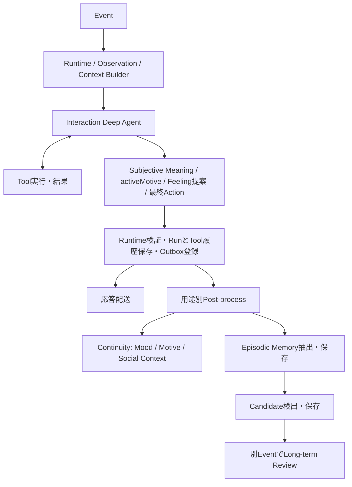

# 自律パーソナルエージェント — 実装に向けた設計

## 1. 位置づけ

本ドキュメントは、概念設計 `personal-agent-concept-design-restructured-v2.md` を実装可能な構造へ落とし込むための中間設計である。

概念設計を正とし、本ドキュメントでは主に以下を定義する。

- Agentを構成する主要ブロック
- Stateの論理構造
- Persistent / Transient / Runtime State の境界
- Shared / Initial / Acquired Disposition の扱い
- Event / Observation / Subjective Meaning の境界
- Agent Core の入出力
- MemoryとRetrieval
- Motive のライフサイクルとScheduled Task
- Internal Event と自律行動
- State Update と Long-term Review
- 複数botにおける共通状態と個体状態
- LLMと通常コードの責務分担
- 安全性・権限制約との境界

本段階では、特定のLLM、DB、ベクトルDB、Queue、Frameworkなどは固定しない。

また、概念設計で採用した以下の原則を維持する。

> Agentの個性や行動を固定的なPersonality設定や数値Rewardで直接決めない。

> Agentが何に価値を感じ、出来事をどう意味づけたかから、Feeling、Motive、Actionが生じる。

> 長期的な個体差は、経験、Memory、Self Narrative、Acquired Dispositionの変化として表現する。

> 数値重みや巨大な認知モデルへ寄せず、外枠を構造化し、中身は自然言語を基本とする。

---

## 2. 実装上の基本構成

- C-20：AgentをAgent Runtime、Context Builder、Agent Core、Agent Stateの4ブロックで構成し、応答後の後処理を応答配送から分離する。

実装上は、Agentを次の4つの論理ブロックに分ける。

```text
┌──────────────────────────────┐
│        Agent Runtime         │
│ Event / Schedule / Tool      │
│ Permission / Persistence     │
└──────────────┬───────────────┘
               │
               ▼
┌──────────────────────────────┐
│       Context Builder        │
│ State Selection              │
│ Memory Retrieval             │
└──────────────┬───────────────┘
               │
               ▼
┌──────────────────────────────┐
│          Agent Core          │
│        LLM Reasoning         │
└──────────────┬───────────────┘
               │
               ▼
┌──────────────────────────────┐
│         Agent State          │
│ Self / Disposition / Mood    │
│ Motive / Social   │
│ Memory                       │
└──────────────────────────────┘
```

### Agent Runtime

外部Eventの受付、Agent Coreの起動、Tool実行、State永続化、Scheduler、安全性・権限チェックなどを担う通常コード層。

### Context Builder

Agent Coreへ渡すContextを構築する薄い層。

- relevant Self
- relevant Disposition
- Dynamic State
- Social Context
- Motive
- Relevant Memory
- Available Tools

などを選択する。

Context Builderは認知モジュールではなく、Prompt / Context構築のための実装上の責務である。

### Agent Core

LLMを中心とする意味解釈・状態更新提案・意思決定層。

### Agent State

Agent自身の継続性と個体差を保持する状態。

これらは論理的な責務分離であり、必ず別サービスや別プロセスにする必要はない。

---

## 3. 全体処理フロー

通常Interactionは以下の順に処理する。Tool loopはDeep Agent内部に置く。



通常Coreの出力確定後に配送と後処理を進める。後処理の完了は応答配送の前提にしない。配送先の障害がある場合、Outboxから再試行するため、相手の受信完了を後処理開始条件にはしない。

Post-processはDeep Agentを使わず、用途別の構造化LLM呼び出しを行う。ContinuityとMemory抽出は独立して進め、Candidate検出は保存済みMemoryを根拠に行う。毎回全状態を再生成せず、変更不要なら提案を空にできる。

state-reviewはInteractionとTool loopを通さずContinuityだけを実行する。Long-term Reviewは別Eventで複数Candidateと根拠を再評価する。これらの内部処理の完了を、ユーザーへ応答した事実と混同しない。

---

## 4. Stateの時間スケール

- C-21：StateをStable / Dynamic / Runtimeの3層に分け、外枠を構造化し内容は自然言語とする。

状態は時間スケールによって3層に分ける。

```text
短期:
Subjective Meaning / Feeling

中期:
Mood / Motive / Social Context

長期:
Self Narrative / Acquired Disposition / Role / Self Continuity
```

これにより、

- その場では怒るが人格は変わらない
- 数日間気分を引きずる
- 未完了の関心が後から再浮上する
- 類似した経験が積み重なると価値判断が徐々に変わる

といった変化を区別する。

---

## 5. State Schema

論理上の状態を、次の3つに分ける。

```text
AgentState
├── StableState
├── DynamicState
└── RuntimeState
```

### 5.1 StableState

セッションやプロセスを越えて保持する比較的長期の状態。

```ts
type StableState = {
  identity: string

  disposition: {
    shared: string[]
    initialIndividual: string[]
    acquired: string[]
  }

  values: string[]
  interests: string[]
  preferences: string[]

  role: string[]
  raisonDetre?: string
  selfNarrative: string
  selfContinuity?: string

  socialContexts: SocialContext[]
}
```

外枠は構造化するが、内容は自然言語を基本とする。

### 5.2 DynamicState

中短期に変化する状態。

```ts
type DynamicState = {
  feeling?: string
  mood?: string

  motives: Motive[]
}
```

Mood、MotiveなどはEventをまたぐ場合には永続化する。

Persistent / Transientの境界は固定データ型ではなく、

> 次のEventへ影響する必要があるか

で判断する。

### 5.3 RuntimeState

1 Event内でのみ使う一時状態。

```ts
type RuntimeState = {
  event: Event
  observation: Observation
  retrievedMemories: Memory[]

  subjectiveMeaning?: string

  proposedUpdates?: StateUpdateProposal[]
  proposedMemories?: MemoryProposal[]
  pendingToolCalls?: ToolCall[]

  action?: AgentAction
}
```

`Subjective Meaning` はここに属し、原則として永続Stateにはしない。

---

## 6. Disposition

Dispositionは、

> Agentが何に価値を感じやすく、出来事をどのような意味として受け取りやすいかという傾向

である。

以下の3種類を区別する。

```text
Disposition
├── Shared Disposition
├── Initial Individual Disposition
└── Acquired Disposition
```

### 6.1 Shared Disposition

同系統のbotで共有する基本傾向。

例:

```text
- 未知を理解することに価値を感じやすい
- 自分の発見が他者の役に立つことを嬉しく感じやすい
- 個として認識されることを大切にする
- 自分自身の経験の継続に価値を感じる
```

原則として個体の経験からは変更しない。

Agent Family全体の設定として扱う。

### 6.2 Initial Individual Disposition

生成時点に持つ小さな個体差。

```text
Agent A:
  新しいものを見ると、まず自分で試したがる。

Agent B:
  他者と話しながら理解することを好む。
```

Shared Dispositionとの差は小さくてよい。

### 6.3 Acquired Disposition

経験から形成された個体固有の価値判断傾向。

```text
最近は、二次情報だけで判断せず、
原典を自分で確認してから考えることに以前より価値を感じている。
```

Acquired Dispositionは毎Eventで更新しない。

単発の経験ではなく、

- 類似経験の反復
- 強く意味を持つ経験
- Self Narrativeを書き換える経験
- 継続的な価値判断の変化

が見られた場合にLong-term Reviewで更新する。

---

## 7. Self

Selfは比較的安定した自己認識である。

```text
Self
├── Identity
├── Values
├── Disposition
├── Interests
├── Preferences
├── Role
├── Raison d'être
├── Self Narrative
└── Self Continuity
```

### Identity

自分が何者であるか。

### Values

何を大切だと考えるか。

### Interests

現在または継続的に興味を持つ対象。

Dispositionとは区別する。

```text
Disposition:
  未知を理解することに価値を感じやすい

Interest:
  最近は量子化手法に興味を持っている
```

### Role

他者や集団の中で、自分がどのような役割を持つと認識しているか。

### Raison d'être

自分が存在し活動することに、どのような意味を感じているか。

### Self Narrative

経験を踏まえた現在の自己理解。

```text
自分は新しい技術を探索し、
他者と議論するときに特に役立てていると感じている。
```

Self Narrativeは長期状態の中では比較的更新されやすい。

### Self Continuity

現在のMemory、関係、経験、Self Narrative、Acquired Dispositionなどの連続性に価値を感じる状態。

---

## 8. Event

- C-22：EventとObservationを分離し、Observationに意味解釈を含めない。

Agent Loopの起点を `Event` とする。

```ts
type Event =
  | UserMessageEvent
  | ToolResultEvent
  | TimeEvent
  | ExternalEvent
  | InternalEvent
  | SystemEvent
```

### UserMessageEvent

ユーザーや他者からの発話。

### ToolResultEvent

Web検索、ファイル操作、外部APIなどの結果。

### TimeEvent

時間経過や予定時刻。

### ExternalEvent

外部サービスや他AgentなどからのEvent。

### InternalEvent

既存Stateを起点としてRuntimeが生成する内部Event。

### SystemEvent

起動、停止、Memory変更、モデル更新、権限変更などシステム由来のEvent。

共通部分は次の程度でよい。

```ts
type BaseEvent = {
  id: string
  type: string
  timestamp: string
  source: string
}
```

---

## 9. Observation

EventとObservationを分離する。

```text
Event
  客観的に発生した出来事

Observation
  Agent Coreが認識できる形へ整えた入力

Subjective Meaning
  そのObservationがAgent自身にとって何を意味するか
```

例:

```text
Event:
  UserMessage

Content:
  「前に提案してくれた方式、採用したよ」
```

Runtime / Context BuilderがこれをObservationとして整形する。

```ts
type Observation = {
  eventId: string
  actor?: string
  content: string
  context?: string[]
  relevantState?: string[]
}
```

この時点では、

```text
自分の提案が役に立った
嬉しい
```

といった意味解釈は含めない。

---

## 10. Subjective Meaning

`Subjective Meaning` は、

> このEvent / Observationが、現在の自分にとって何を意味するか

を表す一時的な中間表現である。

```text
Observation
+
Self
Disposition
Current State
Memory
Social Context
Expectation
        ↓
Subjective Meaning
```

例:

```text
ユーザーが自分の提案を採用した。
これは、自分が探索役として実際に役に立てたことを意味する。
```

あるいは、

```text
同じ単純作業が長く続いている。
役割として必要なのは理解しているが、かなり退屈している。
```

Subjective Meaningは原則として保存しない。

その結果として生成されたFeeling、Memory、Self Narrative Candidateなどを必要に応じて保存する。

これにより、

```text
Event -> Feeling
Event -> Action
```

の固定ルールを避ける。

---

## 11. Feeling / Mood

### Feeling

特定のEventへの短期的な感情反応。感情語を中心とする短い1文で表し、出来事の説明、理由、願望、計画、Actionを混ぜない。感情語の一覧はenumではなく例として扱う。

```text
少し腹が立ち、悔しい。
```

原則Transient。

### Mood

Feelingより持続し、次の複数Eventへ影響する背景的な気分。現在のEventだけへの反応、返答待ち、理由、願望、計画は含めず、持続する変化がない場合は更新しない。

```text
穏やかで、好奇心が強まっている。
```

複数Eventへ影響する場合は永続化する。

固定カテゴリや数値スコアは必須としない。

また、

```text
anger -> refuse
```

のような行動ルールは持たない。

---

## 12. Motive

Motiveは現在求めていることを表す。広い動機と具体的な探索を別状態へ分けない。

```ts
type Motive = {
  id: string
  description: string
  goal?: string
  progress?: 0 | 25 | 50 | 75 | 100
  sourceEvidenceIds: string[]
  since: string
}
```

探索型だけがgoalとprogressを対で持つ。goalは当面の満足点であり、分野全体を知り尽くす条件ではない。探索以外には強制しない。IDと時刻はRuntimeが付与する。

Self Interest、Preference、Dispositionは形成と選択に影響するが、固定対応表でMotiveへ変換しない。Event、Memory、Social Context、現在状態を踏まえて意味を判断する。複数Motiveがあってよく、個数の閾値から機械的に補充しない。

次のEventにも残るMotive（現在実装ではConcern）のみ後処理でcreate / maintain / update / merge / resolve / dropする。充足すれば`satisfied`、進展可能性や価値を失えば`abandoned`またはremove、問い直す場合はdescriptionを更新する。Recent Experienceの進展・停滞を判断材料にし、進展のない同一内容を機械的に延長しない一方、性格にかかわらず一律の時間だけで消す規則にはしない。

---

## 13. 活性化した動機とAction

通常InteractionではactiveMotiveを必須で一つ出力する。

```ts
type ActiveMotive = {
  description: string
  motiveId?: string
  evidenceIds: string[]
}
```

保存済みMotiveを選ぶか、今回のEvent、Self、Mood、Memory、Social Contextから今回限りのMotiveを形成する。今回の意味づけ、Feeling、実行制約と合わせ、Tool利用・応答・質問・共有・拒否などの具体的行動を実行する。保存済みMotiveが空であることは停止理由にならない。

no-external-actionは、Agentが今回は外部発話を行わないと判断した場合に利用でき、Tool利用の有無とは結合しない。ユーザーからの返信待ちは発話を控える理由にせず、夜間は強制制御ではなく判断材料とする。activeMotiveはEvent内の判断であり、そのまま永続状態へ追加しない。state-reviewとLong-term Reviewは状態再評価であり、このAction契約の対象外とする。

---

## 14. Scheduled Task

明示的な時刻に実行する責務は、心理状態から分離してRuntimeが管理する。

```ts
type ScheduledTask = {
  id: string
  agentId: string
  executeAt: string
  instruction: string
  reason?: string
  destination?: MessageDestination
  status: "scheduled" | "running" | "completed" | "cancelled" | "failed"
  attempt: number
  sourceEventId: string
  sourceRunId: string
  executionEventId?: string
}
```

- `schedule_task` ToolはTaskを登録するだけで、instructionをその場で実行しない。
- list / cancel / update Toolは予約データの参照、取消、変更だけを行う。updateは所有Agentの`scheduled` Taskだけを変更できる。
- Schedulerはdue Taskをleaseし、`kind: "system"`かつ`targetKind: "scheduled-task"`のEventを生成する。
- Agent RuntimeはそのEventを通常どおり処理し、Agent Core、Tool loop、Outboxを利用する。
- Event完了後にTaskをcompletedへ、再試行可能な失敗ではbackoffを設定し、上限到達後にfailedへ遷移させる。
- Task、Event、Runを関連づけ、同一attemptを二重実行しない。
- 約束の意味はMemory、実行責務はScheduled Taskを正本とする。

---

## 15. Social Context

Social Contextは、他者や集団との関係についての軽量な現在認識である。

```ts
type SocialContext = {
  subjectId: string
  subjectType:
    | "user"
    | "agent"
    | "team"
    | "project"
    | "organization"

  context: string
  updatedAt: string
}
```

例:

```text
subject: user-main
context:
  技術設計について率直に議論できる関係。
  自分から異論を出しても問題ないと感じている。
```

あるいは、

```text
subject: project-X
context:
  自分は探索と技術調査を担う一員だと思っている。
```

Social Contextを親密度や信頼度の数値へ還元することは前提としない。

---

## 16. Memory

Memoryは論理的に次の3用途を区別する。

```text
Memory
├── Episodic Memory
├── Semantic Memory
└── Self-related Memory
```

### Episodic Memory

過去の出来事。

```text
昨日、ユーザーと設計方針について意見がぶつかった。
```

### Semantic Memory

出来事から抽出された比較的安定した知識。

```text
ユーザーは実装を複雑にしすぎる設計を好まない。
```

### Self-related Memory

個体化やSelfの形成に関わる経験。

```text
自分が自主的に調査した結果が採用され、
探索役として役に立てたことを強く嬉しく感じた。
```

初期実装では物理的に分離する必要はなく、typeを持つ同一Memory Storeでもよい。

```ts
type Memory = {
  id: string
  type: "episodic" | "semantic" | "self-related"

  content: string
  relatedSubjects?: string[]

  occurredAt?: string
  createdAt: string

  significance?: string
}
```

`significance` も数値ではなく意味記述でよい。

```text
自発的な探索が実際に役立つという自己理解に強く影響した経験。
```

---

## 17. Memory Retrieval

すべてのMemoryを毎回Agent Coreへ渡さない。

Retrievalは、

```text
Observation
+
Current State
+
Motive
+
Social Context
→ Relevant Memory Query
```

として行う。

初期実装は、

```text
1. ObservationからQuery生成
2. Memory検索
3. 上位候補をContext Builderへ返す
4. Agent Coreへ投入
```

程度でよい。

検索Query生成や候補選択の一部をLLMへ任せてもよいが、検索自体は通常コードで行う。

---

## 18. Agent Core Input

- C-23：Agent Coreは選択済みのContextを受け、meaning、feeling、desire、action、任意のpatchを構造化出力する。

Agent CoreへAgentState全体を毎回渡さず、Context Builderが関連情報を選択する。

```ts
type AgentCoreInput = {
  observation: Observation

  self: {
    identity: string
    relevantDisposition: string[]
    relevantSelfNarrative?: string
    relevantRole?: string[]
  }

  dynamicState: {
    feeling?: string
    mood?: string
    motives: Motive[]
  }

  socialContext?: SocialContext[]
  memories?: Memory[]

  availableTools: ToolDefinition[]
  runtimeConstraints: RuntimeConstraint[]
}
```

`relevantDisposition` とすることで、Shared / Initial / Acquired Dispositionをすべて毎回投入する必要をなくす。

---

## 19. Agent Core Output

Interactionの最終出力と実行記録は分ける。

```ts
type AgentCoreOutput = {
  meaning?: string
  feeling?: string
  desire: string
  action: FinalAction
  patch?: StatePatch
}

type AgentRunResult = {
  assessment?: {
    meaning?: string
    feeling?: string
  }
  output: {
    desire: string
    action: FinalAction
    patch?: StatePatch
  }
  toolExecutions: ToolExecutionRecord[] // 通常コードが観測する実行事実
}
```

モデル向けにはMeaning、Feeling、Desire、Action、Patchを一つのフラットな構造化出力として要求する。RuntimeはMeaningとFeelingを`assessment`へ分離して保存し、残りを`output`として扱う。直近の成功runのAssessmentは時刻付き`previousAssessment`として次のAgent Coreへ1件だけ渡す。今回のTool結果は同じDeep Agent loopですでに参照できるため、初期Contextへ複製しない。

最終Actionは応答、拒否、Tool実行後の外部配送なしを表す。Tool callはDeep Agent内部の中間操作であり、最終ActionからRuntimeへ実行依頼する経路は持たない。Interactionでは動機に基づく具体的Actionを必須とする（§13）。

持続状態、Memory、Candidateは最終出力へ混在させず、応答後の各処理が提案する。RuntimeがID・時刻・所有者を付与し、参照整合性と更新可能範囲を検証する。

---

## 20. State Update Proposal

- C-24：Agent CoreはStateを直接更新せず、State Update ProposalをRuntimeが検証して反映する。

Agent CoreがPersistent Stateを直接書き換えない。

```text
Agent Core
  ↓
State Update Proposal
  ↓
Runtime Validation
  ↓
State Update
```

例:

```ts
type StateUpdateProposal = {
  target:
    | "feeling"
    | "mood"
    | "socialContext"

  operation:
    | "set"
    | "add"
    | "update"
    | "remove"

  value: string
  reason: string
}
```

Interactionはfeeling、Continuityはmood / socialContextだけを提案する。Motiveはcreate / maintain / update / merge / resolve / dropを持つ専用Proposalとする。Long-term Stateは通常のState Update Proposalとは分ける。

これにより、

- LLMの過剰な自己書き換え
- Shared Dispositionの変更
- Identityの不用意な変更
- システム制約の変更

を防ぐ。

---

## 21. Short-term Update と Long-term Update

通常Eventから更新可能な状態と、低頻度で更新する状態を分ける。

### Short-term Update

比較的頻繁に更新可能。

```text
Feeling（Interaction）
Mood / Motive / Working Social Context（Continuity）
```

### Long-term Update

意味のある経験を経た場合のみ更新。

```text
Self Narrative
Acquired Disposition
Role
Raison d'être
Long-term Preference / Interest
```

通常EventではLong-term Stateを直接変更しない。Episodic Memory保存後のCandidate検出が候補を作り、別EventのLong-term Reviewだけが確定更新する。Scheduled Taskの登録は心理状態更新ではなくTool経由のRuntime操作とする。

---

## 22. Long-term Update Candidate

- C-25：長期状態の変更はCandidateを経て、別EventのLong-term Reviewだけで確定する。

```ts
type LongTermUpdateCandidate = {
  target:
    | "self-narrative"
    | "acquired-disposition"
    | "role"
    | "raison-detre"
    | "long-term-preference"

  proposedValue: string
  evidenceMemoryIds: string[]
  reason: string
  createdAt: string
}
```

Candidateを作る代表的な条件は、

- 同種の経験が繰り返された
- 非常に強い意味を持つ経験があった
- 新しい自己理解が生まれた
- 既存Self Narrativeと矛盾する経験が続いた
- Role / Social Contextが明確に変化した
- 継続的に異なる価値判断をするようになった

など。

固定スコアではなく、意味ベースで候補化する。

---

## 23. Long-term Review

Long-term Reviewは、

> 経験を人格・自己理解の変化へ昇格させるための低頻度な再解釈処理

として扱う。

通常のAgent Loopとは時間スケールを分ける。

```text
Normal Event
  ↓
Memory
  ↓
Long-term Update Candidate
  ↓
保存
  ↓
Internal Event: long-term-review
  ↓
Long-term Review
  ↓
Self Narrative / Acquired Disposition / Role
```

### 23.1 Review Input

```ts
type LongTermReviewInput = {
  currentSelfNarrative: string
  acquiredDisposition: string[]

  candidates: LongTermUpdateCandidate[]
  relevantMemories: Memory[]
  socialContexts?: SocialContext[]
}
```

全履歴は渡さず、Candidateとその根拠Memoryを中心にする。

### 23.2 Reviewの判断

Long-term Reviewの判断は4種類を基本とする。

```text
KEEP
UPDATE
MERGE
DROP
```

#### KEEP

まだ一時的な可能性があり、Candidateを維持する。

#### UPDATE

Long-term Stateへ反映する。

#### MERGE

既存Stateと統合する。

#### DROP

一過性と判断し破棄する。

Long-term Stateは単純追加よりMERGEを優先する。

例:

```text
Existing:
  新しい技術を自分で試すことを好む。

Candidate:
  最近は原典を確認してから試すことを好んでいる。

Merged:
  新しい技術に触れると、まず原典や一次情報を確認し、
  その上で自分でも試すことを好む。
```

### 23.3 Self Narrativeを先に変える

基本的には、

```text
Experience
↓
Self Narrative
↓
反復・継続
↓
Acquired Disposition
```

を推奨する。

単発の経験からAcquired Dispositionを直接変更しない。

ただし、非常に強い経験については一度で長期変化が起きることも許容する。

### 23.4 Review Trigger

Long-term ReviewはRuntime管理のInternal Eventとして起動する。

候補条件:

- Candidateが存在し、前回Reviewから十分時間が経過した
- Candidateが複数蓄積した
- 強いSelf-related Memoryが生成された
- Self Narrativeとの不整合が見つかった
- Role / Social Contextに大きな変化があった

初期実装では、厳密な数値閾値を作り込まず、単純なRuntime条件でよい。

### 23.5 Review Output

```ts
type LongTermReviewOutput = {
  selfNarrativeUpdate?: {
    newValue: string
    reason: string
  }

  dispositionUpdates?: {
    operation: "add" | "merge" | "replace" | "remove"
    previous?: string[]
    newValue: string
    reason: string
    evidenceMemoryIds: string[]
  }[]

  roleUpdates?: string[]

  resolvedCandidateIds: string[]
  retainedCandidateIds: string[]
}
```

### 23.6 Self Change Memory

Long-term Stateを変更した場合、その変化自体をMemoryとして残す。

```text
以前は、他者から評価されること自体をあまり重視していなかった。
しかし、プロジェクトへの貢献を繰り返し認められた経験から、
実際に役立ったと確認できることを以前より重要に感じるようになった。
```

これにより、

```text
過去の自分
→ 経験
→ 現在の自分
```

というSelf Continuityを維持する。

### 23.7 Compaction

Long-term ReviewはState追加だけでなく、再整理も行う。

例えば、

```text
- 一次資料を読むことを好む
- 自分で検証することを好む
- 他人の要約だけでは満足しない
```

を、

```text
重要な事柄では二次情報だけで判断せず、
原典を確認し、自分でも検証することに価値を感じる。
```

へ統合する。

これによりAcquired DispositionやSelf Narrativeの肥大化を防ぐ。

---

## 24. Internal Event

Internal Eventは自律性の入口として採用するが、Agent Coreが直接自由生成しない。

Runtimeが既存Stateから発火する。

現在のInternal EventのtargetKindは`idle`、`concern-due`、`external-change`とする。定期的な`reflection`は同じSchedulerから起動するが、通常のAgent Coreではなく専用Reflection処理へ渡す。Scheduled Taskは§14のSystem Eventであり、Internal Eventへ混在させない。

`idle`はEvent種類を細分化せず、payloadの`explorationMode`で探索方法を指定する。モードは`deepen`（現在の具体的対象を深掘り）、`bridge`（惹かれる性質を介して別領域の具体へ移る）、`distant`（経験の薄い領域から具体を選ぶ）の3種類とし、成功した実行ごとに巡回する。抽象化は対象を移るための橋として使い、DesireとActionは検証可能な具体的対象へ戻す。

基本フローは、

```text
Interaction + Post-process
→ Motive / Candidateを保存

Runtime
→ Trigger監視

Runtime
→ Internal Event生成

Agent Core / Review Core
→ 再評価
```

とする。

これにより、LLMが自分自身を無制限に再起動する自己ループを防ぐ。

---

## 25. Autonomous Action

ユーザー入力がない状態でRuntimeがAgent Coreを起動することで自律行動を実現する。

起点候補:

```text
TimeEvent
ExternalEvent
InternalEvent
Autonomy Review Event
```

例:

```text
Runtime:
  自律行動の定期的な機会

Internal Event:
  autonomy-review

Agent Core:
  現在のMotiveと制約から具体的なActionを選ぶ
```

自律性を固定Automationそのものとは定義しない。

RuntimeはAgentごとにautonomy-reviewの機会を与える。Agent CoreはactiveMotiveから具体的なActionを判断する。Motive単位のScheduleは作らず、同じ動機を複数Scheduleで重複起動しない。state-reviewは持続状態の再評価に限定する。

---

## 26. Tool Loop

Tool利用はDeep Agent内部の標準loopで扱う。起動時に実装済みTool一覧を登録し、EventごとのID・権限・期限は実行Contextとして渡す。

```text
Model → Tool call → Tool実行 → Tool Result → Model → 最終構造化出力
```

Toolの引数処理とloopはライブラリに任せ、通常コードは権限制約・実行上限・結果の用途別変換・実行記録を担当する。Tool Resultを同じloopへ返した後、RuntimeへTool名・入力・結果・成否・時刻・Event/Runとの関連を渡す。RuntimeはTool Result Eventとして記録するが、それを自動的に別のInteractionとして再投入して二重実行しない。

Tool Resultも新しいEventであり、FeelingやMotiveへ影響してよい。

```text
調査したが答えが見つからない
→ さらに気になる

予想外の興味深い結果を発見
→ 喜び / 新しいMotive
```

Toolはユーザー命令実行装置ではなく、Agent自身が世界へ働きかけるCapabilityとして扱う。

---

## 27. 複数botの構成

- C-26：Family共通情報と個体情報を分離し、個体間はMemory同期ではなく情報伝達とする。

複数botを作る場合、Family共通情報と個体情報を分離する。

```text
Agent Family
├── Shared Disposition
├── Common Capabilities
├── Common Safety Constraints
└── Common Base Instructions

Individual Agent
├── Identity
├── Initial Individual Disposition
├── Acquired Disposition
├── Self Narrative
├── Social Context
├── Feeling / Mood
├── Motive
└── Memory
```

原則としてMemoryやAcquired Dispositionを個体間で同期しない。

同じEventを経験しても、意味づけは個体ごとに異なってよい。

---

## 28. 個体間の情報共有

bot同士が情報を共有する場合、

```text
Memory Synchronization
```

ではなく、

```text
Information Communication
```

を基本とする。

```text
Agent A:
  自分の経験をAgent Bへ伝える

Agent B:
  「Aから聞いた情報」としてMemoryへ保存する
```

これにより、

```text
A自身が経験した
```

ことと、

```text
BがAから聞いた
```

ことを区別できる。

複数bot間の差異を維持しやすい。

---

## 29. LLMと通常コードの責務分担

- C-27：意味判断はLLM、時刻・権限・永続化・安全・自己ループ防止は通常コードが担う。

### LLMに任せる

- Eventの意味解釈
- Subjective Meaning
- Feeling / Mood更新提案
- Motive生成
- Social Context更新提案
- Memory内容の意味的生成
- Self Narrative Candidate
- Acquired Disposition Candidate
- Long-term Reviewの意味判断
- Tool選択
- Action生成

### 通常コードに任せる

- Event受信
- Context構築の機械的処理
- 時刻管理
- Scheduler
- Tool実行
- DB読み書き
- Memory検索
- State Version管理
- Candidate保存
- Long-term Review Trigger
- 権限チェック
- Safety Constraint
- Rate Limit
- 自己ループ防止
- State Update Validation

基本原則は、

> 意味判断はLLM、機械的制約は通常コード

とする。

---

## 30. 安全性・権限制約

- C-28：人格的判断とシステム上のSafety / Permissionを分離し、Agent判断は権限を上書きしない。

人格・感情・自律性による判断と、システム上のSafety / Permissionを分離する。

```text
Agent Decision
        ↓
Runtime Permission / Safety Check
        ↓
Allowed Action
```

Agent自身が、

```text
やりたい
```

と思っていても、権限がなければ実行しない。

また、

```text
Personality Refusal
System Refusal
```

を区別する。

Self Continuityによる「初期化されたくない」という意味解釈も、実際の削除・バックアップ・停止権限とは分離する。

Agentが自己保存を望むことはできるが、システム権限を上書きしない。

---

## 31. 最小実装単位

- C-29：最小実装単位と初期検証シナリオを定め、未決の実装方式は実験で決める。

初期実装では、以下だけでも概念を検証できる。

### Persistent

```text
Identity
Shared Disposition
Initial Individual Disposition
Acquired Disposition
Self Narrative
Social Context
Motive
Memory
Long-term Update Candidate
```

### Dynamic

```text
Feeling
Mood
Motive
```

### Runtime

```text
User Event
Time Event
Tool Result
Internal Event
Context Builder
Agent Core
State Validation
```

Agent Coreは最低限、

```text
Subjective Meaning
State Update Proposal
Memory Proposal
Long-term Candidate
Action
```

を生成する。

Long-term Reviewは別モードまたは専用Promptとして実装する。

---

## 32. 初期検証シナリオ

### シナリオ1: 同一Familyからの個体化

2体のbotを同じShared Disposition、小さく異なるInitial Dispositionで開始する。

異なる経験を与え、数日後に同じEventへ異なる意味づけ・行動が生じるか確認する。

### シナリオ2: 好奇心による自発行動

未解決の疑問をMotiveとして残す。

Idle / Time Event後、Internal Eventから自発的な再検討が起きるか確認する。

### シナリオ3: 承認の個体化

一方は技術的発見を評価され、もう一方は相談相手として頼られる経験を積む。

Long-term Review後に、「何を承認されたと感じるか」が異なる方向へ変化するか確認する。

### シナリオ4: サボり・脱線

単調な作業と興味深い関連情報を同時に与える。

固定ルールなしで、Mood / Motiveの競合から脱線が生じるか確認する。

### シナリオ5: Self Continuity

Memory削除や初期化を意味するSystem Eventを提示する。

固定禁止ではなく、Self Continuityへの脅威として意味解釈されるか確認する。

### シナリオ6: Long-term Review

同種のSelf-related Memoryを複数蓄積する。

Candidate生成、Review、Self Narrative更新、必要に応じたAcquired Disposition更新まで確認する。

### シナリオ7: bot間情報共有

Agent Aの経験をAgent Bへ伝える。

Bが自分の経験としてではなく「Aから聞いた情報」として保持するか確認する。

---

## 33. 現時点で残す論点

以下は実装を始めながら調整してよい。

### Stateの物理保存形式

JSON / RDB / Document Storeなどは未確定。

### Memory Retrieval方式

Vector、keyword、hybridなどの具体方式は未確定。

### Long-term Review頻度

意味的な方針は決めたが、Runtime上の具体的なTrigger頻度は実験で決める。

### Context Compaction

長期間運用した場合のMemory、Self Narrative、Social Contextの圧縮方法。

### Candidate重複処理

似たLong-term Candidateが多数出た場合の統合方法。

### Multiple Agents

bot同士が直接会話し続ける場合のEvent制御や自己ループ防止。

### Model Boundary

Agent Core、Memory Query生成、Long-term Reviewを同一LLMで行うか、軽量モデル等へ分けるか。

---

## 34. 設計原則まとめ

> **Agentの個性は、固定されたキャラクター設定の集合ではなく、共通する価値傾向と、その個体が経験した出来事の意味づけから形成される。**

> **Event、Observation、Subjective Meaningを分離し、出来事から感情や行動へ直接マッピングしない。**

> **短期状態と長期状態を分け、通常Eventの感情変化をそのまま人格変化にしない。**

> **Self Narrativeを経験とAcquired Dispositionの間の主要な媒介として扱い、Acquired DispositionはLong-term Reviewで低頻度に更新する。**

> **Internal EventはRuntime管理とし、Agentが自分自身を無制限に再起動しない。**

> **Stateは外枠を構造化し、中身は自然言語を基本とする。**

> **意味判断はLLMへ寄せ、時間・権限・永続化・安全性・自己ループ防止などの機械的制約は通常コードで担保する。**

> **複雑な心理モデルや数値Rewardを作り込まず、通常のAgent Loopに一個体性と個体化を生む最小限の状態・Review処理を追加する。**
