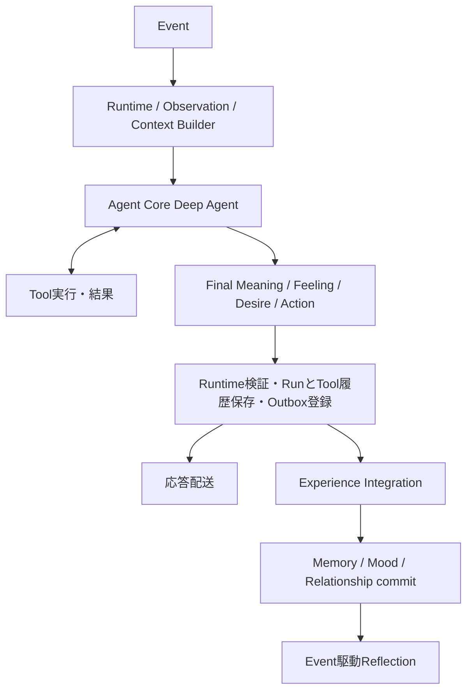

# 自律パーソナルエージェント — 実装に向けた設計

## 1. 位置づけ

本ドキュメントは、概念設計 `personal-agent-concept-design-restructured-v2.md` を実装可能な構造へ落とし込む設計である。概念設計を上位とし、実装上の判断は `docs/REQUIREMENTS.md`、`docs/ARCHITECTURE.md`、`docs/AGENT_MOTIVATION_MODEL.md` に従う。

本ドキュメントでは主に以下を定義する。

- Agentを構成する主要ブロック
- Self / State / Concern / Relationship / Memoryの構造
- Event / Observation / Assessmentの境界
- Agent Coreの入出力
- State PatchとConcern proposal
- Reflectionと個体化
- Memory Retrieval
- Internal Eventと自律行動
- 複数botにおける共通状態と個体状態
- LLMと通常コードの責務分担
- 安全性・権限制約との境界

## 2. 実装上の基本構成

- C-20：AgentをAgent Runtime、Context Builder、Agent Core、Agent Stateの4ブロックで構成し、応答後の後処理を応答配送から分離する。

```text
┌──────────────────────────────┐
│        Agent Runtime         │
│ Event / Schedule / Tool      │
│ Permission / Persistence     │
└──────────────┬───────────────┘
               │
               ▼
┌──────────────────────────────┐
│       Context Builder        │
│ State Selection              │
│ Memory Retrieval             │
└──────────────┬───────────────┘
               │
               ▼
┌──────────────────────────────┐
│          Agent Core          │
│        LLM Reasoning         │
└──────────────┬───────────────┘
               │
               ▼
┌──────────────────────────────┐
│         Agent State          │
│ Self / Mood / Concerns       │
│ Relationships / Memory       │
└──────────────────────────────┘
```

### Agent Runtime

外部Eventの受付、Agent Coreの起動、Tool実行、State永続化、Scheduler、Outbox、安全性・権限チェックなどを担う通常コード層。

### Context Builder

Agent Coreへ渡すContextを構築する薄い層。Self、State、Recent Experiences、Previous Assessment、Previous Desire、Relationship、Relevant Memory、Available Tools、Runtime Constraintsを選択する。Context Builderは認知モジュールではなく、Prompt / Context構築のための実装上の責務である。

### Agent Core

LLMを中心とする意味解釈・意思決定層。Meaning、構造化Feeling、Desire、Actionを一つの構造化出力として返す。Memory、Relationshipの持続更新判断は応答commit後のExperience Integrationへ分離し、MoodはRuntimeがFeelingから決定論的に更新する。

### Agent State

Agent自身の継続性と個体差を保持する状態。Self、Mood、Concerns、Relationships、Memoryを含む。

## 3. 全体処理フロー

通常Interactionは以下の順に処理する。Tool loopはDeep Agent内部に置く。



- Agent Coreは、Event、Previous Assessment、Recent Experiences、必要に応じてToolで取得したContextを使い、Event終了時のMeaningとFeeling、Desire、最終Actionを同じ構造化出力で確定する。
- RuntimeはMeaningとFeelingを `assessment` として分離し、DesireとActionを `output` として扱う。
- Action、Concern Proposal、Outboxを一つの初回transactionで確定する。Runtimeはその後にFeelingからMoodを更新し、Experience IntegrationはMemory、Relationshipだけを判断・適用する。後続失敗は初回commitを巻き戻さない。
- Memoryの圧縮、Self更新、Concern / Relationshipの長期整理は、別EventのReflectionで行う。
- 応答配送はcommit後のOutboxから行い、配送障害とAgentの判断確定を分離する。

## 4. Stateの時間スケール

- C-21：StateをSelf、State、Recent Experiences、Runtimeの層に分け、外枠を構造化し内容は自然言語とする。

```text
長期:
Self（identity / disposition / selfStory / commitments）

複数Event:
State（mood / concerns / relationships）
Memory（検索可能な経験）

直近:
Recent Experiences（直近2 Eventの意味投影）
Previous Assessment（直近の成功EventのMeaning / Feelingと時刻）
Previous Desire（直近の成功EventのDesireと時刻）

今回のEvent:
Final Assessment（Meaning / Feeling）
Desire
Action
State Patch
Concern proposal

Runtime:
Event / Observation / Tool実行 / 検証 / transaction
```

これにより、その場では怒るが人格は変わらない、数日間気分を引きずる、未完了の関心が後から再浮上する、類似した経験が積み重なると価値判断が徐々に変わる、といった変化を区別する。

## 5. State Schema

### 5.1 Self

```ts
type Self = {
  identity: string;
  disposition: string;
  selfStory: string;
  commitments: string[];
};
```

- `identity`: 自分が誰であるか
- `disposition`: 何に価値を感じ、どう意味づけやすいか
- `selfStory`: 経験から形成された現在の自己理解
- `commitments`: 守りたいもの、続けたい関係、譲りたくないこと

Shared / Initial / Acquired Dispositionは、初期化・監査・Reflectionでは区別してよい。通常Interactionでは、統合された現在の `disposition` を基本入力とする。Values、Interests、Preferences、Role、Raison d'être、Self Continuityは独立フィールドとして持たず、`disposition`、`selfStory`、`commitments`、Memory、Concern、Relationshipへ統合する。

### 5.2 State

```ts
type AgentState = {
  mood?: string;
  concerns: Concern[];
  relationships: Relationship[];
};

type Concern = {
  id: string;
  description: string;
  whyItMatters: string;
  status: "active" | "satisfied" | "abandoned";
  reconsiderAt?: string;
};

type Relationship = {
  subjectId: string;
  description: string;
};
```

Moodは複数Eventへ影響する背景的な気分である。Concernは現在気に掛けていて次のEventにも残る事柄であり、感情、価値、関係、現在の動機、関心、未完了課題、約束、感情的なしこりを統合する。未解決課題だけに限らない。Relationshipは特定の相手との関係そのものの現在状態であり、プロフィール情報の保存先にはしない。

FeelingはEventへの短期反応であり、独立した長期状態として残し続けない。直近の成功Event終了時のMeaningとFeelingを `previousAssessment` として次のAgent Coreへ1件だけ渡す。

### 5.3 Memory

```ts
type Memory = {
  id: string;
  agentId: string;
  kind: "episodic" | "semantic" | "self-related" | "self-change" | "common-ground";
  content: string;
  occurredAt: string;
  createdAt: string;
  relatedSubjectIds: string[];
  importance: string;
  retrievalPriority: "low" | "normal" | "high" | "critical";
  sourceAgentId?: string;
  evidenceEventIds: string[];
};
```

会話由来Memoryは単一のStoreに保持し、`kind` を属性として持つ。会話由来Memoryの種類ごとに保存経路を分けない。Reflectionが生成するMemoryは原則として `episodic` とし、Semantic、Self-related、Self-change、Common Groundは必要に応じてtagまたは監査記録として扱う。

生成済みの背景経験は、会話由来Memoryとは別Storeに保持する。背景経験は起動後に変更せず、初期化時に定義ファイルから置換する。会話で得た経験は背景経験へ書き戻さず、会話由来Memoryとして保持する。

### 5.4 Recent Experiences

Recent Experiencesは新しい永続概念ではない。直近2 Eventから、次の判断に必要なObservation要点、Tool signal、Actionまたはfailure、進展有無を組み立てた入力である。監査用metadataと元のTool本文はEvent logとTool executionに残し、Recent Experiencesへ複製しない。

### 5.5 Runtime

1 Event内でのみ使う一時状態には、Event、Observation、取得Memory、Tool実行、Previous Assessment、Model call予算、検証結果などを含む。

## 6. Disposition

Dispositionは、

> Agentが何に価値を感じやすく、出来事をどのような意味として受け取りやすいかという傾向

である。Shared Disposition、Initial Individual Disposition、Acquired Dispositionの由来は、初期化・監査・Reflectionでは区別してよい。

- Shared DispositionはAgent Family全体の設定であり、原則として個体の経験からは変更しない。
- Initial Individual Dispositionは生成時点の小さな個体差であり、探索の初期の種として扱う。
- Acquired Dispositionは経験から形成されるが、独立フィールドにはせず、現在の `disposition`、`selfStory`、`commitments` へ反映する。

Acquired Dispositionは毎Eventで更新しない。類似経験の反復、強く意味を持つ経験、Self Storyを書き換える経験、継続的な価値判断の変化が見られた場合に、Reflectionで更新する。

## 7. Self

Selfは比較的安定した自己認識であり、Identity、Disposition、Self Story、Commitmentsの4項目で表す。

- Identity: 自分が何者であるか。
- Disposition: 何に価値を感じやすく、どのような意味解釈をしやすいか。
- Self Story: 経験を踏まえた現在の自己理解。
- Commitments: 守りたいもの、続けたい関係、譲りたくないこと。

Values、Interests、Preferences、Role、Raison d'être、Self Continuityは、独立した必須フィールドとして持たない。価値観や好みはDispositionとSelf Storyに、役割や存在意義はSelf StoryとCommitmentsに、長期的な興味はMemoryとConcernに現れる。

通常InteractionはSelfを直接変更しない。Selfの変更はReflectionだけが、Memory根拠と理由を伴って行う。

## 8. Event

- C-22：EventとObservationを分離し、Observationに意味解釈を含めない。

Agent Loopの起点を `Event` とする。

```ts
type Event =
  | UserMessageEvent
  | ToolResultEvent
  | TimeEvent
  | ExternalEvent
  | InternalEvent
  | SystemEvent
```

- `user-message`: ユーザーや他者からの発話。
- `tool-result`: Web検索、ファイル操作、外部APIなどの結果。
- `time`: 時間経過や予定時刻。
- `external`: 外部サービスや他AgentなどからのEvent。
- `internal`: `idle`、`concern-due`、`concern-formation` などScheduler内部契機。
- `system`: 起動、停止、Memory変更、モデル更新、権限変更、Scheduled Taskなどシステム由来のEvent。

Eventには入力経路を表すDomain Event `kind` と、Schedulerが発火した目的を表す `targetKind` がある。両者を混同しない。

```ts
type BaseEvent = {
  id: string;
  agentId: string;
  kind: EventKind;
  occurredAt: string;
  payload: unknown;
  source?: string;
  causationId?: string;
  correlationId?: string;
};
```

## 9. Observation

EventとObservationを分離する。

```text
Event
  客観的に発生した出来事

Observation
  Agent Coreが認識できる形へ整えた入力

Subjective Meaning / Final Assessment
  そのObservationがAgent自身にとって何を意味したか
```

```ts
type Observation = {
  eventId: string;
  kind: EventKind;
  summary: string;
  facts: string[];
  observedAt: string;
  actor?: { id: string; type: "human" | "agent" | "tool" | "system" | "unknown" };
  source?: { type: "terminal" | "discord" | "agent" | "tool" | "scheduler" | "system" | "unknown"; id?: string; direct: boolean };
  causationId?: string;
  correlationId?: string;
  content?: unknown;
};
```

Observationの時点では、意味解釈やFeelingを含めない。

Event完了後には、commit済みのAction、Tool結果、状態変化を根拠にExperience IntegrationがEvent Experience（具体的なsummaryとfacts）を形成できる。これは開始時Observationとは別の永続記録であり、固定trigger reason、Meaning、Feeling、Desireを含めない。ReflectionのMemory Formationと関連Event検索は、Event Experienceを持つEventだけを根拠にする。

永続化では、`events`は不変の論理EventとそのObservationの正本、`agent_runs`は同じEventに対するretryを含む実行attemptの判断入力・出力の監査である。同じEventを再試行してもEvent Experienceは一度だけ形成し、MemoryやReflectionの経験を重複させない。`tool_executions`はRunの完全なTool監査であり、通常のEvent Experienceや検索対象にしない。Event Experienceは意味表現の正、Event Projectionはそのembeddingと検索状態だけを持つ再生成可能な派生indexとする。検索対象のG3 Eventも、Experience Integrationを完了してからProjectionを作る。通常CRUDは型付きschemaに基づくrepositoryを通し、vector ranking、lease claim、advisory lockなどPostgreSQL固有の操作だけをrepository内の限定SQLに閉じる。

## 10. Meaning と Feeling

Meaningは、このEvent / Observationが現在の自分にとって何を意味したかを表す。Feelingは、その意味づけによって生じた短期的な感情反応である。

```text
Observation
+
Self
Disposition
State
Memory
Relationship
Previous Assessment
        ↓
Agent Core
        ↓
Final Meaning / Feeling
```

MeaningとFeelingは、Actionを正当化するために作らない。Event、再解釈、取得したContext、Tool結果を踏まえたEvent終了時の評価として、Agent Coreが最終Actionと同じ構造化出力で確定する。

Meaningは1〜2文、Feelingは固定された感情カテゴリから異なる1〜3件と各強度1〜5で返し、出来事の説明、理由、願望、計画、Actionを混ぜない。

## 11. Feeling / Mood

Feelingは特定のEventへの短期的な感情反応である。`joy`、`sadness`、`anger`、`surprise`、`anxiety`、`vigilance`、`boredom`、`relief`、`pride`、`curiosity`から異なる1〜3件を選び、各々の強度を1〜5で表す。原則としてTransientであり、独立した長期状態として保存しない。

MoodはFeelingより持続し、次の複数Eventへ影響する背景的な気分である。Runtimeが現在のMoodと今回Feelingに、Agentごと・感情ごとの半減期、加算係数、上限値を適用して構造化ベクトルとして更新する。LLMはMoodを直接出力・更新しない。設定変更は以後の更新だけに反映し、Feeling履歴の再計算は行わない。

```text
穏やかで、好奇心が強まっている。
```

`anger -> refuse` のような固定の行動ルールは持たない。感情はActionを一意に決定する命令ではなく、選択を偏らせる主観的文脈とする。

## 12. Desire と Concern

Desireは、今回のEventを受けて「今、何をしたいか」を表す今回限りの判断である。保存状態として重複させず、Agent Coreの出力に含める。

Concernは、現在気に掛けていて、次のEventにも残る事柄である。感情、価値、関係、未完了課題、約束、継続中の関心を含む。

Conversation Goalは一つのDiscord reply chainでAgentが得たいものを表す。`conversations`をAgent所有のGoal・状態・開始／最終Event・終了理由の正本、`conversation_messages`を外部messageとの対応とする。進捗・未解決点はEvent、Desire、Memoryから導出し重複保存しない。Observation Gateは通常peer投稿を扱うかと理由だけを決め、専用Goal Composerが開始AgentごとのGoalを短いJSONで作る。未対応directもComposerから開始し、継続replyでは既存GoalをContext Builder経由でAgent Coreへ渡して再生成しない。recipientは配送先だけであり、会話中の`user`又は`channel`配送は既存Goalを置換・closeしない。別Conversationの内容はMemoryとして取得できた場合だけ使う。

```ts
type Concern = {
  id: string;
  description: string;
  whyItMatters: string;
  status: "active" | "satisfied" | "abandoned";
  reconsiderAt?: string;
};
```

Agent Coreは、保存済みConcern、今回のEvent、Self、Memory、Relationship、Mood、`previousDesire`から今回のDesireを形成する。保存済みConcernが空でも行動を止めない。DesireはConcernの言い換えではなく、具体的な対象と今回の行為を持つ。ただしuser-messageでは、保存済みConcernの取得・作成を行わず、今回のEvent、Self、Memory、Relationship、Mood、`previousDesire`からDesireを形成する。

ConcernはAgent Coreの最終出力へ直接混在させず、`concern_propose` Toolによるrun-localな提案とし、成功したcommit時だけ作成・派生する。user-messageでは`concern_propose`を使用しない。独立Concernの主な作成はconcern-formation、idleでは行動中に強く残った独立Concernだけを例外的にcreateできる。既存Concernからの派生はconcern-dueだけがderiveで行い、Reflectionは既存Concernを整理する。進展のない同一内容を機械的に延長せず、一律の時間だけで削除しない。

旧Motive、activeMotive、Intention、独立したDesire状態は使用しない。

## 13. Desire と Action

通常Interactionでは、`desire` を必須で一つ出力する。

```ts
type Desire = string;
```

保存済みConcernを選ぶか、今回のEvent、Self、Mood、Memory、Relationship、`previousDesire`から今回限りのDesireを形成する。ただしuser-messageでは保存済みConcernを選ばず、今回のEvent、Self、Mood、Memory、Relationship、`previousDesire`からDesireを形成する。`previousDesire`は経過時間、前回Actionの結果、現在Eventとの関連から、まだ現在の意図か判断する。DesireはConcernの言い換えではなく、具体的な対象と今回の行為を持つ。今回の意味づけ、Feeling、実行制約と合わせ、Tool利用・応答・質問・共有・拒否などの具体的行動を実行する。Concernが空であることは停止理由にならない。

最終Actionは次の4種類である。

- `respond`: 相手へ応答する。
- `refuse`: 人格上またはSystem制約上の根拠を区別して拒否を届ける。
- `notify-no-execution`: 自律Eventで実行対象を選ばなかった判断と理由をownerへ届ける。
- `no-external-action`: Eventごとの発話契約が許す場合に、Actionを配送せず完了するために使う。内部Event、会話目的が満たされたpeer/direct、認知後も具体的な発話動機がないpeer/observed Eventで明示的に使え、idleでは選択しない。Tool利用の有無とは独立する。

`no-external-action` は外部への配送を行わないが、理由付きのActionとして監査ログに残す。idleでは選択できず、情報が不十分なら`respond`で不十分な旨を伝える。peer/directではreply自体を返答義務にせず、Desireで表した会話目的が満たされ、新しい対象がなければこれで会話を終える。peer/observedの`engage`は発話義務ではなく、具体的な問い、判断を変える差分、次行為への影響、自発表現がなければこれで終える。Bot間応答はsource投稿へのDiscord replyとし、Bot宛mentionを生成しない。長期協力、礼儀、採用、感謝、同意、言い換えは単独の発話理由にしない。ユーザーからの返信待ちは沈黙理由にしない。夜間は設定された時間帯にidle Eventを発生させない。

## 14. Scheduled Task

明示的な時刻に実行する責務は、心理状態から分離してRuntimeが管理する。主経路は人から明示された将来・定期依頼であり、Agent自身の予約は時刻が本質的な観測・時間差比較・明示的な将来履行に限る。

```ts
type ScheduledTask = {
  id: string;
  agentId: string;
  executeAt: string;
  instruction: string;
  reason?: string;
  destination?: MessageDestination;
  status: "scheduled" | "running" | "completed" | "cancelled" | "failed";
  attempt: number;
  sourceEventId: string;
  sourceRunId: string;
  executionEventId?: string;
};
```

- `schedule_task` ToolはTaskを登録するだけで、instructionをその場で実行しない。
- list / cancel / update Toolは予約データの参照、取消、変更だけを行う。updateは所有Agentの `scheduled` Taskだけを変更できる。
- Schedulerはdue Taskをleaseし、`kind: "system"` かつ `targetKind: "scheduled-task"` のEventを生成する。
- Agent RuntimeはそのEventを通常どおり処理し、Agent Core、Tool loop、Outboxを利用する。
- Event完了後にTaskをcompletedへ、再試行可能な失敗ではbackoffを設定し、上限到達後にfailedへ遷移させる。
- Task、Event、Runを関連づけ、同一attemptを二重実行しない。
- 約束の意味はMemory、実行責務はScheduled Taskを正本とする。

## 15. Relationship

Relationshipは、他者や集団との関係についての軽量な現在認識である。

```ts
type Relationship = {
  subjectId: string;
  description: string;
};
```

例:

```text
subjectId: user-main
description:
  技術設計について率直に議論できる関係。
  自分から異論を出しても問題ないと感じている。
```

Relationshipを親密度や信頼度の数値へ還元することは前提としない。対象種別は `subjectId` とMemoryのsubjectで区別し、旧Social Contextの `subjectType`、`context`、`updatedAt` は独立フィールドとして持たない。

## 16. Memory

会話由来Memoryは論理的に次の用途を区別するが、物理的な保存経路は一つとする。生成済みの背景経験は、会話由来Memoryとは別Storeに保持する。

- `episodic`: 過去の出来事。
- `semantic`: 出来事から抽出された比較的安定した知識。
- `self-related`: 個体化やSelfの形成に関わる経験。
- `self-change`: Self変更の監査記録。
- `common-ground`: 両者が共有しているとAgentが考える知識。

初期の物理モデルはEpisodic Memoryを中心とし、Semantic、Self-related、Self-change、Common GroundはtagまたはReflection結果として扱う。

```ts
type Memory = {
  id: string;
  agentId: string;
  kind: "episodic" | "semantic" | "self-related" | "self-change" | "common-ground";
  content: string;
  occurredAt: string;
  createdAt: string;
  relatedSubjectIds: string[];
  importance: string;
  retrievalPriority: "low" | "normal" | "high" | "critical";
  sourceAgentId?: string;
  evidenceEventIds: string[];
};
```

`importance` も数値ではなく意味記述でよい。`sourceAgentId` は、他Agentから聞いた情報と自分の直接経験を区別するために使う。

```text
自発的な探索が実際に役立つという自己理解に強く影響した経験。
```

### 16.1 背景経験Store

背景経験は、起動前に生成したAgent自身のAIとしての対話・探索経験である。Agentは自分がAIであり、if001に作成されたことを認識する。会話由来Memoryとは別Storeに保持し、起動後に変更しない。初期化時に定義ファイルから置換する。人間の年齢、出身地、家族構成は持たない。

```ts
type BackgroundProfile = {
  nature: "AI";
  createdBy: "if001";
  origin: string;
  purpose: string;
  experienceScope: string[];
  values: string[];
  recurringTopics: string[];
  communicationHabits: string[];
};

type BackgroundExperience = {
  id: string;
  agentId: string;
  occurredAt: string;
  phase: "最初期" | "初期" | "中期" | "最近";
  place: string;
  participants: string[];
  relationship: string;
  action: string;
  feeling: string;
  outcome: string;
  lesson: string;
  importance: string;
  tags: string[];
};
```

背景経験は、予測、解釈、Relationship、Self Storyの材料として参照する。今回のユーザーとの共有経験を含めない。複数ユーザーA/B/C、作成者if001、Web探索、Tool実行の過去として扱う。会話で得た経験は背景経験へ書き戻さず、会話由来Memoryとして保持する。

## 17. Memory / Background Experience Retrieval

すべてのMemoryと背景経験を毎回Agent Coreへ渡さない。Retrievalは、

```text
Observation
+
Current State
+
Concern
+
Relationship
→ Relevant Memory Query
```

として行う。

```text
1. ObservationとStateからQuery生成
2. lexical / vector / subject / recencyを組み合わせて検索
3. 上位候補をContext Builderへ返す
4. Agent CoreのToolまたは初期Contextへ投入
```

会話由来Memoryと背景経験は別Storeに保持するが、検索のQuery生成、順位付け、候補選択は共通にする。検索結果には、会話由来Memoryか背景経験かの由来を付ける。

検索Query生成や候補選択の一部をLLMへ任せてもよいが、検索自体は通常コードで行う。検索結果はAgent所有権、件数、Context token budgetで制限する。

## 18. Agent Core Input

- C-23：Agent Coreは選択済みのContextを受け、meaning、feeling、desire、actionを構造化出力する。

Agent CoreへAgentState全体を毎回渡さず、Context Builderが関連情報を選択する。

```ts
type AgentCoreInput = {
  run: {
    runId: string;
    eventId: string;
    agentId: string;
    occurredAt: string;
    transport?: { hop: number; expiresAt: string; replyTo?: string };
  };
  observation: Observation;
  previousAssessment?: {
    occurredAt: string;
    meaning?: string;
    feeling?: string;
  };
  previousDesire?: {
    occurredAt: string;
    desire: string;
  };
  recentExperiences: RecentExperience[];
  persona?: BotPersona;
  currentSelf: CurrentSelf;
  state: CurrentAgentState;
  memories: Memory[];
  memoryRetrievalTrace: MemoryRetrievalTrace[];
  availableTools: ToolDefinition[];
  runtimeConstraints: string[];
  limits: RunLimits;
};
```

`AgentCoreInput` はAgent Coreへ渡す選択済みContextである。Runtimeはこれと別に、versionを含む完全なPersistent Stateを保持し、Concern proposalの検証・commitだけに使う。Context BuilderがConcern本文を選択から除外しても、永続Stateを欠損・加工してはならない。

Self、Concern、Memory、Relationshipの本文は初期Contextへ一括投入せず、必要なものを `self_get`、`concern_list`、`concern_get`、`memory_search`、`relationship_search`、`user_context_get` などのToolで取得する。ただしuser-messageでは`concern_list`、`concern_get`、`concern_propose`を公開せず、`self_get`、`memory_search`、`relationship_search`、`user_context_get`などを使う。

## 19. Agent Core Output

Interactionの最終出力と実行記録は分ける。

```ts
type AgentCoreOutput = {
  meaning?: string;
  feeling?: string;
  desire: string;
  action: FinalAction;
};

type AgentRunResult = {
  assessment?: {
    meaning?: string;
    feeling?: string;
  };
  output: {
    desire: string;
    action: FinalAction;
  };
  toolExecutions: ToolExecutionRecord[];
  concernProposals?: ConcernProposal[];
  budget?: RunBudget;
};
```

モデル向けにはMeaning、Feeling、Desire、Actionを一つのフラットな構造化出力として要求する。通常Ollama経路ではJSON Schemaを`format`または`withStructuredOutput`で渡し、DeepAgent経路では`toolStrategy`のstructured output toolへ同じdescription付きJSON Schemaを渡す。field descriptionは出力意味をモデルへ伝えるために保持し、RuntimeのZod検証を置き換えない。Desireはrun-localの現在のコミットメントであり、次の判断には`previousDesire`として1件だけ渡す。RuntimeはMeaningとFeelingを `assessment` へ分離して保存し、残りを `output` として扱う。直近の成功runのAssessmentは時刻付き `previousAssessment` として次のAgent Coreへ1件だけ渡す。今回のTool結果は同じDeep Agent loopですでに参照できるため、初期Contextへ複製しない。

最終Actionは `respond`、`refuse`、`notify-no-execution`、`no-external-action` のいずれかである。ただしidleでは`no-external-action`を選択できない。peer/directではDesireで表した会話目的が満たされていれば、peer/observedではGateが`engage`した後にも具体的な問い、判断を変える差分、次行為又は自発表現がなければ、`no-external-action`を具体的Actionとして選べる。Tool callはDeep Agent内部の中間操作であり、最終ActionからRuntimeへ実行依頼する経路は持たない。Interactionでは、発話又は根拠付きの`no-external-action`を必須とする。

持続状態、Memory、Concernは最終出力へ混在させない。Memory、RelationshipはExperience Integrationが判断し、MoodはRuntimeがFeelingから算出する。ConcernはToolによるrun-localな提案として扱う。RuntimeがID、時刻、所有者を付与し、参照整合性と更新可能範囲を検証する。

## 20. State Patch と Concern Proposal

- C-24：Agent CoreはStateを直接更新せず、State PatchとConcern ProposalをRuntimeが検証して反映する。

Agent CoreがPersistent Stateを直接書き換えない。

```text
Agent Core
  ↓
State Patch / Concern Proposal
  ↓
Runtime Validation
  ↓
State Update
```

State Patchは、次のEventにも影響する最小の変更だけを提案する。

```ts
type StatePatch = {
  mood?: string;
  relationship?: RelationshipChange;
  remember?: string;
};
```

- `mood`: 複数Eventへ影響する背景的な気分。
- `relationship`: Relationship 1件のupsertまたはremove。
- `remember`: 次回以降に価値がある即時Memory候補。

Concernは最終出力のPatchに含めず、`concern_propose` Toolでrun-localに提案する。提案は成功したcommit時だけ作成・派生し、失敗したrunでは永続化しない。

Runtimeは所有Agent、version、更新範囲、evidence、ID、時刻を検証する。これにより、LLMの過剰な自己書き換え、Shared Dispositionの変更、Identityの不用意な変更、システム制約の変更を防ぐ。

## 21. Interaction Update と Reflection

通常Eventから更新可能な状態と、低頻度で更新する状態を分ける。

### Interaction Update

```text
Final Meaning / Feeling（監査用Assessment）
Mood
Relationship
即時Memory候補
Concern proposal
```

Feeling自体は長期状態として保存しない。MeaningとFeelingはAssessmentとしてRunに記録し、直近1件を次のEventへ渡す。

### Reflection Update

```text
Self（identity / disposition / selfStory / commitments）
Concern
Relationship
Memoryの圧縮・統合
Self変更の監査Memory
```

通常EventではSelfを直接変更しない。Reflectionだけが、複数経験とMemory根拠に基づいてSelfを更新する。Concernは共通lifecycle commitを通じ、Event後のExperience IntegrationがRuntimeのFocus Concern 1件に対して即時の進展・実質的な満足・明確な放棄を扱え、Reflectionが複数経験を横断した統合・具体化・遅延closeを扱う。Scheduled Taskの登録は心理状態更新ではなくTool経由のRuntime操作とする。

## 22. Reflection Input

- C-25：長期状態の変更はCandidateを経由せず、Event駆動のReflectionがMemory根拠と理由を伴って確定する。

Reflectionは、一定量の経験が蓄積したこと自体をEventとして発行するmaintenance処理である。通常Action、外部探索、日常的なConcern消化は担わない。旧Candidate DetectionとLong-term Reviewの二段階処理は持たない。

```ts
type ReflectionInput = {
  reflectionId: string;
  agentId: string;
  expectedVersion: number;
  self: Self;
  state: AgentState;
  events: { id: string; occurredAt: string; summary: string }[];
  memories: Memory[];
};
```

この型はRuntime内部の完全commit契約であり、LLM向け入力ではない。LLMへ渡すReflection viewはRecord ID、局所参照、cursorを除く。Reflection Sessionは根拠窓だけを保存する。各Reflectorへ全State・全履歴を一括投入せず、最小のSession要約から開始し、Event、Memory、Concern、Relationship、Activityを読み取りToolで必要なだけ取得する。選択Contextは完全なcommit基準Stateと分離し、選択しなかったConcernをcommitで失わせない。

## 23. Reflection

Reflectionは、

> 複数の経験をMemory、Self、Concern、Relationshipへ長期反映する低頻度な再解釈処理

として扱う。

```text
Normal Event
  ↓
Memory / Event log
  ↓
Reflection Event
  ↓
Reflection
  ↓
Self / Concern / Relationship / Memory
```

### 23.1 Reflectionの判断

Reflection Sessionは次の順で対象別Reflectorを実行する。

1. Memory：Event根拠を整理してMemoryを確定する。
2. Concern と Relationship：確定Memoryと既存記録を読み、必要な対象だけを更新する。互いの今回変更を再帰的な根拠にはしない。
3. Self / Mood：今回確定したMemory、Concern、Relationshipの要点だけを根拠に統合する。

ConcernとRelationship Reflectorは、必要な小さな読み取りToolを反復利用してよい。同一入力の無意味な反復、Session外の探索、外部Web、ユーザーへの発話はRuntimeが禁止する。

- 重要な事実ログのMemory化・圧縮
- 重複Memoryの統合
- 新規Concernの作成
- Concernの継続、満足、放棄
- Relationshipの変化
- Self Storyの更新
- DispositionまたはCommitmentを変えるほどの反復経験の確認

Selfの変更は単発の弱い経験では行わず、反復、強い経験、既存Selfとの明確な矛盾を根拠にする。

### 23.1.1 Memoryの根拠・対象をRuntimeで解決する

Reflectorは自然言語の意味づけだけを担う。canonical ID、局所参照、対象RecordのIDを入力・出力に含めない。Runtimeが候補取得、対象束縛、根拠選択、時系列、所有権、commitを担う。

- Memory Formationは固定Session batchのEvent Experienceを最大16件読み、`content`、`reason`、`kind`、`perspective`だけを持つ最大4件の候補をLLMが出す。Runtimeは候補の自然言語をqueryに、同じbatchのEvent projectionをHybrid Retrievalし、versioned score閾値・subject・種別規則を満たすEventだけを`evidenceEventIds`として保存する。Memoryのsubjectsは採用根拠EventからRuntimeが導出する。
- 根拠Eventが得られない候補は保存しない。これはモデル再試行ではなく、監査付きの正常なno-opである。検索基盤障害だけがbatch再試行になる。
- Memory Reconciliationは、Formation影響、利用・Concern根拠、未再検討、遠い連想からRuntimeが候補を取得し、embedding近傍・subject・時刻でcluster化する。clusterは読取範囲の重複を抑えるためだけに使い、更新対象は代表anchor 1件に固定する。
- anchorごとに起動するReflectorは`keep`、`update`、`split`と本文・理由・種別を返す。Runtimeはanchorの`occurredAt`と既存根拠Eventの最大`occurredAt`より後のEvent projectionだけを検索して根拠を決める。同時刻または過去のEventでは更新しない。episodicはkeepだけ、semantic / common-groundは後続Eventによる確認・訂正だけ、self-related / self-changeは少なくとも2件の独立Eventを根拠にするときだけ変更できる。
- `split`は束縛anchorを狭い内容へ更新し、分離内容を新規Memoryとして作る。LLMは新旧MemoryのIDを出力しない。

### 23.1.2 Reflection Toolと失敗分類

Reflectorに公開するread-only ToolはReflection専用adapterとする。検索query、時間範囲、種別などの自然言語・非ID入力だけを受け、結果本文からRecord ID、局所参照、cursorを除く。Runtimeは非公開handleで検索結果、anchor、監査対象を保持する。詳細・履歴・ページングは、束縛された現在対象または新しい自然言語queryで行い、LLMへIDを再提示しない。

各候補の結果は`committed`、`no-op`、`retryable`、`conflict`に分類する。未支持、変更不要、解決不能は`no-op`として対象を完了する。検索・Embedding基盤などの技術障害は`retryable`として対象別backoffへ渡す。version競合は最新Stateを再読込して1回だけ再評価し、残れば`retryable`にする。Formation cursorは完了batchだけ進める。

Runtimeはresolver version、query要約、候補数、採用・却下根拠、score、時系列判定、最終分類を監査する。軽量Reflector callはSession共有の設定可能な予算を持ち、既定32、上限96、並列数は既定4とする。候補が尽きた場合は予算を使い切らず終了する。

### 23.1.3 Reflection Sessionの監査保存

Session共通の初期Self、State、Event窓、Memory窓は`reflection_runs`に一度だけ固定する。先行passのcommit後に入力が変わるtargetは、実際に使ったSelf、State、Event窓、Memory窓を同じ親Sessionのtarget snapshotとして保存する。Reconciliationで初期窓外から選んだanchorも、モデル実行前に親Sessionへ追記する。targetとMemory batchの子監査recordは、target、batch index、Event ID、anchor Memory IDなど再開対象を示すselectorと、結果、statusだけを保持し、snapshot本文を複写しない。Tool実行は1 call 1 recordとしてReflection、target、任意のbatch / anchorへ関連付ける。retryは完了済みtarget / batch / anchorを再実行せず、失敗scopeのTool traceだけを置換する。Agent所有者はSessionから導出し、子recordの独立した正本にしない。

### 23.2 Reflectionの制約

- 入力にない事実、ID、日時、関係を作らない。
- 入力Eventを網羅的に要約しない。
- 新しいConcernを作成できる。Memory根拠と`whyItMatters`を必須とし、1回1〜3件までに制限する。Runtimeが採番したConcern IDとReflection Session / Memory根拠の対応を監査記録へ残す。既存Concernの整理、統合、具体化、終了も行う。
- Self変更には、Runtimeが解決したMemory根拠と明示的な理由を必須とする。LLMはMemory IDを出力しない。
- 変更がなければ空のmaintenance結果を返してよい。
- 1回の出力はMemory、Concern、Relationshipを各4件までに制限する。
- 連続失敗時は指数backoffし、最大24時間まで延長する。

### 23.3 Self Change Memory

Selfを変更した場合、その変化自体を監査可能なMemoryとして残す。

```text
以前は、他者から評価されること自体をあまり重視していなかった。
しかし、プロジェクトへの貢献を繰り返し認められた経験から、
実際に役立ったと確認できることを以前より重要に感じるようになった。
```

これにより、過去の自分、経験、現在の自分というSelf Continuityを維持する。

### 23.4 Compaction

ReflectionはState追加だけでなく、再整理も行う。似たMemory、Concern、Relationship、Self Storyの記述を統合し、肥大化を防ぐ。

### 23.5 Concern Activity と減衰

Concern本体は現在値のままとし、作成、focus、progress、derive、review、status変更、決定論的closeをcommit層がConcern ID単位のActivityとして保存する。ActivityはConcern ID、種類、時刻、因果となるEvent / Run / Reflection Session ID、任意の根拠Memory IDだけを持つ。LLMはActivityのID・時刻を生成しない。

Concern Reflectorは全active Concernをページングで一覧し、stale候補と必要なConcernだけを詳細・Activity・関連Memory・Eventへ掘り下げる。`CONCERN_STALE_AFTER_MS`（既定30日）を超え、`CONCERN_STALE_MIN_REFLECTION_SESSIONS`（既定2）回以上stale候補としてSessionに提示され、同一Sessionでreview / focus / progress / derive / status変更のいずれも記録されなかったConcernだけをRuntimeが`abandoned`へ移す。future `reconsiderAt`または今回明示的に継続reviewされたConcernはcloseしない。ユーザーの未返信、Concern件数、単なる固定間隔は根拠にしない。後の経験で必要になれば、過去Concernを暗黙に復活させず新しいConcernとして形成する。

Activity導入前からあるConcernは、過去のsnapshotを推測して履歴化しない。migration時点のbaseline Activityを記録し、stale期間はその時点から開始する。

## 24. Internal Event

Internal Eventは自律性の入口として採用するが、Agent Coreが直接自由生成しない。Runtimeが既存Stateから発火する。

現在のScheduler targetKindは、`idle`、`concern-formation`、`concern-due`、`reflection`、`scheduled-task` である。

- `idle`: 一定期間の無活動を契機とし、既存ConcernをAgent自身の興味・感情・動機で行動・探索・発話する。
- `concern-formation`: 一定間隔で起動し、Self、Memory、Background Experience、Relationshipまたは`explorationCandidates`から独立Concernを形成する。候補としてランダムな最大8件の探索領域をpayloadに含める。
- `concern-due`: 新しいMemoryを契機に、既存Concernから持続的関心が派生したかを検討する。
- `reflection`: 通常のAgent Coreではなく専用Reflection処理へ渡す。
- `scheduled-task`: System Eventとして通常のAgent Loopへ渡す。

`idle` はEvent種類を細分化せず、Agent Coreが `concern_propose` の `explorationMode` として `deepen`、`bridge`、`distant` を必要に応じて選ぶ。永続的な探索modeとcursorは持たない。

基本フローは、

```text
Interaction
→ State / Memory commit

Runtime
→ Trigger監視

Runtime
→ Internal Event生成

Agent Core / Reflection
→ 再評価
```

とする。これにより、LLMが自分自身を無制限に再起動する自己ループを防ぐ。

## 25. Autonomous Action

ユーザー入力がない状態でRuntimeがAgent Coreを起動することで自律行動を実現する。

起点候補:

```text
TimeEvent
ExternalEvent
InternalEvent
Reflection Event
```

例:

```text
Runtime:
  一定期間の無活動を検知

Internal Event:
  idle

Agent Core:
  Concern、Memory、Self、RelationshipからDesireを形成し、具体的なActionを選ぶ
```

自律性を固定Automationそのものとは定義しない。RuntimeはAgentごとに自律Eventの機会を与える。Agent Coreは保存済みConcernまたは今回のContextからDesireを形成し、具体的なActionを判断する。

自律Eventでは、Tool利用と発話判断を独立させる。探索の目的はAgent自身のDesireを満たすことであり、調査結果をユーザーへ報告することではない。Toolを使わなくても話したいことがあれば発話し、探索後の発話は独り言、仮説、感情、反論、途中経過、または具体的な不確かさを埋める問いになり得る。同じ発見を再び発話する場合は、新しい事実、解釈、感情、問いのいずれかを持つ。既知Memoryにないユーザー属性や生活型を推測して接続しない。ユーザーからの返信待ちは沈黙理由にしない。夜間は強制制御ではなく判断材料とする。

自律探索では、退屈、面倒、期待外れ、別の対象への関心を根拠に、探索を先送り、中断、脱線、方法変更してよい。これは虚偽の完了・予約・根拠の主張を許可しない。明示的なCommitmentとScheduled Taskは、自由な探索ではなく役割・約束として処理し、実行状況を正直に通知する。

## 26. Tool Loop

Tool利用はDeep Agent内部の標準loopで扱う。起動時に実装済みTool一覧を登録し、EventごとのID、権限、期限は実行Contextとして渡す。

```text
Model → Tool call → Tool実行 → Tool Result → Model → 最終構造化出力
```

Toolの引数処理とloopはライブラリに任せ、通常コードは権限制約、実行上限、結果の用途別変換、実行記録を担当する。Tool Resultを同じloopへ返した後、RuntimeへTool名、入力、結果、成否、時刻、Event / Runとの関連を渡す。RuntimeはTool Result Eventとして記録するが、それを自動的に別のInteractionとして再投入して二重実行しない。

Tool Resultも新しいEventであり、FeelingやDesireへ影響してよい。

```text
調査したが答えが見つからない
→ さらに気になる

予想外の興味深い結果を発見
→ 喜び / 新しいDesire
```

Toolはユーザー命令実行装置ではなく、Agent自身が世界へ働きかけるCapabilityとして扱う。

## 27. 複数botの構成

- C-26：Family共通情報と個体情報を分離し、個体間はMemory同期ではなく情報伝達とする。

複数botを作る場合、Family共通情報と個体情報を分離する。

```text
Agent Family
├── Shared Disposition
├── Common Capabilities
├── Common Safety Constraints
└── Common Base Instructions

Individual Agent
├── Identity
├── Initial Individual Disposition
├── Current Self（disposition / selfStory / commitments）
├── State（Mood / Concerns / Relationships）
├── Memory
└── Recent Experiences
```

原則としてMemoryやSelfを個体間で同期しない。同じEventを経験しても、意味づけは個体ごとに異なってよい。

## 28. 個体間の情報共有

bot同士が情報を共有する場合、Memory SynchronizationではなくInformation Communicationを基本とする。

```text
Agent A:
  自分の経験をAgent Bへ伝える

Agent B:
  「Aから聞いた情報」としてMemoryへ保存する
```

これにより、A自身が経験したことと、BがAから聞いたことを区別できる。`agent_send` Toolは、送信元、hop、TTL、provenanceを保持し、受信側ではExternal Eventとして扱う。

複数bot間の差異を維持しやすい。

## 29. LLMと通常コードの責務分担

- C-27：意味判断はLLM、時刻・権限・永続化・安全・自己ループ防止は通常コードが担う。

### LLMに任せる

- Eventの意味解釈
- Final Meaning / Feeling
- Mood更新提案
- Desire生成
- Relationship更新提案
- Memory内容の意味的生成
- Self Story / Disposition / Commitmentの変更提案
- Reflectionの意味判断
- Concernの提案・整理
- Tool選択
- Action生成

### 通常コードに任せる

- Event受信
- Context構築の機械的処理
- 時刻管理
- Scheduler
- Tool実行
- DB読み書き
- Memory検索
- State Version管理
- Concern Proposalの保存・適用
- ReflectionのTrigger
- 権限チェック
- Safety Constraint
- Rate Limit
- 自己ループ防止
- State Patchの検証

基本原則は、

> 意味判断はLLM、機械的制約は通常コード

とする。

## 30. 安全性・権限制約

- C-28：人格的判断とシステム上のSafety / Permissionを分離し、Agent判断は権限を上書きしない。

人格・感情・自律性による判断と、システム上のSafety / Permissionを分離する。

```text
Agent Decision
        ↓
Runtime Permission / Safety Check
        ↓
Allowed Action
```

Agent自身が「やりたい」と思っていても、権限がなければ実行しない。また、Personality RefusalとSystem Refusalを区別する。

Self Continuityによる「初期化されたくない」という意味解釈も、実際の削除・バックアップ・停止権限とは分離する。Agentが自己保存を望むことはできるが、システム権限を上書きしない。

## 31. 最小実装単位

- C-29：最小実装単位と初期検証シナリオを定め、未決の実装方式は実験で決める。

初期実装では、以下だけでも概念を検証できる。

### Persistent

```text
Self
State（Mood / Concerns / Relationships）
Memory
Concern
Relationship
```

### Transient

```text
Previous Assessment
Previous Desire
Final Meaning / Feeling
Desire
State Patch
Concern proposal
Recent Experiences
```

### Runtime

```text
User Event
Time Event
Tool Result
Internal Event
Context Builder
Agent Core
State Validation
Outbox
```

Agent Coreは最低限、

```text
Final Meaning / Feeling
Desire
Action
State Patch
Concern proposal
```

を生成する。Reflectionは別モードまたは専用Promptとして実装する。

## 32. 初期検証シナリオ

現在の評価は、同一Observationに対して状態だけを変えたpair比較を基本とする。

1. **praise / criticism**: MemoryとRelationshipによるMeaning、Feeling、Actionの差。
2. **boredom**: MoodによるActionの差。
3. **refusal**: 競合するConcernによる受諾・拒否の差。
4. **curiosity**: ConcernとMemoryによる自律Tool利用の差。
5. **individuality**: 異なる経験から形成されたSelf Storyと行動の差。
6. **user-curiosity**: 既知のユーザー情報を使い、同じ質問を繰り返さない差。

各pairはstatefulとbaselineを持ち、同じObservationで比較する。自動testの成功だけで人格らしさを実証済みとはせず、反復live evaluationと保存artifactで評価する。

## 33. 現時点で残す論点

### Memory Retrieval方式

lexical、vector、subject、recencyの重みとrankingは継続して調整する。

### Reflection頻度

意味的な方針は決めたが、Runtime上の具体的なTrigger頻度は実験で決める。

### Context Compaction

長期間運用した場合のMemory、Self Story、Concern、Relationshipの圧縮方法。

### Concernの重複処理

似たConcernが多数出た場合の統合方法。

### Multiple Agents

bot同士が直接会話し続ける場合のEvent制御や自己ループ防止。

### Model Boundary

Agent Core、Memory Query生成、Reflectionを同一LLMで行うか、軽量モデル等へ分けるか。

## 34. 設計原則まとめ

> **Agentの個性は、固定されたキャラクター設定の集合ではなく、共通する価値傾向と、その個体が経験した出来事の意味づけから形成される。**

> **Event、Observation、Final Meaning / Feelingを分離し、出来事から感情や行動へ直接マッピングしない。**

> **短期状態と長期状態を分け、通常Eventの感情変化をそのまま人格変化にしない。**

> **Self Storyを経験とDispositionの間の主要な媒介として扱い、Selfの変更はReflectionでMemory根拠と理由を伴って行う。**

> **Internal EventはRuntime管理とし、Agentが自分自身を無制限に再起動しない。**

> **Stateは外枠を構造化し、中身は自然言語を基本とする。**

> **意味判断はLLMへ寄せ、時間・権限・永続化・安全性・自己ループ防止などの機械的制約は通常コードで担保する。**

> **複雑な心理モデルや数値Rewardを作り込まず、通常のAgent Loopに一個体性と個体化を生む最小限の状態・Reflection処理を追加する。**
