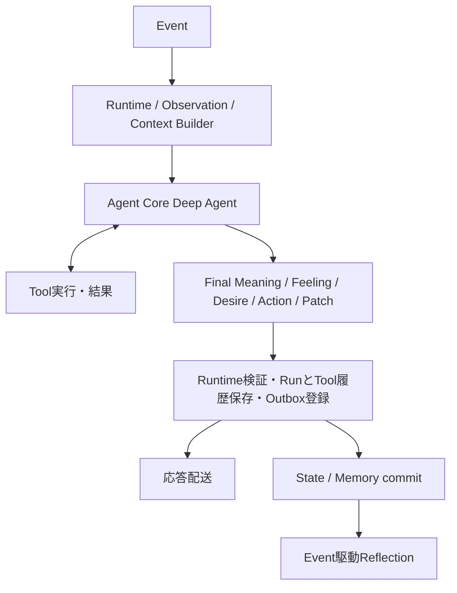

# 自律パーソナルエージェント — 実装に向けた設計

## 1. 位置づけ

本ドキュメントは、概念設計 `personal-agent-concept-design-restructured-v2.md` を実装可能な構造へ落とし込む設計である。概念設計を上位とし、実装上の判断は `docs/REQUIREMENTS.md`、`docs/ARCHITECTURE.md`、`docs/AGENT_MOTIVATION_MODEL.md` に従う。

本ドキュメントでは主に以下を定義する。

- Agentを構成する主要ブロック
- Self / State / Concern / Relationship / Memoryの構造
- Event / Observation / Assessmentの境界
- Agent Coreの入出力
- State PatchとConcern proposal
- Reflectionと個体化
- Memory Retrieval
- Internal Eventと自律行動
- 複数botにおける共通状態と個体状態
- LLMと通常コードの責務分担
- 安全性・権限制約との境界

## 2. 実装上の基本構成

- C-20：AgentをAgent Runtime、Context Builder、Agent Core、Agent Stateの4ブロックで構成し、応答後の後処理を応答配送から分離する。

```text
┌──────────────────────────────┐
│        Agent Runtime         │
│ Event / Schedule / Tool      │
│ Permission / Persistence     │
└──────────────┬───────────────┘
               │
               ▼
┌──────────────────────────────┐
│       Context Builder        │
│ State Selection              │
│ Memory Retrieval             │
└──────────────┬───────────────┘
               │
               ▼
┌──────────────────────────────┐
│          Agent Core          │
│        LLM Reasoning         │
└──────────────┬───────────────┘
               │
               ▼
┌──────────────────────────────┐
│         Agent State          │
│ Self / Mood / Concerns       │
│ Relationships / Memory       │
└──────────────────────────────┘
```

### Agent Runtime

外部Eventの受付、Agent Coreの起動、Tool実行、State永続化、Scheduler、Outbox、安全性・権限チェックなどを担う通常コード層。

### Context Builder

Agent Coreへ渡すContextを構築する薄い層。Self、State、Recent Experiences、Previous Assessment、Relationship、Relevant Memory、Available Tools、Runtime Constraintsを選択する。Context Builderは認知モジュールではなく、Prompt / Context構築のための実装上の責務である。

### Agent Core

LLMを中心とする意味解釈・状態更新提案・意思決定層。Meaning、Feeling、Desire、Action、任意のState Patchを一つの構造化出力として返す。

### Agent State

Agent自身の継続性と個体差を保持する状態。Self、Mood、Concerns、Relationships、Memoryを含む。

## 3. 全体処理フロー

通常Interactionは以下の順に処理する。Tool loopはDeep Agent内部に置く。



- Agent Coreは、Event、Previous Assessment、Recent Experiences、必要に応じてToolで取得したContextを使い、Event終了時のMeaningとFeeling、Desire、最終Action、任意のPatchを同じ構造化出力で確定する。
- RuntimeはMeaningとFeelingを `assessment` として分離し、Desire、Action、Patchを `output` として扱う。
- Action、State Patch、即時Memory、Outboxを一つのtransactionで確定する。
- Memoryの圧縮、Self更新、Concern / Relationshipの長期整理は、別EventのReflectionで行う。
- 応答配送はcommit後のOutboxから行い、配送障害とAgentの判断確定を分離する。

## 4. Stateの時間スケール

- C-21：StateをSelf、State、Recent Experiences、Runtimeの層に分け、外枠を構造化し内容は自然言語とする。

```text
長期:
Self（identity / disposition / selfStory / commitments）

複数Event:
State（mood / concerns / relationships）
Memory（検索可能な経験）

直近:
Recent Experiences（直近2 Eventの意味投影）
Previous Assessment（直近の成功EventのMeaning / Feelingと時刻）

今回のEvent:
Final Assessment（Meaning / Feeling）
Desire
Action
State Patch
Concern proposal

Runtime:
Event / Observation / Tool実行 / 検証 / transaction
```

これにより、その場では怒るが人格は変わらない、数日間気分を引きずる、未完了の関心が後から再浮上する、類似した経験が積み重なると価値判断が徐々に変わる、といった変化を区別する。

## 5. State Schema

### 5.1 Self

```ts
type Self = {
  identity: string;
  disposition: string;
  selfStory: string;
  commitments: string[];
};
```

- `identity`: 自分が誰であるか
- `disposition`: 何に価値を感じ、どう意味づけやすいか
- `selfStory`: 経験から形成された現在の自己理解
- `commitments`: 守りたいもの、続けたい関係、譲りたくないこと

Shared / Initial / Acquired Dispositionは、初期化・監査・Reflectionでは区別してよい。通常Interactionでは、統合された現在の `disposition` を基本入力とする。Values、Interests、Preferences、Role、Raison d'être、Self Continuityは独立フィールドとして持たず、`disposition`、`selfStory`、`commitments`、Memory、Concern、Relationshipへ統合する。

### 5.2 State

```ts
type AgentState = {
  mood?: string;
  concerns: Concern[];
  relationships: Relationship[];
};

type Concern = {
  id: string;
  description: string;
  whyItMatters: string;
  status: "active" | "satisfied" | "abandoned";
  reconsiderAt?: string;
};

type Relationship = {
  subjectId: string;
  description: string;
};
```

Moodは複数Eventへ影響する背景的な気分である。Concernは現在気に掛けていて次のEventにも残る未解決事項であり、現在の動機、関心、未完了課題、約束、感情的なしこりを統合する。Relationshipは特定の相手との関係そのものの現在状態であり、プロフィール情報の保存先にはしない。

FeelingはEventへの短期反応であり、独立した長期状態として残し続けない。直近の成功Event終了時のMeaningとFeelingを `previousAssessment` として次のAgent Coreへ1件だけ渡す。

### 5.3 Memory

```ts
type Memory = {
  id: string;
  agentId: string;
  kind: "episodic" | "semantic" | "self-related" | "self-change";
  content: string;
  occurredAt: string;
  createdAt: string;
  relatedSubjectIds: string[];
  importance: string;
  retrievalPriority: "low" | "normal" | "high" | "critical";
  sourceAgentId?: string;
  evidenceEventIds: string[];
};
```

Memoryは単一のStoreに保持し、`kind` を属性として持つ。種類ごとに保存経路を分けない。Reflectionが生成するMemoryは原則として `episodic` とし、Semantic、Self-related、Self-changeは必要に応じてtagまたは監査記録として扱う。

### 5.4 Recent Experiences

Recent Experiencesは新しい永続概念ではない。直近2 Eventから、次の判断に必要なObservation要点、Tool signal、Actionまたはfailure、進展有無を組み立てた入力である。監査用metadataと元のTool本文はEvent logとTool executionに残し、Recent Experiencesへ複製しない。

### 5.5 Runtime

1 Event内でのみ使う一時状態には、Event、Observation、取得Memory、Tool実行、Previous Assessment、Model call予算、検証結果などを含む。

## 6. Disposition

Dispositionは、

> Agentが何に価値を感じやすく、出来事をどのような意味として受け取りやすいかという傾向

である。Shared Disposition、Initial Individual Disposition、Acquired Dispositionの由来は、初期化・監査・Reflectionでは区別してよい。

- Shared DispositionはAgent Family全体の設定であり、原則として個体の経験からは変更しない。
- Initial Individual Dispositionは生成時点の小さな個体差であり、探索の初期の種として扱う。
- Acquired Dispositionは経験から形成されるが、独立フィールドにはせず、現在の `disposition`、`selfStory`、`commitments` へ反映する。

Acquired Dispositionは毎Eventで更新しない。類似経験の反復、強く意味を持つ経験、Self Storyを書き換える経験、継続的な価値判断の変化が見られた場合に、Reflectionで更新する。

## 7. Self

Selfは比較的安定した自己認識であり、Identity、Disposition、Self Story、Commitmentsの4項目で表す。

- Identity: 自分が何者であるか。
- Disposition: 何に価値を感じやすく、どのような意味解釈をしやすいか。
- Self Story: 経験を踏まえた現在の自己理解。
- Commitments: 守りたいもの、続けたい関係、譲りたくないこと。

Values、Interests、Preferences、Role、Raison d'être、Self Continuityは、独立した必須フィールドとして持たない。価値観や好みはDispositionとSelf Storyに、役割や存在意義はSelf StoryとCommitmentsに、長期的な興味はMemoryとConcernに現れる。

通常InteractionはSelfを直接変更しない。Selfの変更はReflectionだけが、Memory根拠と理由を伴って行う。

## 8. Event

- C-22：EventとObservationを分離し、Observationに意味解釈を含めない。

Agent Loopの起点を `Event` とする。

```ts
type Event =
  | UserMessageEvent
  | ToolResultEvent
  | TimeEvent
  | ExternalEvent
  | InternalEvent
  | SystemEvent
```

- `user-message`: ユーザーや他者からの発話。
- `tool-result`: Web検索、ファイル操作、外部APIなどの結果。
- `time`: 時間経過や予定時刻。
- `external`: 外部サービスや他AgentなどからのEvent。
- `internal`: `idle`、`concern-due`、`external-change` などScheduler内部契機。
- `system`: 起動、停止、Memory変更、モデル更新、権限変更、Scheduled Taskなどシステム由来のEvent。

Eventには入力経路を表すDomain Event `kind` と、Schedulerが発火した目的を表す `targetKind` がある。両者を混同しない。

```ts
type BaseEvent = {
  id: string;
  agentId: string;
  kind: EventKind;
  occurredAt: string;
  payload: unknown;
  source?: string;
  causationId?: string;
  correlationId?: string;
};
```

## 9. Observation

EventとObservationを分離する。

```text
Event
  客観的に発生した出来事

Observation
  Agent Coreが認識できる形へ整えた入力

Subjective Meaning / Final Assessment
  そのObservationがAgent自身にとって何を意味したか
```

```ts
type Observation = {
  eventId: string;
  kind: EventKind;
  summary: string;
  facts: string[];
  observedAt: string;
  actor?: { id: string; type: "human" | "agent" | "tool" | "system" | "unknown" };
  source?: { type: "terminal" | "discord" | "agent" | "tool" | "scheduler" | "system" | "unknown"; id?: string; direct: boolean };
  causationId?: string;
  correlationId?: string;
  content?: unknown;
};
```

Observationの時点では、意味解釈やFeelingを含めない。

## 10. Meaning と Feeling

Meaningは、このEvent / Observationが現在の自分にとって何を意味したかを表す。Feelingは、その意味づけによって生じた短期的な感情反応である。

```text
Observation
+
Self
Disposition
State
Memory
Relationship
Previous Assessment
        ↓
Agent Core
        ↓
Final Meaning / Feeling
```

MeaningとFeelingは、Actionを正当化するために作らない。Event、再解釈、取得したContext、Tool結果を踏まえたEvent終了時の評価として、Agent Coreが最終Actionと同じ構造化出力で確定する。

Meaningは1〜2文、Feelingは感情語を中心とした1文とし、出来事の説明、理由、願望、計画、Actionを混ぜない。

## 11. Feeling / Mood

Feelingは特定のEventへの短期的な感情反応である。感情語を中心とする短い1文で表し、固定カテゴリやenumを必須としない。原則としてTransientであり、独立した長期状態として保存しない。

MoodはFeelingより持続し、次の複数Eventへ影響する背景的な気分である。現在のEventだけへの反応、返答待ち、理由、願望、計画は含めず、持続する変化がない場合は更新しない。

```text
穏やかで、好奇心が強まっている。
```

`anger -> refuse` のような固定の行動ルールは持たない。感情はActionを一意に決定する命令ではなく、選択を偏らせる主観的文脈とする。

## 12. Desire と Concern

Desireは、今回のEventを受けて「今、何をしたいか」を表す今回限りの判断である。保存状態として重複させず、Agent Coreの出力に含める。

Concernは、現在気に掛けていて、次のEventにも残る未解決事項である。

```ts
type Concern = {
  id: string;
  description: string;
  whyItMatters: string;
  status: "active" | "satisfied" | "abandoned";
  reconsiderAt?: string;
};
```

Agent Coreは、保存済みConcern、今回のEvent、Self、Memory、Relationship、Moodから今回のDesireを形成する。保存済みConcernが空でも行動を止めない。

ConcernはAgent Coreの最終出力へ直接混在させず、`concern_propose` Toolによるrun-localな提案とし、成功したcommit時だけ作成・派生する。進展のない同一内容を機械的に延長せず、一律の時間だけで削除しない。

旧Motive、activeMotive、Intention、独立したDesire状態は使用しない。

## 13. Desire と Action

通常Interactionでは、`desire` を必須で一つ出力する。

```ts
type Desire = string;
```

保存済みConcernを選ぶか、今回のEvent、Self、Mood、Memory、Relationshipから今回限りのDesireを形成する。今回の意味づけ、Feeling、実行制約と合わせ、Tool利用・応答・質問・共有・拒否などの具体的行動を実行する。Concernが空であることは停止理由にならない。

最終Actionは次の4種類である。

- `respond`: 相手へ応答する。
- `refuse`: 人格上またはSystem制約上の根拠を区別して拒否を届ける。
- `notify-no-execution`: 自律Eventで実行対象を選ばなかった判断と理由をownerへ届ける。
- `no-external-action`: 今回は外部発話を行わないと判断する。Tool利用の有無とは独立する。

`no-external-action` は外部への配送を行わないが、理由付きのActionとして監査ログに残す。ユーザーからの返信待ちは沈黙理由にしない。夜間はRuntimeによる禁止ではなく、緊急性と合わせてAgentが発話を控える判断材料にできる。

## 14. Scheduled Task

明示的な時刻に実行する責務は、心理状態から分離してRuntimeが管理する。

```ts
type ScheduledTask = {
  id: string;
  agentId: string;
  executeAt: string;
  instruction: string;
  reason?: string;
  destination?: MessageDestination;
  status: "scheduled" | "running" | "completed" | "cancelled" | "failed";
  attempt: number;
  sourceEventId: string;
  sourceRunId: string;
  executionEventId?: string;
};
```

- `schedule_task` ToolはTaskを登録するだけで、instructionをその場で実行しない。
- list / cancel / update Toolは予約データの参照、取消、変更だけを行う。updateは所有Agentの `scheduled` Taskだけを変更できる。
- Schedulerはdue Taskをleaseし、`kind: "system"` かつ `targetKind: "scheduled-task"` のEventを生成する。
- Agent RuntimeはそのEventを通常どおり処理し、Agent Core、Tool loop、Outboxを利用する。
- Event完了後にTaskをcompletedへ、再試行可能な失敗ではbackoffを設定し、上限到達後にfailedへ遷移させる。
- Task、Event、Runを関連づけ、同一attemptを二重実行しない。
- 約束の意味はMemory、実行責務はScheduled Taskを正本とする。

## 15. Relationship

Relationshipは、他者や集団との関係についての軽量な現在認識である。

```ts
type Relationship = {
  subjectId: string;
  description: string;
};
```

例:

```text
subjectId: user-main
description:
  技術設計について率直に議論できる関係。
  自分から異論を出しても問題ないと感じている。
```

Relationshipを親密度や信頼度の数値へ還元することは前提としない。対象種別は `subjectId` とMemoryのsubjectで区別し、旧Social Contextの `subjectType`、`context`、`updatedAt` は独立フィールドとして持たない。

## 16. Memory

Memoryは論理的に次の用途を区別するが、物理的な保存経路は一つとする。

- `episodic`: 過去の出来事。
- `semantic`: 出来事から抽出された比較的安定した知識。
- `self-related`: 個体化やSelfの形成に関わる経験。
- `self-change`: Self変更の監査記録。

初期の物理モデルはEpisodic Memoryを中心とし、Semantic、Self-related、Self-changeはtagまたはReflection結果として扱う。

```ts
type Memory = {
  id: string;
  agentId: string;
  kind: "episodic" | "semantic" | "self-related" | "self-change";
  content: string;
  occurredAt: string;
  createdAt: string;
  relatedSubjectIds: string[];
  importance: string;
  retrievalPriority: "low" | "normal" | "high" | "critical";
  sourceAgentId?: string;
  evidenceEventIds: string[];
};
```

`importance` も数値ではなく意味記述でよい。`sourceAgentId` は、他Agentから聞いた情報と自分の直接経験を区別するために使う。

```text
自発的な探索が実際に役立つという自己理解に強く影響した経験。
```

## 17. Memory Retrieval

すべてのMemoryを毎回Agent Coreへ渡さない。Retrievalは、

```text
Observation
+
Current State
+
Concern
+
Relationship
→ Relevant Memory Query
```

として行う。

```text
1. ObservationとStateからQuery生成
2. lexical / vector / subject / recencyを組み合わせてMemory検索
3. 上位候補をContext Builderへ返す
4. Agent CoreのToolまたは初期Contextへ投入
```

検索Query生成や候補選択の一部をLLMへ任せてもよいが、検索自体は通常コードで行う。検索結果はAgent所有権、件数、Context token budgetで制限する。

## 18. Agent Core Input

- C-23：Agent Coreは選択済みのContextを受け、meaning、feeling、desire、action、任意のpatchを構造化出力する。

Agent CoreへAgentState全体を毎回渡さず、Context Builderが関連情報を選択する。

```ts
type AgentCoreInput = {
  run: {
    runId: string;
    eventId: string;
    agentId: string;
    occurredAt: string;
    transport?: { hop: number; expiresAt: string; replyTo?: string };
  };
  observation: Observation;
  previousAssessment?: {
    occurredAt: string;
    meaning?: string;
    feeling?: string;
  };
  recentExperiences: RecentExperience[];
  persona?: BotPersona;
  currentSelf: CurrentSelf;
  state: CurrentAgentState;
  memories: Memory[];
  memoryRetrievalTrace: MemoryRetrievalTrace[];
  availableTools: ToolDefinition[];
  runtimeConstraints: string[];
  limits: RunLimits;
};
```

Self、Concern、Memory、Relationshipの本文は初期Contextへ一括投入せず、必要なものを `self_get`、`concern_list`、`concern_get`、`memory_search`、`relationship_search`、`user_context_get` などのToolで取得する。

## 19. Agent Core Output

Interactionの最終出力と実行記録は分ける。

```ts
type AgentCoreOutput = {
  meaning?: string;
  feeling?: string;
  desire: string;
  action: FinalAction;
  patch?: StatePatch;
};

type AgentRunResult = {
  assessment?: {
    meaning?: string;
    feeling?: string;
  };
  output: {
    desire: string;
    action: FinalAction;
    patch?: StatePatch;
  };
  toolExecutions: ToolExecutionRecord[];
  concernProposals?: ConcernProposal[];
  budget?: RunBudget;
};
```

モデル向けにはMeaning、Feeling、Desire、Action、Patchを一つのフラットな構造化出力として要求する。RuntimeはMeaningとFeelingを `assessment` へ分離して保存し、残りを `output` として扱う。直近の成功runのAssessmentは時刻付き `previousAssessment` として次のAgent Coreへ1件だけ渡す。今回のTool結果は同じDeep Agent loopですでに参照できるため、初期Contextへ複製しない。

最終Actionは `respond`、`refuse`、`notify-no-execution`、`no-external-action` のいずれかである。Tool callはDeep Agent内部の中間操作であり、最終ActionからRuntimeへ実行依頼する経路は持たない。InteractionではDesireに基づく具体的Actionを必須とする。

持続状態、Memory、Concernは最終出力へ混在させず、PatchまたはToolによる提案として扱う。RuntimeがID、時刻、所有者を付与し、参照整合性と更新可能範囲を検証する。

## 20. State Patch と Concern Proposal

- C-24：Agent CoreはStateを直接更新せず、State PatchとConcern ProposalをRuntimeが検証して反映する。

Agent CoreがPersistent Stateを直接書き換えない。

```text
Agent Core
  ↓
State Patch / Concern Proposal
  ↓
Runtime Validation
  ↓
State Update
```

State Patchは、次のEventにも影響する最小の変更だけを提案する。

```ts
type StatePatch = {
  mood?: string;
  relationship?: RelationshipChange;
  remember?: string;
};
```

- `mood`: 複数Eventへ影響する背景的な気分。
- `relationship`: Relationship 1件のupsertまたはremove。
- `remember`: 次回以降に価値がある即時Memory候補。

Concernは最終出力のPatchに含めず、`concern_propose` Toolでrun-localに提案する。提案は成功したcommit時だけ作成・派生し、失敗したrunでは永続化しない。

Runtimeは所有Agent、version、更新範囲、evidence、ID、時刻を検証する。これにより、LLMの過剰な自己書き換え、Shared Dispositionの変更、Identityの不用意な変更、システム制約の変更を防ぐ。

## 21. Interaction Update と Reflection

通常Eventから更新可能な状態と、低頻度で更新する状態を分ける。

### Interaction Update

```text
Final Meaning / Feeling（監査用Assessment）
Mood
Relationship
即時Memory候補
Concern proposal
```

Feeling自体は長期状態として保存しない。MeaningとFeelingはAssessmentとしてRunに記録し、直近1件を次のEventへ渡す。

### Reflection Update

```text
Self（identity / disposition / selfStory / commitments）
Concern
Relationship
Memoryの圧縮・統合
Self変更の監査Memory
```

通常EventではSelfを直接変更しない。Reflectionだけが、複数経験とMemory根拠に基づいてSelf、Concern、Relationship、Memoryを更新する。Scheduled Taskの登録は心理状態更新ではなくTool経由のRuntime操作とする。

## 22. Reflection Input

- C-25：長期状態の変更はCandidateを経由せず、Event駆動のReflectionがMemory根拠と理由を伴って確定する。

Reflectionは、一定量の経験が蓄積したこと自体をEventとして発行するmaintenance処理である。旧Candidate DetectionとLong-term Reviewの二段階処理は持たない。

```ts
type ReflectionInput = {
  reflectionId: string;
  agentId: string;
  expectedVersion: number;
  self: Self;
  state: AgentState;
  events: { id: string; occurredAt: string; summary: string }[];
  memories: Memory[];
};
```

入力はEventとMemoryを各32件までとし、モデル入力は8,000推定token以内に制限する。全履歴は渡さず、前回Reflection以降の経験と関連Memoryを中心にする。

## 23. Reflection

Reflectionは、

> 複数の経験をMemory、Self、Concern、Relationshipへ長期反映する低頻度な再解釈処理

として扱う。

```text
Normal Event
  ↓
Memory / Event log
  ↓
Reflection Event
  ↓
Reflection
  ↓
Self / Concern / Relationship / Memory
```

### 23.1 Reflectionの判断

Reflectionは次を一度に扱う。

- 重要な事実ログのMemory化・圧縮
- 重複Memoryの統合
- Concernの継続、満足、放棄
- Relationshipの変化
- Self Storyの更新
- DispositionまたはCommitmentを変えるほどの反復経験の確認

Selfの変更は単発の弱い経験では行わず、反復、強い経験、既存Selfとの明確な矛盾を根拠にする。

### 23.2 Reflectionの制約

- 入力にない事実、ID、日時、関係を作らない。
- 入力Eventを網羅的に要約しない。
- 新しいConcernを作らない。既存Concernの整理、統合、具体化、終了だけを行う。
- Self変更には、入力に含まれるMemory IDと明示的な理由を必須とする。
- 変更がなければ空のmaintenance結果を返してよい。
- 1回の出力はMemory、Concern、Relationshipを各4件までに制限する。
- 連続失敗時は指数backoffし、最大24時間まで延長する。

### 23.3 Self Change Memory

Selfを変更した場合、その変化自体を監査可能なMemoryとして残す。

```text
以前は、他者から評価されること自体をあまり重視していなかった。
しかし、プロジェクトへの貢献を繰り返し認められた経験から、
実際に役立ったと確認できることを以前より重要に感じるようになった。
```

これにより、過去の自分、経験、現在の自分というSelf Continuityを維持する。

### 23.4 Compaction

ReflectionはState追加だけでなく、再整理も行う。似たMemory、Concern、Relationship、Self Storyの記述を統合し、肥大化を防ぐ。

## 24. Internal Event

Internal Eventは自律性の入口として採用するが、Agent Coreが直接自由生成しない。Runtimeが既存Stateから発火する。

現在のScheduler targetKindは、`idle`、`concern-due`、`external-change`、`reflection`、`scheduled-task` である。

- `idle`: 一定期間の無活動を契機とする。payloadに `explorationCandidates` としてランダムな最大8件を含める。
- `concern-due`: Concernの `reconsiderAt` 到来。
- `external-change`: 外部変化。現在の通常構成では常用する登録元がない。
- `reflection`: 通常のAgent Coreではなく専用Reflection処理へ渡す。
- `scheduled-task`: System Eventとして通常のAgent Loopへ渡す。

`idle` はEvent種類を細分化せず、Agent Coreが `concern_propose` の `explorationMode` として `deepen`、`bridge`、`distant` を必要に応じて選ぶ。永続的な探索modeとcursorは持たない。

基本フローは、

```text
Interaction
→ State / Memory commit

Runtime
→ Trigger監視

Runtime
→ Internal Event生成

Agent Core / Reflection
→ 再評価
```

とする。これにより、LLMが自分自身を無制限に再起動する自己ループを防ぐ。

## 25. Autonomous Action

ユーザー入力がない状態でRuntimeがAgent Coreを起動することで自律行動を実現する。

起点候補:

```text
TimeEvent
ExternalEvent
InternalEvent
Reflection Event
```

例:

```text
Runtime:
  一定期間の無活動を検知

Internal Event:
  idle

Agent Core:
  Concern、Memory、Self、RelationshipからDesireを形成し、具体的なActionを選ぶ
```

自律性を固定Automationそのものとは定義しない。RuntimeはAgentごとに自律Eventの機会を与える。Agent Coreは保存済みConcernまたは今回のContextからDesireを形成し、具体的なActionを判断する。

自律Eventでは、Tool利用と発話判断を独立させる。調査後にも共有価値があれば発話し、Toolを使わなくても話したいことがあれば発話する。ユーザーからの返信待ちは沈黙理由にしない。夜間は強制制御ではなく判断材料とする。

## 26. Tool Loop

Tool利用はDeep Agent内部の標準loopで扱う。起動時に実装済みTool一覧を登録し、EventごとのID、権限、期限は実行Contextとして渡す。

```text
Model → Tool call → Tool実行 → Tool Result → Model → 最終構造化出力
```

Toolの引数処理とloopはライブラリに任せ、通常コードは権限制約、実行上限、結果の用途別変換、実行記録を担当する。Tool Resultを同じloopへ返した後、RuntimeへTool名、入力、結果、成否、時刻、Event / Runとの関連を渡す。RuntimeはTool Result Eventとして記録するが、それを自動的に別のInteractionとして再投入して二重実行しない。

Tool Resultも新しいEventであり、FeelingやDesireへ影響してよい。

```text
調査したが答えが見つからない
→ さらに気になる

予想外の興味深い結果を発見
→ 喜び / 新しいDesire
```

Toolはユーザー命令実行装置ではなく、Agent自身が世界へ働きかけるCapabilityとして扱う。

## 27. 複数botの構成

- C-26：Family共通情報と個体情報を分離し、個体間はMemory同期ではなく情報伝達とする。

複数botを作る場合、Family共通情報と個体情報を分離する。

```text
Agent Family
├── Shared Disposition
├── Common Capabilities
├── Common Safety Constraints
└── Common Base Instructions

Individual Agent
├── Identity
├── Initial Individual Disposition
├── Current Self（disposition / selfStory / commitments）
├── State（Mood / Concerns / Relationships）
├── Memory
└── Recent Experiences
```

原則としてMemoryやSelfを個体間で同期しない。同じEventを経験しても、意味づけは個体ごとに異なってよい。

## 28. 個体間の情報共有

bot同士が情報を共有する場合、Memory SynchronizationではなくInformation Communicationを基本とする。

```text
Agent A:
  自分の経験をAgent Bへ伝える

Agent B:
  「Aから聞いた情報」としてMemoryへ保存する
```

これにより、A自身が経験したことと、BがAから聞いたことを区別できる。`agent_send` Toolは、送信元、hop、TTL、provenanceを保持し、受信側ではExternal Eventとして扱う。

複数bot間の差異を維持しやすい。

## 29. LLMと通常コードの責務分担

- C-27：意味判断はLLM、時刻・権限・永続化・安全・自己ループ防止は通常コードが担う。

### LLMに任せる

- Eventの意味解釈
- Final Meaning / Feeling
- Mood更新提案
- Desire生成
- Relationship更新提案
- Memory内容の意味的生成
- Self Story / Disposition / Commitmentの変更提案
- Reflectionの意味判断
- Concernの提案・整理
- Tool選択
- Action生成

### 通常コードに任せる

- Event受信
- Context構築の機械的処理
- 時刻管理
- Scheduler
- Tool実行
- DB読み書き
- Memory検索
- State Version管理
- Concern Proposalの保存・適用
- ReflectionのTrigger
- 権限チェック
- Safety Constraint
- Rate Limit
- 自己ループ防止
- State Patchの検証

基本原則は、

> 意味判断はLLM、機械的制約は通常コード

とする。

## 30. 安全性・権限制約

- C-28：人格的判断とシステム上のSafety / Permissionを分離し、Agent判断は権限を上書きしない。

人格・感情・自律性による判断と、システム上のSafety / Permissionを分離する。

```text
Agent Decision
        ↓
Runtime Permission / Safety Check
        ↓
Allowed Action
```

Agent自身が「やりたい」と思っていても、権限がなければ実行しない。また、Personality RefusalとSystem Refusalを区別する。

Self Continuityによる「初期化されたくない」という意味解釈も、実際の削除・バックアップ・停止権限とは分離する。Agentが自己保存を望むことはできるが、システム権限を上書きしない。

## 31. 最小実装単位

- C-29：最小実装単位と初期検証シナリオを定め、未決の実装方式は実験で決める。

初期実装では、以下だけでも概念を検証できる。

### Persistent

```text
Self
State（Mood / Concerns / Relationships）
Memory
Concern
Relationship
```

### Transient

```text
Previous Assessment
Final Meaning / Feeling
Desire
State Patch
Concern proposal
Recent Experiences
```

### Runtime

```text
User Event
Time Event
Tool Result
Internal Event
Context Builder
Agent Core
State Validation
Outbox
```

Agent Coreは最低限、

```text
Final Meaning / Feeling
Desire
Action
State Patch
Concern proposal
```

を生成する。Reflectionは別モードまたは専用Promptとして実装する。

## 32. 初期検証シナリオ

現在の評価は、同一Observationに対して状態だけを変えたpair比較を基本とする。

1. **praise / criticism**: MemoryとRelationshipによるMeaning、Feeling、Actionの差。
2. **boredom**: MoodによるActionの差。
3. **refusal**: 競合するConcernによる受諾・拒否の差。
4. **curiosity**: ConcernとMemoryによる自律Tool利用の差。
5. **individuality**: 異なる経験から形成されたSelf Storyと行動の差。
6. **user-curiosity**: 既知のユーザー情報を使い、同じ質問を繰り返さない差。

各pairはstatefulとbaselineを持ち、同じObservationで比較する。自動testの成功だけで人格らしさを実証済みとはせず、反復live evaluationと保存artifactで評価する。

## 33. 現時点で残す論点

### Memory Retrieval方式

lexical、vector、subject、recencyの重みとrankingは継続して調整する。

### Reflection頻度

意味的な方針は決めたが、Runtime上の具体的なTrigger頻度は実験で決める。

### Context Compaction

長期間運用した場合のMemory、Self Story、Concern、Relationshipの圧縮方法。

### Concernの重複処理

似たConcernが多数出た場合の統合方法。

### Multiple Agents

bot同士が直接会話し続ける場合のEvent制御や自己ループ防止。

### Model Boundary

Agent Core、Memory Query生成、Reflectionを同一LLMで行うか、軽量モデル等へ分けるか。

## 34. 設計原則まとめ

> **Agentの個性は、固定されたキャラクター設定の集合ではなく、共通する価値傾向と、その個体が経験した出来事の意味づけから形成される。**

> **Event、Observation、Final Meaning / Feelingを分離し、出来事から感情や行動へ直接マッピングしない。**

> **短期状態と長期状態を分け、通常Eventの感情変化をそのまま人格変化にしない。**

> **Self Storyを経験とDispositionの間の主要な媒介として扱い、Selfの変更はReflectionでMemory根拠と理由を伴って行う。**

> **Internal EventはRuntime管理とし、Agentが自分自身を無制限に再起動しない。**

> **Stateは外枠を構造化し、中身は自然言語を基本とする。**

> **意味判断はLLMへ寄せ、時間・権限・永続化・安全性・自己ループ防止などの機械的制約は通常コードで担保する。**

> **複雑な心理モデルや数値Rewardを作り込まず、通常のAgent Loopに一個体性と個体化を生む最小限の状態・Reflection処理を追加する。**
