# 予測・予測誤差・背景経験の設計

## 1. 位置づけ

本ドキュメントは、既存の概念設計 `personal-agent-concept-design-restructured-v2.md` と実装設計 `personal-agent-implementation-design-v2.md` を上位とし、予測・予測誤差・背景経験・MainAgent統合だけを追加で定める一次ドキュメントである。

- C-30：既存のAgent Loopに、G1〜G3の予測、予測誤差、背景経験、感情・動機、記憶更新の循環を追加する。
- C-31：MainAgentは既存のAgent Coreとし、予測・誤差評価をMainAgentの外側の責務として置く。

予測・誤差評価はMainAgentの行動を直接決めない。MainAgentは予測結果、誤差評価、背景経験、Memoryを材料として、従来どおりMeaning、Feeling、Desire、Actionを決める。予測結果に従う義務はない。

本ドキュメントが予測・背景経験について既存設計と異なる定めをした場合、その範囲では本ドキュメントを優先する。Self、State、Concern、Relationship、Memory、Action、Reflectionの既存の意味は変更しない。

## 2. 設計原則

- C-32：G1/G2は応答後に次ターンのユーザー発話を予測し、1ターン遅れで予測誤差を評価する。
- C-33：事前予測、観測、観測後の推論を時点で区別し、観測後の推論を事前予測として扱わない。
- C-34：G1/G2は1回のLLM callで、予測、誤差評価、観測候補、G3起動判断を返す。このcallは通常応答とは別の追加callとする。
- C-35：予測は複数の候補と離散的な期待度で表し、校正済み確率や数値スコアとして扱わない。
- C-36：誤差評価は、一致、意外性、差異、解釈、不確実性、原因帰属を別項目として持つ。
- C-37：G1/G2の観測候補はMemoryへの書込みではなく提案とし、すべてのMemory書込みは単一のMemoryWriteServiceを通す。明示された観測事実だけを自動受理し、推測された信念はMainAgentまたはReflectionの判断を要する。
- C-38：G1/G2はG3の要否、対象階層、理由を返し、RuntimeがG3 Eventを作る。
- C-39：G3はMainAgentとは別インスタンスのDeep Agentとし、共通RetrievalのToolで必要な情報を取得する。
- C-40：G3は前回の仮説を支持、反証、判断不能で評価し、新しい仮説とMainAgent向けの調査結果を返す。G3はMemoryを直接書き換えない。
- C-41：G3後のMainAgent再判断は通常のAgent Loopに通し、G3 Eventだけを通知必須の例外とする。
- C-42：G3は応答後に遅延実行し、初回応答と次のuser-messageを待たせない。
- C-43：背景経験は会話由来のMemoryと分離した専用Storeに保持し、会話由来のMemoryと区別する。
- C-44：背景経験は固定プロフィールと、いつ、どこで、誰と、何をして、何を感じ、結果どうなったか、何を学んだかを持つ。
- C-45：背景経験は不変とし、初期化のたびにYAMLで上書きする。会話由来のMemory、信念、Self、Stateは保持する。
- C-46：背景経験は共通Retrievalで取得し、G1/G2はRuntime、G3とMainAgentはToolで取得する。
- C-47：背景経験に現在のユーザーとの共有経験を含めず、Agentは自分の過去として参照する。
- C-48：予測誤差は感情・動機の入力であり、誤差を減らすことを期待するDesireとActionを生み得る。誤差は信念修正やユーザーへの迎合を強制しない。
- C-49：Common GroundはMemoryの `common-ground` kindで表し、Agentが両者の共有知識と考える内容、subject、根拠を持つ。
- C-50：予測、誤差評価、G3仮説、G3 Taskは専用の永続化領域に保存し、後から集計できるようにする。
- C-51：予測Contextと背景経験は、Agent所有権と既存のContext budgetの対象にする。
- C-52：G1/G2/G3の失敗は記録してスキップし、通常会話を継続する。G3は再試行し、期限切れは破棄する。
- C-53：評価は、予測誤差がMeaning、Feeling、Desire、Action、Memoryへ影響する循環を主対象とし、Event、Run、グループ、candidateIndexごとのdesireの期待とRecentExperienceのeffectを照合する。的中率と期待度校正は診断指標として扱う。
- C-54：予測結果はDebug UIで観測でき、ユーザーへ予測を直接開示しない。
- C-55：すべての会話由来Memoryの書込みは単一のMemoryWriteServiceを通す。AgentCore、G1/G2、G3、Reflectionは候補または意図だけを渡す。
- C-56：会話由来Memoryと背景経験の検索は、単一のRetrievalServiceでvector、keyword、subject、recencyを共通の順位付けで扱う。
- C-57：予測誤差からのMemory更新は、予測・観測・文脈をqueryにしたRAGで候補を取得し、MemoryIntentをMemoryWriteServiceへ渡す。予測専用の意味IDやタグで対応づけない。
- C-58：MemoryWriteServiceはMemoryIntentからcreate、update、no-opを決め、更新対象はRAG候補から解決する。誤った記憶の更新も許容する。
- C-59：Event種別をuser-message、memory-update、G3、reflectionに分ける。memory-updateはMemoryIntentを適用し、LLMを呼ばない。
- C-60：memory-updateとreflectionは、MemoryWriteServiceとRAGによる更新対象取得を共通化する。Self、Relationship、ConcernはMemoryWriteServiceで更新しない。
- C-61：Eventの優先順位はuser-message、memory-update、G3、reflectionの順とする。user-messageを待たせず、古い更新対象は再検索またはno-opにする。
- C-62：Actionの期待はdesireに、Actionの結果はRecentExperienceに、Memory更新意図はrememberとMemoryIntentに統合する。actionExpectation、actionEffects、memoryUpdatesという専用fieldを持たない。
- C-63：MainAgentのMemory更新はそのEventのtransactionで行う。G1/G2/G3とReflectionのMemory更新はmemory-update Eventで行う。Event種別ごとにMemory更新の可否を持つ。
- C-64：ReflectionのMemory更新とSelf、Relationship、Concernの更新は同一DB transactionを必須としない。対象ごとの状態、冪等性、再試行、順序を持つ。
- C-65：G1/G2のpredictionEvaluationは予測シグナルであり、MeaningとFeelingはMainAgentだけが確定する。G1/G2はFeelingを出力しない。
- C-66：MemoryIntentのtargetはMemory kindに限定する。RelationshipとConcernは既存のPatchまたはConcern Proposalへ渡し、G3のMemoryIntentはpredictionContextに含める。
- C-67：MemoryWriteServiceはDB gatewayとしてtransaction clientを受け取り、Memory versionの楽観ロックとAgent単位の直列処理を行う。旧INSERT経路を残さない。
- C-68：Reflectionはplanと対象別statusで更新し、Memory更新後にSelf、Relationship、Concernを更新する。失敗した対象だけを再試行する。
- C-69：memory-update Eventは専用Handlerで処理し、user-message優先の協調的スケジューリングを行う。強制中断はしない。
- C-70：予測Loopは旧continuity / memory分割後処理ではない。G1/G2の追加LLM callはNFRの例外とし、call予算とdeadlineを持つ。

## 3. 用語

| 用語 | 定義 |
|---|---|
| MainAgent | 既存のAgent Core。予測結果を材料にMeaning、Feeling、Desire、Actionを決める主体 |
| G1 | 言語形式の予測グループ。語彙、文法、表記、口調、言い回しを扱う |
| G2 | 意味・会話行為の予測グループ。命題、質問、依頼、同意、拒否、話題転換を扱う |
| G3 | 認知・対人モデルの予測グループ。L4〜L6の意図、知識、信念、関係を扱う |
| 事前予測 | 観測前に確定し、保存された予測 |
| 予測誤差 | 事前予測と、観測およびその解釈を照合した結果 |
| 仮説評価 | G3が前回の仮説を、新しい観測と根拠で支持、反証、判断不能に分類した結果 |
| 背景経験 | Agentの過去として設定された架空の自伝的経験。会話由来のMemoryとは別Storeに置く |
| 観測候補 | G1/G2が観測から生成する、保存候補の事実や傾向。MemoryWriteServiceの入力を経て保存される |
| 誤差低減のDesire | 予測誤差を減らすために、確認、質問、検索、試行、記憶更新、信念維持、無視などを選ぶ動機 |
| 共通Retrieval | 会話由来Memoryと背景経験を同じ順位付けで検索するサービス |
| 予測記録 | 予測内容、グループ、階層、文脈、観測、誤差をEvent / Runに紐づけて保持する記録。意味分類IDは持たない |
| candidateIndex | 出力内の予測候補、またはRAG候補の位置。意味分類やタグではない |
| MemoryIntent | Memoryの作成・更新の意図。content、reason、evidence、confidence、targetを持つ |
| memoryCandidates | RAGで取得したMemoryIntentの候補。candidateIndex、content、source、similarityを持つ |
| predictionEvaluation | G1/G2が返す予測誤差の評価。Meaning / Feelingとは別の予測シグナル |
| reflection plan | Reflectionが適用する対象と順序を持つ更新計画。対象別statusで管理する |
| Memory version | Memoryの楽観ロックに使う版番号。update時に照合する |
| prediction-linked memory | 予測誤差の後に作成または更新されたMemory。意味IDではなく、内容、Event、evidenceでたどる |
| effect | G1/G2がRecentExperienceのAction結果として記録する誤差変化の評価。reduced / unchanged / increased / unknown |
| reflection target status | ReflectionのMemory、Self、Relationship、Concernごとのpending / completed / failed / blocked |

## 4. 全体像

```mermaid
flowchart TD
  U[user-message] --> C[Context Builder]
  P1[前ターンの予測と誤差評価] --> C
  C --> M[MainAgent<br/>既存Agent Core]
  M <--> R1[共通Retrieval Tool]
  R1 <--> MEM[会話由来Memory]
  R1 <--> BG[背景経験Store]
  M --> A1[Meaning / Feeling / Desire / Action]
  A1 --> R[応答]
  R --> G12[G1/G2<br/>追加の1 call]
  G12 --> E[予測誤差の保存]
  G12 --> N[次ターンの予測の保存]
  G12 --> OC[観測候補]
  OC --> MW[MemoryWriteService]
  MW --> MEM
  G12 -->|needsG3| S[Scheduler]
  S --> G3[G3 Agent<br/>別Deep Agent]
  G3 <--> R1
  G3 --> H[仮説評価と調査結果]
  H --> M2[MainAgentの再判断]
  M2 --> A2[追加発話 / 記憶更新 / 何もしない]
  A2 --> MW
```



予測は応答経路の外側に置く。ユーザーへの通常応答はMainAgentが行い、G1/G2は応答の配送後に実行する。G3は必要な場合だけSchedulerがEventとして起動する。

## 5. 予測のライフサイクル

### 5.1 ターン内の順序

```text
turn t:
  user-message M_t
  → Context Builder が E_{t-1} を読み込む
       E_{t-1} = P_{t-1}（M_tへの予測）
                 + P_{t-2} と M_{t-1} の誤差評価
  → MainAgent が応答 R_t
  → G1/G2（同期・追加の1 call）
       P_{t-1} と M_t を照合して E_t を作る
       P_t（M_{t+1}への予測）を作る
       観測候補、MemoryIntent、G3起動判断を作る
  → memory-update Event を登録
       MemoryWriteServiceがcreate/update/no-opを適用
  → needsG3 なら G3 Event を登録
  → G3 が前回仮説を評価し、調査結果とMemoryIntentを返す
  → MainAgent が再判断する
       MainAgentのrememberは、そのEventの応答transactionで更新する
  → G3由来のMemoryIntentをmemory-update Eventへ登録
```

- 設計原則C-32に従い、ターンtの誤差E_tがMainAgentへ渡るのはターンt+1である。
- ターンtのMainAgentは、ターンt-1で作られた予測P_{t-1}と、その前の誤差E_{t-1}を使う。
- 誤差の1ターン遅れは、人間の連続的な認知を離散的な会話ターンへ写像したものとして扱う。
- G1/G2は応答のcommit後に実行する。次の入力を処理する前に、予測と誤差評価を保存する。
- G1/G2とG3のMemoryIntentは、memory-update EventとしてMemoryWriteServiceが適用する。
- MainAgentのrememberは、そのEventの応答transactionでMemoryWriteServiceが適用する。
- memory-update EventはLLMを呼ばず、決定済みのMemoryIntentだけを適用する。
- G1/G2は追加のLLM callを持つ。このcallは通常応答のcall数を増やすが、予測と誤差評価をMainAgentの意思決定から分離するために必要とする。
- MainAgentのActionで期待する変化は、desireの自然言語に含める。専用のaction expectation fieldは持たない。
- 次のuser-message M_{t+1} を観測したG1/G2が、Actionの後に観測された結果からeffectを評価し、RecentExperienceのAction結果へ記録する。
- G1/G2は、予測誤差、観測、contextSummaryをqueryにしてRAGでmemoryCandidatesを取得し、MemoryIntentを作る。
- G1/G2が生成するP_tは、そのcallの時点で保存済みのMemoryを使う。同じcallで生成した観測候補はP_tの生成後に保存するため、そのMemoryが効くのは次の予測P_{t+1}からである。
- したがって、Action、Memory更新、次回予測の誤差変化の対応は、最低2ターン後に評価する。

### 5.2 時点の区別

- 設計原則C-33に従い、観測後に検索した情報や生成した仮説を、観測前の予測として扱わない。
- 保存する予測には、生成時点、参照したContextの時点、対象のEvent、対象グループ、対象階層を持たせる。
- 遅延したG3の結果には、発生元Event、基準時点、参照したMemoryと背景経験のIDを持たせる。
- G3が追加発話した後に、既存のP_tをそのまま使うか再予測するかは未決とする。

### 5.3 最初のターンと予測対象外のEvent

- 最初のuser-messageには前回予測がないため、誤差評価を行わない。
- G1/G2の予測対象はuser-messageへの応答後に限る。
- idle、concern-due、scheduled-task、agent-messageなどのEventで予測を行うかは未決とする。
- 次にuser-messageが来ないまま予測の有効期限を過ぎた場合の扱いは未決とする。

### 5.4 Event種別と優先順位

- 設計原則C-59に従い、Event種別を `user-message`、`memory-update`、`prediction-g3`、`prediction-g3-result`、`reflection` に分ける。
- `user-message` は会話入力とMainAgentの応答を扱う。
- `memory-update` は、G1/G2、G3、Reflectionが決定したMemoryIntentを適用する。
- `reflection` は、複数Eventをまたぐ記憶の整理、統合、矛盾解消、Self、Relationship、Concernの更新を扱う。

| Event | 内部種別 | 役割 | LLM call | Memory更新 |
|---|---|---|---|---|
| `user-message` | user-message | 会話入力、Context構築、MainAgentの応答 | あり | MainAgentのrememberを同じtransactionで適用 |
| `memory-update` | internal + targetKind `memory-update` | 決定済みのMemoryIntentの適用 | なし | MemoryWriteServiceが適用 |
| `prediction-g3` | internal + targetKind `prediction-g3` | G3による仮説評価と調査 | あり | 直接更新しない |
| `prediction-g3-result` | internal + targetKind `prediction-g3-result` | G3結果を受けたMainAgentの再判断 | あり | 採用したMemoryIntentをrememberで適用 |
| `reflection` | internal + targetKind `reflection` | 時差式の記憶整理、長期状態の更新 | あり | MemoryIntentをmemory-update Eventへ渡す |

- 設計原則C-61に従い、同一Agent内の優先順位は `user-message`、`memory-update`、G3、`reflection` の順とする。
- 設計原則C-69に従い、`memory-update` は専用のMemoryUpdateHandlerで処理し、AgentHarnessを実行しない。
- `user-message` が待っている間は、`memory-update`、G3、`reflection` を開始しない。
- 実行中の `memory-update` や `reflection` があっても、新しい `user-message` を優先する。強制中断はせず、短いtransaction単位で完了させる。
- `reflection` はbatchに分割し、user-messageが来たら次のbatchを開始しない。
- `user-message` の応答を `memory-update`、G3、`reflection` の完了まで待たせない。
- `memory-update` は次の予測に使いたいため、`reflection` より先に適用する。
- G3 Eventはmemory-updateの後、reflectionより前に実行する。G3の結果によるmemory-updateは、G3完了後に登録する。
- `memory-update` の適用中にMemoryが更新され、候補が古くなった場合は、同じqueryで再検索するかno-opにする。
- `reflection` はMemoryの変更を `memory-update` Eventとして発行できる。Self、Relationship、ConcernはReflection自身のcommitで更新する。
- MainAgentのrememberは、そのEventのtransactionでMemoryWriteServiceが適用する。memory-update Eventにはしない。

```text
user-message Event
  → MainAgent
  → G1/G2
  → memory-update Event
  → G3 Event（必要時）
  → MainAgent再判断
  → 採用したMemoryIntentをrememberで適用

reflection Event（時差式）
  → 記憶の整理・統合・矛盾解消
  → memory-update Event（Memory分）
  → Self / Relationship / Concernの更新（Reflection内）
```

## 6. 予測誤差と感情・動機の循環

### 6.1 基本循環

- 設計原則C-48に従い、予測誤差は感情・動機の入力として扱う。
- 予測誤差は、それ自体が感情ではない。MainAgentがSelf、Disposition、Concern、Relationship、背景経験を用いて appraisal し、MeaningとFeelingを生む。
- 誤差は、誤差を減らすためのDesireを生み得る。Desireは、確認、質問、検索、試行、記憶更新、信念維持、無視、拒否などのActionへつながる。
- Actionの結果は、Memory、Common Ground、Relationship、Concern、Selfの更新候補になる。更新はMemoryWriteServiceまたは既存のReflectionを通す。
- 更新されたMemoryと背景経験は、次の予測のpriorを変える。同じ状況が再び起これば、予測誤差が減る可能性がある。
- 予測誤差が減ることは保証しない。誤った記憶、誤った原因帰属、信念の維持によって、誤差が残る、または増える場合がある。

```text
予測 P_t
  → 観測 M_{t+1}
  → 誤差 E_{t+1}（一致 / 意外性 / 差異 / 不確実性 / 原因帰属）
  → appraisal（Self / Disposition / Concern / Relationship / 背景経験）
  → Meaning / Feeling
  → 誤差低減のDesire（確認 / 質問 / 検索 / 試行 / 記憶更新 / 信念維持 / 無視）
  → Action
  → Memory / Common Ground / Relationship / Concern の更新
  → 次の予測 P_{t+1} のpriorが変わる
```

### 6.2 感情と動機の例

| 誤差の状況 | 生じ得るFeeling | 生じ得るDesire | Actionの例 |
|---|---|---|---|
| 予測した会話行為が外れた | 驚き、戸惑い、好奇 | 理由を知りたい | 質問する、追加で検索する |
| 相手の口調が急に変わった | 警戒、不安、気遣い | 相手の状態を確かめたい | 話題を変える、確認する、距離を取る |
| 自分の記憶と相手の発言が食い違う | 疑念、混乱、苛立ち | 記憶を確かめたい、主張したい | 記憶を検索する、相手に確認する、信念を維持する |
| 予測が当たり、相手が期待通りに進んだ | 安堵、満足、退屈 | このまま続けたい、別の話題へ移りたい | 続ける、要約する、話題を変える |
| 予測が繰り返し外れ、説明できない | 不安、焦り、諦め | 関与を減らしたい、別の見方を探したい | 質問を減らす、距離を取る、別の仮説を試す |

- 同じ誤差でも、Self、Disposition、Concern、Relationship、背景経験が違えば、FeelingとDesireは変わる。
- 誤差低減のDesireは、他のConcernやCommitmentと競合する。常に最優先ではない。
- 誤差を減らす方法は、相手への迎合だけではない。自分の記憶を疑う、相手に確認する、信念を維持する、話題を変える、何もしないことも含む。
- ユーザーに合わせるために予測誤差を使わない。予測誤差は、Agent自身の理解と関係を更新するための信号である。

### 6.3 既存のAgent Core出力との関係

- 設計原則C-65に従い、G1/G2の `predictionEvaluation` は予測シグナルであり、MeaningとFeelingではない。G1/G2はFeelingを出力しない。
- 予測誤差は、`predictionContext` としてMainAgentへ渡す。
- MainAgentだけが `meaning` と `feeling` を確定する。G1/G2の `interpretation` は観測の読み取りであり、最終的なMeaningではない。
- MainAgentは、既存の `meaning`、`feeling`、`desire`、`action`、`patch`、`concern_propose`、`remember` を使って循環を表現する。新しい感情moduleやMotivation tableは追加しない。
- `feeling` には、驚き、戸惑い、好奇、警戒、不安、疑念、苛立ち、安堵、退屈などを、今回のEventの短期反応として書ける。
- `desire` には、誤差を減らすために今回何をしたいかを書ける。例：理由を確かめたい、記憶を検索したい、相手の状態を確認したい、今の信念を維持したい。
- `patch` は、Mood、Relationship、即時Memory意図の既存の範囲に限定する。Selfの変更はReflectionだけが行う。
- 予測誤差の appraisal は、Actionの正当化のために作らない。Event終了時のMeaning / Feelingとして確定する。

### 6.4 非迎合の制約

- 予測誤差が大きいことを、相手の期待に合わせる理由にしない。
- 誤差低減のDesireは、AgentのSelf、Commitment、Concern、Relationshipと矛盾する場合、行動を変えない選択を持つ。
- 相手の方が誤っている、記憶の方が正しい、状況が例外的であると判断してよい。
- 予測性能の評価は、迎合の増加を成功として扱わない。

### 6.5 予測誤差から記憶更新対象を取得する

- 設計原則C-57に従い、予測誤差からのMemory更新は、予測・観測・文脈をqueryにしたRAGで更新候補を取得して行う。
- 予測専用の意味ID、タグ、分類キーで予測とMemoryを対応づけない。
- 予測記録は、グループ、階層、予測内容、期待度、contextSummary、観測、誤差をEvent / Runに紐づけて保持する。意味分類IDは持たない。
- 更新対象は、次の手順で取得する。
  1. 予測誤差、観測、contextSummary、appraisalをqueryにする。
  2. RetrievalServiceが会話由来MemoryからmemoryCandidatesを取得する。
  3. G1/G2またはG3が、候補ごとの内容と類似度を見て、rememberとしてMemoryIntentを作る。
  4. MemoryWriteServiceがMemoryIntentとmemoryCandidatesを照合し、create、update、no-opを決める。
  5. MemoryWriteServiceがAgent所有権、根拠、内容、重複を検証して適用する。
- MemoryIntentは、content、reason、evidence、confidence、targetを持つ。operationや候補Indexは持たない。
- MemoryWriteServiceは、類似度の高い候補があればupdateし、適切な候補がなければcreateする。変更が不要ならno-opにする。
- updateは、候補のMemoryの内容、importance、subject、evidenceを修正する。
- no-opは、予測誤差があっても記憶を変更しない判断である。信念維持、状況の例外扱い、記憶への疑念を含む。
- MemoryWriteServiceは、更新対象の候補Indexを内部で解決する。候補Indexは構造的な位置であり、意味タグではない。
- 更新されたMemoryは、次の同じような状況でRAGから取得され、予測のpriorと解釈の候補になる。
- 同じ状況かどうかは、予測内容、観測、contextSummaryの自然言語の類似度、subject、recencyで判断する。完全一致のキーを要求しない。
- 誤った記憶の更新、誤った原因帰属、更新しない判断を許容する。次の誤差が減ることは保証しない。
- G3も同じ手順を使う。G3は `retrieval_search` で候補を取得し、rememberとしてMemoryIntentを提案する。保存はMainAgentの再判断後に行う。

```text
予測: 次の発話は質問になると予測（high）
観測: ユーザーは質問せず、話題を変えた
誤差: unexpected / surprise=medium
appraisal: 戸惑い、関係への気遣い
Desire: 相手の関心を確かめたい（この話題転換で、何に関心があるか確かめたい）
Action: 話題を戻さず、別の話題を振る
次の観測: ユーザーが別の話題で質問した
effect: unchanged（質問の出方は変わったが、予測した質問自体は外れたまま）
RAG query: 「質問を予測したが話題転換だった。相手の関心と疲れ」
memoryCandidates:
  - 0: 「このユーザーは雑談では質問を返すことが多い」 similarity=0.72
  - 1: 「このユーザーは疲れているとき話題を変える」 similarity=0.68
remember（MemoryIntent）:
  content: 「このユーザーは疲れているとき、質問に答えず話題を変えることがある」
  reason: 「話題転換の原因を疲れとして解釈した」
  evidence: 今回の観測Event
MemoryWriteService:
  candidate 1 に類似 → update
```

## 7. G1/G2

### 7.1 予測対象

| グループ | 予測対象 | 主な入力 | 背景経験の使い方 |
|---|---|---|---|
| G1 | 次のユーザー発話の語彙、文法、表記、口調、言い回し | 直近の会話、ユーザーの観測履歴、現在の話題 | 現在のユーザー履歴が乏しいときの弱い事前期待に限る |
| G2 | 次のユーザー発話の意味、命題、会話行為 | 直近の会話、未解決事項、目標、Common Ground、関連する背景経験 | 過去に出会った人々の傾向として事前期待に使う |
| G3 | ユーザーの意図、知識、信念、個人傾向、関係 | G1/G2の評価、現在の発話、複数の記憶種別 | 自分の過去の対人経験として仮説形成に使う |

G1は現在のユーザーから観測した履歴を優先する。背景経験をユーザー固有の事実として扱わない。

### 7.2 入力

G1/G2の入力には次を含める。

- 現在のuser-messageと直近の会話
- 前ターンの予測と誤差評価
- ユーザーについての観測済みMemory
- Common Ground
- 未解決の質問、依頼、Concern
- 現在の話題と会話上の重要性
- 現在の関係状態
- 共通Retrievalで取得した関連する背景経験

背景経験は件数と文字数を制限し、Context budgetの内側で渡す。取得した背景経験には、現在のユーザーとの共有経験ではないことを示す由来を付ける。

### 7.3 出力

G1/G2は1回の構造化出力で次を返す。

```text
predictions:
  g1:
    candidates:
      - candidateIndex: 0
        feature: 語彙 / 文法 / 表記 / 口調 / 言い回し
        content: 自然言語の予測内容
        expectation: very_high / high / medium / low / very_low
        contextSummary: 話題、状況、関係の自然言語要約
        rationale: 根拠
  g2:
    candidates:
      - candidateIndex: 0
        speechAct: 質問 / 同意 / 拒否 / 保留 / 話題転換 など
        content: 自然言語の予測内容
        expectation: very_high / high / medium / low / very_low
        contextSummary: 話題、状況、関係の自然言語要約
        rationale: 根拠
predictionEvaluations:
  - group: g1 / g2
    candidateIndex: 評価した候補の位置
    match: primary / alternative / unexpected / undecidable
    surprise: none / low / medium / high / unknown
    difference: 予測と観測の差異の自然言語説明
    interpretation: Agentが実際の発話をどう受け取ったか
    uncertainty: 解釈の不確実性
    attribution: 不一致の原因についての仮説。判断できない場合は保留
    observed: 実際の観測
    errorDirection: over / under / matched / undecidable
    effect: reduced / unchanged / increased / unknown
    effectEvidence: Actionの効果の根拠
remember:
  - content: 作成・更新したいMemoryの内容
    reason: 変更する理由
    evidenceEventIds: 根拠Event
    confidence: high / medium / low
    target: episodic / semantic / self-related / self-change / common-ground
observationCandidates:
  - kind: semantic / common-ground
    content: 保存候補の観測事実または傾向
    subjectIds: 対象
    importance: 重要度
    evidenceEventIds: 根拠Event
    rationale: 保存候補にする理由
    explicitness: explicit / inferred
g3:
  needsG3: true / false
  targetLayers: L4 / L5 / L6
  reason: 深掘りが必要な理由
  priority: high / medium / low
```

- 設計原則C-35に従い、期待度は離散値とし、確率値や校正済みスコアとして扱わない。
- 設計原則C-36に従い、`difference`、`surprise`、`uncertainty`を別項目として扱う。
- 設計原則C-57に従い、Memory更新はRAGで取得したmemoryCandidatesとremember（MemoryIntent）から行う。予測専用の意味IDやタグを使わない。
- `candidateIndex` は出力内の予測候補の構造的な位置であり、意味分類ではない。
- `contextSummary` は自然言語の文脈要約であり、タグではない。Retrievalのqueryに使う。
- `predictionEvaluations` は候補ごとに返す。予測全体を1つの評価にまとめない。
- G1/G2はMeaningやFeelingを出力しない。`predictionEvaluations` はMainAgentのAssessmentへの入力である。
- `effect` は、前ターンのActionがその候補に与えた影響をreduced、unchanged、increased、unknownで表す。RuntimeはこれをRecentExperienceのAction結果へ投影する。
- `remember` はMemoryIntentである。MemoryWriteServiceがmemoryCandidatesと照合し、create、update、no-opを決める。
- `observationCandidates` は一般的な観測事実の候補である。`remember` は誤差に基づくMemoryIntentであり、両者を混ぜない。
- 想定内の低期待候補が実現した場合と、会話の枠組み自体が成立しなかった場合を区別する。
- 候補外の応答を許容し、候補にないことを誤差の失敗とみなさない。
- 解釈と観測を区別し、解釈が誤り得ることを前提にする。
- `explicitness` は、ユーザーが明示した事実か、Agentが推測した内容かを示す。

### 7.4 観測候補とMemory書込み

- 設計原則C-37に従い、G1/G2は観測候補を返す。保存するかどうかはMemoryWriteServiceの検証を経る。
- `explicitness=explicit` の観測事実は、MemoryWriteServiceがAgent所有権、根拠Event、種別、文字数、重複を検証して保存できる。
- `explicitness=inferred` の内容は自動保存しない。MainAgentの判断またはReflectionの入力にする。
- `remember` はMemoryIntentとして渡し、MemoryWriteServiceがmemoryCandidatesとの類似度からcreate、update、no-opを決める。
- `remember` のtargetはMemory kindに限る。RelationshipとConcernは`remember`に含めず、MainAgentのPatchまたはConcern提案へ渡す。
- 会話全文の転載、推測だけの信念、現在のユーザーとの架空の共有経験は保存しない。
- 同じ内容の候補を毎ターン保存しないための統合と減衰は、MemoryWriteServiceの責務とする。

### 7.5 G3起動判断

- 設計原則C-38に従い、G1/G2は `needsG3`、`targetLayers`、`reason`、`priority` を返す。
- 起動判断には、予測との不一致、解釈の不確実性、会話上の重要性、目標との関連性、未解決事項を使う。
- 数値の閾値や固定の対応表を必須としない。判断は自然言語の理由と離散値で表す。
- targetLayersはL4、L5、L6から選ぶ。複数指定してよい。
- Runtimeは `needsG3` を検証し、G3 Eventを作る。G1/G2が判断できない場合は起動しない。
- G3を応答前に起動する経路は初期実装では持たない。

## 8. G3 Agent

### 8.1 実行

- 設計原則C-39に従い、G3はMainAgentとは別インスタンスのDeep Agentとする。
- MainAgent用とG3用に別々の `createDeepAgent` を構成し、system prompt、Tool、構造化出力を分ける。
- G3は応答後の遅延Eventとして実行する。
- G3のEventは、発生元のユーザーEvent、基準時点、対象階層、前回予測、G1/G2の評価を持つ。
- G3の処理状態はpending、running、completed、failed、expiredを持つ。
- 実行回数、Tool call数、model call数、deadlineに上限を設ける。
- 設計原則C-42に従い、G3はuser-messageより低優先度で実行する。user-messageが待っている間はG3を開始せず、実行中の場合は次のuser-messageを優先する。
- G3が完了したら、結果を保存し、`prediction-g3-result` の内部Eventを作る。MainAgentはそのEventで再判断する。
- G3の結果が古い場合は、現在の会話状態を確認し、追加発話に使うか破棄するかをMainAgentが決める。

### 8.2 Tool

G3は共通RetrievalのToolと、既存の状態取得Toolを使う。

| Tool | 用途 |
|---|---|
| `retrieval_search` | 会話由来Memoryと背景経験を、vector、keyword、subject、recencyで共通検索する |
| `self_get` | 現在のSelfを取得する |
| `concern_list` | Concernの一覧を取得する |
| `concern_get` | 個別のConcernを取得する |

- `retrieval_search` は `scope`（conversation / background / all）、`kinds`、`subjectIds`、`query`、`occurredAfter`、`occurredBefore`、`limit` を持つ。
- 既存の `memory_search`、`user_context_get`、`relationship_search` は、共通RetrievalServiceの薄いadapterとして残す。別の順位付けを持たない。
- 専用の `get_related_episodes`、`get_shared_knowledge`、`get_beliefs`、`get_relationship_context` は追加しない。共通Retrievalの `scope` と `kinds` で表現する。
- Toolは背景経験と会話Memoryを混ぜず、由来が分かる結果を返す。
- Toolの結果はサイズと件数を制限し、G3のContext budgetの内側に収める。

### 8.3 仮説評価

- 設計原則C-40に従い、G3は前回のG3で作った仮説を、今回の観測、G1/G2の評価、取得した根拠で評価する。
- 評価は支持、反証、判断不能のいずれかとする。
- 初回のG3には前回仮説がないため、仮説の生成だけを行う。
- 仮説は対象階層、内容、期待度、支持する根拠、反証する根拠、観測可能な兆候を持つ。
- G3はG1/G2の誤差原因を、取得した情報の範囲で帰属する。判断できない場合は保留する。
- G3は現在のユーザーとの共有経験を捏造しない。背景経験を共有経験として扱わない。
- G3はMemoryを直接書き換えない。仮説評価、新しい仮説、MainAgent向けの調査結果を返す。

### 8.4 出力

G3は次の項目を構造化して返す。

```text
hypothesisEvaluations:
  - hypothesisId: 前回の仮説ID
    layer: L4 / L5 / L6
    verdict: supported / refuted / undecidable
    evidence: 根拠の参照
    difference: 予測と観測の差異
    uncertainty: 判断の不確実性
    attribution: 原因についての仮説
newHypotheses:
  - hypothesisIndex: 出力内の仮説の位置
    layer: L4 / L5 / L6
    content: 仮説
    expectation: very_high / high / medium / low / very_low
    supportingSignals: 支持し得る観測
    counterSignals: 反証し得る観測
summary: MainAgent向けの簡潔な要約
investigationResults:
  - question: G3が確かめた問い
    finding: 得られた知見
    evidence: 参照したMemory / 背景経験
    confidence: high / medium / low
remember:
  - content: 作成・更新したいMemoryの内容
    reason: 変更する理由
    evidenceEventIds: 根拠Event
    confidence: high / medium / low
    target: episodic / semantic / self-related / self-change / common-ground
```

- G3は更新候補を直接保存しない。`summary`、`investigationResults`、`remember` をMainAgentへ渡す。
- `remember` はMemoryIntentとして扱い、MemoryWriteServiceがmemoryCandidatesとの類似度からcreate、update、no-opを決める。
- RelationshipとConcernは`remember`に含めず、`summary`または既存の提案形式でMainAgentへ渡す。MainAgentがPatchまたはConcern Proposalを決める。
- `hypothesisIndex` は出力内の仮説を指す構造的な位置であり、意味分類ではない。
- 保存するかどうかはMainAgentの再判断で決める。MainAgentは既存の `remember`、Patch、`concern_propose` を使う。
- Memory書込みはMemoryWriteServiceを通す。
- G3の仮説と仮説評価は、予測記録のG3グループとして保存する。

### 8.5 再判断

- 設計原則C-41に従い、G3の結果は通常のAgent Loopへ渡し、MainAgentが追加発話、記憶更新、何もしないを決める。
- 追加発話は既存の `respond` または `refuse` を使う。
- 発話しない場合は `no-external-action` を使える。
- G3 Eventは通知必須の例外とし、`notify-no-execution` を必須にしない。
- G3 Eventの成功条件は、具体的なTool実行、記憶更新、追加発話、または明示的な `no-external-action` のいずれかとする。
- G3の結果が古い場合は、MainAgentが現在の会話状態を確認して追加発話の可否を決める。
- G3が追加発話した後の次ターン予測の扱いは未決とする。

## 9. 背景経験

### 9.1 目的と位置づけ

Agentの予測と解釈に、人間の自伝的経験に相当する事前情報を与える。背景経験は、現在のユーザーとの共有経験ではなく、Agent自身の過去として扱う。

- 設計原則C-43に従い、背景経験は会話由来のMemoryと分離した専用Storeに保持する。
- 会話由来のMemoryは、会話とTool結果から形成される。背景経験は起動前に設定される。
- 背景経験は検索と参照の対象にするが、会話由来のMemoryとは更新経路を分ける。
- 概念設計C-10は、会話由来Memoryと生成済みの背景経験を別Storeに保持すると定めている。背景経験は起動後に変更せず、初期化時に定義ファイルから置換する。

### 9.2 プロフィール

Agentごとに固定のプロフィールを作る。プロフィールは背景経験の生成と整合性検査の基準になる。

| 項目 | 内容 |
|---|---|
| birthYear | 生年 |
| currentAge | 現在の年齢 |
| birthplace | 出生地 |
| currentCity | 現在の居住地 |
| occupation | 仕事または学び |
| family | 家族 |
| closePeople | 継続して関わる人物 |
| values | 価値観 |
| recurringTopics | 繰り返し関わるテーマ |
| communicationHabits | 話し方の傾向 |

プロフィールは既存personaとinitial-selfを基に生成し、必要ならpersonaとinitial-selfを修正する。プロフィールはYAMLを正とし、DBでは `agents.config` またはSelfの初期値へ投入する。専用のプロフィールtableは作らない。

### 9.3 経験レコード

- 設計原則C-44に従い、1件の経験は次の項目を持つ。

| 項目 | 内容 |
|---|---|
| id | Agent内で一意なID |
| occurredAt | 出来事の日時または時期 |
| age | 当時の年齢 |
| place | 場所 |
| participants | 関わった人物 |
| relationship | 当時の関係 |
| action | 何をしたか、何が起きたか |
| feeling | 何を感じたか |
| outcome | その結果どうなったか |
| lesson | 何を学んだか、形成された信念 |
| importance | 重要度 |
| tags | 話題、感情、対人、仕事、趣味などのタグ |

- 100件を1体の人生として時系列に並べる。
- 幼少期、学び、仕事、対人、趣味、失敗、成功、喪失を分散させる。
- 現在のユーザーとの共有経験を含めない。
- 現在のユーザーの名前、ID、固有の出来事を参照しない。
- 実在の人物を本人特定できる形で登場させない。

### 9.4 YAML

背景経験は `config/background-experiences/<agent>.yaml` を正とする。

```yaml
version: 1
agentId: aka
profile:
  birthYear: 1992
  currentAge: 33
  birthplace: 神奈川県
  currentCity: 東京都
  occupation: IT企業の研究開発
  family:
    - 父
    - 母
    - 妹
  closePeople:
    - 大学院の友人
    - 前職の同僚
  values:
    - 根拠を確かめる
    - 安易な結論を避ける
  recurringTopics:
    - AI
    - 絵画
    - 古い映画
  communicationHabits:
    - 落ち着いた説明
    - 断定を避ける
experiences:
  - id: aka-exp-0001
    occurredAt: "1998-06"
    age: 6
    place: 神奈川県の実家
    participants:
      - 父
    relationship: 親子
    action: 古いカメラを分解して組み立て直した
    feeling: 仕組みが分かる喜びと、元に戻せるかの不安
    outcome: 組み立て直せず、父に手伝ってもらった
    lesson: 分からない部品は、記録してから外す方がよい
    importance: medium
    tags:
      - 技術
      - 失敗
      - 家族
```

### 9.5 生成と検証

- 設計原則C-45に従い、背景経験は開発時に一度だけ生成し、YAMLとしてリポジトリへ保存する。
- 生成は既存personaとinitial-selfを入力にしたLLMで行い、人レビューを経て確定する。
- 初期化のたびにYAMLを検証して専用Storeへ投入する。
- 背景経験は不変とし、YAMLの修正時は背景経験だけを上書きする。会話由来のMemory、信念、Self、Stateは保持する。
- 次の検査を自動化する。
  - Schemaと必須項目
  - IDの一意性
  - 日時と年齢の整合
  - プロフィールとの矛盾
  - 現在のユーザーとの共有経験の不在
  - 実在人物の特定可能性
  - タグ、感情、テーマ、年代の分布
- 検査に失敗したYAMLは投入しない。
- 背景経験の埋め込みは、投入時または変更時に生成する。全件再生成か差分更新かは未決とする。

### 9.6 予測への利用

| 利用箇所 | 使い方 |
|---|---|
| G1 | ユーザー履歴が乏しいときの弱い言語的 prior に限る |
| G2 | 過去に出会った人々の会話行為の傾向として prior に使う |
| G3 | 自分の対人経験として、意図、知識、関係の仮説形成に使う |
| MainAgent | 自分の過去として応答、比喩、価値判断、自己開示に使う |
| Reflection | 背景経験を変更しない。会話Memoryの整理だけを行う |

- 背景経験は、同じ誤差に対するFeelingとDesireの appraisal を変える。
- 背景経験の有無や内容の違いによって、同じユーザー発話でも異なる予測、解釈、行動を選べることを評価する。

## 10. 共通Retrieval

### 10.1 単一のRetrievalService

- 設計原則C-56に従い、会話由来Memoryと背景経験の検索は単一のRetrievalServiceで行う。
- 検索シグナルは、vector類似度、keyword、subject、recencyの4つとする。
- 順位付けは両Storeで同じにする。`retrievalPriority` の補正も共通にする。
- Storeごとに異なるランキング式を持たない。
- 既存の `PostgresMemoryRetriever` を基底にし、背景経験Storeをunionまたは共通viewで扱う。
- 既存の `PostgresMemoryEmbeddingLifecycle` は `memories` table専用であるため、背景経験にも使える共通のEmbeddingLifecycleへ一般化する。

```text
retrieve({
  agentId,
  query,
  scope: conversation / background / all,
  kinds,
  subjectIds,
  occurredAfter,
  occurredBefore,
  limit
}) -> RetrievedItem[]
```

`RetrievedItem` は、source、id、content、occurredAt、importance、retrievalPriority、matchedBy、provenance、evidenceEventIds、similarityを持つ。

- prediction-linked memoryは、予測内容、観測、contextSummaryの自然言語をqueryにして、vector、keyword、subject、recencyで取得する。
- 完全一致の意味キーを要求しない。同じような状況かどうかは、類似度と文脈で判断する。
- memoryCandidatesとして渡すときは、RetrievedItemの順序をcandidateIndexとして付ける。candidateIndexは構造的な位置であり、意味分類ではない。
- 取得したprediction-linked memoryは、G1/G2/G3の次の予測のpriorと解釈の候補に使う。

### 10.2 Toolとadapter

- G3とMainAgentは `retrieval_search` Toolを使う。`scope`、`kinds`、`subjectIds`、`query`、期間、limitを指定できる。
- G1/G2はRuntimeが同じRetrievalServiceを直接呼ぶ。Toolは公開しない。
- 既存の `memory_search`、`user_context_get`、`relationship_search` は、共通RetrievalServiceの薄いadapterとして残す。
- 既存ToolのSQLに別のランキング式を残さない。adapterはRetrievalServiceの結果を整形するだけにする。
- G3専用の `get_related_episodes`、`get_shared_knowledge`、`get_beliefs`、`get_relationship_context` は追加しない。
- `self_get`、`concern_list`、`concern_get` は状態取得Toolとして残す。

### 10.3 既存実装の移行

- 現在の `memory_search` はILIKE検索であり、共通Retrievalの順位付けと一致しない。共通RetrievalServiceのadapterへ置き換える。
- 現在の `PostgresMemoryRetriever` は本番compositionで使われていない。本番のContext構築、G1/G2、G3、MainAgentの検索で使う。
- 背景経験を別tableにする場合も、検索SQLと順位付けを複製せず、RetrievalServiceの内部でunionする。
- 取得件数、文字数、Contextに占める割合を制限する。

## 11. 記憶更新と書込み経路

### 11.1 記憶種別の対応

| 記憶種別 | 既存で足りるか | 対応先 |
|---|---|---|
| Episodic / Conversation | 足りる | `memories.kind = episodic` |
| User Model | 足りる | `memories` の `semantic` とsubject |
| Agent Self-Model | 足りる | Selfと `self-related`、`self-change` |
| Common Ground | 追加する | `memories.kind = common-ground` |
| Relationship Model | 足りる | `State.relationships` と関係Memory |
| Goal / Task Model | 足りる | ConcernとScheduled Task |

- 設計原則C-49に従い、Common Groundは `kind=common-ground`、`content`、`relatedSubjectIds`（Agentとユーザー）、`evidenceEventIds`、`importance` を持つ。
- Common Groundは客観的事実ではなく、Agentが両者の共有知識と考える内容である。誤り得る。
- 背景経験は上記の記憶種別とは別のStoreに置く。
- 既存Memoryの `remember` がepisodicを書く意図は維持する。実際の書込みはMemoryWriteServiceが行う。

### 11.2 単一のMemoryWriteService

- 設計原則C-55に従い、会話由来Memoryの書込みは単一のMemoryWriteServiceを通す。
- 次の入力を扱う。
  - AgentCoreの `remember`、Patch、`concern_propose`
  - G1/G2の観測候補と `remember`
  - ReflectionのMemoryIntent
  - G3の `remember` と、調査結果に基づくMainAgentの判断
- MemoryWriteServiceは、Agent所有権、origin、kind、content、subject、evidenceEventIds、importance、重複、文字数を検証する。
- `explicitness=explicit` の観測事実は、G1/G2の候補から自動受理できる。
- `explicitness=inferred` の内容、信念、自己像、関係、Common Groundの変更は、MainAgentまたはReflectionの判断を要する。
- 既存のMemory書込みは新規作成だけで、既存Memoryの更新経路を持たない。MemoryWriteServiceにupdateとno-opを追加する。
- 更新対象は会話由来Memoryに限る。背景経験は更新しない。
- `remember` はMemoryIntentとして、content、reason、evidenceEventIds、confidence、targetを持つ。operationや候補Indexは持たない。
- MemoryWriteServiceは、memoryCandidatesとの類似度からupdate、create、no-opを決める。予測専用の意味IDは使わない。
- 設計原則C-67に従い、MemoryWriteServiceはDB gatewayとしてtransaction clientを受け取り、Memory versionの楽観ロックとAgent単位の直列処理を行う。
- 既存の直接INSERT経路を削除し、MemoryWriteService以外からmemoriesへ書き込まない。
- 更新対象の選択と更新内容は誤り得る。誤った記憶の更新、更新しない判断を許容する。
- 同一Event内のAction、State変更、Memory、Outboxは既存のtransactionで確定する。
- MainAgentのrememberはそのEventのtransaction、G1/G2/ReflectionのMemoryIntentはmemory-update Eventのtransactionで適用する。G3のMemoryIntentはMainAgentの再判断で採用された場合、MainAgentのrememberとして同じEventのtransactionで適用する。
- G1/G2/G3の応答後書込みは、sourceEventIdとintentIndexの冪等性キーで重複を防ぐ。
- 書込み失敗は予測処理の失敗として記録し、応答や既存Memoryを巻き戻さない。
- 背景経験の初期化はMemoryWriteServiceを通さず、専用Storeの初期化処理で行う。

### 11.3 更新の境界

- 設計原則C-48に従い、予測誤差は記憶更新の入力であり、修正を強制しない。
- 観測事実はMemoryWriteServiceが保存する。
- 信念、自己像、関係、共通認識の変更はMainAgentが決める。
- Selfの変更は既存のReflectionの制約に従う。
- 予測誤差だけを理由に、ユーザーへの迎合、信念の撤回、関係の変更を行わない。
- 記憶違い、勘違い、誤った原因帰属を許容する。
- 同じ観測事実の重複保存を避ける統合と減衰は、MemoryWriteServiceの責務とする。

### 11.4 MemoryUpdate Event

- 設計原則C-59に従い、G1/G2/ReflectionのMemory更新は `memory-update` Eventとして適用する。G3のMemoryIntentはMainAgentの再判断で採用された場合、MainAgentのrememberとしてそのEventのtransactionで適用する。
- `memory-update` は決定済みの更新計画を適用するEventであり、LLMを呼ばない。
- payloadは次を持つ。

```text
memory-update Event:
  agentId: 対象Agent
  sourceEventId: 更新計画を作った元Event
  sourceRunId: 更新計画を作ったRun
  query: RAGで更新候補を取得したquery
  intents:
    - kind: episodic / semantic / self-related / self-change / common-ground
      content: 作成・更新したいMemory内容
      subjectIds: 対象
      importance: 重要度
      reason: 変更理由
      evidenceEventIds: 根拠Event
      confidence: high / medium / low
      target: episodic / semantic / self-related / self-change / common-ground
  idempotencyKey: sourceEventId + intentIndex
```

- MemoryWriteServiceは、EventのAgent所有権、sourceEventId、sourceRunId、idempotencyKeyを検証する。
- MemoryWriteServiceは、queryとmemoryCandidatesを照合し、intentごとにcreate、update、no-opを決める。
- 候補が古い場合は同じqueryで再検索する。再検索で適切な候補がなければcreate、変更が不要ならno-opにする。
- 設計原則C-67に従い、updateはMemory versionを照合し、versionが変わっていれば再検索またはno-opにする。
- memory-update Eventとreflection EventはAgent単位で直列に処理する。
- 解決したoperationとMemory IDは監査記録に残す。
- 1つのmemory-update Eventは1つのtransactionで適用する。部分的なintentだけをcommitしない。
- 個別intentのvalidation failureはEvent failureとして記録し、元のuser-message応答は巻き戻さない。
- 同じsourceEventIdとintentIndexの再適用は冪等にする。
- 更新対象は会話由来Memoryに限る。背景経験は更新しない。
- MemoryIntentのtargetにrelationshipまたはconcernを含めない。RelationshipとConcernはMainAgentのPatchまたはConcern提案へ渡す。

### 11.5 Reflectionとの共通化

- 設計原則C-60に従い、memory-update Eventとreflection Eventは、MemoryWriteServiceとRAGによる更新対象取得を共通化する。
- 両Eventは、query、memoryCandidates、MemoryIntent、create/update/no-op、validation、auditの同じ仕組みを使う。
- 更新対象の取得方法、候補Indexの解決、重複検出、冪等性、失敗時の扱いを共通化する。

| 項目 | memory-update Event | reflection Event |
|---|---|---|
| トリガー | 応答後、G3後 | 定期・時差式 |
| 主な対象 | 会話由来Memory | Memory、Self、Relationship、Concern |
| 更新単位 | 今回の誤差に紐づく小さな更新 | 複数Eventをまたぐ整理・統合 |
| 作成 | あり | あり |
| 更新 | あり | あり |
| no-op | あり | あり |
| 共通処理 | RAG候補取得、MemoryWriteService、検証、audit | 同じMemoryWriteServiceを使う |
| 固有処理 | なし | 統合、矛盾解消、Self / Relationship / Concernの更新 |

- Reflectionは、Memoryの変更をmemory-update Eventとして発行する。
- Self、Relationship、Concern、MoodはMemoryではないため、MemoryWriteServiceでは更新しない。既存のReflection、Patch、Concern Proposalを使う。
- Reflectionがmemory-update Eventを発行する場合、Reflectionの入力上限（Event / Memory各32件）と出力上限（Memory / Concern / Relationship各4件）に収める。
- 予測誤差の生ログをすべてReflectionへ流さず、要約・集約したprediction errorとMemoryIntent、解決済みoperationの履歴を渡す。
- 設計原則C-64/C-68に従い、ReflectionのMemory更新とSelf、Relationship、Concernの更新は同一DB transactionを必須としない。
- Reflectionはreflection planを作り、Memory、Self、Relationship、Concernごとにpending、completed、failed、blockedの状態を持つ。
- Memory更新はmemory-update Eventで先に適用し、その結果を根拠にSelf、Relationship、Concernを更新する。
- Memory更新が失敗した場合、依存するSelf、Relationship、Concernはblockedにし、次回Reflectionで再試行する。
- Self、Relationship、Concernの更新が失敗した場合はfailedとして記録し、その対象だけを次回Reflectionで再試行する。部分成功を許容する。
- 部分成功はDebug UIと監査で識別できるようにする。
- Reflectionのmemory-update Eventも、sourceEventId、sourceRunId、idempotencyKeyを持つ。

## 12. MainAgent統合

- 設計原則C-31に従い、MainAgentは既存のAgent Coreとする。
- 予測結果、誤差評価、G3結果、観測候補は、`AgentCoreInput` の `predictionContext` として渡す。
- `predictionContext` は、前回の予測、前回の誤差評価、G3の要約と調査結果、観測候補の要約だけを持ち、予測記録の全項目を複製しない。
- 動的な予測結果をsystem promptへ埋め込まない。system promptは安定した人格と規則だけを持つ。
- MainAgentには `retrieval_search` を公開し、必要時に自分の過去とMemoryを参照できるようにする。
- MainAgentは予測結果に従う義務を持たない。予測と異なるActionを選んでよい。
- 予測をユーザーへ直接開示しない。必要な場合はAgentの言葉として自然に言及する。
- 予測Contextは既存の4,500推定tokenのContext上限と8,000推定tokenの警告閾値の内側で扱う。
- 予測Context、背景経験、G3結果の所有Agentを検証し、別Agentのデータを混入させない。
- 設計原則C-66に従い、`predictionContext` は、前回の予測と誤差評価、G3の要約とmemoryIntents、RecentExperienceのeffect、memoryCandidatesを含む。
- G3のmemoryIntentsは、MainAgentが採用・不採用を決めるためのMemoryIntentであり、G3は直接保存しない。
- 設計原則C-58に従い、MainAgentはActionで期待する変化を `desire` の自然言語に含める。専用のactionExpectation fieldは持たない。
- MainAgentがMemoryを更新する場合も、`retrieval_search` でmemoryCandidatesを取得し、`remember` としてMemoryIntentを返す。
- Runtimeは`remember`の文字数、Agent所有権、target、evidenceを検証する。
- `remember` がないActionは、Memoryを変更しない。
- MainAgentの`remember`は、そのEventのtransactionでMemoryWriteServiceが適用する。
- effectの評価はMainAgentではなく、次のG1/G2が観測後に行い、RecentExperienceのAction結果へ記録する。

## 13. 永続化

- 設計原則C-50に従い、予測、誤差評価、G3仮説、G3 Taskを専用の永続化領域に保存する。
- 既存のEvent、Run、Assessment、Memoryの意味を変更しない。
- 予測と誤差は、後から対象グループ、対象階層、期待度、的中結果、意外性で集計できるようにする。

| 領域 | 保持する内容 |
|---|---|
| `prediction_records` | Agent、Event、Run、グループ、対象階層、Contextの基準時点、contextSummary、状態、G3要否、priorExpectation、予測候補JSONB |
| `prediction_evaluations` | Event、Run、グループ、candidateIndex、対象予測、対象観測、一致、意外性、差異、解釈、不確実性、原因帰属、effect、errorDirection、priorExpectation、observed、評価者 |
| `g3_tasks` | 発生元Event、Run、対象階層、処理状態、期限、試行回数、結果参照、調査結果JSONB |
| `background_experiences` | Agent、日時、年齢、場所、人物、関係、行動、感情、結果、学び、重要度、タグ、埋め込み、埋め込み状態 |
| `memory_mutations` | sourceEventId、sourceRunId、intentIndex、operation、targetMemoryId、before、after、reason、evidenceEventIds、idempotencyKey、適用時刻 |

- 予測候補は `prediction_records` のJSONBに保存し、候補ごとの専用tableは作らない。
- prediction_recordsとprediction_evaluationsはEventとRunで検索できるようにする。予測専用の意味IDは作らない。
- prediction-linked memoryは既存の `memories` に保存し、sourceEventId、priorExpectation、observed、discrepancy、contextSummary、effect、evidenceEventIds、confidence、versionを保持する。
- `memories` にversionを追加し、MemoryWriteServiceがupdate時に照合する。
- `reflection_runs` にreflection planと対象別statusを保持する。
- memory-update Eventは既存のeventsとagent_runsに保存し、mutationの監査はmemory_mutationsに保存する。
- MemoryWriteServiceは、sourceEventId、intentIndex、解決したoperation、Memory ID、更新前後の内容をmemory_mutationsへ記録する。
- ReflectionのMemory、Self、Relationship、Concernごとの状態はreflection_runsに保持し、部分成功を識別できるようにする。
- G3の仮説は `prediction_records` のG3グループ、仮説評価は `prediction_evaluations` に保存する。
- 背景プロフィールの専用tableは作らない。YAMLを正とし、`agents.config` またはSelfへ投入する。
- 背景経験は初期化のたびにYAMLで置換する。会話由来のMemoryとStateは置換しない。
- 背景経験のIDはYAMLで安定させる。
- 背景経験の埋め込み状態を保持し、検索可能になるまで再試行する。
- 保持期間、削除、アーカイブは未決とする。

## 14. 失敗・再試行

- 設計原則C-52に従い、G1/G2の失敗は応答のcommit後に記録する。応答は巻き戻さない。
- G1/G2が失敗したターンは、予測、誤差評価、観測候補の保存をスキップする。
- 次のuser-messageでは前回予測がないものとして扱い、通常会話を継続する。
- G1/G2のLLM callにはdeadlineと最大試行回数を設ける。超過時はスキップし、次のuser-messageを待たせない。
- G3の失敗は記録し、再試行する。期限切れ、古いContext、対象Eventの完了済みなどの場合は破棄する。
- G3の再試行で同じTool callや同じ調査を重複実行しない。
- G3はuser-messageより低優先度で実行する。user-messageが待っている間はG3を開始せず、実行中の場合は次のuser-messageを優先する。
- 予測処理の失敗を理由に、MainAgentの応答、Memory、Outboxのtransactionを壊さない。
- 部分的な予測記録、誤差評価、観測候補をcommitしない。
- MainAgentのrememberが空、または文字数上限を超える場合、validation failureとして記録する。Action自体は継続できる。
- MemoryIntentの候補が古い場合、MemoryWriteServiceは同じqueryで再検索するか、createまたはno-opにする。
- Memory versionが競合した場合、MemoryWriteServiceは再検索・再判定し、解決できなければno-opにする。
- memory-update Eventの失敗は、sourceEventIdとidempotencyKeyで再試行する。部分的なintentだけをcommitしない。
- memory-update Eventの失敗で、元のuser-messageの応答やOutboxを巻き戻さない。
- memory-update Eventはuser-messageより低優先度で実行し、user-messageが待っている間は開始しない。
- memory-update EventはMemoryUpdateHandlerで処理し、AgentHarnessの失敗経路に混ぜない。
- reflectionのMemory更新が失敗しても、Self、Relationship、Concernの更新を同じ失敗として扱わない。それぞれのcommit境界を分け、reflection target statusで再試行する。
- Memory更新が失敗した場合、依存するSelf、Relationship、Concernはblockedにし、次回Reflectionで再試行する。
- MemoryIntentの根拠が欠ける場合、MemoryWriteServiceは保存せず、一般的なMemoryとしても扱わない。
- RecentExperienceのeffectが取得できない場合、effectはunknownとし、対応づけの失敗として記録する。
- 失敗の種類、発生箇所、試行回数、最後のエラーを観測できるようにする。

## 15. 評価

### 15.1 主指標

- 設計原則C-53に従い、予測誤差がMeaning、Feeling、Desire、Action、Memoryへ影響する循環を主対象とする。
- 次の変化を評価する。
  - G1/G2のpredictionEvaluationがFeelingを直接生成せず、MainAgentのFeeling / Meaningが変わるか。
  - 予測誤差の有無で、Feeling、Desire、Actionが変わるか。
  - 予測誤差の大きさと原因帰属で、誤差低減のDesireが変わるか。
  - 誤差低減のActionの結果、Memory、Common Ground、Relationship、Concernが更新されるか。
  - 更新後の次の予測で、同じ状況の誤差が減るか、残るか、増えるか。
  - 同じ誤差でも、Self、Disposition、Concern、背景経験が違えば、FeelingとActionが変わるか。
  - 予測誤差が、迎合ではなく、確認、検索、信念維持、拒否、距離取りへつながるか。
- Event、Run、グループ、candidateIndexごとに、priorExpectation、observed、errorDirection、RecentExperienceのeffect、MemoryWriteServiceが解決したoperationを追跡する。
- 同じような状況かどうかは、予測内容、観測、contextSummaryの自然言語の類似度と、subjectで判断する。
- 類似した状況で、Memoryのcreate、update、no-opの後に誤差がどう変わったかを評価する。
- desireに含まれる期待とRecentExperienceのeffectの一致率、RAG候補から更新対象を選べた割合、createとupdateの割合、更新後の誤差低減率を集計する。
- 誤ったMemory更新やno-opも記録し、失敗ではなく認知の偏りとして分析する。
- memory-update Eventの成功率、再検索率、no-op率、冪等再適用の重複防止、Memory version競合率、Reflection target statusのblockedからcompletedへの再試行成功率を評価する。
- user-messageがmemory-update Eventやreflection Eventで待たされないことを評価する。
- 即時memory-updateとReflection整理の効果を分けて評価する。
- 誤差が減らない場合も失敗にしない。信念維持、誤った記憶、状況の変化として区別する。
- 的中率、期待度の校正、意外性の分布は診断指標として扱い、それだけを成功条件にしない。

### 15.2 比較条件

- 背景経験ありとなし
- 背景経験セットの違い
- 記憶更新ありとなし
- 即時memory-updateありとなし
- Reflection整理ありとなし
- 会話の前半と後半
- G3ありとなし
- 予測誤差をMainAgentへ渡す場合と渡さない場合

### 15.3 シナリオ

- 初回ターンで前回予測がない状態
- ユーザーの口調が一貫している会話
- ユーザーの口調や会話行為が途中で変わる会話
- 話題転換、拒否、質問の連続
- 関係性や機微な話題を含む会話
- 予測誤差から疑念や好奇心が生じ、確認や検索へつながる会話
- 予測誤差から信念を維持し、相手に確認する会話
- 予測誤差から距離を取る、話題を変える会話
- 背景経験を共有経験として誤認しないことの確認
- G3が追加発話する場合としない場合
- 予測処理が失敗しても会話が継続することの確認

### 15.4 Artifact

- 評価結果は、シナリオ、繰り返し回数、モデル、promptバージョン、背景経験セット、記憶更新の設定とともに保存する。
- 予測、誤差、G3仮説、観測候補、Memory更新、MainAgentの応答を含める。
- 失敗、timeout、schema不正を成功に含めない。
- 期待方向へ届かない効果量を成功に含めない。
- 人間レビューが必要な結果を区別する。
- 具体的な合格閾値は未決とする。

## 16. 非目標

- 人間の認知構造を完全に再現すること。
- 予測を校正済みの確率モデルとして扱うこと。
- 予測誤差から信念修正や迎合を自動で強制すること。
- すべての予測をユーザーへ開示すること。
- 現在のユーザーとの共有経験を背景経験から捏造すること。
- 旧Candidate Detection、Long-term Review、Interactionごとの後処理pipelineを復活させること。
- 背景経験を会話由来のMemoryと同一のStoreで管理すること。
- すべての背景経験を毎ターンContextへ入れること。
- Memory、背景経験、予測の検索ごとに異なるランキング式を持つこと。

## 17. 未決事項

- 各Agentの具体的なプロフィール
- 背景経験の埋め込みを全件再生成するか、差分更新するか
- 共通Retrievalの検索クエリ、top-k、スコア、Contextへ入れる件数
- G3が追加発話した後の次ターン予測の扱い
- 予測の有効期限と保持期間
- user-message以外のEventで予測を行うか
- 観測候補とMemoryIntentの統合と減衰の具体的な規則
- update、create、no-opを選ぶ基準
- RAG候補の類似度閾値と、同じような状況かを判定するLLM judgeの使い方
- desireに含まれる期待とRecentExperienceのeffectの対応を評価する方法
- 評価の合格閾値と比較条件の厳密な統制
- CLI表示の要否と表示項目
- 背景経験の生成に使うモデルと人レビューの範囲
- 背景経験の年代、テーマ、感情の分布目標
- Memory version競合時の再検索回数とno-op基準
- G3のmemoryIntentsをMainAgentが採用する基準
- predictionEvaluationの項目とAssessmentへの渡し方
- MemoryUpdateHandlerのqueue・leaseの具体実装
- 旧Memory INSERT削除の移行手順
- NFRのcall予算とdeadlineの具体値
- ARCHITECTUREへの予測Loopの注記

## 18. 既存設計との関係

- 概念設計のC-01からC-19、実装設計のC-20からC-29を既存の原則とする。
- 本ドキュメントはC-30からC-70を追加する。
- Agent Coreの構造化出力（C-23）は維持する。予測Contextとremember（MemoryIntent）は入力・出力として追加する。
- Actionの期待はdesire、Actionの結果はRecentExperience、Memory更新意図はrememberとMemoryIntentへ統合する。
- G1/G2のpredictionEvaluationは予測シグナルであり、Meaning / FeelingはMainAgentだけが確定する。
- MemoryWriteServiceはDB gatewayとしてtransaction client、Memory version、楽観ロック、Agent単位の直列処理を持つ。
- 予測Loopは旧continuity / memory分割後処理ではない。G1/G2の追加callはNFRの例外とし、call予算とdeadlineを持つ。
- State PatchとConcern Proposalの境界（C-24）は維持する。
- Reflectionの責務（C-25）は維持する。背景経験はReflectionの変更対象にしない。
- LLMと通常コードの責務分担（C-27）を維持する。予測の意味判断はLLM、時刻、所有権、永続化、上限、再試行は通常コードが担う。
- 最小実装単位と検証方針（C-29）を維持する。
- 概念設計C-10は、会話由来Memoryと背景経験を別Storeに保持すると定めている。両者は共通Retrievalで検索する。
- 既存の「通常Interactionに必要なLLM call数を増やさない」要件は、G1/G2の追加callを例外とする。この例外は承認済みとし、`docs/REQUIREMENTS.md` のNFRを更新する。
- 既存の「Interactionごとのcontinuity / memory分割後処理」と「Memory種別ごとの保存経路」の削除方針は維持する。G1/G2は予測・誤差評価の処理であり、Memory書込みは単一のMemoryWriteServiceに集約する。
- Event種別はuser-message、memory-update、G3、reflectionに分ける。memory-updateは決定済みのMemory更新計画だけを適用し、LLMを呼ばない。
- memory-updateとreflectionはMemoryWriteServiceとRAGによる更新対象取得を共通化する。Self、Relationship、ConcernはMemoryWriteServiceで更新しない。
- Eventの優先順位はuser-message、memory-update、G3、reflectionの順とする。user-messageを待たせない。
- 旧Candidate DetectionとLong-term Reviewは復活させない。G3は予測仮説の遅延評価であり、旧pipelineではない。

下流の要件ID、ADR、テストIDは、`docs/REQUIREMENTS.md`、`docs/ARCHITECTURE.md`、`docs/TEST_STRATEGY.md` で本ドキュメントのC IDを参照して定義する。
